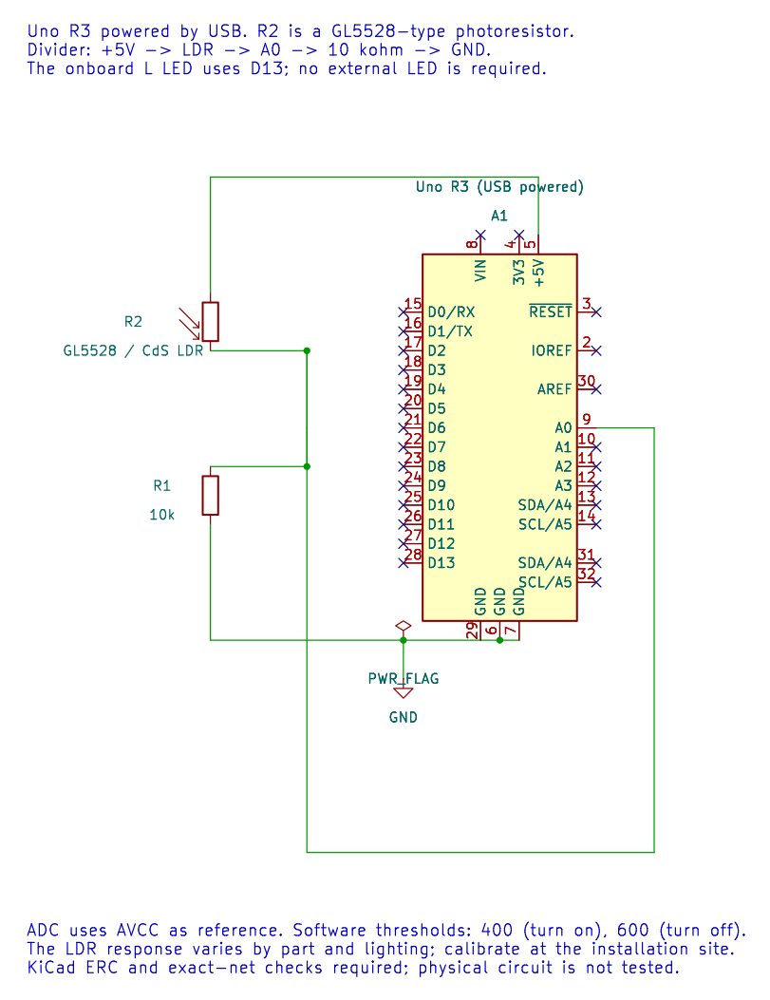

# Light-Dependent Resistor Threshold Lamp

## What You Will Learn

An LDR, or photoresistor, changes resistance with light. A fixed resistor and the LDR form a divider whose voltage the Uno reads on A0. Lab 17 uses that reading to switch the onboard LED, while separate thresholds prevent rapid toggling near one value.



The editable KiCad schematic shows the divider and Uno signal connections. Its electrical checks do not establish the real threshold or response under a particular lamp.

## Wiring and Divider Direction

The reference circuit puts the LDR above A0 and the 10 kΩ resistor below it:

```text
5 V ── LDR ──┬── A0
             └── 10 kΩ ── GND
```

The divider voltage is `Vout = 5 V × Rfixed / (RLDR + Rfixed)`. In darkness the LDR resistance rises, so Vout and the ADC code fall. If you swap the two divider parts, the direction reverses.

| Connection | Uno R3 | Purpose |
| --- | --- | --- |
| Divider top | 5 V | Supply |
| LDR and fixed-resistor junction | A0 | Analogue measurement |
| 10 kΩ resistor lower end | GND | Divider return |
| Uno onboard LED | D13 | Threshold output; no external LED required |

For a separate LED, use a resistor and a GPIO other than a pin already owned by another peripheral.

## Hysteresis in the Example

Lab 17 samples A0 and uses two thresholds. A code below 400 turns the LED on. A code above 600 turns it off. Values between 400 and 600 retain the previous state. This gap is called hysteresis; it avoids flicker when sensor noise moves the ADC result around a single threshold.

The values 400 and 600 are demonstration settings, not calibrated lux levels. The LDR part, fixed resistor, light geometry and ADC reference all affect the reading.

## Build and Try the Lab

```powershell
python atmega328p-labs/tools/build.py 17-ldr --compiler gcc
python atmega328p-labs/tools/build.py 17-ldr --compiler xc8
```

After uploading, cover the LDR and uncover it. The onboard LED should turn on in darkness and switch off in brighter light once the thresholds are crossed. To adjust sensitivity, record ADC readings in the intended lighting conditions and choose thresholds with a useful gap.

## Code Walkthrough

### LDR threshold lamp
The example's `main()` configures its peripherals, runs the algorithm and reports or displays the result. These source operations are listed in execution order:

- `bool on = false;` - Stores this intermediate or output value for the next algorithm step. Check the units and range represented by each operand.
- `(void)avr_adc_init(AVR_ADC_AVCC);` - Selects the reference in ADMUX and enables the ADC in ADCSRA with a divide-by-128 prescaler. At 16 MHz, the ADC clock is 125 kHz. The HAL keeps the result right-adjusted, waits for reference settling and leaves ADC interrupts disabled.
- `(void)avr_gpio_mode(13U, AVR_GPIO_OUTPUT);` - Maps the Uno header pin to its AVR port, sets its DDR direction bit and prepares the PORT latch for the requested initial level or pull-up.
- `for (;;)` - Repeats the foreground task indefinitely; each pass checks inputs, advances the calculation or services the peripheral shown below.
- `if (avr_adc_read(0U, &sample, AVR_POLL_BUDGET) == AVR_OK)` - The body runs only when the conversion succeeds and its code is between 1 and 1022. The HAL selects the channel in ADMUX, disables the digital buffer through DIDR0, discards the first conversion after a channel change, and polls with a finite budget.
- `if (sample < 400U)` - Tests the stated condition; the following block handles the matching case and the other path is skipped.
- `on = true;` - Stores this intermediate or output value for the next algorithm step. Check the units and range represented by each operand.
- `else if (sample > 600U)` - This statement participates in the operation sequence; follow its expression to see which state or output changes.
- `on = false;` - Stores this intermediate or output value for the next algorithm step. Check the units and range represented by each operand.
- `(void)avr_gpio_write(13U, on);` - Changes the pin's PORT output latch; for an input pin this selects its pull-up state.
- `_delay_ms(20);` - Waits for the stated interval; the foreground does no other work during this blocking delay.

Algorithm: With the LDR on top, darkness raises its resistance and lowers the divider output. Separate on/off thresholds prevent rapid chatter near one boundary.
Expected behaviour: Covering the LDR turns L on after crossing the lower threshold
**HAL source files in this repository:** [ATmega328P HAL on GitHub](https://github.com/arnabdasbwn/atmega328p-hal)

- [`include/avr_hal/adc.h`](https://github.com/arnabdasbwn/atmega328p-hal/blob/main/include/avr_hal/adc.h)
- [`include/avr_hal/gpio.h`](https://github.com/arnabdasbwn/atmega328p-hal/blob/main/include/avr_hal/gpio.h)
- [`src/adc.c`](https://github.com/arnabdasbwn/atmega328p-hal/blob/main/src/adc.c)
- [`src/gpio.c`](https://github.com/arnabdasbwn/atmega328p-hal/blob/main/src/gpio.c)


## Common Problems

- **The LED is on in bright light:** Check the divider order; swapping LDR and fixed resistor reverses the direction.
- **The LED flickers:** Increase the threshold gap or average samples, then confirm the divider wiring and ground.
- **The ADC is always at one extreme:** Check for an open resistor, short circuit or missing sensor connection.
- **Different rooms need different thresholds:** This simple circuit is not a lux meter; calibrate it for the use case.

## Check Your Understanding

1. Why does darkness lower the ADC result in the stated divider arrangement?
2. What happens when the sample is between 400 and 600?
3. Why are there two thresholds instead of one?

**Suggested answers:** The LDR is above A0; its resistance rises in darkness and leaves less voltage across the fixed resistor. The LED keeps its previous state. The gap prevents noise near a single boundary from causing repeated switching.

## Source and Further Reading

- [Lab 17 source](<https://github.com/arnabdasbwn/atmega328p-labs/blob/main/examples/17-ldr/main.c>)
- Check the selected LDR datasheet for resistance range, spectral response and temperature dependence.
- [ATmega328P Documentation](https://www.microchip.com/en-us/product/ATMEGA328P), ADC section.
