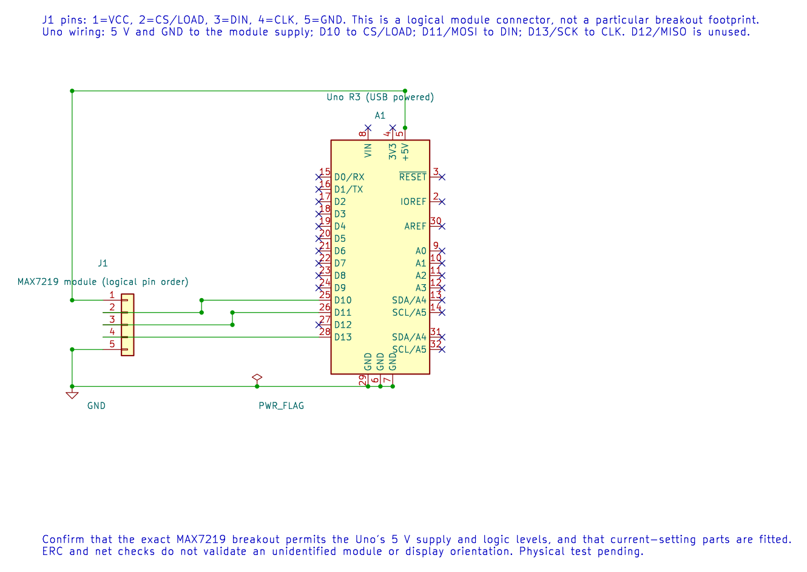

# Interfacing an 8×8 LED Matrix

## Objectives and Prerequisites

This lesson uses an 8×8 matrix module built around a MAX7219 display driver. The Uno sends a few bytes over SPI; the MAX7219 multiplexes the LED rows and keeps refreshing the display. This is different from directly scanning a bare matrix using sixteen GPIO pins. Read [GPIO programming](gpio-programming.md), [SPI concepts](spi-concepts.md) and [electrical safety](electrical.md) first.

## Use the Correct Module

Choose a MAX7219 8×8 matrix breakout that identifies its supply range and includes the current-setting resistor required by the driver. The MAX7219 datasheet specifies a 4.0–5.5 V operating supply, so the Uno's 5 V rail is within the device range; still check that the breakout is a genuine compatible design and includes the required current-setting parts. A bare matrix does not have the same wiring or current control.

| Uno R3 | MAX7219 module |
| --- | --- |
| D10 / SS | CS or LOAD |
| D11 / MOSI | DIN |
| D13 / SCK | CLK |
| D12 / MISO | Not connected for this one-way transfer |
| 5 V and GND | Module supply, only when allowed by its documentation |

The editable KiCad schematic labels the module pins by function rather than assuming one breakout-board connector layout. ERC and exact-net checks validate the drawing; the module has not been physically tested.

Keep the SPI wires short and connect a shared ground. If the breakout does not include local decoupling, follow the driver data sheet's capacitor recommendations. Do not connect a bare matrix directly to the Uno based on this table.

## Send a Pixel Pattern

The [complete MAX7219 example](<https://github.com/arnabdasbwn/atmega328p-labs/blob/main/examples/48-led-matrix-max7219/main.c>) sets SPI mode 0 at 1 MHz, selects the module with D10, configures the scan and intensity registers, and writes eight row bytes for a capital A. The wiring order and the matrix's physical rotation can differ between breakouts; rotate or remap the row bytes after confirming the module orientation.

The display driver's scan engine handles the rapid row switching. The Uno does not need to hold each row on continuously or use a long delay loop. That frees the foreground program to do other work while the display controller refreshes the pixels.

## Build and Expected Result

Build the example from the course root with `python "atmega328p-labs/tools/build.py" 48-led-matrix-max7219 --compiler xc8`. After the module is checked, wired and uploaded, it should show a capital A. The firmware builds with XC8 and AVR GCC. No MAX7219 module was available for a physical display test; record the exact module version and supply voltage when testing it.

## Troubleshooting and Exercise

If the display stays blank, check the module supply, common ground, CS/LOAD wire, MOSI and SCK. Confirm that D10 is the chip-select pin and that the breakout really uses a MAX7219-compatible interface. If the symbol appears rotated, adjust the bit-to-row mapping rather than changing the SPI wiring.

Why can the Uno leave the matrix alone after sending the eight row bytes?

**Answer:** The MAX7219 stores the row data and refreshes the matrix internally. The MCU needs to send new bytes only when the displayed pattern changes.

## Code Walkthrough

### MAX7219 8x8 LED matrix
The example's `main()` configures its peripherals, runs the algorithm and reports or displays the result. These source operations are listed in execution order:

- `avr_status_t status = matrix_show_a();` - Use the linked public header for this function's parameters, register ownership, blocking behavior and status values.
- `if (status != AVR_OK)` - Tests the stated condition; the following block handles the matching case and the other path is skipped.
- `(void)avr_gpio_write(MATRIX_CS_PIN, true);` - Changes the pin's PORT output latch; for an input pin this selects its pull-up state.
- `for (;;)` - Repeats the foreground task indefinitely; each pass checks inputs, advances the calculation or services the peripheral shown below.

Algorithm: The MAX7219 scans the matrix internally and accepts addressed register writes over SPI mode 0.
Expected behaviour: The matrix displays a capital A; orientation may differ by module
**HAL source files in this repository:** [ATmega328P HAL on GitHub](https://github.com/arnabdasbwn/atmega328p-hal)

- [`include/avr_hal/gpio.h`](https://github.com/arnabdasbwn/atmega328p-hal/blob/main/include/avr_hal/gpio.h)
- [`include/avr_hal/spi.h`](https://github.com/arnabdasbwn/atmega328p-hal/blob/main/include/avr_hal/spi.h)
- [`src/gpio.c`](https://github.com/arnabdasbwn/atmega328p-hal/blob/main/src/gpio.c)
- [`src/spi.c`](https://github.com/arnabdasbwn/atmega328p-hal/blob/main/src/spi.c)

## References

- [MAX7219 experiment source and wiring record](<https://github.com/arnabdasbwn/atmega328p-labs/blob/main/examples/48-led-matrix-max7219/main.c>)
- [Analog Devices MAX7219/MAX7221 datasheet](https://www.analog.com/media/en/technical-documentation/data-sheets/MAX7219-MAX7221.pdf)
- [SPI concepts](spi-concepts.md) and [SPI registers](spi-registers.md)
- Use the manufacturer's MAX7219 data sheet and the exact breakout-board schematic to confirm supply, current-setting resistor and pin labels.
