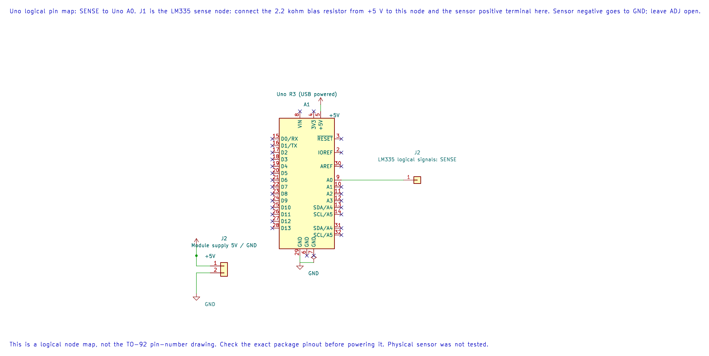

# LM335 Temperature Sensor

## What You Will Learn

The LM335 is a temperature-dependent shunt sensor. Its output is about 10 mV per kelvin, so at 25 °C (298.15 K) the output is about 2.98 V. This is different from the LM35, whose output is about 10 mV per degree Celsius.

## Parts and Wiring

Lab 19 uses a bare three-terminal LM335, a 2.2 kΩ bias resistor and the Uno's AVCC-referenced ADC. Verify the package pinout before wiring; the sensor's ADJ terminal is left open in this basic example.

| Connection | Destination | Purpose |
| --- | --- | --- |
| Uno 5 V | 2.2 kΩ resistor, then sensor positive/output node | Bias current and measurement voltage |
| Sensor output node | A0 | ADC input |
| Sensor negative | GND | Return |
| ADJ | Leave open for the basic lab | Calibration adjustment not used |

The Uno ground and sensor ground must be common. Keep A0 within the ADC input range, and use the exact sensor datasheet for package orientation and operating limits.



The editable KiCad pin map identifies the measurement node and supply. The 2.2 kΩ resistor and sensor terminals are described in the wiring table; verify the exact package pinout.

## Convert Voltage to Temperature

The sensor output is approximately 10 mV/K:

```text
temperature_kelvin = output_millivolts / 10
temperature_celsius = output_millivolts / 10 − 273.15
```

At 25 °C, `output ≈ 2981.5 mV`, giving `298.15 K` and `25 °C`. Lab 19 prints millivolts as an unsigned integer. It does not print Celsius; do not label the millivolt output as a temperature.

The code converts ADC codes using a nominal 5000 mV reference. If the Uno's AVCC differs from 5.000 V, the voltage estimate shifts. Measure or calibrate the reference when better accuracy is needed.

## Build and Observe

```powershell
python atmega328p-labs/tools/build.py 19-lm335 --compiler gcc
python atmega328p-labs/tools/build.py 19-lm335 --compiler xc8
```

After uploading, open a 9600-baud terminal and record the sensor millivolts after it settles. Convert the value using the equation above and compare with a separate thermometer. Warm the sensor gently; do not use a flame or exceed the part's range.

## Code Walkthrough

### LM335 Kelvin-output sensor
The example's `main()` configures its peripherals, runs the algorithm and reports or displays the result. These source operations are listed in execution order:

- `(void)avr_adc_init(AVR_ADC_AVCC);` - Selects the reference in ADMUX and enables the ADC in ADCSRA with a divide-by-128 prescaler. At 16 MHz, the ADC clock is 125 kHz. The HAL keeps the result right-adjusted, waits for reference settling and leaves ADC interrupts disabled.
- `(void)avr_uart_init(9600UL);` - Configures USART0 for asynchronous 8N1. It chooses a baud divisor and normal/double-speed mode, programs UBRR0/UCSR0A/UCSR0C, then enables receive and transmit in UCSR0B.
- `for (;;)` - Repeats the foreground task indefinitely; each pass checks inputs, advances the calculation or services the peripheral shown below.
- `if (avr_adc_read(0U, &sample, AVR_POLL_BUDGET) == AVR_OK)` - The body runs only when the conversion succeeds and its code is between 1 and 1022. The HAL selects the channel in ADMUX, disables the digital buffer through DIDR0, discards the first conversion after a channel change, and polls with a finite budget.
- `uint16_t mv = avr_adc_millivolts(sample, 5000U);` - Scales the ADC code with a 32-bit intermediate and the supplied reference voltage. This ideal calculation does not calibrate the reference.
- `(void)avr_uart_u16(mv);` - Formats an unsigned integer as decimal digits and sends them on USART0; it does not add a newline.
- `(void)avr_uart_put('\n', AVR_POLL_BUDGET);` - Waits for the USART transmit buffer within its poll budget, then writes the byte to UDR0.
- `_delay_ms(500);` - Waits for the stated interval; the foreground does no other work during this blocking delay.

Algorithm: LM335 behaves as a shunt sensor with 10 mV/K output, unlike LM35. Convert T(C)=mV/10-273.15. The resistor current near room temperature is (5-2.982)/2200=0.918 mA.
Expected behaviour: At 25 C the output is near 2981.5 mV; terminal prints sensor millivolts
**HAL source files in this repository:** [ATmega328P HAL on GitHub](https://github.com/arnabdasbwn/atmega328p-hal)

- [`include/avr_hal/adc.h`](https://github.com/arnabdasbwn/atmega328p-hal/blob/main/include/avr_hal/adc.h)
- [`include/avr_hal/uart.h`](https://github.com/arnabdasbwn/atmega328p-hal/blob/main/include/avr_hal/uart.h)
- [`src/adc.c`](https://github.com/arnabdasbwn/atmega328p-hal/blob/main/src/adc.c)
- [`src/uart.c`](https://github.com/arnabdasbwn/atmega328p-hal/blob/main/src/uart.c)


## Common Problems

- **Voltage is near zero:** Check the sensor pinout, bias resistor and ground.
- **Voltage is near the supply:** Check for an open sensor connection or incorrect resistor placement.
- **Temperature is off by about 273 degrees:** The sensor output is Kelvin-proportional; subtract 273.15 to obtain Celsius.
- **The result shifts with USB supply:** The ADC conversion assumes nominal AVCC. Measure that reference or calibrate the conversion.

## Check Your Understanding

1. What voltage is expected near 0 °C, approximately?
2. What does a printed value of 2982 mean in this program?
3. Why should the LM335 and LM35 use different conversion equations?

**Suggested answers:** Near 273.15 K, the output is about 2.73 V. The program prints millivolts, so it represents approximately 2.982 V or 298.2 K. Their outputs use different temperature references: Kelvin for LM335 and Celsius for LM35.

## Source and Further Reading

- [Lab 19 source](<https://github.com/arnabdasbwn/atmega328p-labs/blob/main/examples/19-lm335/main.c>)
- [Texas Instruments LM335 Product Documentation](https://www.ti.com/product/LM335)
- [ATmega328P Documentation](https://www.microchip.com/en-us/product/ATMEGA328P), ADC section.
