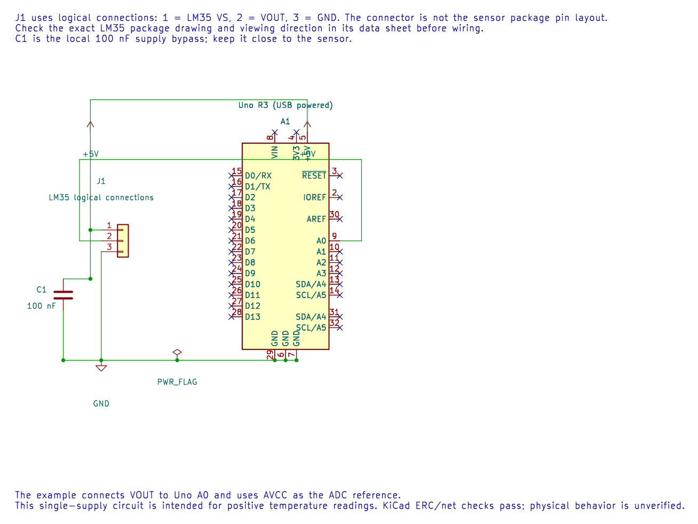

# Measure Temperature with an LM35

## Identify the Sensor Package

The LM35 produces an analogue voltage proportional to temperature in degrees Celsius, nominally 10 mV per °C. Package pin order depends on the exact part and viewing orientation. Read the Texas Instruments data sheet before wiring; do not copy pin order from a photograph of a different package.

For the maintained single-supply lab, connect the LM35 supply to a permitted voltage, ground to Uno GND, and output to A0. Place the recommended decoupling capacitor near the sensor supply pins. The simple arrangement is intended for positive temperature readings; other LM35 configurations support different ranges and require their own circuit.

In this schematic, J1 is a logical three-wire connector: pin 1 is VS, pin 2 is VOUT and pin 3 is GND. It does not show the physical LM35 package pin order. Check the exact part, package and viewing direction in the [Texas Instruments data sheet](https://www.ti.com/product/LM35) before wiring. The editable KiCad source passes ERC and exact-net checks; it has not been tested on hardware.

## Convert the Reading

At a nominal 5 V reference, one ideal ADC code is about 4.883 mV. With a 10 mV/°C sensor slope, one code represents roughly:

`4.883 mV / (10 mV/°C) ≈ 0.488 °C per code`

The [LM35 example](<https://github.com/arnabdasbwn/atmega328p-labs/blob/main/examples/18-lm35/main.c>) reports millivolts and tenths of a degree. Display resolution is not the same as accuracy. Sensor tolerance, reference error, offset, ADC quantisation and thermal contact affect the measurement.

Build with `python "atmega328p-labs/tools/build.py" 18-lm35 --compiler xc8`. Compare the result with a thermometer only after the sensor has reached thermal equilibrium and the reference voltage is known.

## Exercise with Answer

Does printing a temperature to 0.1 °C prove that the measurement is accurate to 0.1 °C?

**Answer:** No. It only describes the printed step. The sensor and reference error, ADC resolution, noise and thermal conditions may be much larger.

## Code Walkthrough

### LM35 temperature measurement
The example's `main()` configures its peripherals, runs the algorithm and reports or displays the result. These source operations are listed in execution order:

- `(void)avr_adc_init(AVR_ADC_AVCC);` - Selects the reference in ADMUX and enables the ADC in ADCSRA with a divide-by-128 prescaler. At 16 MHz, the ADC clock is 125 kHz. The HAL keeps the result right-adjusted, waits for reference settling and leaves ADC interrupts disabled.
- `(void)avr_uart_init(9600UL);` - Configures USART0 for asynchronous 8N1. It chooses a baud divisor and normal/double-speed mode, programs UBRR0/UCSR0A/UCSR0C, then enables receive and transmit in UCSR0B.
- `for (;;)` - Repeats the foreground task indefinitely; each pass checks inputs, advances the calculation or services the peripheral shown below.
- `if (avr_adc_read(0U, &sample, AVR_POLL_BUDGET) == AVR_OK)` - The body runs only when the conversion succeeds and its code is between 1 and 1022. The HAL selects the channel in ADMUX, disables the digital buffer through DIDR0, discards the first conversion after a channel change, and polls with a finite budget.
- `(void)avr_uart_u16(avr_adc_millivolts(sample, 5000U));` - Formats an unsigned integer as decimal digits and sends them on USART0; it does not add a newline. Scales the ADC code with a 32-bit intermediate and the supplied reference voltage. This ideal calculation does not calibrate the reference.
- `(void)avr_uart_put('\n', AVR_POLL_BUDGET);` - Waits for the USART transmit buffer within its poll budget, then writes the byte to UDR0.
- `_delay_ms(500);` - Waits for the stated interval; the foreground does no other work during this blocking delay.

Algorithm: The simple single-supply circuit measures positive temperatures. At 10 mV/C, a 4.883 mV ADC step is approximately 0.488 C; displayed digits do not imply higher accuracy.
Expected behaviour: Printed millivolts equal tenths of a degree Celsius: 250 means about 25.0 C
**HAL source files in this repository:** [ATmega328P HAL on GitHub](https://github.com/arnabdasbwn/atmega328p-hal)

- [`include/avr_hal/adc.h`](https://github.com/arnabdasbwn/atmega328p-hal/blob/main/include/avr_hal/adc.h)
- [`include/avr_hal/uart.h`](https://github.com/arnabdasbwn/atmega328p-hal/blob/main/include/avr_hal/uart.h)
- [`src/adc.c`](https://github.com/arnabdasbwn/atmega328p-hal/blob/main/src/adc.c)
- [`src/uart.c`](https://github.com/arnabdasbwn/atmega328p-hal/blob/main/src/uart.c)

## References

- Texas Instruments, [LM35 product page and data sheet](https://www.ti.com/product/LM35)
- [LM35 example and wiring notes](<https://github.com/arnabdasbwn/atmega328p-labs/blob/main/examples/18-lm35/main.c>)
- [ADC concepts](adc-concepts.md)
