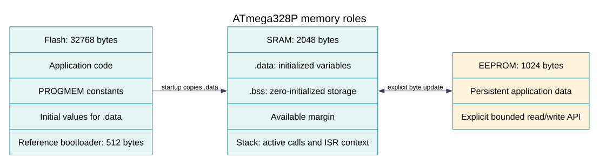

# Flash, SRAM, EEPROM and the AVR Address Spaces
## Objectives and Prerequisites

Choose where a value belongs, explain why an ordinary pointer cannot read every
kind of AVR memory, and estimate the working RAM left for a stack. You should know
binary and hexadecimal numbers and have read the [CPU lesson](cpu-core.md).

## Four Spaces, Four Purposes

The ATmega328P has 32 KiB of program Flash, 2 KiB of data SRAM and 1 KiB of EEPROM.
These numbers describe different hardware. A 32 KiB Flash chip does not give a C
program 32 KiB of general-purpose variables.



Program Flash stores instructions and may hold constants through AVR-specific
program-memory features. Data SRAM stores the live stack, global/static variables,
and local variables that need storage. The AVR data space also addresses the CPU
register file and memory-mapped I/O registers; those locations are not additional
physical SRAM. EEPROM is a separate nonvolatile space for small settings or other
values that must survive reset and power removal.

## Worked Memory Budget

The Uno R3's standard Optiboot allocation is 512 bytes. The application budget is
therefore:

```text
32,768 Flash bytes - 512 bootloader bytes = 32,256 application bytes
```

On SRAM, suppose a build report shows 320 bytes of `.data` and `.bss`. Those
initialized and zero-initialized objects leave at most:

```text
2,048 SRAM bytes - 320 static bytes = 1,728 bytes for stack and other runtime use
```

That 1,728-byte remainder is not a measured stack guarantee. Calls, nested calls,
interrupt context, saved registers and local arrays all consume stack. Avoid large
automatic arrays and recursion, then inspect generated code and the map file for
high-risk paths.

## What C Declarations Mean on AVR

Initialized global and static objects usually contribute to `.data`: their initial
bytes are stored in Flash and copied to SRAM during startup. Zero-initialized
objects occupy `.bss`; startup clears that region. Local objects with automatic
storage duration are usually placed on the stack when they need memory. A compiler
can keep some values in registers, so inspect the build rather than assuming every
local variable has a fixed byte cost.

On classic AVR, `const` alone does not promise that a lookup table stays in Flash.
The [Flash-constants example](<https://github.com/arnabdasbwn/atmega328p-labs/blob/main/examples/25-flash-constants/main.c>)
uses `PROGMEM` and the matching read accessor. This is a compiler-specific address
space extension; follow its API rather than casting an ordinary SRAM pointer.
`volatile` controls compiler access to an object that can change outside the
current code flow. It does not move an object to Flash or make multi-byte access
atomic.

## Where EEPROM Fits

EEPROM retains bytes when power is removed, but a write takes much longer than a
normal SRAM store and the memory has finite write endurance. Use it for occasional
settings and counters with a wear policy, not for every sample in a fast loop. The
[EEPROM HAL example](<https://github.com/arnabdasbwn/atmega328p-labs/blob/main/examples/24-eeprom/main.c>) bounds its
address and status checks. The ATmega328P datasheet specifies the EEPROM control
sequence and programming characteristics; do not copy assumptions from a larger
AVR family member.

## Observe the Actual Memory Use

```powershell
python "atmega328p-labs/tools/build.py" 25-flash-constants --compiler gcc
python "atmega328p-labs/tools/build.py" 25-flash-constants --compiler xc8
```

Read the Flash and static-RAM totals, then inspect `firmware.map`. The [startup and
stack lesson](startup-stack.md) explains the reset copy/clear work and how to read
the `.data`, `.bss` and stack relationship. For an independent sanity check, build
the same example with XC8 and compare sizes; different results are normal as long
as both images satisfy the board limits.

## Exercise with Answer

A report shows 200 bytes of static SRAM. How much SRAM is not occupied by those
static objects, and is that the safe stack size?

**Answer:** `2,048 - 200 = 1,848` bytes remain before accounting for stack use and
other runtime needs. That is not a safe stack-size measurement. Calls and
interrupts use some of the remainder, so leave a reviewed margin.

## Code Walkthrough


**Example code on GitHub:**
- [HAL Software Self-Test (`90-selftest`)](https://github.com/arnabdasbwn/atmega328p-labs/blob/main/examples/90-selftest/main.c)

### Read a lookup table from Flash
The example's `main()` configures its peripherals, runs the algorithm and reports or displays the result. These source operations are listed in execution order:

- `(void)avr_uart_init(9600UL);` - Configures USART0 for asynchronous 8N1. It chooses a baud divisor and normal/double-speed mode, programs UBRR0/UCSR0A/UCSR0C, then enables receive and transmit in UCSR0B.
- `for (uint8_t i = 0U; i < 8U; ++i)` - Repeats while `i < 8U` is true; `uint8_t i = 0U` sets the starting state and `++i` advances it each pass.
- `uint16_t value = pgm_read_word(&squares[i]);` - Reads the table entry with the AVR program-memory access function; ordinary data-space dereferencing is not used for this Flash table.
- `(void)avr_uart_u16(value);` - Formats an unsigned integer as decimal digits and sends them on USART0; it does not add a newline.
- `(void)avr_uart_put('\n', AVR_POLL_BUDGET);` - Waits for the USART transmit buffer within its poll budget, then writes the byte to UDR0.
- `for (;;)` - Repeats the foreground task indefinitely; each pass checks inputs, advances the calculation or services the peripheral shown below.

Algorithm: PROGMEM keeps the table in program memory; pgm_read_word uses the appropriate Flash access. A const qualifier alone does not describe the AVR storage/access mechanism in all toolchains.
Expected behaviour: Prints the squares of 0..7
**HAL source files in this repository:** [ATmega328P HAL on GitHub](https://github.com/arnabdasbwn/atmega328p-hal)

- [`include/avr_hal/uart.h`](https://github.com/arnabdasbwn/atmega328p-hal/blob/main/include/avr_hal/uart.h)
- [`src/uart.c`](https://github.com/arnabdasbwn/atmega328p-hal/blob/main/src/uart.c)


### EEPROM persistent counter
The example's `main()` configures its peripherals, runs the algorithm and reports or displays the result. These source operations are listed in execution order:

- `uint8_t value = 0U;` - Clears the state/counter after its threshold is reached so the next interval starts from zero.
- `(void)avr_uart_init(9600UL);` - Configures USART0 for asynchronous 8N1. It chooses a baud divisor and normal/double-speed mode, programs UBRR0/UCSR0A/UCSR0C, then enables receive and transmit in UCSR0B.
- `if (avr_eeprom_read(0U, &value, AVR_POLL_BUDGET) == AVR_OK)` - The operation runs only after this API reports AVR_OK. Reads an EEPROM address after range checking and waits within the supplied completion budget.
- `if (value == 255U)` - Tests the stated condition; the following block handles the matching case and the other path is skipped.
- `value = 0U;` - Clears the state/counter after its threshold is reached so the next interval starts from zero.
- `++value;` - Advances the event/sample counter once for the condition just observed.
- `if (avr_eeprom_update(0U, value, AVR_POLL_BUDGET) == AVR_OK)` - The operation runs only after this API reports AVR_OK. Writes only when the stored value differs, reducing unnecessary EEPROM wear; the completion wait is bounded.
- `(void)avr_uart_u16(value);` - Formats an unsigned integer as decimal digits and sends them on USART0; it does not add a newline.
- `for (;;)` - Repeats the foreground task indefinitely; each pass checks inputs, advances the calculation or services the peripheral shown below.

Algorithm: Only one write occurs at boot. Writing continuously in the main loop would consume finite EEPROM endurance. This single-byte demonstration is not a power-fail-safe multi-byte record format.
Expected behaviour: Counter advances once per reset; opening a terminal may itself reset the Uno
**HAL source files in this repository:** [ATmega328P HAL on GitHub](https://github.com/arnabdasbwn/atmega328p-hal)

- [`include/avr_hal/eeprom.h`](https://github.com/arnabdasbwn/atmega328p-hal/blob/main/include/avr_hal/eeprom.h)
- [`include/avr_hal/uart.h`](https://github.com/arnabdasbwn/atmega328p-hal/blob/main/include/avr_hal/uart.h)
- [`src/eeprom.c`](https://github.com/arnabdasbwn/atmega328p-hal/blob/main/src/eeprom.c)
- [`src/uart.c`](https://github.com/arnabdasbwn/atmega328p-hal/blob/main/src/uart.c)


### HAL Software Self-Test
The example's `main()` configures its peripherals, runs the algorithm and reports or displays the result. These source operations are listed in execution order:

- `avr_debounce_t button;` - Use the linked public header for this function's parameters, register ownership, blocking behavior and status values.
- `uint8_t result = 0U;` - Clears the state/counter after its threshold is reached so the next interval starts from zero.
- `(void)avr_uart_init(9600UL);` - Configures USART0 for asynchronous 8N1. It chooses a baud divisor and normal/double-speed mode, programs UBRR0/UCSR0A/UCSR0C, then enables receive and transmit in UCSR0B.
- `CHECK(avr_gpio_mode(20U, AVR_GPIO_OUTPUT) == AVR_ERROR_ARGUMENT);` - Maps the Uno header pin to its AVR port, sets its DDR direction bit and prepares the PORT latch for the requested initial level or pull-up.
- `CHECK(avr_gpio_read(13U, NULL) == AVR_ERROR_ARGUMENT);` - Reads the electrical level through PINx without changing direction or the output latch.
- `CHECK(avr_timer_ctc(AVR_TIMER0, 32U, 100U) == AVR_ERROR_ARGUMENT);` - Configures 0 in CTC mode with prescaler 32 and OCRnA TOP 100; event rate is 16 MHz / (32 x (100 + 1)) = 4950.5 Hz. The HAL disables this timer's interrupt sources and leaves flag polling to the caller.
- `CHECK(avr_timer_ctc(AVR_TIMER0, 64U, 256U) == AVR_ERROR_ARGUMENT);` - Configures 0 in CTC mode with prescaler 64 and OCRnA TOP 256; event rate is 16 MHz / (64 x (256 + 1)) = 972.763 Hz. The HAL disables this timer's interrupt sources and leaves flag polling to the caller.
- `CHECK(avr_timer_ctc(AVR_TIMER2, 128U, 124U) == AVR_OK);` - Configures 2 in CTC mode with prescaler 128 and OCRnA TOP 124; event rate is 16 MHz / (128 x (124 + 1)) = 1000 Hz. The HAL disables this timer's interrupt sources and leaves flag polling to the caller.
- `CHECK((TCCR2B & 7U) == 5U);` - Selects Timer2 clock/prescaler and remaining waveform bits. Timer2 has distinct prescaler encodings.
- `CHECK(avr_timer1_pwm(8U, 40000U, 3000U) == AVR_OK);` - Configures Timer1 mode 14 with prescaler 8; ICR1 becomes 39999, giving a 20 ms frame, and OCR1A starts at 3000 ticks (1500 us high).
- `CHECK(ICR1 == 39999U && OCR1A == 3000U);` - Timer1 input-capture register and, in the selected PWM mode, the TOP value. Timer1 Compare A; it sets the match point or PWM pulse width.
- `CHECK(avr_adc_millivolts(512U, 5000U) == 2500U);` - Calls `avr_adc_millivolts()`; its public HAL header defines the arguments, register ownership, blocking behavior and status results.
- `CHECK(avr_adc_read(6U, NULL, 0U) == AVR_ERROR_ARGUMENT);` - Calls `avr_adc_read()`; its public HAL header defines the arguments, register ownership, blocking behavior and status results.
- `CHECK(avr_eeprom_read(1024U, &result, 0UL) == AVR_ERROR_ARGUMENT);` - Calls `avr_eeprom_read()`; its public HAL header defines the arguments, register ownership, blocking behavior and status results.
- `CHECK(avr_twi_transfer(0U, NULL, 0U, NULL, 0U, 0UL) == AVR_ERROR_ARGUMENT);` - Calls `avr_twi_transfer()`; its public HAL header defines the arguments, register ownership, blocking behavior and status results.
- `CHECK(avr_elapsed(5UL, UINT32_MAX - 4UL, 10UL));` - Calls `avr_elapsed()`; its public HAL header defines the arguments, register ownership, blocking behavior and status results.
- `CHECK(!avr_elapsed(5UL, UINT32_MAX - 4UL, 11UL));` - Calls `avr_elapsed()`; its public HAL header defines the arguments, register ownership, blocking behavior and status results.
- `avr_debounce_init(&button, true, UINT32_MAX - 10UL);` - Calls `avr_debounce_init()`; its public HAL header defines the arguments, register ownership, blocking behavior and status results.
- `CHECK(!avr_debounce_update(&button, false, UINT32_MAX - 9UL, 20U));` - Calls `avr_debounce_update()`; its public HAL header defines the arguments, register ownership, blocking behavior and status results.
- `CHECK(!avr_debounce_update(&button, false, 9UL, 20U));` - Calls `avr_debounce_update()`; its public HAL header defines the arguments, register ownership, blocking behavior and status results.
- `CHECK(avr_debounce_update(&button, false, 10UL, 20U));` - Accepts a changed input only after it remains stable for the requested interval, then reports that accepted change once.
- `CHECK(!avr_debounce_update(&button, false, 11UL, 20U));` - Accepts a changed input only after it remains stable for the requested interval, then reports that accepted change once.
- `(void)avr_uart_write((const uint8_t *)"PASS\n", 5U, AVR_POLL_BUDGET);` - Sends the specified bytes through USART0; a timeout can occur after a prefix has already been sent.
- `for (;;)` - Repeats the foreground task indefinitely; each pass checks inputs, advances the calculation or services the peripheral shown below.

Algorithm: A bounded self-test checks software contracts and links a second source file so header-owned definitions are detected.
Expected behaviour: The fixture prints PASS after argument, timer-range, debounce and independent-translation-unit checks; otherwise it prints FAIL and stops
**HAL source files in this repository:** [ATmega328P HAL on GitHub](https://github.com/arnabdasbwn/atmega328p-hal)

- [`include/avr_hal/adc.h`](https://github.com/arnabdasbwn/atmega328p-hal/blob/main/include/avr_hal/adc.h)
- [`include/avr_hal/common.h`](https://github.com/arnabdasbwn/atmega328p-hal/blob/main/include/avr_hal/common.h)
- [`include/avr_hal/eeprom.h`](https://github.com/arnabdasbwn/atmega328p-hal/blob/main/include/avr_hal/eeprom.h)
- [`include/avr_hal/gpio.h`](https://github.com/arnabdasbwn/atmega328p-hal/blob/main/include/avr_hal/gpio.h)
- [`include/avr_hal/timer.h`](https://github.com/arnabdasbwn/atmega328p-hal/blob/main/include/avr_hal/timer.h)
- [`include/avr_hal/twi.h`](https://github.com/arnabdasbwn/atmega328p-hal/blob/main/include/avr_hal/twi.h)
- [`include/avr_hal/uart.h`](https://github.com/arnabdasbwn/atmega328p-hal/blob/main/include/avr_hal/uart.h)
- [`lib/drivers/debounce.c`](https://github.com/arnabdasbwn/atmega328p-hal/blob/main/lib/drivers/debounce.c)
- [`lib/drivers/debounce.h`](https://github.com/arnabdasbwn/atmega328p-hal/blob/main/lib/drivers/debounce.h)
- [`src/adc.c`](https://github.com/arnabdasbwn/atmega328p-hal/blob/main/src/adc.c)
- [`src/common.c`](https://github.com/arnabdasbwn/atmega328p-hal/blob/main/src/common.c)
- [`src/eeprom.c`](https://github.com/arnabdasbwn/atmega328p-hal/blob/main/src/eeprom.c)
- [`src/gpio.c`](https://github.com/arnabdasbwn/atmega328p-hal/blob/main/src/gpio.c)
- [`src/timer.c`](https://github.com/arnabdasbwn/atmega328p-hal/blob/main/src/timer.c)
- [`src/twi.c`](https://github.com/arnabdasbwn/atmega328p-hal/blob/main/src/twi.c)
- [`src/uart.c`](https://github.com/arnabdasbwn/atmega328p-hal/blob/main/src/uart.c)


## References

For current device details, use the [Microchip ATmega328P documentation](https://www.microchip.com/en-us/product/ATMEGA328P). Check the document listed for your exact device and package; board-level pin labels and circuitry are covered by the [Uno R3 pinout](https://www.arnabkumardas.com/pinout/arduino-uno-r3/).
