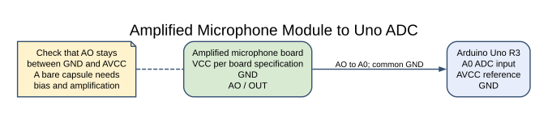
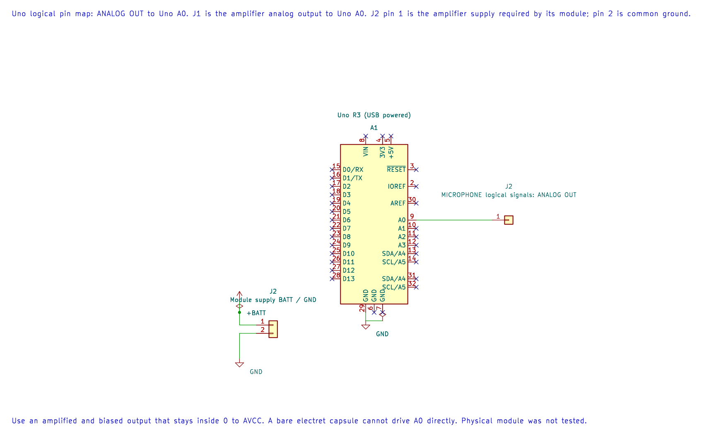

# Amplified Microphone Module

## What You Will Learn

A microphone produces a small electrical signal from sound. A microphone breakout adds bias and amplification so the Uno can sample it. Lab 36 reads an analogue output and reports the difference between the highest and lowest ADC values in a group of 200 samples.

This is a rough amplitude indicator. It is not a sound-pressure meter, calibrated decibel value or uniformly sampled audio recorder.

## Module and Wiring

Use a 5 V-compatible amplified module with a labelled analogue output. A bare electret capsule needs a bias and amplifier circuit and must not be connected directly to A0.

| Microphone module | Uno R3 | Purpose |
| --- | --- | --- |
| VCC | Supply required by the module | Power |
| GND | GND | Shared reference |
| AO / OUT | A0 | Analogue waveform |

Confirm the module output remains between ground and AVCC. Some boards also have a digital comparator output; this lab does not use it.

## Peak-To-Peak ADC Range





The editable KiCad pin map shows the Uno signal assignment and module supply reference. Follow the exact amplifier board rating and keep its output within the ADC range.

For each 200-sample group, the program records a minimum code and a maximum code, then prints:

```text
range_code = maximum_code − minimum_code
```

Quiet sound should produce a smaller range than a nearby clap, though the result depends on microphone gain, room acoustics and how quickly the loop samples. The example does not set an audio sampling rate. UART output and ADC conversion time also affect the next measurement window.

To estimate a meaningful sound level in dB SPL, a design needs a calibrated microphone, known frequency response, stable sampling and an appropriate RMS or weighting calculation. This lab does none of those things.

## Build and Try the Lab

```powershell
python atmega328p-labs/tools/build.py 36-microphone --compiler gcc
python atmega328p-labs/tools/build.py 36-microphone --compiler xc8
```

After uploading, open a 9600-baud terminal. Record several quiet-room values, then clap at a safe distance and compare. Do not hold a loud sound source directly against the microphone.

## Code Walkthrough

### Microphone envelope sampling
The example's `main()` configures its peripherals, runs the algorithm and reports or displays the result. These source operations are listed in execution order:

- `(void)avr_adc_init(AVR_ADC_AVCC);` - Selects the reference in ADMUX and enables the ADC in ADCSRA with a divide-by-128 prescaler. At 16 MHz, the ADC clock is 125 kHz. The HAL keeps the result right-adjusted, waits for reference settling and leaves ADC interrupts disabled.
- `(void)avr_uart_init(9600UL);` - Configures USART0 for asynchronous 8N1. It chooses a baud divisor and normal/double-speed mode, programs UBRR0/UCSR0A/UCSR0C, then enables receive and transmit in UCSR0B.
- `for (;;)` - Repeats the foreground task indefinitely; each pass checks inputs, advances the calculation or services the peripheral shown below.
- `uint16_t low = 1023U, high = 0U;` - Clears the state/counter after its threshold is reached so the next interval starts from zero.
- `for (uint16_t i = 0U; i < 200U; ++i)` - Repeats while `i < 200U` is true; `uint16_t i = 0U` sets the starting state and `++i` advances it each pass.
- `if (avr_adc_read(0U, &sample, AVR_POLL_BUDGET) == AVR_OK)` - The body runs only when the conversion succeeds and its code is between 1 and 1022. The HAL selects the channel in ADMUX, disables the digital buffer through DIDR0, discards the first conversion after a channel change, and polls with a finite budget.
- `if (sample < low)` - Tests the stated condition; the following block handles the matching case and the other path is skipped.
- `low = sample;` - Stores this intermediate or output value for the next algorithm step. Check the units and range represented by each operand.
- `if (sample > high)` - Tests the stated condition; the following block handles the matching case and the other path is skipped.
- `high = sample;` - Stores this intermediate or output value for the next algorithm step. Check the units and range represented by each operand.
- `(void)avr_uart_u16((uint16_t)(high - low));` - Formats an unsigned integer as decimal digits and sends them on USART0; it does not add a newline.
- `(void)avr_uart_put('\n', AVR_POLL_BUDGET);` - Waits for the USART transmit buffer within its poll budget, then writes the byte to UDR0.

Algorithm: This is an amplitude indicator, not calibrated dB SPL and not a uniformly sampled audio recorder. The loop timing and amplifier bandwidth limit what can be inferred.
Expected behaviour: Peak-to-peak ADC code range increases with sound level
**HAL source files in this repository:** [ATmega328P HAL on GitHub](https://github.com/arnabdasbwn/atmega328p-hal)

- [`include/avr_hal/adc.h`](https://github.com/arnabdasbwn/atmega328p-hal/blob/main/include/avr_hal/adc.h)
- [`include/avr_hal/uart.h`](https://github.com/arnabdasbwn/atmega328p-hal/blob/main/include/avr_hal/uart.h)
- [`src/adc.c`](https://github.com/arnabdasbwn/atmega328p-hal/blob/main/src/adc.c)
- [`src/uart.c`](https://github.com/arnabdasbwn/atmega328p-hal/blob/main/src/uart.c)


## Common Problems

- **The output remains at 0 or 1023:** Check the module output, supply, ground and analogue range.
- **Values do not respond to sound:** Check that AO, not the digital comparator pin, is connected to A0.
- **Results vary between modules:** Gain and microphone sensitivity differ; the value is not calibrated.
- **Audio detail is missing:** The example reports a slow peak-to-peak window, not individual audio samples.

## Check Your Understanding

1. What does the example's printed number represent?
2. Why can it not be labelled dB SPL?
3. How would a fixed-rate sample timer improve an audio measurement?

**Suggested answers:** It is the peak-to-peak ADC code range across one set of 200 conversions. There is no calibration, frequency weighting or sound-pressure reference. A fixed rate makes the sample timing known, which is necessary for analysing signal frequency and amplitude consistently.

## Source and Further Reading

- [Lab 36 source](<https://github.com/arnabdasbwn/atmega328p-labs/blob/main/examples/36-microphone/main.c>)
- Check the chosen module datasheet for supply, analogue-output range and amplifier gain.
- [ATmega328P Documentation](https://www.microchip.com/en-us/product/ATMEGA328P), ADC section.
