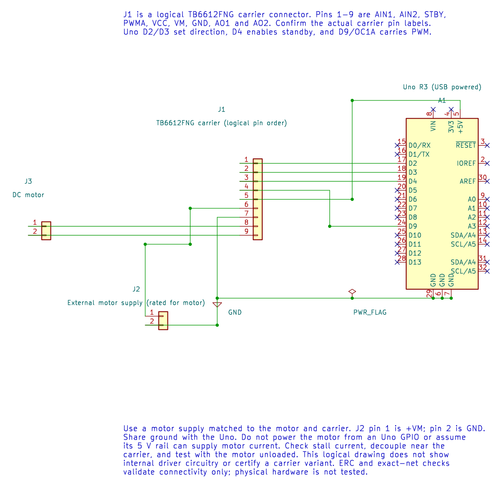

# TB6612FNG and L298 Motor Driver Comparison

## What You Will Learn

A brushed DC motor needs more current than an Uno GPIO can provide. A motor driver uses transistor bridges to switch motor current, while the Uno supplies direction and PWM control signals. Lab 28 uses a TB6612FNG module, Lab 75 shows an L298N carrier, and the PWM lesson explains timer ownership. This page compares the driver families so you can read their ratings before selecting a carrier.

The L298 is a bipolar-transistor driver. The TB6612FNG uses MOSFET outputs and generally has lower conduction loss at comparable current. Neither part can exceed its supply, current, thermal or PCB limits. A breakout module's advertised current is not a substitute for the chip datasheet or thermal design.

## Compare the Driver Limits

| Property | L298 | TB6612FNG |
| --- | --- | --- |
| Output stage | Bipolar transistor bridges | MOSFET bridges |
| Datasheet headline supply limit | Up to 46 V supply | 15 V maximum supply rating; use the datasheet operating conditions for design |
| Current headline | Up to 2 A per bridge under specified conditions; the headline total depends on package and thermal conditions | 1.2 A average and 3.2 A peak ratings under specified conditions |
| Loss at motor current | Bipolar saturation voltage can consume a substantial part of a low motor supply | Lower typical output resistance, but current still creates heat |
| Carrier differences | Often a large board with a heatsink and a 5 V regulator/jumper | Small carrier layout; thermal performance depends on PCB copper and module design |

These are device datasheet values, not a safe motor selection by themselves. Repetitive current, ambient temperature, package, cooling, supply, motor stall current and the carrier PCB all matter. Do not compare a peak current on one datasheet with a continuous current on another.

For a simplified estimate, if current is `I` and the bridge's total on-resistance is `R`, MOSFET conduction loss is approximately `I^2 x R`. A bipolar bridge instead has a current-dependent saturation voltage; its conduction loss is approximately `I x V_drop`. Both estimates ignore switching loss and thermal resistance, so they are for comparison, not a thermal sign-off.

## Choose for the Actual Motor

- Choose an L298N carrier only when its voltage range is useful and you can tolerate its voltage drop, size and heat. Check the carrier's regulator and enable jumpers.
- A TB6612FNG carrier can suit smaller low-voltage motors where its supply and current limits fit the stall case. Confirm the exact carrier's cooling and logic-level wiring.
- In either case, check stall current, not only no-load current. Use a supply with a sensible current limit, an appropriate fuse where needed, common ground, and short motor wiring.
- Never power the motor from an Uno GPIO pin. Keep driver logic and motor power connections distinct.

## TB6612FNG Wiring for Lab 28

Start with one low-voltage motor, a suitable external motor supply and a TB6612FNG breakout. Keep the motor unloaded during first tests.

| Uno R3 | TB6612FNG signal | Purpose |
| --- | --- | --- |
| D2 | AIN1 | Direction input 1 |
| D3 | AIN2 | Direction input 2 |
| D4 | STBY | Enable the bridge; high for operation |
| D9 / OC1A | PWMA | Timer1 speed control |
| 5 V | VCC | Logic supply, within module rating |
| External rated supply | VM | Motor supply |
| GND | GND | Common reference |
| Motor leads | AO1 and AO2 | Motor output |

Place the required decoupling close to the driver. Connect the external supply ground to Uno ground. Do not power the motor from the Uno 5 V rail or an I/O pin.

## Direction, PWM and Stop State



Lab 28 sets AIN1 high, AIN2 low and STBY high, then applies PWM to PWMA for one second. It stops PWM for one second. PWM controls the average applied voltage; it does not guarantee a particular motor speed because load, supply and motor characteristics matter.

For a real application, define what “stop” means: coast, brake or disable. Make direction outputs inactive during reset and use a deliberate stop or dead-time before changing direction. Timer1 is owned by the PWM driver, so another Timer1 lesson cannot run at the same time without redesign.

## Build and Try the Lab

```powershell
python atmega328p-labs/tools/build.py 28-motor --compiler gcc
python atmega328p-labs/tools/build.py 28-motor --compiler xc8
```

After confirming all wiring and current ratings, test the motor unloaded at low PWM. Measure the supply during start-up and check driver temperature. This course has only build validation; no motor hardware has been tested.

## Common Problems and Safety

- **Motor does not move:** Check STBY, motor supply, common ground and output wiring.
- **Uno resets on start:** The supply may dip due to motor startup current. Use a suitable supply and decoupling.
- **Driver becomes hot:** Check motor stall current, duty cycle, load and module heat sinking.
- **Direction changes cause a current spike:** Stop the PWM before changing bridge inputs; follow the motor and driver requirements.
- **L298N output is much slower or weaker:** Its voltage drop can be significant; compare the motor terminal voltage under load.

## Code Walkthrough


**Example code on GitHub:**
- [L298N forward PWM motor control (`75-l298n-motor`)](https://github.com/arnabdasbwn/atmega328p-labs/blob/main/examples/75-l298n-motor/main.c)

### TB6612FNG DC motor PWM
The example's `main()` configures its peripherals, runs the algorithm and reports or displays the result. These source operations are listed in execution order:

- `(void)avr_gpio_mode(2U, AVR_GPIO_OUTPUT);` - Maps the Uno header pin to its AVR port, sets its DDR direction bit and prepares the PORT latch for the requested initial level or pull-up.
- `(void)avr_gpio_mode(3U, AVR_GPIO_OUTPUT);` - Maps the Uno header pin to its AVR port, sets its DDR direction bit and prepares the PORT latch for the requested initial level or pull-up.
- `(void)avr_gpio_mode(4U, AVR_GPIO_OUTPUT);` - Maps the Uno header pin to its AVR port, sets its DDR direction bit and prepares the PORT latch for the requested initial level or pull-up.
- `(void)avr_timer_pwm8(AVR_TIMER1, 64U, 0U, 0U);` - Selects 8-bit fast PWM, connects the chosen timer compare outputs, loads OCRnA/OCRnB and starts the prescaled clock. This takes ownership of that timer and its output pins.
- `(void)avr_gpio_write(2U, true);` - Changes the pin's PORT output latch; for an input pin this selects its pull-up state.
- `(void)avr_gpio_write(3U, false);` - Changes the pin's PORT output latch; for an input pin this selects its pull-up state.
- `(void)avr_gpio_write(4U, true);` - Changes the pin's PORT output latch; for an input pin this selects its pull-up state.
- `for (;;)` - Repeats the foreground task indefinitely; each pass checks inputs, advances the calculation or services the peripheral shown below.
- `OCR1A = 128U;` - Timer1 Compare A sets the match point or PWM pulse width, depending on the selected mode.
- `_delay_ms(1000);` - Waits for the stated interval; the foreground does no other work during this blocking delay.
- `OCR1A = 0U;` - Timer1 Compare A sets the match point or PWM pulse width, depending on the selected mode.

Algorithm: PWM controls applied average voltage; it does not directly regulate speed. Check stall current against the driver and supply. Direction changes require a deliberate stop/dead-time policy.
Expected behaviour: Motor runs forward for one second then stops for one second
**HAL source files in this repository:** [ATmega328P HAL on GitHub](https://github.com/arnabdasbwn/atmega328p-hal)

- [`include/avr_hal/gpio.h`](https://github.com/arnabdasbwn/atmega328p-hal/blob/main/include/avr_hal/gpio.h)
- [`include/avr_hal/timer.h`](https://github.com/arnabdasbwn/atmega328p-hal/blob/main/include/avr_hal/timer.h)
- [`src/gpio.c`](https://github.com/arnabdasbwn/atmega328p-hal/blob/main/src/gpio.c)
- [`src/timer.c`](https://github.com/arnabdasbwn/atmega328p-hal/blob/main/src/timer.c)


### L298N forward PWM motor control
The example's `main()` configures its peripherals, runs the algorithm and reports or displays the result. These source operations are listed in execution order:

- `(void)avr_gpio_mode(2U, AVR_GPIO_OUTPUT);` - Maps the Uno header pin to its AVR port, sets its DDR direction bit and prepares the PORT latch for the requested initial level or pull-up.
- `(void)avr_gpio_mode(3U, AVR_GPIO_OUTPUT);` - Maps the Uno header pin to its AVR port, sets its DDR direction bit and prepares the PORT latch for the requested initial level or pull-up.
- `(void)avr_gpio_mode(9U, AVR_GPIO_OUTPUT);` - Maps the Uno header pin to its AVR port, sets its DDR direction bit and prepares the PORT latch for the requested initial level or pull-up.
- `(void)avr_gpio_write(9U, false);` - Changes the pin's PORT output latch; for an input pin this selects its pull-up state.
- `(void)avr_gpio_write(2U, false);` - Changes the pin's PORT output latch; for an input pin this selects its pull-up state.
- `(void)avr_gpio_write(3U, false);` - Changes the pin's PORT output latch; for an input pin this selects its pull-up state.
- `if (avr_timer_pwm8(AVR_TIMER1, 64U, 0U, 0U) != AVR_OK)` - This checks for any setup or transfer error before the program continues. Selects 8-bit fast PWM, connects the chosen timer compare outputs, loads OCRnA/OCRnB and starts the prescaled clock. This takes ownership of that timer and its output pins.
- `for (;;)` - Repeats the foreground task indefinitely; each pass checks inputs, advances the calculation or services the peripheral shown below.
- `(void)avr_gpio_write(2U, true);` - Changes the pin's PORT output latch; for an input pin this selects its pull-up state.
- `OCR1A = 128U;` - Timer1 Compare A sets the match point or PWM pulse width, depending on the selected mode.
- `_delay_ms(1000);` - Waits for the stated interval; the foreground does no other work during this blocking delay.
- `OCR1A = 0U;` - Timer1 Compare A sets the match point or PWM pulse width, depending on the selected mode.

Algorithm: The bridge switches motor current from VS while GPIO pins provide logic. Timer1 Fast PWM at 16 MHz / 64 / 256 is about 976.6 Hz. PWM duty does not directly set speed.
Expected behaviour: The example drives the motor in one direction at nominal 50 percent PWM for one second, then disables ENA for one second
**HAL source files in this repository:** [ATmega328P HAL on GitHub](https://github.com/arnabdasbwn/atmega328p-hal)

- [`include/avr_hal/gpio.h`](https://github.com/arnabdasbwn/atmega328p-hal/blob/main/include/avr_hal/gpio.h)
- [`include/avr_hal/timer.h`](https://github.com/arnabdasbwn/atmega328p-hal/blob/main/include/avr_hal/timer.h)
- [`src/gpio.c`](https://github.com/arnabdasbwn/atmega328p-hal/blob/main/src/gpio.c)
- [`src/timer.c`](https://github.com/arnabdasbwn/atmega328p-hal/blob/main/src/timer.c)


## Check Your Understanding

1. Which supply powers the motor, and which supply powers the TB6612FNG logic?
2. Does 50% PWM guarantee half the motor's speed?
3. Why should the Uno and driver share ground?

**Suggested answers:** VM powers the motor bridge and VCC powers logic. No; load and motor behavior are nonlinear. A shared reference lets the driver interpret Uno logic levels correctly.

## Source and Further Reading

- [Lab 28 source](<https://github.com/arnabdasbwn/atmega328p-labs/blob/main/examples/28-motor/main.c>)
- [Toshiba TB6612FNG Datasheet](https://toshiba.semicon-storage.com/info/TB6612FNG_datasheet_en_20141001.pdf?did=10660&prodName=TB6612FNG)
- [ST L298 Datasheet](https://www.st.com/resource/en/datasheet/l298.pdf)
- [ATmega328P Documentation](https://www.microchip.com/en-us/product/ATMEGA328P), Timer1 output compare pins.
