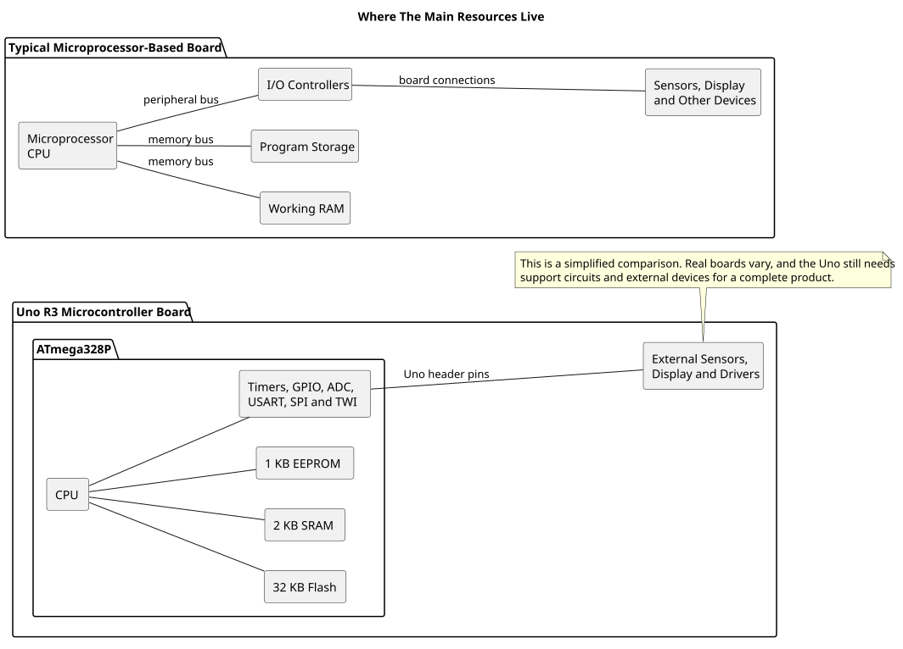

# Microprocessors and Microcontrollers

## Objectives and Prerequisites

By the end of this lesson, you should be able to explain the difference between a microprocessor and a microcontroller, identify what is built into an ATmega328P, and choose a suitable starting point for a simple product. Read [What Makes a System Embedded?](embedded-system.md) first.

## Two Ways to Build a Computer

A **microprocessor (MPU)** is centred on its CPU. A traditional microprocessor system uses separate chips or devices for working memory, program storage and input/output. A **microcontroller (MCU)** combines a CPU with memory and peripherals on one chip. The exact mix varies by device, so always check its datasheet.

| Part of the system | Typical microprocessor board | ATmega328P microcontroller |
| --- | --- | --- |
| CPU | In the processor | On the microcontroller die |
| Working memory | Usually external DRAM | 2 KB SRAM on chip |
| Program storage | Often external Flash or storage | 32 KB Flash on chip |
| Nonvolatile data | Often a separate device or file system | 1 KB EEPROM on chip |
| Peripherals | Commonly provided by companion chips | Timers, ADC, GPIO, USART, SPI and TWI are integrated |
| Typical board needs | More power, memory and supporting hardware | A compact supply, clock source and the required signal-conditioning circuits |

These are common design patterns, not strict definitions. Modern application processors often include memory controllers and many peripherals, while some microcontrollers need external components. The useful question is: **which resources does this particular chip provide, and what else must the board add?**

The drawing shows a common arrangement, not a rule for every board. For instance, an application processor may include memory controllers or other peripherals on the same package. Use the device documentation and board schematic to find the actual boundaries.

## Follow a Sensor Reading

Suppose a product reads a temperature sensor and switches on a fan. With an ATmega328P, the analogue input can be sampled by its ADC, the CPU can compare the reading with a threshold, and a timer or GPIO can control a transistor that drives the fan. The chip also provides Flash for the program and SRAM for variables.

### Worked ADC Example

For an illustration, use an LM35 and assume the Uno's ADC reference is exactly 5.00 V. At 30°C, the LM35's nominal 10 mV/°C output is 300 mV. The 10-bit ADC result is approximately `300 mV × 1023 ÷ 5000 mV = 61`, so firmware could compare the sample with a threshold near 61 before switching the fan driver. Real thresholds need margin for reference and sensor error, and the fan needs a transistor or other suitable driver. See [the LM35 lesson](lm35.md) for sensor wiring and [the ADC programming lesson](adc-programming.md) for the conversion calculation.

A microprocessor board could perform the same job, but the board might use an external ADC, memory and a driver interface. It may also run an operating system and support a display, network connection or several applications. Those abilities are useful when the product needs them; they add hardware and software complexity when it does not.

The microcontroller pin cannot power a fan directly. Both designs still need a suitable driver, power supply and protection circuit. Choosing an MCU does not remove the need to design the electronics around its signals and loads.

## Choose by the Product'S Needs

For a battery-powered thermostat, a small MCU can be a good fit when it needs only a few sensor inputs, a display and predictable control. A Linux-capable processor board may be a better fit when the product needs a rich graphical interface, large storage, networking and several independently updated applications.

Make the choice from requirements rather than from the chip name alone:

1. List the inputs, outputs, communication links and response times.
2. Estimate Flash, RAM, storage and processing needs.
3. Check power use, start-up time, operating environment and expected service life.
4. Include development, update, safety and maintenance requirements.
5. Compare complete system cost and complexity, including support chips and software.

An MCU can run a real-time operating system, and a microprocessor can control physical hardware. The distinction is not simply “simple versus powerful”; it is about the resources integrated into the device and the system built around it.

## Exercise with Answer

A door sensor must wake a device, report its state over a low-power radio and return to sleep. It has no screen and needs little memory. Which starting point is more suitable, and what should you verify before choosing a specific part?

**Answer:** A low-power microcontroller is a sensible starting point because the job needs a few inputs, radio communication and sleep control rather than a large operating environment. Check that the chosen MCU or radio module supports the required sleep and wake behaviour, signal levels, radio protocol, memory, power budget and response time. The final design still needs a suitable radio circuit and antenna.

## References

For current device details, use the [Microchip ATmega328P documentation](https://www.microchip.com/en-us/product/ATMEGA328P). Check the document listed for your exact device and package; board-level pin labels and circuitry are covered by the [Uno R3 pinout](https://www.arnabkumardas.com/pinout/arduino-uno-r3/).
