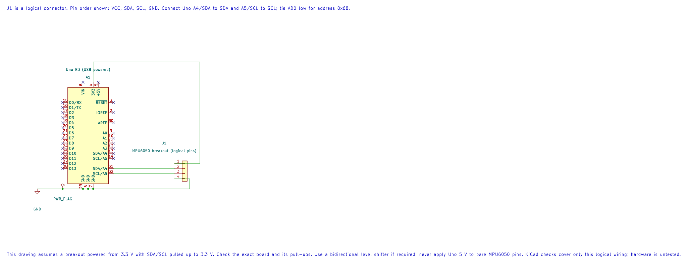

# MPU6050 Accelerometer and Gyroscope

## What You Will Learn

The MPU6050 contains a three-axis accelerometer and a three-axis gyroscope. It communicates with the Uno over I²C, and its measurements are available in device registers. Lab 32 checks the device identity, wakes the sensor and reads the three raw accelerometer axes.

This example does not read the gyroscope, calibrate offsets or convert readings into g or degrees per second. We will keep those steps for a follow-up experiment so you can first see how a register-based sensor read works.

## Check the Breakout and Wire It

The bare MPU6050 is a 3.3 V device. Breakout boards differ: some include a regulator and level translation, while others do not. Check the circuit or documentation for your exact board before connecting it to the 5 V Uno.

The diagram shows the logical signal connections for a 3.3 V breakout whose I²C lines are pulled up to 3.3 V. Add a bidirectional level shifter when your board or wiring requires one. Never connect 5 V directly to the bare sensor pins.



The connector in the drawing is a logical pin list, not the physical layout of a particular breakout.

| MPU6050 Signal | Uno R3 Connection | Purpose |
| --- | --- | --- |
| SDA | A4 / SDA | I²C data |
| SCL | A5 / SCL | I²C clock |
| AD0 | GND | Select the common address `0x68` |
| VCC | 3.3 V, if supported by the board | Sensor supply |
| GND | GND | Shared electrical reference |

The I²C bus needs pull-up resistors to the correct logic voltage. Many breakouts already have them. Check the board before adding more, since parallel pull-ups lower the total resistance.

## Read the Identity and Wake the Sensor

Lab 32 reads `WHO_AM_I` at register `0x75` and expects the value `0x68`. It then writes zero to `PWR_MGMT_1` at `0x6B` to leave sleep mode, and reads six bytes beginning at `0x3B`.

Each accelerometer axis is a signed, big-endian 16-bit two's-complement value. The example prints the raw 16-bit pattern as an unsigned decimal number. For example, the bit pattern `65535` represents signed value −1. At the default ±2 g range, the nominal sensitivity is 16,384 counts per g. Account for sensor offset, orientation and calibration before using that value in an application.

## Compare Direct Register Access and the HAL

Start with [Lab 74](<https://github.com/arnabdasbwn/atmega328p-labs/blob/main/examples/74-twi-register-read/main.c>). It performs just the identity-register transaction using the AVR's `TWCR`, `TWDR` and `TWSR` registers. The onboard D13 LED turns on when the device at address `0x68` returns `0x68`.

Then read [Lab 32](<https://github.com/arnabdasbwn/atmega328p-labs/blob/main/examples/32-mpu6050/main.c>). It repeats the identity check through the TWI HAL, wakes the sensor and reads the accelerometer bytes. The two examples let you compare a short register-level transaction with a reusable driver used by a complete sensor program.

## Build and Try the Lab

```powershell
python atmega328p-labs/tools/build.py 32-mpu6050 --compiler gcc
python atmega328p-labs/tools/build.py 32-mpu6050 --compiler xc8
```

After uploading, open a 9600-baud serial terminal and gently tilt the board. The three comma-separated raw values should change. The MPU6050 breakout was not available for this software check, so the firmware builds pass, but the physical I²C transaction and sensor readings have not been tested.

## Code Walkthrough

### Direct-Register TWI Identity Read
The example's `main()` configures its peripherals, runs the algorithm and reports or displays the result. These source operations are listed in execution order:

- `uint8_t identity = 0U;` - Clears the state/counter after its threshold is reached so the next interval starts from zero.
- `DDRB |= _BV(DDB5);` - Sets the Port B direction bits; a set bit selects output mode.
- `PORTB &= (uint8_t)~_BV(PORTB5);` - Sets or clears the Port B output latch. When the pin is an output, this determines its output level; on an input, it controls the pull-up.
- `twi_result_t result = mpu6050_register_read(MPU6050_WHO_AM_I_REGISTER, &identity);` - Stores this intermediate or output value for the next algorithm step. Check the units and range represented by each operand.
- `if ((result == TWI_RESULT_OK) && (identity == MPU6050_WHO_AM_I_VALUE))` - Tests the stated condition; the following block handles the matching case and the other path is skipped.
- `PORTB |= _BV(PORTB5);` - Sets or clears the Port B output latch. When the pin is an output, this determines its output level; on an input, it controls the pull-up.
- `for (;;)` - Repeats the foreground task indefinitely; each pass checks inputs, advances the calculation or services the peripheral shown below.

Algorithm: Directly controls TWBR/TWSR/TWCR/TWDR, checks each TWI status, uses repeated START, NACKs the final byte and bounds waits.
Expected behaviour: D13 turns on when WHO_AM_I register 0x75 returns 0x68
**HAL source files in this repository:** [ATmega328P HAL on GitHub](https://github.com/arnabdasbwn/atmega328p-hal)


### MPU6050 identity and acceleration
The example's `main()` configures its peripherals, runs the algorithm and reports or displays the result. These source operations are listed in execution order:

- `uint8_t identity = 0U, bytes[6];` - Clears the state/counter after its threshold is reached so the next interval starts from zero.
- `(void)avr_twi_init(100000UL);` - Configures TWI for the requested bus rate and enables the peripheral. The bus still requires suitable external pull-ups and compatible signal voltage.
- `(void)avr_uart_init(9600UL);` - Configures USART0 for asynchronous 8N1. It chooses a baud divisor and normal/double-speed mode, programs UBRR0/UCSR0A/UCSR0C, then enables receive and transmit in UCSR0B.
- `if (avr_device_read(0x68U, 0x75U, &identity, 1U) != AVR_OK || identity != 0x68U)` - This checks for any setup or transfer error before the program continues. Selects a device register and reads the requested number of bytes using the driver's TWI transaction.
- `return 1;` - Stops this path and returns the indicated status when setup or validation cannot continue.
- `if (avr_device_write(0x68U, 0x6BU, 0U) != AVR_OK)` - This checks for any setup or transfer error before the program continues. Writes the supplied bytes beginning at a device register using the driver's bus transaction.
- `for (;;)` - Repeats the foreground task indefinitely; each pass checks inputs, advances the calculation or services the peripheral shown below.
- `if (avr_device_read(0x68U, 0x3BU, bytes, 6U) == AVR_OK)` - The operation runs only after this API reports AVR_OK. Selects a device register and reads the requested number of bytes using the driver's TWI transaction.
- `for (uint8_t i = 0U; i < 6U; i = (uint8_t)(i + 2U))` - Repeats while `i < 6U` is true; `uint8_t i = 0U` sets the starting state and `i = (uint8_t` advances it each pass.
- `uint16_t raw = (uint16_t)((uint16_t)bytes[i] << 8U) | bytes[i + 1U];` - Stores this intermediate or output value for the next algorithm step. Check the units and range represented by each operand.
- `(void)avr_uart_u16(raw);` - Formats an unsigned integer as decimal digits and sends them on USART0; it does not add a newline.
- `(void)avr_uart_put(i == 4U ? '\n' : ',', AVR_POLL_BUDGET);` - Waits for the USART transmit buffer within its poll budget, then writes the byte to UDR0.
- `_delay_ms(100);` - Waits for the stated interval; the foreground does no other work during this blocking delay.

Algorithm: The default acceleration range is plus or minus 2 g with nominal 16384 LSB/g. Output is two's-complement big-endian. The example prints unsigned bit patterns to avoid hidden signed conversion; values above 32767 represent negative readings.
Expected behaviour: After identity verification and wake, six bytes are read as three raw 16-bit words
**HAL source files in this repository:** [ATmega328P HAL on GitHub](https://github.com/arnabdasbwn/atmega328p-hal)

- [`include/avr_hal/twi.h`](https://github.com/arnabdasbwn/atmega328p-hal/blob/main/include/avr_hal/twi.h)
- [`include/avr_hal/uart.h`](https://github.com/arnabdasbwn/atmega328p-hal/blob/main/include/avr_hal/uart.h)
- [`lib/drivers/register_device.c`](https://github.com/arnabdasbwn/atmega328p-hal/blob/main/lib/drivers/register_device.c)
- [`lib/drivers/register_device.h`](https://github.com/arnabdasbwn/atmega328p-hal/blob/main/lib/drivers/register_device.h)
- [`src/twi.c`](https://github.com/arnabdasbwn/atmega328p-hal/blob/main/src/twi.c)
- [`src/uart.c`](https://github.com/arnabdasbwn/atmega328p-hal/blob/main/src/uart.c)


## Common Problems

- **The identity check fails:** Confirm the selected address, AD0 connection, SDA/SCL wiring, supply and pull-ups.
- **TWI operations time out:** Check that the bus is not held low and that the sensor and Uno share a ground reference.
- **A printed value appears negative:** Values above 32,767 represent negative signed measurements, even though this lab prints their unsigned bit patterns.
- **The reading does not match acceleration in g:** Apply the correct sensitivity and account for offset calibration and sensor orientation.

## Check Your Understanding

1. Why does the example check `WHO_AM_I` before reading measurements?
2. What signed value has the unsigned bit pattern `65535`?
3. Does Lab 32 output calibrated gyroscope speed?

**Suggested Answers:** The identity check confirms that a device at the expected address responds with the expected value before the program relies on its register map. The signed 16-bit value is −1. No; this lab reads raw accelerometer axes only.

## Source and Further Reading

- [Lab 74: Direct Register TWI Read](<https://github.com/arnabdasbwn/atmega328p-labs/blob/main/examples/74-twi-register-read/main.c>)
- [Lab 32: MPU6050 Through The HAL](<https://github.com/arnabdasbwn/atmega328p-labs/blob/main/examples/32-mpu6050/main.c>)
- Check the datasheet and schematic for your exact MPU6050 breakout to confirm its supply, pull-ups, logic levels and register behavior.
- [ATmega328P Device Documentation](https://www.microchip.com/en-us/product/ATMEGA328P), TWI chapter.
