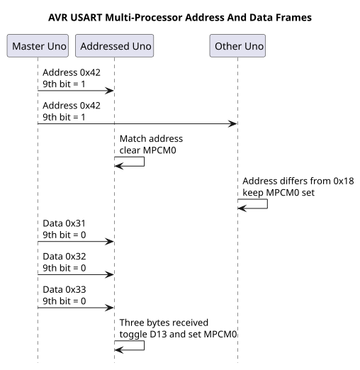
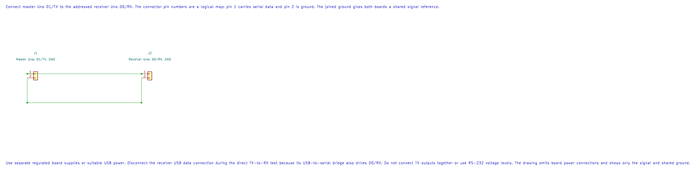

# USART Multi-Processor Communication

## Learning Goals

This lesson shows how the ATmega328P USART can distinguish address frames from data frames. Two Uno projects send one nine-bit address followed by three eight-bit payload bytes. The receiver uses the address to decide whether it should process those bytes.

## Why a Ninth Bit Helps

The normal asynchronous USART frame carries eight data bits. In multi-processor communication mode, the USART can send or receive a ninth bit as well. A small shared-bus protocol can use that bit to mark an address. Receivers ignore data while their address filter is enabled, which reduces software work on a multidrop bus.

The ninth bit is not a complete networking protocol. It does not provide a packet length, checksum, acknowledgement, retry, arbitration or electrical bus driver. This lab uses a fixed three-byte payload and a one-way connection to keep the frame sequence clear.

## Two-Uno Reference Link

The master sends serial data on D1/TX. Connect it to the addressed Uno's D0/RX and join the grounds. Use a separate, suitable regulated supply for the boards. Do not connect RS-232 voltages. For a shared multidrop electrical bus, add a proper line driver or bus transceiver and follow its termination and contention rules; directly wiring several push-pull TX pins together can damage the boards.



The slave's USB-to-serial bridge can also drive D0/RX, so disconnect its USB data connection during the bus test. The master USB bridge normally only receives the master TX line, but use a power-only connection if the test setup connects devices in a way that could contend.

| Signal | Master Uno | Receiver Uno |
| --- | --- | --- |
| Serial data | D1 / TX | D0 / RX |
| Ground | GND | GND |
| Power | Separate regulated supply | Separate regulated supply |


### KiCad Connection Drawing



Open the editable KiCad schematic or its pin map. The drawing has passed ERC and exact-net checks; the physical circuit has not been tested.

## Build the Master and Receiver

Build each project with both installed compilers:

```powershell
python atmega328p-labs/tools/build.py 53-mpcm-master --compiler gcc
python atmega328p-labs/tools/build.py 53-mpcm-master --compiler xc8
python atmega328p-labs/tools/build.py 54-mpcm-slave --compiler gcc
python atmega328p-labs/tools/build.py 54-mpcm-slave --compiler xc8
```

The master configures 9600 baud and nine-bit frames. It sets TXB80 immediately before writing address `0x42` to UDR0, then sends data bytes `0x31`, `0x32` and `0x33` with the ninth bit clear. It repeats once per second.

The receiver starts with MPCM0 filtering enabled. It reads UCSR0A status and RXB80 before consuming UDR0 so the ninth bit and error flags match the current byte. Address `0x42` disables the filter for the following data. A different address keeps the filter enabled. After three data bytes, the receiver toggles its built-in D13 LED and re-enables filtering.

## Observe the Bus

With both Unos programmed and connected, the slave's D13 LED should toggle about once each second. A logic analyser connected to the master TX and ground can show the ninth address bit followed by three ordinary data frames. The master example's expected sequence is:

```text
Address frame: ninth bit = 1, data = 0x42
Data frame:    ninth bit = 0, data = 0x31
Data frame:    ninth bit = 0, data = 0x32
Data frame:    ninth bit = 0, data = 0x33
```

The installed workspace contains only one Uno. Compiler results therefore confirm the two projects build; they do not verify a live bus or a second-board response.

## Source Files and Register References

- [Master Firmware](<https://github.com/arnabdasbwn/atmega328p-labs/blob/main/examples/53-mpcm-master/main.c>)
- [Receiver Firmware](<https://github.com/arnabdasbwn/atmega328p-labs/blob/main/examples/54-mpcm-slave/main.c>)
- [Master Wiring Metadata](<https://github.com/arnabdasbwn/atmega328p-labs/blob/main/examples/53-mpcm-master/lab.json>)
- [Receiver Wiring Metadata](<https://github.com/arnabdasbwn/atmega328p-labs/blob/main/examples/54-mpcm-slave/lab.json>)
- Microchip, [ATmega328P Device Documentation](https://www.microchip.com/en-us/product/ATMEGA328P), USART chapter: MPCM0, TXB80, RXB80 and 9-bit frame size configuration.

## Code Walkthrough

### USART Multi-Processor Master
The example's `main()` configures its peripherals, runs the algorithm and reports or displays the result. These source operations are listed in execution order:

- `const uint8_t payload[3] = {UINT8_C(0x31), UINT8_C(0x32), UINT8_C(0x33)};` - Stores this intermediate or output value for the next algorithm step. Check the units and range represented by each operand.
- `UCSR0A = 0U;` - Contains USART status and speed-control flags, including transmit/receive readiness and U2X0.
- `UBRR0H = 0U;` - Clears the state/counter after its threshold is reached so the next interval starts from zero.
- `UBRR0L = (uint8_t)AVR_MPCM_UBRR_9600;` - Stores this intermediate or output value for the next algorithm step. Check the units and range represented by each operand.
- `UCSR0C = _BV(UCSZ01) | _BV(UCSZ00);` - Sets UCSZ01:0=0b11 for eight data bits; defaults select asynchronous mode, no parity and one stop bit.
- `UCSR0B = _BV(TXEN0) | _BV(UCSZ02);` - Enables USART receive/transmit and optional USART interrupts.
- `for (;;)` - Repeats the foreground task indefinitely; each pass checks inputs, advances the calculation or services the peripheral shown below.
- `if (!avr_mpcm_send(UINT8_C(0x42), true))` - This condition chooses the next path based on the API result. Use the linked public header for this function's parameters, register ownership, blocking behavior and status values.
- `return 1;` - Stops this path and returns the indicated status when setup or validation cannot continue.
- `for (uint8_t index = 0U; index < 3U; index++)` - Repeats while `index < 3U` is true; `uint8_t index = 0U` sets the starting state and `index++` advances it each pass.
- `if (!avr_mpcm_send(payload[index], false))` - This condition chooses the next path based on the API result. Use the linked public header for this function's parameters, register ownership, blocking behavior and status values.
- `for (uint8_t delay_part = 0U; delay_part < 10U; delay_part++)` - Repeats while `delay_part < 10U` is true; `uint8_t delay_part = 0U` sets the starting state and `delay_part++` advances it each pass.
- `_delay_ms(100);` - Waits for the stated interval; the foreground does no other work during this blocking delay.

Algorithm: The USART ninth bit marks an address frame; UCSR0B.TXB80 must be written before UDR0.
Expected behaviour: At 9600 baud, send a ninth-bit address 0x42 followed by data bytes 0x31, 0x32 and 0x33 once each second
**HAL source files in this repository:** [ATmega328P HAL on GitHub](https://github.com/arnabdasbwn/atmega328p-hal)

- [`include/avr_hal/common.h`](https://github.com/arnabdasbwn/atmega328p-hal/blob/main/include/avr_hal/common.h)
- [`src/common.c`](https://github.com/arnabdasbwn/atmega328p-hal/blob/main/src/common.c)


### USART Multi-Processor Addressed Receiver
The example's `main()` configures its peripherals, runs the algorithm and reports or displays the result. These source operations are listed in execution order:

- `avr_mpcm_frame_t frame;` - Use the linked public header for this function's parameters, register ownership, blocking behavior and status values.
- `bool addressed = false;` - Stores this intermediate or output value for the next algorithm step. Check the units and range represented by each operand.
- `uint8_t received_count = 0U;` - Clears the state/counter after its threshold is reached so the next interval starts from zero.
- `if (avr_gpio_mode(13U, AVR_GPIO_OUTPUT) != AVR_OK)` - This checks for any setup or transfer error before the program continues. Maps the Uno header pin to its AVR port, sets its DDR direction bit and prepares the PORT latch for the requested initial level or pull-up.
- `return 1;` - Stops this path and returns the indicated status when setup or validation cannot continue.
- `UCSR0A = _BV(MPCM0);` - Contains USART status and speed-control flags, including transmit/receive readiness and U2X0.
- `UBRR0H = 0U;` - Clears the state/counter after its threshold is reached so the next interval starts from zero.
- `UBRR0L = (uint8_t)AVR_MPCM_UBRR_9600;` - Stores this intermediate or output value for the next algorithm step. Check the units and range represented by each operand.
- `UCSR0C = _BV(UCSZ01) | _BV(UCSZ00);` - Sets UCSZ01:0=0b11 for eight data bits; defaults select asynchronous mode, no parity and one stop bit.
- `UCSR0B = _BV(RXEN0) | _BV(UCSZ02);` - Enables USART receive/transmit and optional USART interrupts.
- `for (;;)` - Repeats the foreground task indefinitely; each pass checks inputs, advances the calculation or services the peripheral shown below.
- `if (avr_mpcm_receive(&frame, AVR_POLL_BUDGET))` - Tests this condition to choose which algorithm path runs.
- `if (frame.address_frame)` - Tests this condition to choose which algorithm path runs.
- `addressed = frame.value == AVR_MPCM_DEVICE_ADDRESS;` - Stores this intermediate value for the next step of the algorithm; check the operands and units.
- `received_count = 0U;` - Stores this intermediate value for the next step of the algorithm; check the operands and units.
- `if (addressed)` - Tests this condition to choose which algorithm path runs.
- `UCSR0A &= (uint8_t)~_BV(MPCM0);` - USART status and speed-control flags.
- `UCSR0A |= _BV(MPCM0);` - USART status and speed-control flags.
- `else if (addressed)` - This statement advances the operation sequence; follow its expression to see the state change.
- `received_count++;` - Advances the event/sample counter once for the condition just observed.
- `if (received_count >= 3U)` - Tests the stated condition; the following block handles the matching case and the other path is skipped.
- `(void)avr_gpio_toggle(13U);` - Atomically toggles the selected pin output latch.
- `addressed = false;` - Stores this intermediate or output value for the next algorithm step. Check the units and range represented by each operand.

Algorithm: MPCM0 filters non-address frames; the ninth received bit and RXB80 determine whether the current frame is an address.
Expected behaviour: The receiver accepts 0x42 address frames and toggles the onboard LED after three data frames
**HAL source files in this repository:** [ATmega328P HAL on GitHub](https://github.com/arnabdasbwn/atmega328p-hal)

- [`include/avr_hal/gpio.h`](https://github.com/arnabdasbwn/atmega328p-hal/blob/main/include/avr_hal/gpio.h)
- [`src/gpio.c`](https://github.com/arnabdasbwn/atmega328p-hal/blob/main/src/gpio.c)


## Common Problems

- **Receiver never sees the address:** confirm baud rate, shared ground, D1-to-D0 wiring, 9-bit frame-size bits and the receiver's RXEN0 setting.
- **The next byte has the wrong marker:** set TXB80 only after UDRE0 is set and immediately before writing the associated byte to UDR0.
- **The receiver misses data:** process each received byte promptly, check overrun/framing status and do not perform long blocking work between frames.
- **LED toggles for an unknown node:** verify the received ninth bit is checked before treating the byte as payload.
- **Two transmitters interfere:** the USART ninth-bit feature does not make a safe wired-OR bus. Use a proper transceiver and a protocol that controls which node may transmit.

## Check Your Understanding

1. What does the ninth bit mean in this experiment?
2. Why does the receiver enable MPCM filtering again after three bytes?
3. Does MPCM provide collision detection or a checksum?

**Suggested answers:** A set ninth bit marks an address; a clear bit marks payload. The receiver expects a fixed three-byte payload and returns to filtering so unrelated data frames are ignored. MPCM does not provide collision detection or error-checking by itself.

## References

- Microchip, [ATmega328P Device Documentation](https://www.microchip.com/en-us/product/ATMEGA328P), USART multi-processor communication mode and receiver/transmitter data registers.
- Review the Uno R3 [Pinout Reference](https://www.arnabkumardas.com/pinout/arduino-uno-r3/) before connecting serial signals.

**Validation status:** Both projects build with AVR GCC and XC8. There is one Uno in the workspace, so the master/slave connection and LED response remain physically untested.
