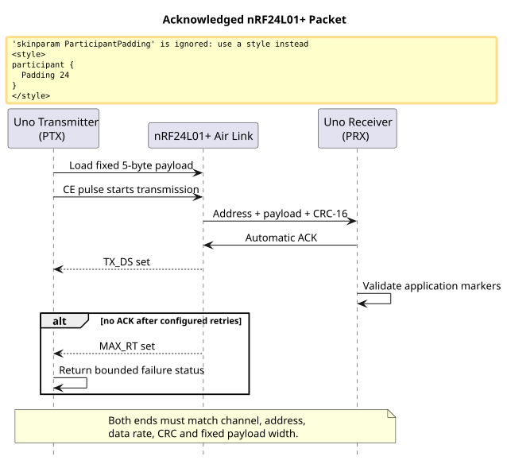
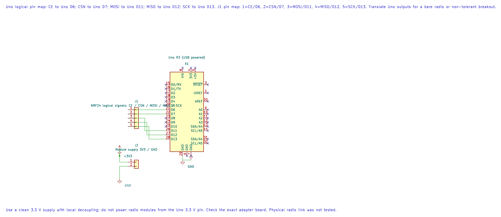
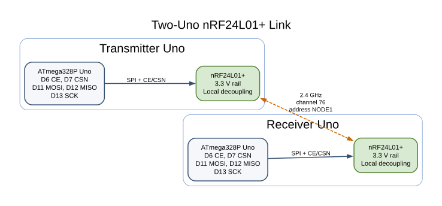

# nRF24L01++ Radio Link

## Learning Goals

This lesson sends a small counter packet between two Uno R3 boards. You will configure the nRF24L01+ over SPI, use its hardware acknowledgement and retry features, and check the received application data before acting on it.

The nRF24L01+ is a 2.4 GHz packet transceiver. Its SPI interface configures the radio and transfers payloads; it does not carry the data over the air. Two endpoints must agree on channel, address, data rate, CRC, pipe and payload width. A radio ACK confirms receipt at the link layer, but the application still needs to validate the packet contents.

## Radio Packet and Acknowledgement

The transmitter sends five bytes: a marker, an 8-bit sequence value, its bitwise complement, a check byte, and a trailer. The radio uses a five-byte address, fixed-width payload, CRC-16 and auto-acknowledgement. It retries at most 15 times, then returns a maximum-retry status. The foreground code also has a finite poll count, so it does not wait forever if the module is absent or misconfigured.





The editable KiCad pin map records the Uno-side radio signals. Check the exact adapter board and provide a clean 3.3 V supply; do not power the radio from the Uno 3.3 V output.

The two example programs share channel 76, address `NODE1`, 1 Mbps data rate, pipe 0 and five-byte payload settings. The radio link is half-duplex and frequency-shared. Other devices may use the same 2.4 GHz band, so an acknowledgement is a result for one exchange, not a promise of continuous delivery or a deadline.

## Parts and Wiring

Use two Uno R3 boards, two nRF24L01+ modules, two stable 3.3 V supplies or regulators, local decoupling, and two LEDs with series resistors for the indicators. The Nordic IC supply range is 1.9–3.6 V. Many low-cost breakout boards do not translate 5 V signals. Verify the exact module, especially if it has a PA/LNA amplifier and a larger antenna connector.

Wire each radio to its own Uno:

| Uno R3 Pin | nRF24L01+ Pin | Purpose |
| --- | --- | --- |
| D6 | CE | Selects standby, transmit or receive state. |
| D7 | CSN | Active-low SPI chip select. |
| D11 / MOSI | MOSI | SPI controller-to-radio data. |
| D12 / MISO | MISO | SPI radio-to-controller data. |
| D13 / SCK | SCK | SPI clock. |
| Separate 3.3 V rail | VCC | Must stay within the module's supply range. |
| GND | GND | Join signal ground. |
| D4 through 1 kΩ and LED | — | Optional send/receive indication. |

Add a 100 nF ceramic capacitor and a suitable local bulk capacitor close to the module's supply pins; use the module maker's guidance for the exact values. Keep the SPI wires short. Do not power the radio from a Uno GPIO. Keep D10 as an output because it is the ATmega328P hardware SPI controller's SS pin. The HAL uses D6 and D7 for CE and CSN, leaving D10–D13 for SPI.



## Build the Transmitter and Receiver

Lab 58 is the transmitter; Lab 59 is the receiver. Build both independently with the selected compiler:

```powershell
python atmega328p-labs/tools/build.py 58-nrf24-transmitter --compiler gcc
python atmega328p-labs/tools/build.py 59-nrf24-receiver --compiler gcc
python atmega328p-labs/tools/build.py 58-nrf24-transmitter --compiler xc8
python atmega328p-labs/tools/build.py 59-nrf24-receiver --compiler xc8
```

Upload Lab 58 to one Uno and Lab 59 to the second. After upload, disconnect each Uno's USB data connection if it interferes with the wiring, but keep the boards safely powered. Connect the radio modules to their own boards. The transmitter's D4 LED is high while its most recent send was acknowledged. The receiver toggles D4 after it accepts a packet whose application fields pass validation.

The shared driver is [`nrf24.h`](https://github.com/arnabdasbwn/atmega328p-hal/blob/main/lib/drivers/nrf24.h) and [`nrf24.c`](https://github.com/arnabdasbwn/atmega328p-hal/blob/main/lib/drivers/nrf24.c). `avr_nrf24_init()` uses SPI mode 0 at 4 MHz, configures the fixed address and packet parameters, and selects PTX or PRX operation. `avr_nrf24_transmit()` pulses CE and checks `TX_DS` or `MAX_RT`. `avr_nrf24_receive()` checks `RX_DR`, reads exactly five bytes into temporary storage, and copies the result to the caller only after a successful transfer.

## Observe and Troubleshoot

On a working two-radio link, the transmitter indicator turns on after an acknowledged send. The receiver indicator toggles after each valid packet. Remove power from the receiving radio and the sender should stop indicating success after the hardware retries or foreground poll bound is reached.

If sends fail, verify each radio's 3.3 V rail while transmitting, ground continuity, CE/CSN polarity, MOSI/MISO/SCK mapping, address and channel. Compare the two module markings and board design; an amplified PA/LNA module can draw more current than the small PCB-antenna module. If the sender reports an ACK but the receiver does not toggle, inspect the application marker/check fields and the receiver LED wiring. Do not respond to unstable operation by raising output power before checking supply and wiring.

## Exercises

1. What does `TX_DS` establish when auto-acknowledgement is enabled?
2. Why does the receiver check packet fields even though the radio uses CRC-16?
3. How many bytes of application payload are sent in one packet, and why is the queue not a general-purpose file or image transport?

**Suggested answers:** `TX_DS` reports a completed transmission with the expected link-layer acknowledgement. CRC checks accidental bit errors in the radio frame, while application markers and a check byte help detect wrong packet layouts or stale/misinterpreted data. Each payload is only five bytes; larger data needs fragmentation, sequencing, loss recovery, memory budgeting and an application-level integrity scheme.

## Validation and References

Labs 58 and 59 build with AVR GCC and XC8. The [94-nrf24-driver-test fixture](https://github.com/arnabdasbwn/atmega328p-labs/blob/main/examples/94-nrf24-driver-test/main.c) checks selected driver results against a scripted peripheral model. No nRF24L01+ modules or second Uno were available for a radio link test, and AVR8js does not model the RF channel. Build success does not establish antenna range, power integrity, regulatory compliance or physical packet delivery.

- [Nordic Semiconductor nRF24L01+ Product Specification](https://devzone.nordicsemi.com/cfs-file/__key/communityserver-discussions-components-files/4/content.pdf)
- [ATmega328P Device Documentation](https://www.microchip.com/en-us/product/ATMEGA328P)
- [Uno R3 Pinout](https://www.arnabkumardas.com/pinout/arduino-uno-r3/)

## Code Walkthrough


**Example code on GitHub:**
- [nRF24L01+ Acknowledged Transmitter (`58-nrf24-transmitter`)](https://github.com/arnabdasbwn/atmega328p-labs/blob/main/examples/58-nrf24-transmitter/main.c)
- [nRF24L01+ Fixed-Payload Receiver (`59-nrf24-receiver`)](https://github.com/arnabdasbwn/atmega328p-labs/blob/main/examples/59-nrf24-receiver/main.c)

### nRF24L01+ Acknowledged Transmitter
The example's `main()` configures its peripherals, runs the algorithm and reports or displays the result. These source operations are listed in execution order:

- `static const uint8_t radio_address[AVR_NRF24_ADDRESS_LENGTH] = {'N', 'O', 'D', 'E', '1'};` - Stores this intermediate or output value for the next algorithm step. Check the units and range represented by each operand.
- `avr_nrf24_t radio;` - Use the linked public header for this function's parameters, register ownership, blocking behavior and status values.
- `if ((avr_gpio_mode(4U, AVR_GPIO_OUTPUT) != AVR_OK) ||` - This checks for any setup or transfer error before the program continues. Maps the Uno header pin to its AVR port, sets its DDR direction bit and prepares the PORT latch for the requested initial level or pull-up.
- `(avr_nrf24_init(&radio, 6U, 7U, radio_address, false) != AVR_OK))` - Configures the nRF24L01+ address, role and chip-select/enable pins. The radio module needs its own suitable regulated supply and local decoupling.
- `return 1;` - Stops this path and returns the indicated status when setup or validation cannot continue.
- `uint8_t sequence = 0U;` - Clears the state/counter after its threshold is reached so the next interval starts from zero.
- `for (;;)` - Repeats the foreground task indefinitely; each pass checks inputs, advances the calculation or services the peripheral shown below.
- `const uint8_t payload[AVR_NRF24_PAYLOAD_LENGTH] =` - This statement participates in the operation sequence; follow its expression to see which state or output changes.
- `const avr_status_t status = avr_nrf24_transmit(&radio, payload, UINT16_C(12000));` - Sends one fixed-size payload and waits only up to the supplied timeout for the radio result.
- `if (avr_gpio_write(4U, status == AVR_OK) != AVR_OK)` - The operation runs only after this API reports AVR_OK. Changes the pin's PORT output latch; for an input pin this selects its pull-up state.
- `sequence++;` - Advances the event/sample counter once for the condition just observed.
- `_delay_ms(1000);` - Waits for the stated interval; the foreground does no other work during this blocking delay.

Algorithm: Auto-ack and bounded retransmission improve delivery, but the application still checks its packet markers and reports failure.
Expected behaviour: D4 indicator is high while the most recent five-byte payload received a link-layer ACK
**HAL source files in this repository:** [ATmega328P HAL on GitHub](https://github.com/arnabdasbwn/atmega328p-hal)

- [`include/avr_hal/gpio.h`](https://github.com/arnabdasbwn/atmega328p-hal/blob/main/include/avr_hal/gpio.h)
- [`lib/drivers/nrf24.c`](https://github.com/arnabdasbwn/atmega328p-hal/blob/main/lib/drivers/nrf24.c)
- [`lib/drivers/nrf24.h`](https://github.com/arnabdasbwn/atmega328p-hal/blob/main/lib/drivers/nrf24.h)
- [`src/gpio.c`](https://github.com/arnabdasbwn/atmega328p-hal/blob/main/src/gpio.c)


### nRF24L01+ Fixed-Payload Receiver
The example's `main()` configures its peripherals, runs the algorithm and reports or displays the result. These source operations are listed in execution order:

- `static const uint8_t radio_address[AVR_NRF24_ADDRESS_LENGTH] = {'N', 'O', 'D', 'E', '1'};` - Stores this intermediate or output value for the next algorithm step. Check the units and range represented by each operand.
- `avr_nrf24_t radio;` - Use the linked public header for this function's parameters, register ownership, blocking behavior and status values.
- `if ((avr_gpio_mode(4U, AVR_GPIO_OUTPUT) != AVR_OK) ||` - This checks for any setup or transfer error before the program continues. Maps the Uno header pin to its AVR port, sets its DDR direction bit and prepares the PORT latch for the requested initial level or pull-up.
- `(avr_nrf24_init(&radio, 6U, 7U, radio_address, true) != AVR_OK))` - Configures the nRF24L01+ address, role and chip-select/enable pins. The radio module needs its own suitable regulated supply and local decoupling.
- `return 1;` - Stops this path and returns the indicated status when setup or validation cannot continue.
- `for (;;)` - Repeats the foreground task indefinitely; each pass checks inputs, advances the calculation or services the peripheral shown below.
- `const avr_status_t status = avr_nrf24_receive(&radio, payload, UINT16_C(12000));` - Waits up to the supplied timeout for one fixed-size radio payload.
- `if (status == AVR_OK)` - Only enters the following block when the operation reports success.
- `const uint8_t sequence = payload[1];` - Stores this intermediate or output value for the next algorithm step. Check the units and range represented by each operand.
- `const uint8_t expected_complement = (uint8_t)(UINT8_MAX - sequence);` - Stores this intermediate or output value for the next algorithm step. Check the units and range represented by each operand.
- `const bool valid = (payload[0] == AVR_NRF24_SAMPLE_MARKER) &&` - Stores this intermediate value for the next step of the algorithm; check the operands and units.
- `(payload[2] == expected_complement) &&` - This statement advances the operation sequence; follow its expression to see the state change.
- `(payload[3] == (uint8_t)(AVR_NRF24_SAMPLE_MARKER + sequence)) &&` - This statement advances the operation sequence; follow its expression to see the state change.
- `(payload[4] == AVR_NRF24_SAMPLE_TRAILER);` - This statement advances the operation sequence; follow its expression to see the state change.
- `if (valid && (avr_gpio_toggle(4U) != AVR_OK))` - This checks for any setup or transfer error before the program continues. Atomically toggles the selected pin output latch.
- `else if (status != AVR_ERROR_TIMEOUT)` - This statement participates in the operation sequence; follow its expression to see which state or output changes.
- `if (avr_gpio_write(4U, false) != AVR_OK)` - This checks for any setup or transfer error before the program continues. Changes the pin's PORT output latch; for an input pin this selects its pull-up state.
- `_delay_ms(100);` - Waits for the stated interval; the foreground does no other work during this blocking delay.

Algorithm: The fixed pipe-0 payload length and radio CRC establish frame integrity; application markers catch incorrect packet interpretation.
Expected behaviour: D4 toggles after each valid five-byte application packet is received
**HAL source files in this repository:** [ATmega328P HAL on GitHub](https://github.com/arnabdasbwn/atmega328p-hal)

- [`include/avr_hal/gpio.h`](https://github.com/arnabdasbwn/atmega328p-hal/blob/main/include/avr_hal/gpio.h)
- [`lib/drivers/nrf24.c`](https://github.com/arnabdasbwn/atmega328p-hal/blob/main/lib/drivers/nrf24.c)
- [`lib/drivers/nrf24.h`](https://github.com/arnabdasbwn/atmega328p-hal/blob/main/lib/drivers/nrf24.h)
- [`src/gpio.c`](https://github.com/arnabdasbwn/atmega328p-hal/blob/main/src/gpio.c)


### nRF24L01+ Driver Result Fixture
The example's `main()` configures its peripherals, runs the algorithm and reports or displays the result. These source operations are listed in execution order:

- `static const uint8_t address[AVR_NRF24_ADDRESS_LENGTH] = {'N', 'O', 'D', 'E', '1'};` - Stores this intermediate or output value for the next algorithm step. Check the units and range represented by each operand.
- `static const uint8_t payload[AVR_NRF24_PAYLOAD_LENGTH] = {0xA5U, 0x2AU, 0xD5U, 0xCFU, 0x5AU};` - Stores this intermediate or output value for the next algorithm step. Check the units and range represented by each operand.
- `avr_nrf24_t radio;` - Use the linked public header for this function's parameters, register ownership, blocking behavior and status values.
- `if (avr_uart_init(9600UL) != AVR_OK)` - This checks for any setup or transfer error before the program continues. Configures USART0 for asynchronous 8N1. It chooses a baud divisor and normal/double-speed mode, programs UBRR0/UCSR0A/UCSR0C, then enables receive and transmit in UCSR0B.
- `return 1;` - Stops this path and returns the indicated status when setup or validation cannot continue.
- `if (avr_nrf24_init(&radio, 6U, 7U, address, false) != AVR_OK)` - This checks for any setup or transfer error before the program continues. Configures the nRF24L01+ address, role and chip-select/enable pins. The radio module needs its own suitable regulated supply and local decoupling.
- `(void)avr_uart_write((const uint8_t *)"FAIL\n", 5U, AVR_POLL_BUDGET);` - Sends the specified bytes through USART0; a timeout can occur after a prefix has already been sent.
- `if (avr_nrf24_transmit(&radio, payload, 100U) != AVR_OK)` - This checks for any setup or transfer error before the program continues. Sends one fixed-size payload and waits only up to the supplied timeout for the radio result.
- `(void)avr_uart_write((const uint8_t *)"FAIL1\n", 6U, AVR_POLL_BUDGET);` - Sends the specified bytes through USART0; a timeout can occur after a prefix has already been sent.
- `if (avr_nrf24_transmit(&radio, payload, 100U) != AVR_ERROR_IO)` - This condition chooses the next path based on the API result. Sends one fixed-size payload and waits only up to the supplied timeout for the radio result.
- `(void)avr_uart_write((const uint8_t *)"FAIL2\n", 6U, AVR_POLL_BUDGET);` - Sends the specified bytes through USART0; a timeout can occur after a prefix has already been sent.
- `(void)avr_uart_write((const uint8_t *)"PASS\n", 5U, AVR_POLL_BUDGET);` - Sends the specified bytes through USART0; a timeout can occur after a prefix has already been sent.
- `for (;;)` - Repeats the foreground task indefinitely; each pass checks inputs, advances the calculation or services the peripheral shown below.

Algorithm: Driver success and bounded-retry failure handling can be exercised without claiming RF or hardware validation.
Expected behaviour: The simulation prints PASS after modeling TX_DS on one send and MAX_RT on the next
**HAL source files in this repository:** [ATmega328P HAL on GitHub](https://github.com/arnabdasbwn/atmega328p-hal)

- [`include/avr_hal/uart.h`](https://github.com/arnabdasbwn/atmega328p-hal/blob/main/include/avr_hal/uart.h)
- [`lib/drivers/nrf24.c`](https://github.com/arnabdasbwn/atmega328p-hal/blob/main/lib/drivers/nrf24.c)
- [`lib/drivers/nrf24.h`](https://github.com/arnabdasbwn/atmega328p-hal/blob/main/lib/drivers/nrf24.h)
- [`src/uart.c`](https://github.com/arnabdasbwn/atmega328p-hal/blob/main/src/uart.c)
