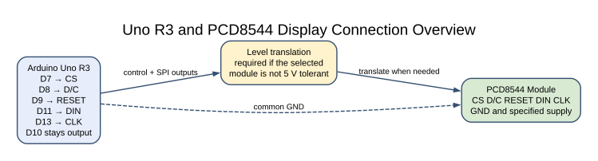
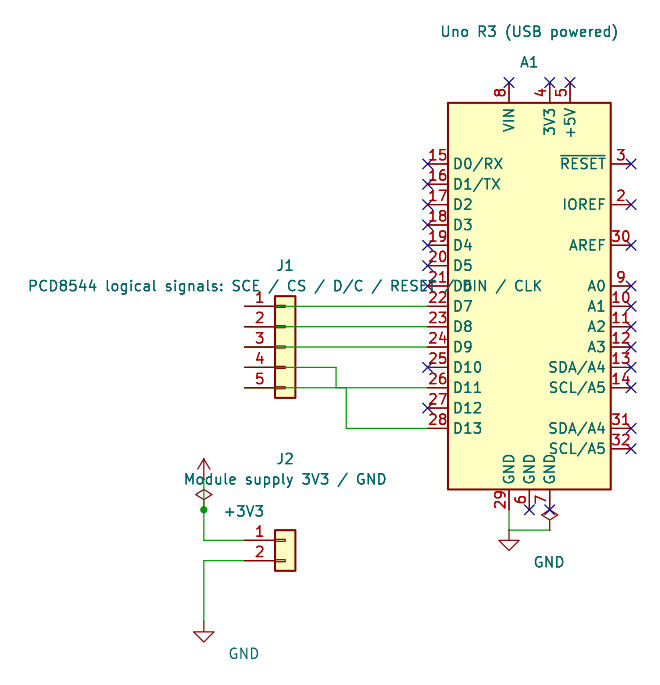

# PCD8544 Nokia 5110 Display

## Learning Goals

This lesson uses the Uno hardware SPI peripheral to write to a PCD8544 display. You will see how the controller divides its display RAM into pages and why a full framebuffer is a poor fit for a small SRAM device.

## The Display Memory Layout

The PCD8544 drives 84 columns by 48 rows of monochrome pixels. A full image needs one bit for each pixel:

```text
84 columns × 48 rows ÷ 8 bits per byte = 504 bytes
```

The Uno has only 2 KB of SRAM for global variables, local variables and the stack. Reserving 504 bytes for a screen can leave little room for the rest of a program. The driver in this lesson writes one 8-row page at a time, using an 84-byte buffer.

The display RAM has six pages. Each byte represents one column of eight vertical pixels; the page index selects which group of eight rows is updated. The example clears the display, then writes a simple alternating pattern to page 2.

## Check Supply and Logic Levels

The PCD8544 controller IC is a low-voltage device. Many hobby modules include extra components, but layouts and input protection differ. Check your exact board's supply range and logic levels before connecting it to the 5 V Uno. If the display inputs are not 5 V tolerant, use suitable level translation for CS, D/C, RESET, DIN and CLK. No display MISO connection is used.

| Arduino Uno R3 | Display Module | Note |
| --- | --- | --- |
| D7 | CS | Active-low chip select |
| D8 | D/C | LOW sends commands; HIGH sends display data |
| D9 | RESET | Active-low hardware reset |
| D11 / COPI | DIN | SPI controller output |
| D13 / SCK | CLK | SPI clock |
| GND | GND | Common ground |
| Supply | VCC or VIN as specified by the breakout maker | Do not assume every Nokia 5110 board accepts 5 V |

The SPI HAL also configures D10 as an output and uses D10–D13 for the SPI peripheral. The PCD8544 driver therefore rejects D10–D13 for its separate control pins.

## Commands and Pixel Data





The editable KiCad pin map records the Uno-side signal assignments. Check the actual breakout pinout and add translation on any 5 V output that reaches a 3.3 V-only input.

The driver selects SPI mode 0 at 2 MHz. It resets the module, enters extended instruction mode, sets the requested contrast and bias, returns to basic mode and selects normal display operation. The contrast value is a starting point; the panel's ideal setting depends on its LCD glass and module design.

To write one page, the driver sets the column and page addresses, switches D/C to data mode and sends 84 bytes. Each SPI wait is bounded by the shared HAL poll budget. On failure, the driver deasserts CS and returns the error. A partial write may have advanced the controller address, so reinitialize before retrying.

## Build and Observe

Build the experiment with both available toolchains:

```powershell
python atmega328p-labs/tools/build.py 52-pcd8544 --compiler gcc
python atmega328p-labs/tools/build.py 52-pcd8544 --compiler xc8
```

Upload the generated HEX through the Uno bootloader after checking your module's voltage requirements. The display should show alternating black and white vertical blocks in one 8-pixel-high band; the other five pages should remain blank. Adjust the contrast setting in `main.c` a little at a time if the pixels are difficult to see.

## Source Files

- [PCD8544 Public Driver Header](https://github.com/arnabdasbwn/atmega328p-hal/blob/main/lib/drivers/pcd8544.h)
- [PCD8544 Driver Implementation](https://github.com/arnabdasbwn/atmega328p-hal/blob/main/lib/drivers/pcd8544.c)
- [Uno Page-Buffer Example](<https://github.com/arnabdasbwn/atmega328p-labs/blob/main/examples/52-pcd8544/main.c>)
- [Wiring And Exercise Metadata](<https://github.com/arnabdasbwn/atmega328p-labs/blob/main/examples/52-pcd8544/lab.json>)
- [SPI Fundamentals](spi-concepts.md)

## Troubleshooting

- **Blank screen:** check the breakout power, ground, RESET level, CS and SPI wiring before changing contrast.
- **Random pixels:** confirm D/C is LOW for commands and HIGH for page bytes, and verify the module's SPI clock timing.
- **Very dark or faint pixels:** adjust contrast within the controller's documented range; the correct value varies by LCD panel.
- **Display works with a different board but not the Uno:** check 5 V signal levels, pin mapping and SPI clock frequency.
- **Unexpected output on D13:** D13 is also the Uno's SPI clock pin and its onboard LED may flicker during transfers.

## Code Walkthrough

### PCD8544 Page Buffer Display
The example's `main()` configures its peripherals, runs the algorithm and reports or displays the result. These source operations are listed in execution order:

- `avr_pcd8544_t display;` - Use the linked public header for this function's parameters, register ownership, blocking behavior and status values.
- `if (avr_pcd8544_init(&display, 7U, 8U, 9U, 50U) != AVR_OK)` - This checks for any setup or transfer error before the program continues. Use the linked public header for this function's parameters, register ownership, blocking behavior and status values.
- `return 1;` - Stops this path and returns the indicated status when setup or validation cannot continue.
- `for (uint8_t page = 0U; page < AVR_PCD8544_PAGES; page++)` - Repeats while `page < AVR_PCD8544_PAGES` is true; `uint8_t page = 0U` sets the starting state and `page++` advances it each pass.
- `for (uint8_t column = 0U; column < AVR_PCD8544_COLUMNS; column++)` - Repeats while `column < AVR_PCD8544_COLUMNS` is true; `uint8_t column = 0U` sets the starting state and `column++` advances it each pass.
- `page_data[column] = ((page == 2U) && (((column / 6U) % 2U) == 0U)) ? UINT8_MAX : 0U;` - Stores this intermediate or output value for the next algorithm step. Check the units and range represented by each operand.
- `if (avr_pcd8544_write_page(&display, page, page_data) != AVR_OK)` - This checks for any setup or transfer error before the program continues. Use the linked public header for this function's parameters, register ownership, blocking behavior and status values.
- `for (;;)` - Repeats the foreground task indefinitely; each pass checks inputs, advances the calculation or services the peripheral shown below.
- `_delay_ms(1000);` - Waits for the stated interval; the foreground does no other work during this blocking delay.

Algorithm: The driver writes the display's six 84-byte pages one at a time using a single 84-byte application buffer instead of a 504-byte framebuffer.
Expected behaviour: One 8-pixel-high band shows alternating 6-column blocks; the remaining display pages are blank
**HAL source files in this repository:** [ATmega328P HAL on GitHub](https://github.com/arnabdasbwn/atmega328p-hal)

- [`include/avr_hal/common.h`](https://github.com/arnabdasbwn/atmega328p-hal/blob/main/include/avr_hal/common.h)
- [`lib/drivers/pcd8544.c`](https://github.com/arnabdasbwn/atmega328p-hal/blob/main/lib/drivers/pcd8544.c)
- [`lib/drivers/pcd8544.h`](https://github.com/arnabdasbwn/atmega328p-hal/blob/main/lib/drivers/pcd8544.h)
- [`src/common.c`](https://github.com/arnabdasbwn/atmega328p-hal/blob/main/src/common.c)


## Check Your Understanding

1. How many bytes does a full 84 by 48 monochrome image need?
2. How much SRAM does the example allocate for a page of pixel data?
3. Why does the driver deassert CS after an SPI error?

**Suggested answers:** A full frame needs 504 bytes. One page uses 84 bytes. CS is deasserted so the peripheral is not left selected after an incomplete transaction; the controller may still need reinitialization before retrying.

## References

- Philips Semiconductors, [PCD8544 Product Specification](https://cdn-shop.adafruit.com/datasheets/pcd8544.pdf), 12 April 1999. The document specifies the 84-column by 48-row display RAM, serial interface timing and low-voltage supply.
- Microchip, [ATmega328P Device Documentation](https://www.microchip.com/en-us/product/ATMEGA328P), SPI chapter and Uno pin mapping.
- See the [Arduino Uno R3 Pinout](https://www.arnabkumardas.com/pinout/arduino-uno-r3/) for board header locations.

**Validation status:** AVR GCC and XC8 builds are required for the example. No physical module is available here; wiring, contrast and visible output remain unverified.
