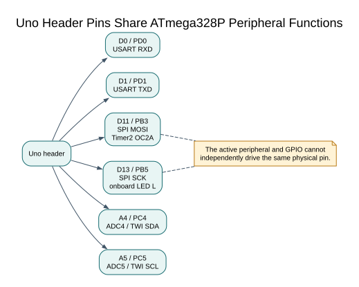

# Uno Pin Names and ATmega328P Alternate Functions
## Objectives and Prerequisites

Given a signal name such as `D13`, find its AVR port bit and alternate functions, then identify when two features compete for one pin. Before starting, read [the device overview](atmega328p-specs.md) and [AVR architecture](avr-architecture.md).



## One Physical Pin Can Have Several Logical Roles

An Uno header label is a board-level name. The ATmega328P datasheet describes the package pin, port bit and peripheral function. The board schematic connects selected package pins to header pads, LEDs, USB serial circuitry and other components. These are related views; their names are not interchangeable in every API.

| Uno label | AVR GPIO | Common hardware role | Typical consequence |
| --- | --- | --- | --- |
| D0 | PD0 | USART RXD | Shared with the Uno USB-to-serial receive path; serial upload and monitor use it |
| D1 | PD1 | USART TXD | Shared with USB-to-serial transmit; external drivers can conflict during upload |
| D2 | PD2 | External interrupt INT0 | A GPIO input or an interrupt input; configure one owner |
| D3 | PD3 | INT1, OC2B | Timer2 PWM output shares the interrupt-capable GPIO pin |
| D5 | PD5 | OC0B | Timer0 compare output; Arduino core also uses Timer0 for timekeeping |
| D6 | PD6 | OC0A | Timer0 compare output and core timekeeping resource |
| D9 | PB1 | OC1A | Timer1 compare output |
| D10 | PB2 | SS, OC1B | SPI SS or Timer1 compare output; SPI master should keep SS configured as output |
| D11 | PB3 | MOSI, OC2A | SPI MOSI and Timer2 compare output share the same pin |
| D12 | PB4 | MISO | SPI data input or ordinary GPIO |
| D13 | PB5 | SCK | SPI clock; also connected to the Uno onboard LED circuit |
| A0-A5 | PC0-PC5 | ADC0-ADC5 | Analog inputs can also be digital GPIO |
| A4 | PC4 | SDA / ADC4 | TWI data line uses this header |
| A5 | PC5 | SCL / ADC5 | TWI clock line uses this header |

This list covers common Uno R3 functions, not every signal or electrical condition. Consult the [interactive Uno pinout](https://www.arnabkumardas.com/pinout/arduino-uno-r3/) and the board schematic for connector-level details. Consult datasheet section 14 for the exact package pin and alternate-function table.

## Worked Conflict: D13 as LED or SPI Clock

D13 maps to PB5. In the [register Blink lab](<https://github.com/arnabdasbwn/atmega328p-labs/blob/main/examples/01-blink-register/main.c>), software configures PB5 as an output and toggles the output latch. In SPI master mode, the SPI peripheral drives SCK on that same pin. These functions cannot independently drive two different signals at once. If the SPI peripheral owns PB5, the LED may flicker with the clock and must not be treated as an independent status output.

A resource plan should therefore name both the pin and its owner:

```text
D13 / PB5: SPI SCK owns the output while an SPI transfer is active
D10 / PB2: keep as output for SPI master SS behavior
D11 / PB3: SPI MOSI; do not also use as Timer2 OC2A
```

A peripheral's inactive state and DDR requirements are documented in its datasheet chapter. Set up each pin for the intended role before enabling transfers; do not assume that selecting one peripheral automatically makes every connected device safe.

## Timer Ownership Reaches the Pins

Hardware PWM pins are timer compare outputs, so using a timer for a scheduler, periodic interrupt or another waveform can change PWM behavior on all of its channels. On the standard Uno core, Timer0 supports `millis()` and `micros()` timekeeping. A bare-metal lab that changes Timer0 prescaling or compare settings can therefore disrupt those functions. The course keeps Arduino comparison sketches separate from bare-metal examples and documents each interrupt-vector and timer owner.

To generate PWM on D9, identify OC1A/PB1 and Timer1 first. To produce periodic scheduling ticks, select and configure an available timer. Then check that no other library or feature expects that timer. A pin table alone cannot reveal timer ownership; inspect the peripheral and software architecture too.

## Debugging and Wiring Checks

Before attaching a module, write down the Uno pin, AVR pin, selected function, direction, voltage level and owner. Check for shared signals, onboard loads, pull-up requirements and input/output direction. For D0/D1, disconnect devices that might drive the serial lines during bootloader upload. For I2C, confirm that pull-up voltage is safe for every connected device. Never connect two push-pull outputs together because both happen to be called `SCK` or `TX`.

Build both exercises with AVR GCC and MPLAB XC8 to see the same physical header names used from bare-metal C:

```powershell
python "atmega328p-labs/tools/build.py" 01-blink-register --compiler gcc
python "atmega328p-labs/tools/build.py" 01-blink-register --compiler xc8
python "atmega328p-labs/tools/build.py" 14-uart-echo --compiler gcc
python "atmega328p-labs/tools/build.py" 14-uart-echo --compiler xc8
```

The second program's USART configuration does not prove serial wiring, baud accuracy or a working USB cable. Compilation tests source and toolchain behavior only.

## Exercise with Answer

An SPI display uses D11 for MOSI. You also want hardware PWM on D11. What must you check before enabling both?

**Answer:** D11 is PB3/MOSI and OC2A. Both peripherals use the same physical pin, so the signals conflict while SPI is driving MOSI. Choose a different PWM pin or use software PWM with its timing limits; do not configure two active owners for that pin.

## Code Walkthrough


**Example code on GitHub:**
- [Bounded UART echo (`14-uart-echo`)](https://github.com/arnabdasbwn/atmega328p-labs/blob/main/examples/14-uart-echo/main.c)

### Register-level Blink
The example's `main()` configures its peripherals, runs the algorithm and reports or displays the result. These source operations are listed in execution order:

- `PORTB &= (uint8_t)~_BV(PORTB5);` - Sets or clears the Port B output latch. When the pin is an output, this determines its output level; on an input, it controls the pull-up.
- `DDRB |= _BV(DDB5);` - Sets the Port B direction bits; a set bit selects output mode.
- `for (;;)` - Repeats the foreground task indefinitely; each pass checks inputs, advances the calculation or services the peripheral shown below.
- `PINB = _BV(PINB5);` - Writing a one to a PINB bit toggles that pin's PORTB output latch on the ATmega328P.
- `_delay_ms(500);` - Waits for the stated interval; the foreground does no other work during this blocking delay.

Algorithm: Pin direction and output latch are separate hardware state.
Expected behaviour: L toggles every 500 ms
**HAL source files in this repository:** [ATmega328P HAL on GitHub](https://github.com/arnabdasbwn/atmega328p-hal)


### Bounded UART echo
The example's `main()` configures its peripherals, runs the algorithm and reports or displays the result. These source operations are listed in execution order:

- `(void)avr_uart_init(9600UL);` - Configures USART0 for asynchronous 8N1. It chooses a baud divisor and normal/double-speed mode, programs UBRR0/UCSR0A/UCSR0C, then enables receive and transmit in UCSR0B.
- `for (;;)` - Repeats the foreground task indefinitely; each pass checks inputs, advances the calculation or services the peripheral shown below.
- `avr_status_t status = avr_uart_get(&byte, AVR_POLL_BUDGET);` - Use the linked public header for this function's parameters, register ownership, blocking behavior and status values.
- `if (status == AVR_OK)` - Only enters the following block when the operation reports success.
- `(void)avr_uart_put(byte, AVR_POLL_BUDGET);` - Waits for the USART transmit buffer within its poll budget, then writes the byte to UDR0.

Algorithm: One 8N1 frame contains ten bits. At 9600 baud, a frame takes approximately 1.042 ms; the application must service reception before hardware buffering overflows.
Expected behaviour: Each received byte is echoed once
**HAL source files in this repository:** [ATmega328P HAL on GitHub](https://github.com/arnabdasbwn/atmega328p-hal)

- [`include/avr_hal/uart.h`](https://github.com/arnabdasbwn/atmega328p-hal/blob/main/include/avr_hal/uart.h)
- [`src/uart.c`](https://github.com/arnabdasbwn/atmega328p-hal/blob/main/src/uart.c)


## References

For current device details, use the [Microchip ATmega328P documentation](https://www.microchip.com/en-us/product/ATMEGA328P). Check the document listed for your exact device and package; board-level pin labels and circuitry are covered by the [Uno R3 pinout](https://www.arnabkumardas.com/pinout/arduino-uno-r3/).
