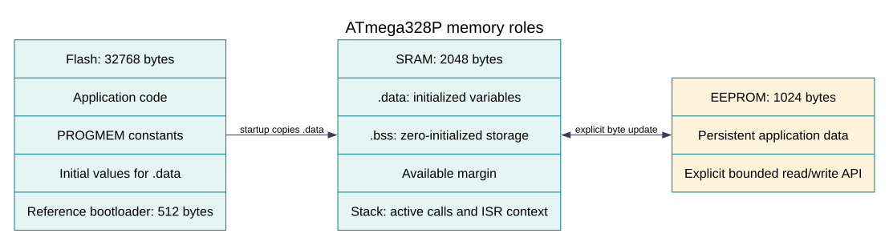

# Pointers, Registers and Address Spaces

## What You Will Learn

A pointer is a typed value that identifies the address of an object. It does not store the object's size, and it does not prove that an address is safe to use. This lesson uses a small bounded copy on the Uno to show how a pointer and a length work together.

After the lesson, you should be able to:

- Read `&object`, `*pointer` and `pointer[index]` in simple C code.
- Explain why a function needs a length as well as a pointer.
- Validate arguments before writing through a pointer.
- Distinguish SRAM, Flash constants and peripheral registers on the ATmega328P.

## Pointer Basics with an Array

Consider a three-byte array:

```c
uint8_t readings[3] = {10U, 20U, 30U};
uint8_t *next = &readings[1];
```

`&readings[1]` means “the address of element 1”. `*next` reads the value stored there, which is 20. `next[1]` uses the same indexing rule as `*(next + 1)` and refers to the third array element.

Pointer arithmetic is scaled by the pointed-to type. Adding one to a `uint8_t *` advances one byte; adding one to a `uint16_t *` advances two bytes on this device. A pointer may be compared or advanced within its array, including to one position past the end, but that one-past pointer must never be dereferenced.

## Why a Length Must Travel with a Pointer

When an array is passed to a function, C passes a pointer to its first element. The function cannot recover the original array length from that pointer. A safe interface passes the size separately:

```c
avr_status_t avr_copy_bytes(const uint8_t *source, size_t length,
                            uint8_t *destination, size_t capacity);
```

The maintained implementation in Lab 64 checks null pointers and destination capacity before it writes any byte. If the destination is too small, the function returns an error and leaves it unchanged. Its caller still has to provide a truthful `length` for the source object; C cannot automatically verify that claim.

Inside a function, `sizeof(source)` gives the size of the pointer, not the original array. Use the array's `sizeof` at the place where the array is declared, or pass the element count explicitly. For a fixed array, `sizeof array / sizeof array[0]` calculates the element count in the same scope.

## Data Memory, Flash and Registers



The ATmega328P has distinct program Flash and data memory. A normal data pointer refers to the data address space. AVR GCC uses `PROGMEM` and `pgm_read_*` helpers for many Flash-resident constants; do not treat every Flash address as an ordinary SRAM pointer. The supported compiler extensions and their use are documented in the build lessons and toolchain headers.

Peripheral registers such as `PORTB` are mapped into the data address space by the device header. The `volatile` qualifier tells the compiler that a register access has an observable hardware effect and must not be removed or cached like ordinary memory. It does not make a multi-byte operation atomic, and it does not make an invalid address safe.

## Run the Pointer Bounds Lab

Lab 64 uses the Uno's onboard D13 LED. No external wiring is required. Build the example with either compiler:

```powershell
python atmega328p-labs/tools/build.py 64-pointer-bounds --compiler gcc
python atmega328p-labs/tools/build.py 64-pointer-bounds --compiler xc8
```

The program copies three known bytes, checks that the result matches, rejects a null source, and rejects a destination that is one byte too small. D13 turns on only when the checks pass. The build command does not upload firmware; use the course's serial upload instructions after you inspect the code.

## Common Pointer Errors

- **Indexing past the array:** Check the element count before using an index.
- **Confusing bytes with elements:** `length` may mean bytes or elements; name and document it clearly.
- **Assuming a pointer reveals an array length:** It does not. Pass the size in the function call.
- **Writing through an uninitialised pointer:** Initialise it to a real object or `NULL` before use.
- **Removing `volatile` from a register:** This can let the compiler combine or omit hardware accesses.
- **Using RAM access for a Flash constant:** Use the selected AVR compiler's program-memory helpers.

## Code Walkthrough


**Example code on GitHub:**
- [Pointer and Buffer Bounds Check (`64-pointer-bounds`)](https://github.com/arnabdasbwn/atmega328p-labs/blob/main/examples/64-pointer-bounds/main.c)

### Pointer and Buffer Bounds Check
The example's `main()` configures its peripherals, runs the algorithm and reports or displays the result. These source operations are listed in execution order:

- `const uint8_t input[3] = {UINT8_C(0x12), UINT8_C(0x34), UINT8_C(0x56)};` - Stores this intermediate or output value for the next algorithm step. Check the units and range represented by each operand.
- `uint8_t output[3] = {UINT8_C(0xA5), UINT8_C(0xA5), UINT8_C(0xA5)};` - Stores this intermediate or output value for the next algorithm step. Check the units and range represented by each operand.
- `bool passed = true;` - Stores this intermediate or output value for the next algorithm step. Check the units and range represented by each operand.
- `if (avr_gpio_mode(13U, AVR_GPIO_OUTPUT) != AVR_OK)` - This checks for any setup or transfer error before the program continues. Maps the Uno header pin to its AVR port, sets its DDR direction bit and prepares the PORT latch for the requested initial level or pull-up.
- `return 1;` - Stops this path and returns the indicated status when setup or validation cannot continue.
- `passed = passed && (avr_copy_bytes(input, sizeof(input), output, sizeof(output)) == AVR_OK);` - Use the linked public header for this function's parameters, register ownership, blocking behavior and status values.
- `passed = passed && (memcmp(input, output, sizeof(input)) == 0);` - Stores this intermediate or output value for the next algorithm step. Check the units and range represented by each operand.
- `passed = passed && (avr_copy_bytes(NULL, 1U, output, sizeof(output)) == AVR_ERROR_ARGUMENT);` - Use the linked public header for this function's parameters, register ownership, blocking behavior and status values.
- `passed = passed && (avr_copy_bytes(input, sizeof(input), output, sizeof(output) - 1U) ==` - Use the linked public header for this function's parameters, register ownership, blocking behavior and status values.
- `passed =` - This statement participates in the operation sequence; follow its expression to see which state or output changes.
- `passed && (output[0] == input[0]) && (output[1] == input[1]) && (output[2] == input[2]);` - This statement participates in the operation sequence; follow its expression to see which state or output changes.
- `if (avr_gpio_write(13U, passed) != AVR_OK)` - This checks for any setup or transfer error before the program continues. Changes the pin's PORT output latch; for an input pin this selects its pull-up state.
- `for (;;)` - Repeats the foreground task indefinitely; each pass checks inputs, advances the calculation or services the peripheral shown below.

Algorithm: A pointer identifies an address but does not carry the size of the object it refers to.
Expected behaviour: The Uno onboard LED turns on after valid copy, null-source rejection and destination-capacity checks pass
**HAL source files in this repository:** [ATmega328P HAL on GitHub](https://github.com/arnabdasbwn/atmega328p-hal)

- [`include/avr_hal/gpio.h`](https://github.com/arnabdasbwn/atmega328p-hal/blob/main/include/avr_hal/gpio.h)
- [`src/gpio.c`](https://github.com/arnabdasbwn/atmega328p-hal/blob/main/src/gpio.c)


## Check Your Understanding

1. If `uint16_t *p` points to `samples[0]`, how far does `p + 1` advance in bytes?
2. Why is `sizeof(pointer)` not a safe way to find the original array length?
3. Why does Lab 64 check capacity before copying?

**Suggested answers:** It advances by one `uint16_t`, which is two bytes on the ATmega328P. A function receives a pointer and loses the array's compile-time length. Checking first prevents a partial write when the requested copy cannot fit.

## Source and Further Reading

For current device details, use the [Microchip ATmega328P documentation](https://www.microchip.com/en-us/product/ATMEGA328P). Check the document listed for your exact device and package; board-level pin labels and circuitry are covered by the [Uno R3 pinout](https://www.arnabkumardas.com/pinout/arduino-uno-r3/).
