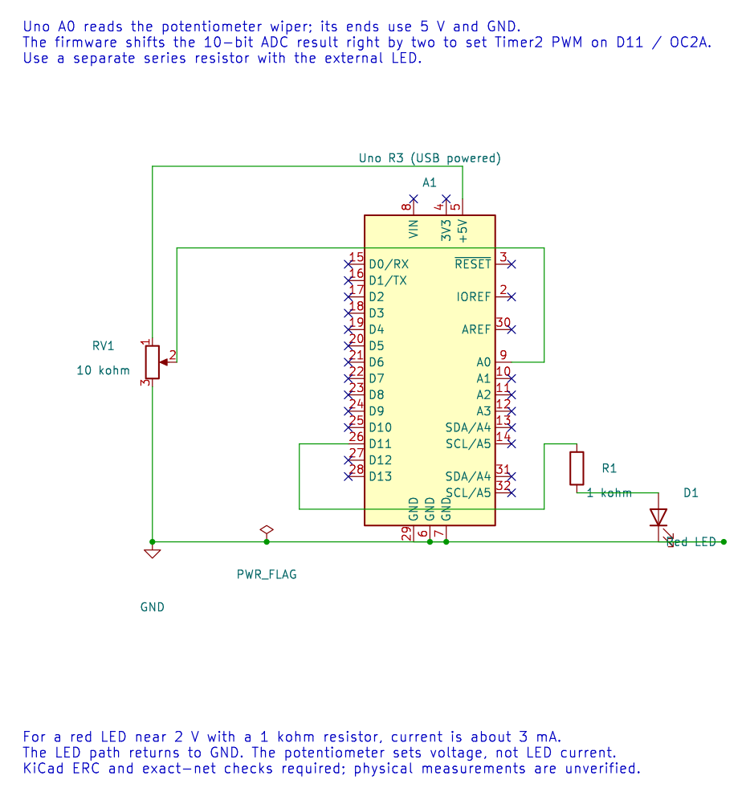

# Control LED PWM with a Potentiometer

## Read, Scale and Output

Connect a 10 kΩ potentiometer wiper to A0 and its ends to the Uno supply and ground. Connect an external LED to D11/OC2A through its own series resistor. Confirm the module or LED wiring before power-up.

The editable KiCad schematic has zero ERC findings and passes exact-net checks. Check the breadboard wiring before applying power; physical response has not been measured.

The [potentiometer PWM lab](<https://github.com/arnabdasbwn/atmega328p-labs/blob/main/examples/16-pot-pwm/main.c>) reads a 10-bit ADC code and uses the upper eight bits for an 8-bit PWM value. Shifting right by two divides the range by four: ADC values 0–3 map to duty 0, 4–7 map to duty 1, and so on through 1023 to 255.

The LED brightness should change as the knob moves. ADC noise can make the output alternate near a code boundary. A bounded average can smooth the reading, while hysteresis can reduce small reversals; both add behaviour that should be selected based on response and noise needs.

## Build and Exercise

Build with `python "atmega328p-labs/tools/build.py" 16-pot-pwm --compiler xc8`. Timer2 OC2A uses D11, not the onboard D13 LED. The source builds with both toolchains; the circuit has not been physically measured.

How many consecutive 10-bit ADC codes map to one 8-bit PWM value when the code is shifted right by two?

**Answer:** Four codes. Each group shares the same upper eight bits.

## Code Walkthrough

### ADC-controlled LED PWM
The example's `main()` configures its peripherals, runs the algorithm and reports or displays the result. These source operations are listed in execution order:

- `(void)avr_adc_init(AVR_ADC_AVCC);` - Selects the reference in ADMUX and enables the ADC in ADCSRA with a divide-by-128 prescaler. At 16 MHz, the ADC clock is 125 kHz. The HAL keeps the result right-adjusted, waits for reference settling and leaves ADC interrupts disabled.
- `(void)avr_timer_pwm8(AVR_TIMER2, 64U, 0U, 0U);` - Selects 8-bit fast PWM, connects the chosen timer compare outputs, loads OCRnA/OCRnB and starts the prescaled clock. This takes ownership of that timer and its output pins.
- `for (;;)` - Repeats the foreground task indefinitely; each pass checks inputs, advances the calculation or services the peripheral shown below.
- `if (avr_adc_read(0U, &sample, AVR_POLL_BUDGET) == AVR_OK)` - The body runs only when the conversion succeeds and its code is between 1 and 1022. The HAL selects the channel in ADMUX, disables the digital buffer through DIDR0, discards the first conversion after a channel change, and polls with a finite budget.
- `OCR2A = (uint8_t)(sample >> 2U);` - Shifts a 10-bit ADC code right by two to map 0..1023 into the 8-bit PWM range 0..255.
- `_delay_ms(10);` - Waits for the stated interval; the foreground does no other work during this blocking delay.

Algorithm: A 10-bit measurement becomes an 8-bit duty setting by discarding two least-significant bits. Four adjacent ADC codes map to one duty code.
Expected behaviour: Turning the knob changes LED brightness
**HAL source files in this repository:** [ATmega328P HAL on GitHub](https://github.com/arnabdasbwn/atmega328p-hal)

- [`include/avr_hal/adc.h`](https://github.com/arnabdasbwn/atmega328p-hal/blob/main/include/avr_hal/adc.h)
- [`include/avr_hal/timer.h`](https://github.com/arnabdasbwn/atmega328p-hal/blob/main/include/avr_hal/timer.h)
- [`src/adc.c`](https://github.com/arnabdasbwn/atmega328p-hal/blob/main/src/adc.c)
- [`src/timer.c`](https://github.com/arnabdasbwn/atmega328p-hal/blob/main/src/timer.c)

## References

- [Potentiometer-to-PWM source and wiring](<https://github.com/arnabdasbwn/atmega328p-labs/blob/main/examples/16-pot-pwm/main.c>)
- [ADC programming](adc-programming.md)
- [PWM LED control](pwm-led.md)
