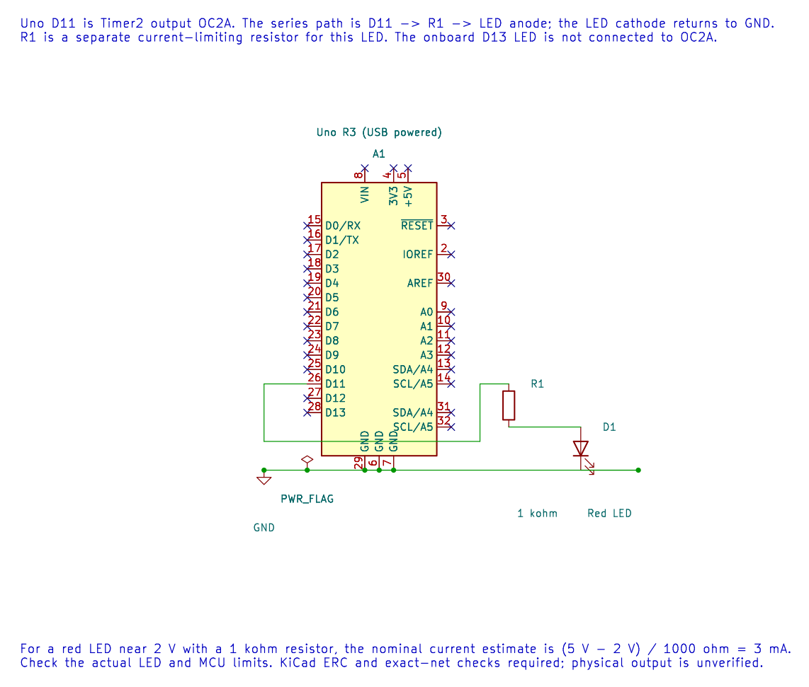

# Control LED Brightness with PWM

## PWM Controls Average Output

Pulse-width modulation (PWM) switches an output between low and high. The **duty cycle** is the fraction of each period spent high. A 25% duty cycle is high for one quarter of each period. For an LED, changing duty cycle changes average power and perceived brightness; human perception is not linear with duty.

On the Uno, the course example uses Timer2 output OC2A on D11. With fast PWM, TOP=255 and a divide-by-64 prescaler:

`f_PWM = 16,000,000 / (64 × 256) = 976.5625 Hz`

Use one series resistor for an external LED. The onboard LED is on D13 and is not connected to OC2A, so this example does not control it.

The editable KiCad schematic connects D11 through a 1 kΩ resistor and LED to ground. KiCad ERC and exact-net checks pass; this circuit has not been measured on hardware.

## Build and Observe

The [PWM LED lab](<https://github.com/arnabdasbwn/atmega328p-labs/blob/main/examples/11-pwm-led/main.c>) gradually changes the compare value, then restarts the brightness ramp. Build it with `python "atmega328p-labs/tools/build.py" 11-pwm-led --compiler xc8`. After a verified upload, observe the external LED. A scope or logic analyser shows the pulse train more clearly than the eye.

The endpoint `OCR=0` has special pulse behaviour in fast PWM. For a guaranteed off state, explicitly disconnect or configure the output as documented rather than assuming every compare endpoint produces a perfect static low.

## Exercise with Answer

Why does the onboard D13 LED not follow the D11 PWM waveform?

**Answer:** D11 maps to Timer2 OC2A. D13 is a separate GPIO pin and has no connection to that output-compare channel on the Uno R3.

## Code Walkthrough

### PWM LED brightness
The example's `main()` configures its peripherals, runs the algorithm and reports or displays the result. These source operations are listed in execution order:

- `(void)avr_timer_pwm8(AVR_TIMER2, 64U, 0U, 0U);` - Selects 8-bit fast PWM, connects the chosen timer compare outputs, loads OCRnA/OCRnB and starts the prescaled clock. This takes ownership of that timer and its output pins.
- `for (;;)` - Repeats the foreground task indefinitely; each pass checks inputs, advances the calculation or services the peripheral shown below.
- `for (uint16_t duty = 1U; duty < 255U; ++duty)` - Repeats while `duty < 255U` is true; `uint16_t duty = 1U` sets the starting state and `++duty` advances it each pass.
- `OCR2A = (uint8_t)duty;` - Timer2 Compare A sets the match point or PWM duty value, depending on the selected mode.
- `_delay_ms(10);` - Waits for the stated interval; the foreground does no other work during this blocking delay.

Algorithm: Fast PWM frequency is 16 MHz / 64 / 256 = 976.5625 Hz. Average power changes with duty; perception is nonlinear. Endpoint OCR=0 has special pulse behavior.
Expected behaviour: External LED smoothly increases brightness then restarts
**HAL source files in this repository:** [ATmega328P HAL on GitHub](https://github.com/arnabdasbwn/atmega328p-hal)

- [`include/avr_hal/timer.h`](https://github.com/arnabdasbwn/atmega328p-hal/blob/main/include/avr_hal/timer.h)
- [`src/timer.c`](https://github.com/arnabdasbwn/atmega328p-hal/blob/main/src/timer.c)

## References

- [PWM LED source and wiring record](<https://github.com/arnabdasbwn/atmega328p-labs/blob/main/examples/11-pwm-led/main.c>)
- [Timer2 overview](timer2.md)
- [ATmega328P product documentation](https://www.microchip.com/en-us/product/ATMEGA328P), PWM modes and output compare.
