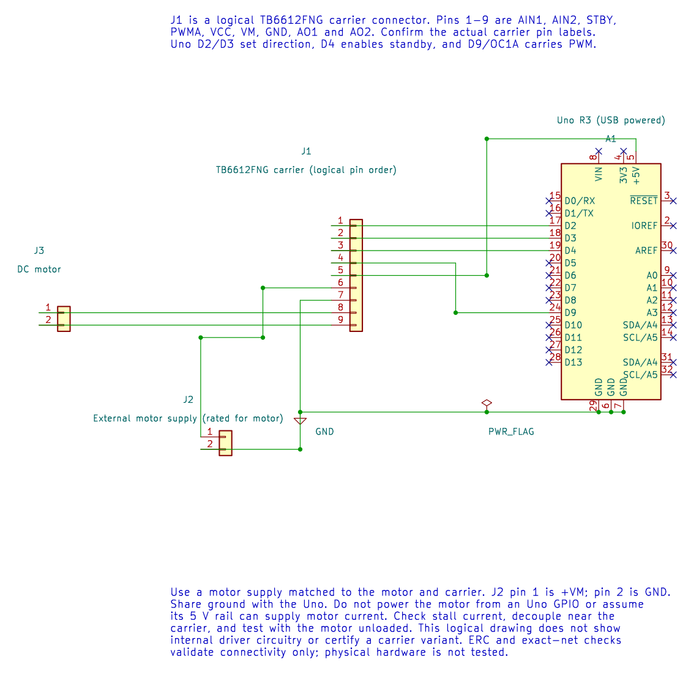

# Control a DC Motor with PWM

## What You Will Learn

- Explain why a motor needs a driver between it and the Uno.
- Trace the direction and PWM signals from Uno pins to a TB6612FNG carrier.
- Estimate PWM frequency and duty from the timer settings.
- Identify the current, voltage and Timer1 limits that matter before testing.

You should know basic GPIO and PWM from [Timer1](timer1.md) and [PWM LED example](pwm-led.md). The experiment uses an Uno R3, a TB6612FNG carrier with a verified pinout, a small brushed DC motor, a regulated motor supply, and suitable decoupling capacitors. The motor supply must match the motor and carrier.

## Keep Motor Current Out of the GPIO Pin

An Uno pin provides a logic signal. It cannot safely supply the current a motor needs, especially when the motor starts or stalls. The TB6612FNG switches current from the external motor supply while the Uno controls direction and PWM.



The drawing treats the carrier as a logical connector because breakout boards place their pins differently. Match the labels on your board; do not copy a physical connector position from the image.

| Uno R3 Pin | TB6612FNG Signal | Purpose |
| --- | --- | --- |
| D2 | AIN1 | Direction input 1 |
| D3 | AIN2 | Direction input 2 |
| D4 | STBY | Driver standby control |
| D9 / OC1A | PWMA | Timer1 PWM output |
| Uno 5 V | VCC | Logic supply, only when supported by the carrier |
| External motor supply + | VM | Motor supply |
| Uno GND and supply negative | GND | Shared reference |
| Motor leads | AO1 and AO2 | Driver outputs to the motor |

Check the carrier datasheet as well as the driver IC datasheet: some boards add connectors, regulators or protection components. Check the motor's stall current, which can be much higher than its no-load running current. Secure the motor, leave the mechanical load off for the first test, and fit the board-recommended decoupling near the driver. Never connect a motor to an Uno GPIO pin.

## Duty Cycle Is Not a Speed Command

PWM switches the motor supply quickly. The duty cycle is the fraction of each PWM period that the output is high. For this example, Timer1 uses 8-bit Fast PWM with a prescaler of 64. At the Uno's 16 MHz clock:

```text
PWM frequency = 16,000,000 / (64 * 256), about 977 Hz
duty at OCR1A = 128 / 256 = 50%
```

This is a useful estimate, not a speed setting. Motor speed also depends on supply voltage, driver losses, load and friction. Starting torque can be higher than the torque needed to keep a spinning motor moving. To regulate speed, add a sensor such as an encoder and use feedback; PWM by itself is open-loop control.

The [TB6612FNG example](<https://github.com/arnabdasbwn/atmega328p-labs/blob/main/examples/28-motor/main.c>) sets AIN1 high, AIN2 low and STBY high. It then writes 128 to OCR1A for one second, writes zero for one second, and repeats. The example does not reverse direction. It uses Timer1 PWM on D9, so it cannot share Timer1 with the servo example in the same build without redesigning timer ownership.

## Build and Observe

From the course root, build the maintained example with XC8:

```powershell
python "atmega328p-labs/tools/build.py" 28-motor --compiler xc8
```

The same experiment can also be built with AVR GCC by selecting `--compiler gcc`. Both builds are software checks. They do not test motor current, wiring, rotation or temperature.

Before connecting the motor supply, check each wire against the table, confirm the carrier's VCC and VM limits, confirm common ground, and measure the supply voltage. Then apply power with the motor unloaded. The expected pattern is one second of forward drive followed by one second with PWM set to zero. The driver remains out of standby during the stop interval, so zero PWM is not the same as disconnecting the motor leads.

## Code Walkthrough

### TB6612FNG DC motor PWM
The example's `main()` configures its peripherals, runs the algorithm and reports or displays the result. These source operations are listed in execution order:

- `(void)avr_gpio_mode(2U, AVR_GPIO_OUTPUT);` - Maps the Uno header pin to its AVR port, sets its DDR direction bit and prepares the PORT latch for the requested initial level or pull-up.
- `(void)avr_gpio_mode(3U, AVR_GPIO_OUTPUT);` - Maps the Uno header pin to its AVR port, sets its DDR direction bit and prepares the PORT latch for the requested initial level or pull-up.
- `(void)avr_gpio_mode(4U, AVR_GPIO_OUTPUT);` - Maps the Uno header pin to its AVR port, sets its DDR direction bit and prepares the PORT latch for the requested initial level or pull-up.
- `(void)avr_timer_pwm8(AVR_TIMER1, 64U, 0U, 0U);` - Selects 8-bit fast PWM, connects the chosen timer compare outputs, loads OCRnA/OCRnB and starts the prescaled clock. This takes ownership of that timer and its output pins.
- `(void)avr_gpio_write(2U, true);` - Changes the pin's PORT output latch; for an input pin this selects its pull-up state.
- `(void)avr_gpio_write(3U, false);` - Changes the pin's PORT output latch; for an input pin this selects its pull-up state.
- `(void)avr_gpio_write(4U, true);` - Changes the pin's PORT output latch; for an input pin this selects its pull-up state.
- `for (;;)` - Repeats the foreground task indefinitely; each pass checks inputs, advances the calculation or services the peripheral shown below.
- `OCR1A = 128U;` - Timer1 Compare A sets the match point or PWM pulse width, depending on the selected mode.
- `_delay_ms(1000);` - Waits for the stated interval; the foreground does no other work during this blocking delay.
- `OCR1A = 0U;` - Timer1 Compare A sets the match point or PWM pulse width, depending on the selected mode.

Algorithm: PWM controls applied average voltage; it does not directly regulate speed. Check stall current against the driver and supply. Direction changes require a deliberate stop/dead-time policy.
Expected behaviour: Motor runs forward for one second then stops for one second
**HAL source files in this repository:** [ATmega328P HAL on GitHub](https://github.com/arnabdasbwn/atmega328p-hal)

- [`include/avr_hal/gpio.h`](https://github.com/arnabdasbwn/atmega328p-hal/blob/main/include/avr_hal/gpio.h)
- [`include/avr_hal/timer.h`](https://github.com/arnabdasbwn/atmega328p-hal/blob/main/include/avr_hal/timer.h)
- [`src/gpio.c`](https://github.com/arnabdasbwn/atmega328p-hal/blob/main/src/gpio.c)
- [`src/timer.c`](https://github.com/arnabdasbwn/atmega328p-hal/blob/main/src/timer.c)


## Common Problems

- **The motor does not move:** Check VM, common ground, STBY, motor connections and the carrier's actual pin labels. A supply limit or a high-friction load can prevent starting.
- **The Uno resets:** The motor supply may sag or inject noise. Check supply capacity, grounding and the carrier's decoupling guidance.
- **The driver becomes hot:** Stop the test. Check stall current, load, wiring and the carrier's thermal limits before trying again.
- **Another timer example stops working:** Both examples may claim Timer1. Use separate builds or choose a design with explicit timer ownership.

## Try It Yourself

Why can a motor fail to start at 50% PWM while continuing to spin at that duty once it is moving?

**Answer:** Starting torque must overcome static friction and the load. At 50% PWM, the available current or torque may be too low to start the motor. Once it is moving, less torque may be enough to keep it turning.

## References

- [TB6612FNG motor lab and wiring record](<https://github.com/arnabdasbwn/atmega328p-labs/blob/main/examples/28-motor/main.c>)
- [Toshiba TB6612FNG datasheet](https://toshiba.semicon-storage.com/info/TB6612FNG_datasheet_en_20141001.pdf?did=10660&prodName=TB6612FNG). Check the breakout board and motor datasheets too; IC ratings do not guarantee the same ratings for every module or motor.
- [Timer1 and shared resource ownership](timer1.md)
- Editable KiCad schematic, ERC report and exported netlist
