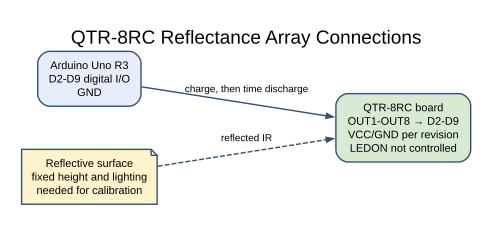
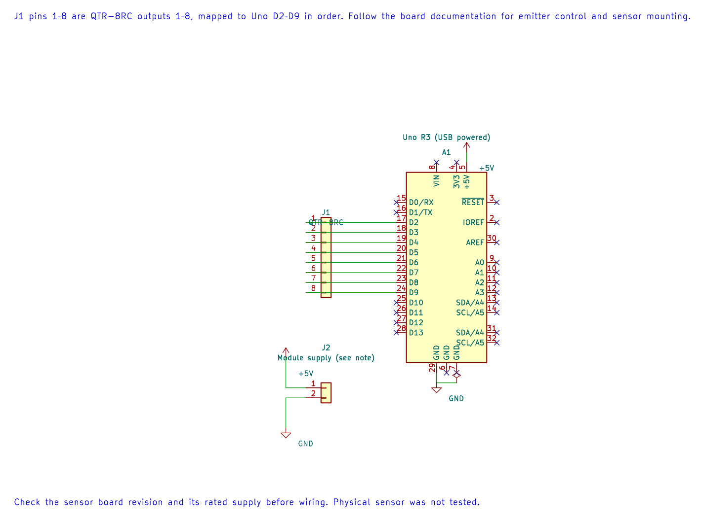

# QTR-8RC Reflectance Sensor Array

## What You Will Learn

The QTR-8RC uses infrared LEDs and phototransistors to sense reflected light. Each output behaves like an RC node: the Uno first charges it high, then changes the pin to input and measures how long it takes to fall low. A dark surface usually produces a longer discharge than a bright surface, but the result depends on sensor height, surface and room lighting.

## Wiring

Lab 42 connects the eight sensor outputs to consecutive Uno pins D2–D9. Connect the sensor supply and ground according to the exact QTR board documentation. Some revisions expose emitter control separately; this example does not control an emitter-enable pin.

| QTR-8RC signal | Uno R3 | Purpose |
| --- | --- | --- |
| OUT1–OUT8 | D2–D9 in order | RC discharge outputs |
| VCC | Board-rated supply | Sensor and emitter supply |
| GND | GND | Shared reference |
| LEDON / emitter control, if present | Follow module documentation | Not controlled by this example |

Check the board revision and pin labels before connecting. The outputs are used as digital I/O, not as ADC voltages.

## How the Timing Measurement Works





The editable KiCad pin map shows the eight output connections and supply reference. Check the board revision and supply limits before wiring.

For each sample, the program configures all eight pins as outputs and drives them high. After 10 µs, it switches them to inputs and polls for up to 2,000 loop ticks. When a channel first reads low, its tick count is stored. The program prints eight comma-separated counts.

These are relative loop counts, not microseconds. Their scale depends on compiler code generation and loop work. A channel that never goes low keeps the maximum value 2,000. The example does not calibrate the array, compute a line position or control a robot.

## Build and Try the Lab

```powershell
python atmega328p-labs/tools/build.py 42-qtr8rc --compiler gcc
python atmega328p-labs/tools/build.py 42-qtr8rc --compiler xc8
```

Place the array at a fixed height over a white surface, record all eight values, then move a dark strip under one sensor at a time. Use the readings to find the active channel order. Repeat after fixing the height and lighting; calibration values from one setup may not work in another.

## Code Walkthrough

### QTR-8RC discharge timing
The example's `main()` configures its peripherals, runs the algorithm and reports or displays the result. These source operations are listed in execution order:

- `(void)avr_uart_init(9600UL);` - Configures USART0 for asynchronous 8N1. It chooses a baud divisor and normal/double-speed mode, programs UBRR0/UCSR0A/UCSR0C, then enables receive and transmit in UCSR0B.
- `for (;;)` - Repeats the foreground task indefinitely; each pass checks inputs, advances the calculation or services the peripheral shown below.
- `for (uint8_t i = 0U; i < 8U; ++i)` - Repeats while `i < 8U` is true; `uint8_t i = 0U` sets the starting state and `++i` advances it each pass.
- `duration[i] = 2000U;` - Stores this intermediate or output value for the next algorithm step. Check the units and range represented by each operand.
- `(void)avr_gpio_mode((uint8_t)(i + 2U), AVR_GPIO_OUTPUT);` - Maps the Uno header pin to its AVR port, sets its DDR direction bit and prepares the PORT latch for the requested initial level or pull-up.
- `(void)avr_gpio_write((uint8_t)(i + 2U), true);` - Changes the pin's PORT output latch; for an input pin this selects its pull-up state.
- `_delay_us(10);` - Waits for the stated interval; the foreground does no other work during this blocking delay.
- `(void)avr_gpio_mode((uint8_t)(i + 2U), AVR_GPIO_INPUT);` - Maps the Uno header pin to its AVR port, sets its DDR direction bit and prepares the PORT latch for the requested initial level or pull-up.
- `for (uint16_t tick = 0U; tick < 2000U; ++tick)` - Repeats while `tick < 2000U` is true; `uint16_t tick = 0U` sets the starting state and `++tick` advances it each pass.
- `(void)avr_gpio_read((uint8_t)(i + 2U), &high);` - Reads the electrical level through PINx without changing direction or the output latch.
- `if (!high && duration[i] == 2000U)` - Tests this condition to choose which algorithm path runs.
- `duration[i] = tick;` - Stores this intermediate or output value for the next algorithm step. Check the units and range represented by each operand.
- `(void)avr_uart_u16(duration[i]);` - Formats an unsigned integer as decimal digits and sends them on USART0; it does not add a newline.
- `(void)avr_uart_put(i == 7U ? '\n' : ',', AVR_POLL_BUDGET);` - Waits for the USART transmit buffer within its poll budget, then writes the byte to UDR0.
- `_delay_ms(50);` - Waits for the stated interval; the foreground does no other work during this blocking delay.

Algorithm: The sensor measures discharge time, not ADC voltage. This baseline reports loop counts, not microseconds. Calibrate minima/maxima at the installed height and lighting before computing line position.
Expected behaviour: Eight relative discharge-loop counts differ over light and dark surfaces
**HAL source files in this repository:** [ATmega328P HAL on GitHub](https://github.com/arnabdasbwn/atmega328p-hal)

- [`include/avr_hal/gpio.h`](https://github.com/arnabdasbwn/atmega328p-hal/blob/main/include/avr_hal/gpio.h)
- [`include/avr_hal/uart.h`](https://github.com/arnabdasbwn/atmega328p-hal/blob/main/include/avr_hal/uart.h)
- [`src/gpio.c`](https://github.com/arnabdasbwn/atmega328p-hal/blob/main/src/gpio.c)
- [`src/uart.c`](https://github.com/arnabdasbwn/atmega328p-hal/blob/main/src/uart.c)


## Common Problems

- **All channels report 2,000:** Check power, ground and output pin order; the voltage did not fall within the polling window.
- **Readings swap order:** Check whether your board labels OUT1 at the left or right end.
- **Counts change with height:** Reflectance and distance both affect the phototransistor current; keep the mechanical height fixed.
- **A line follower loses the track:** This raw example does not implement calibration, line-position calculation or recovery behavior.

## Check Your Understanding

1. Why is this an RC timing sensor rather than an analogue voltage measurement?
2. What does the reported value 2,000 mean?
3. Why must calibration use the final sensor height and lighting?

**Suggested answers:** The firmware times a digital input's fall from high to low after charging it. It means no low transition was observed within the polling bound. Surface reflection and geometry change the discharge time, so calibration is specific to the installed setup.

## Source and Further Reading

- [Lab 42 source](<https://github.com/arnabdasbwn/atmega328p-labs/blob/main/examples/42-qtr8rc/main.c>)
- Check the exact QTR-8RC revision's Pololu user guide for pinout, supply and emitter-control behavior.
- [ATmega328P Documentation](https://www.microchip.com/en-us/product/ATMEGA328P), GPIO section.
