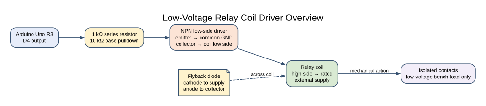
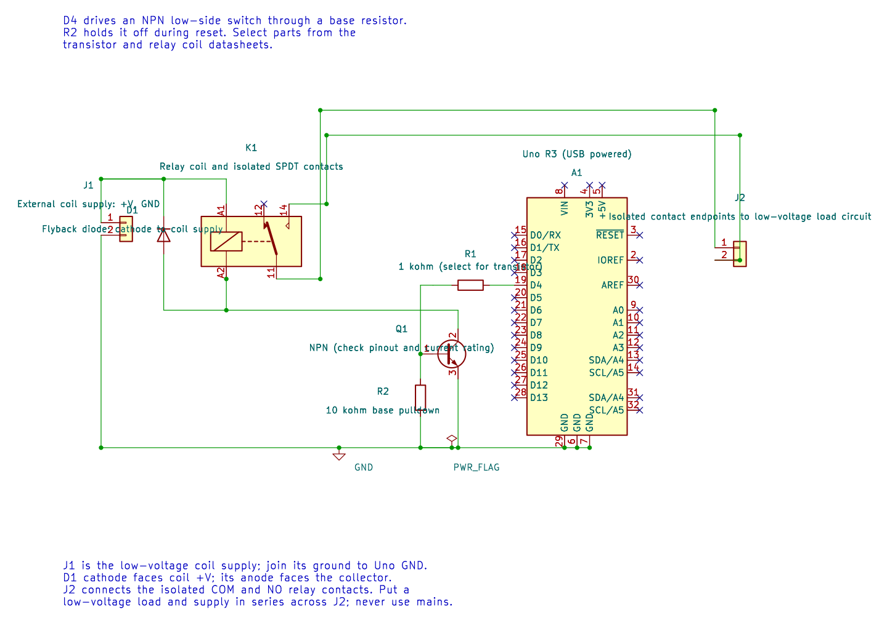

# Relay Module and Transistor Driver

## What You Will Learn

A relay uses a coil to move an isolated set of contacts. The Uno output pin cannot supply the coil current, so Lab 33 controls an NPN transistor that acts as a switch. A diode across the coil provides a path for its stored magnetic energy when the transistor turns off.

## Parts and Low-Voltage Wiring

Use a relay coil whose voltage and current match the external supply and driver. The lab output pin is D4. The wiring below is for a discrete NPN low-side driver; a relay module may use a different input circuit, so check its schematic and input polarity.

| Uno or part | Connection | Purpose |
| --- | --- | --- |
| D4 | 1 kΩ resistor to NPN base | Limits base current |
| NPN emitter | Common GND | Return path |
| NPN collector | Relay coil low side | Switches coil current |
| Relay coil high side | External coil supply | Provides coil power |
| 10 kΩ resistor | NPN base to emitter | Keeps the driver off during reset |
| Flyback diode | Across coil; cathode to supply, anode to collector | Limits inductive turn-off voltage |
| Uno GND and supply GND | Join at the low-voltage driver | Provides a shared control reference |

The relay contacts are electrically separate from the coil. In this exercise, use them only to switch a low-voltage battery-powered LED or other safe bench load. Do not wire mains voltage. Check the transistor pinout and coil current before assembly; resistor values must be selected for the chosen part, not copied blindly to a different relay.

## How the Example Behaves



Lab 33 configures D4 as an output, turns the coil driver on for one second and leaves it off for two seconds. The program controls the coil only; it does not read a sensor or use the relay contacts as a feedback input.

At reset, the Uno pins start as inputs. The base pulldown keeps the transistor off until firmware configures and drives D4. This default matters because an accidental pulse can turn on a pump, lock or motor in a real design.


### KiCad Connection Drawing



Open the editable KiCad schematic or its pin map. The drawing has passed ERC and exact-net checks; the physical circuit has not been tested.

## Build and Observe

```powershell
python atmega328p-labs/tools/build.py 33-relay --compiler gcc
python atmega328p-labs/tools/build.py 33-relay --compiler xc8
```

Build validation passes. If you assemble the low-voltage circuit, first test the driver with the coil disconnected and measure D4. Then connect a correctly rated coil, confirm the diode orientation and current limit, and only then test the contact-side LED load. The relay click and coil voltage have not been physically verified in this course workspace.

## Common Problems and Safety

- **Uno resets when the coil switches:** Check the external supply, decoupling and common-ground wiring. Do not power the coil from an Uno GPIO.
- **The transistor heats:** Confirm base drive, coil current, transistor pinout and device ratings.
- **The relay chatters:** Check supply stability and whether the contacts are switching a load that disturbs the control supply.
- **The contacts do not switch:** Check the selected normally-open or normally-closed terminals and continuity with power removed.
- **A module claims “5 V input”:** Check its actual input circuit and active polarity; the module label alone does not describe every clone.

## Code Walkthrough

### Low-voltage relay driver
The example's `main()` configures its peripherals, runs the algorithm and reports or displays the result. These source operations are listed in execution order:

- `(void)avr_gpio_mode(4U, AVR_GPIO_OUTPUT);` - Maps the Uno header pin to its AVR port, sets its DDR direction bit and prepares the PORT latch for the requested initial level or pull-up.
- `for (;;)` - Repeats the foreground task indefinitely; each pass checks inputs, advances the calculation or services the peripheral shown below.
- `(void)avr_gpio_write(4U, true);` - Changes the pin's PORT output latch; for an input pin this selects its pull-up state.
- `_delay_ms(1000);` - Waits for the stated interval; the foreground does no other work during this blocking delay.
- `(void)avr_gpio_write(4U, false);` - Changes the pin's PORT output latch; for an input pin this selects its pull-up state.
- `_delay_ms(2000);` - Waits for the stated interval; the foreground does no other work during this blocking delay.

Algorithm: A coil is an inductive load. The transistor supplies coil current and the diode provides a path when that current is interrupted. GPIO alone cannot drive the coil.
Expected behaviour: Relay energizes one second and rests two seconds
**HAL source files in this repository:** [ATmega328P HAL on GitHub](https://github.com/arnabdasbwn/atmega328p-hal)

- [`include/avr_hal/gpio.h`](https://github.com/arnabdasbwn/atmega328p-hal/blob/main/include/avr_hal/gpio.h)
- [`src/gpio.c`](https://github.com/arnabdasbwn/atmega328p-hal/blob/main/src/gpio.c)


## Check Your Understanding

1. Why does the relay coil need a transistor driver?
2. What happens to the diode polarity if it is installed backwards across the coil?
3. What state should the driver have while the Uno is resetting?

**Suggested answers:** The coil current exceeds what a GPIO pin should deliver. A backwards diode may conduct continuously and short the supply when the transistor is on. The external pulldown should hold the transistor off until firmware deliberately enables it.

## Source and Further Reading

- [Lab 33 source](<https://github.com/arnabdasbwn/atmega328p-labs/blob/main/examples/33-relay/main.c>)
- Check the selected relay, transistor and diode datasheets for coil current, contact rating, pinout and thermal limits.
- [ATmega328P Documentation](https://www.microchip.com/en-us/product/ATMEGA328P), GPIO reset-state details.
