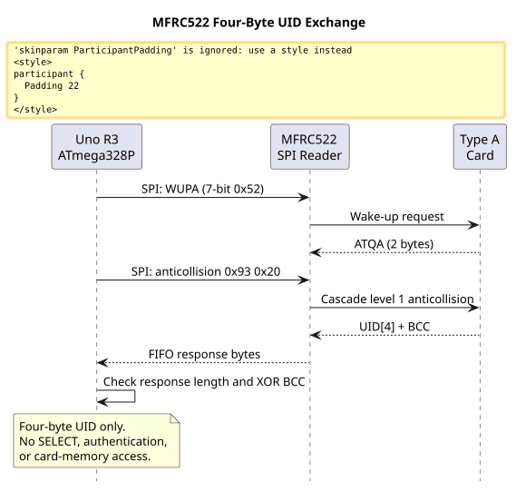
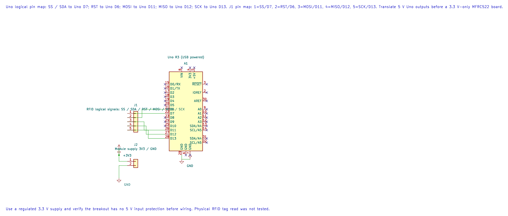
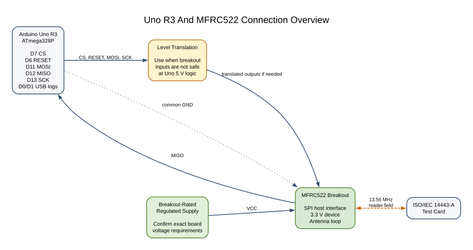

# MFRC522 RFID UID Reader

## Learning Goals

This lesson uses an MFRC522 breakout to request a nearby ISO/IEC 14443-A card and read one four-byte UID. You will see how the Uno controls the reader over SPI, how anticollision returns identifier bytes, and why an identifier is not a secure credential.

The MFRC522 handles the radio modulation and card communication, while the ATmega328P configures its registers and reads response bytes. The example stops after checking the four-byte cascade-level-one UID and its block check character (BCC). It does not select the card, authenticate, or access card memory.

## Reader and Card Exchange

The program sends WUPA, a seven-bit wake-up command. The reader returns ATQA when a compatible Type A card responds. The program then sends the cascade-level-one anticollision command, `0x93 0x20`. A single four-byte UID response contains four UID bytes plus a BCC byte. The driver checks that the BCC equals the XOR of the four UID bytes.

This subset deliberately stops there. A cascade tag (`0x88`) means the UID continues at another cascade level; the driver returns `AVR_ERROR_UNSUPPORTED` instead of reporting a partial UID. When two cards respond together, the driver reports a collision. Full selection, cascade resolution, authentication and memory commands belong in later work.





The editable KiCad pin map records the Uno-side assignments. Verify the reader board and translate 5 V signals before connecting to a 3.3 V-only module.

### A UID Is Not Authentication

A card UID is visible during the protocol and may be copied or emulated by other devices. It can be useful as an inventory label, but it must not be the only check for a lock, payment or account access. Real access control needs a supported cryptographic protocol, managed keys, threat analysis and a secure backend. Do not use this teaching example for a safety or security boundary.

## Parts and Wiring

Use an Uno R3, an MFRC522-compatible breakout and a Type A test card. The MFRC522 IC is a low-voltage part. Common RC522 boards use a 3.3 V supply and may not include 5 V input translation. Check the exact breakout's schematic and pin labels; do not assume every board carrying “RC522” is identical.

| Uno R3 Pin | Reader Pin | Purpose |
| --- | --- | --- |
| D7 | SDA / SS / NSS | SPI chip select; the board may label it `SDA`. |
| D6 | RST / NRSTPD | Hardware reset and power-down control. |
| D11 / MOSI | MOSI | Commands and register data from Uno to reader. |
| D12 / MISO | MISO | Register and FIFO data from reader to Uno. |
| D13 / SCK | SCK | SPI clock. |
| Regulated 3.3 V rail | 3.3V / VCC | Use the exact breakout's rated input. |
| GND | GND | Shared signal reference. |

Use level translation for Uno output signals unless the exact breakout documentation confirms they are safe at 5 V. The HAL keeps D10 as an output for hardware SPI controller mode; this project uses D7 for the reader's chip select. D0/D1 stay connected to the Uno USB-serial bridge for 9600-baud UID logs because the reader uses SPI, not the hardware USART.



## Build and Run Lab 60

The maintained driver is [`mfrc522.h`](https://github.com/arnabdasbwn/atmega328p-hal/blob/main/lib/drivers/mfrc522.h) and [`mfrc522.c`](https://github.com/arnabdasbwn/atmega328p-hal/blob/main/lib/drivers/mfrc522.c). The Uno example is [`60-mfrc522-uid`](https://github.com/arnabdasbwn/atmega328p-labs/blob/main/examples/60-mfrc522-uid/main.c). Build with either installed compiler:

```powershell
python atmega328p-labs/tools/build.py 60-mfrc522-uid --compiler gcc
python atmega328p-labs/tools/build.py 60-mfrc522-uid --compiler xc8
```

Upload the program, connect the reader after checking its supply and logic levels, and open a 9600-baud serial monitor. Present a supported four-byte tag. The program should print a line such as `UID: 04A1B2C3` once. Removing the tag clears its last-seen state; presenting it again prints the UID again. The example reports collision, unsupported UID length and reader communication errors separately.

The driver uses bounded polling for the MFRC522 IRQ register and a hardware timer for card-response timeout. It stores the five-byte anticollision response in a small fixed buffer. Caller UID storage is updated only after the response length and BCC pass.

## Troubleshooting

- If the reader never returns register data, verify SPI mode, D7 chip select, D6 reset, and MOSI/MISO/SCK wiring.
- If setup returns an SPI error, check the reader supply and logic levels first. A module powered from 5 V may be damaged if it expects 3.3 V.
- If no UID appears, test with a supported Type A card near the antenna and confirm that the module antenna is not damaged or detuned.
- If multiple cards are close to the antenna, the anticollision exchange may report a collision. Present one card at a time; this example does not walk the full collision tree.
- If the driver reports an unsupported UID form, it may be a seven-byte or ten-byte UID that needs additional cascade handling.

## Exercises

1. What does the BCC check protect against, and what does it not prove?
2. Why does this driver stop when the first UID byte is the cascade tag `0x88`?
3. Why should a project not grant access based only on the UID printed by this example?

**Suggested answers:** The XOR BCC catches some response corruption; it is not cryptographic integrity or proof of card identity. `0x88` means the UID uses another cascade level, which this implementation does not parse. UIDs can be observed and copied, so a real system needs cryptographic authentication and a managed security design.

## Validation and References

Lab 60 builds with AVR GCC and XC8. The [95-mfrc522-uid-test fixture](https://github.com/arnabdasbwn/atmega328p-labs/blob/main/examples/95-mfrc522-uid-test/main.c) supplies scripted register and card responses to check UID parsing and error handling. No MFRC522 reader or card was available, so the antenna, SPI electrical levels and real card response have not been physically tested.

The [NXP MFRC522 datasheet](https://www.nxp.com/docs/en/data-sheet/MFRC522.pdf) describes SPI and ISO/IEC 14443-A support. NXP's [product page](https://www.nxp.com/products/rfid-nfc/nfc-hf/nfc-readers/standard-performance-mifare-and-ntag-frontend%3AMFRC52202HN1) recommends a newer part for new designs; this course keeps MFRC522 as a common learning module, not a new-product recommendation.

- [ATmega328P Device Documentation](https://www.microchip.com/en-us/product/ATMEGA328P)
- [Uno R3 Pinout](https://www.arnabkumardas.com/pinout/arduino-uno-r3/)

## Code Walkthrough

### MFRC522 Four-Byte UID Reader
The example's `main()` configures its peripherals, runs the algorithm and reports or displays the result. These source operations are listed in execution order:

- `avr_mfrc522_t reader;` - Use the linked public header for this function's parameters, register ownership, blocking behavior and status values.
- `if (avr_uart_init(9600UL) != AVR_OK)` - This checks for any setup or transfer error before the program continues. Configures USART0 for asynchronous 8N1. It chooses a baud divisor and normal/double-speed mode, programs UBRR0/UCSR0A/UCSR0C, then enables receive and transmit in UCSR0B.
- `return 1;` - Stops this path and returns the indicated status when setup or validation cannot continue.
- `if (avr_mfrc522_init(&reader, 7U, 6U) != AVR_OK)` - This checks for any setup or transfer error before the program continues. Initialises the MFRC522 over SPI using the provided chip-select and reset pins.
- `if (avr_mfrc522_print_text("MFRC522 setup failed\r\n") != AVR_OK)` - This checks for any setup or transfer error before the program continues. Use the linked public header for this function's parameters, register ownership, blocking behavior and status values.
- `return 2;` - Stops this path and returns the indicated status when setup or validation cannot continue.
- `uint8_t last_uid[AVR_MFRC522_UID_LENGTH] = {0U, 0U, 0U, 0U};` - Stores this intermediate or output value for the next algorithm step. Check the units and range represented by each operand.
- `bool have_last_uid = false;` - Stores this intermediate or output value for the next algorithm step. Check the units and range represented by each operand.
- `for (;;)` - Repeats the foreground task indefinitely; each pass checks inputs, advances the calculation or services the peripheral shown below.
- `const avr_status_t status = avr_mfrc522_read_uid(&reader, uid, UINT16_C(5000));` - Requests and validates a supported card UID; absent, unsupported or ambiguous card responses return an error status.
- `if (status == AVR_OK)` - Only enters the following block when the operation reports success.
- `bool changed = !have_last_uid;` - Stores this intermediate value for the next step of the algorithm; check the operands and units.
- `for (uint8_t index = 0U; index < AVR_MFRC522_UID_LENGTH; index++)` - Repeats while `index < AVR_MFRC522_UID_LENGTH` is true; `uint8_t index = 0U` initializes the loop and `index++` advances it.
- `changed = changed || (uid[index] != last_uid[index]);` - Stores this intermediate value for the next step of the algorithm; check the operands and units.
- `if (changed)` - Tests this condition to choose which algorithm path runs.
- `if (avr_mfrc522_print_text("UID: ") != AVR_OK)` - Takes the error path if setup or transfer fails.
- `if (avr_mfrc522_print_hex(uid[index]) != AVR_OK)` - Takes the error path if setup or transfer fails.
- `last_uid[index] = uid[index];` - Stores this intermediate value for the next step of the algorithm; check the operands and units.
- `if (avr_mfrc522_print_text("\r\n") != AVR_OK)` - Takes the error path if setup or transfer fails.
- `have_last_uid = true;` - Stores this intermediate value for the next step of the algorithm; check the operands and units.
- `else if ((status == AVR_ERROR_UNSUPPORTED) || (status == AVR_ERROR_BUSY))` - This statement advances the operation sequence; follow its expression to see the state change.
- `if (avr_mfrc522_print_text("Unsupported UID length or multiple tags\r\n") != AVR_OK)` - Takes the error path if setup or transfer fails.
- `have_last_uid = false;` - Stores this intermediate or output value for the next algorithm step. Check the units and range represented by each operand.
- `else if (status == AVR_ERROR_TIMEOUT)` - This statement participates in the operation sequence; follow its expression to see which state or output changes.
- `if (avr_mfrc522_print_text("Reader communication error\r\n") != AVR_OK)` - This checks for any setup or transfer error before the program continues. Use the linked public header for this function's parameters, register ownership, blocking behavior and status values.
- `_delay_ms(100);` - Waits for the stated interval; the foreground does no other work during this blocking delay.

Algorithm: WUPA wakes Type A cards, anticollision returns cascade-level UID bytes, and the BCC detects a simple response error.
Expected behaviour: Serial output reports a supported four-byte UID once while a tag is present
**HAL source files in this repository:** [ATmega328P HAL on GitHub](https://github.com/arnabdasbwn/atmega328p-hal)

- [`include/avr_hal/uart.h`](https://github.com/arnabdasbwn/atmega328p-hal/blob/main/include/avr_hal/uart.h)
- [`lib/drivers/mfrc522.c`](https://github.com/arnabdasbwn/atmega328p-hal/blob/main/lib/drivers/mfrc522.c)
- [`lib/drivers/mfrc522.h`](https://github.com/arnabdasbwn/atmega328p-hal/blob/main/lib/drivers/mfrc522.h)
- [`src/uart.c`](https://github.com/arnabdasbwn/atmega328p-hal/blob/main/src/uart.c)


### MFRC522 UID Parser Fixture
The example's `main()` configures its peripherals, runs the algorithm and reports or displays the result. These source operations are listed in execution order:

- `avr_mfrc522_t reader;` - Use the linked public header for this function's parameters, register ownership, blocking behavior and status values.
- `if (avr_uart_init(9600UL) != AVR_OK)` - This checks for any setup or transfer error before the program continues. Configures USART0 for asynchronous 8N1. It chooses a baud divisor and normal/double-speed mode, programs UBRR0/UCSR0A/UCSR0C, then enables receive and transmit in UCSR0B.
- `return 1;` - Stops this path and returns the indicated status when setup or validation cannot continue.
- `if (avr_mfrc522_init(&reader, 7U, 6U) != AVR_OK)` - This checks for any setup or transfer error before the program continues. Initialises the MFRC522 over SPI using the provided chip-select and reset pins.
- `if (avr_uart_write((const uint8_t *)"FAIL\n", 5U, AVR_POLL_BUDGET) != AVR_OK)` - This checks for any setup or transfer error before the program continues. Sends the specified bytes through USART0; a timeout can occur after a prefix has already been sent.
- `return 2;` - Stops this path and returns the indicated status when setup or validation cannot continue.
- `uint8_t uid[AVR_MFRC522_UID_LENGTH] = {0U, 0U, 0U, 0U};` - Stores this intermediate or output value for the next algorithm step. Check the units and range represented by each operand.
- `const avr_status_t valid_status = avr_mfrc522_read_uid(&reader, uid, 20U);` - Requests and validates a supported card UID; absent, unsupported or ambiguous card responses return an error status.
- `const bool valid_uid = (uid[0] == UINT8_C(0x04)) && (uid[1] == UINT8_C(0xA1)) &&` - Stores this intermediate or output value for the next algorithm step. Check the units and range represented by each operand.
- `(uid[2] == UINT8_C(0xB2)) && (uid[3] == UINT8_C(0xC3));` - This statement participates in the operation sequence; follow its expression to see which state or output changes.
- `if ((valid_status != AVR_OK) || !valid_uid)` - Takes the error path if setup or transfer fails.
- `if (avr_uart_write((const uint8_t *)"FAIL1\n", 6U, AVR_POLL_BUDGET) != AVR_OK)` - Takes the error path if setup or transfer fails.
- `uid[0] = UINT8_C(0xAA);` - Stores this intermediate value for the next step of the algorithm; check the operands and units.
- `uid[1] = UINT8_C(0xBB);` - Stores this intermediate value for the next step of the algorithm; check the operands and units.
- `uid[2] = UINT8_C(0xCC);` - Stores this intermediate value for the next step of the algorithm; check the operands and units.
- `uid[3] = UINT8_C(0xDD);` - Stores this intermediate value for the next step of the algorithm; check the operands and units.
- `if ((avr_mfrc522_read_uid(&reader, uid, 20U) != AVR_ERROR_IO) || (uid[0] != UINT8_C(0xAA)) ||` - Tests this condition to choose which algorithm path runs.
- `(uid[1] != UINT8_C(0xBB)) || (uid[2] != UINT8_C(0xCC)) || (uid[3] != UINT8_C(0xDD)))` - This statement advances the operation sequence; follow its expression to see the state change.
- `if (avr_uart_write((const uint8_t *)"FAIL2\n", 6U, AVR_POLL_BUDGET) != AVR_OK)` - Takes the error path if setup or transfer fails.
- `if ((avr_mfrc522_read_uid(&reader, uid, 20U) != AVR_ERROR_UNSUPPORTED) ||` - Tests this condition to choose which algorithm path runs.
- `(uid[0] != UINT8_C(0xAA)) || (uid[1] != UINT8_C(0xBB)) || (uid[2] != UINT8_C(0xCC)) ||` - This statement advances the operation sequence; follow its expression to see the state change.
- `(uid[3] != UINT8_C(0xDD)))` - This statement advances the operation sequence; follow its expression to see the state change.
- `if (avr_uart_write((const uint8_t *)"FAIL3\n", 6U, AVR_POLL_BUDGET) != AVR_OK)` - Takes the error path if setup or transfer fails.
- `if ((avr_mfrc522_read_uid(&reader, uid, 20U) != AVR_ERROR_TIMEOUT) ||` - This condition chooses the next path based on the API result. Requests and validates a supported card UID; absent, unsupported or ambiguous card responses return an error status.
- `if (avr_uart_write((const uint8_t *)"FAIL4\n", 6U, AVR_POLL_BUDGET) != AVR_OK)` - This checks for any setup or transfer error before the program continues. Sends the specified bytes through USART0; a timeout can occur after a prefix has already been sent.
- `if (avr_uart_write((const uint8_t *)"PASS\n", 5U, AVR_POLL_BUDGET) != AVR_OK)` - This checks for any setup or transfer error before the program continues. Sends the specified bytes through USART0; a timeout can occur after a prefix has already been sent.
- `for (;;)` - Repeats the foreground task indefinitely; each pass checks inputs, advances the calculation or services the peripheral shown below.

Algorithm: Validate transport parsing and unchanged-on-failure output separately from RF and board-level behavior.
Expected behaviour: The simulation prints PASS after valid UID/BCC, corrupted BCC, cascade-tag and timer-timeout cases
**HAL source files in this repository:** [ATmega328P HAL on GitHub](https://github.com/arnabdasbwn/atmega328p-hal)

- [`include/avr_hal/uart.h`](https://github.com/arnabdasbwn/atmega328p-hal/blob/main/include/avr_hal/uart.h)
- [`lib/drivers/mfrc522.c`](https://github.com/arnabdasbwn/atmega328p-hal/blob/main/lib/drivers/mfrc522.c)
- [`lib/drivers/mfrc522.h`](https://github.com/arnabdasbwn/atmega328p-hal/blob/main/lib/drivers/mfrc522.h)
- [`src/uart.c`](https://github.com/arnabdasbwn/atmega328p-hal/blob/main/src/uart.c)
