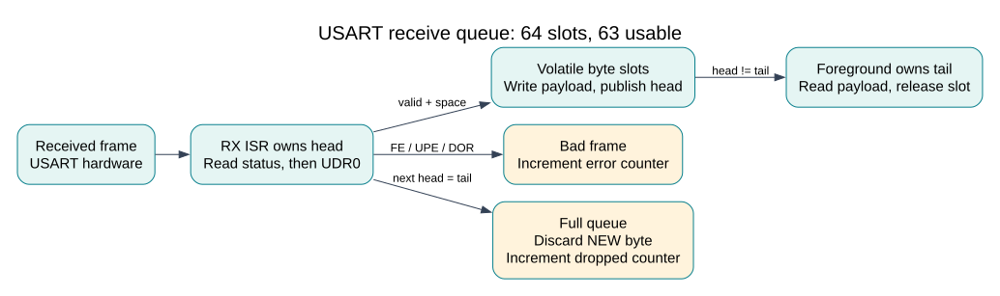
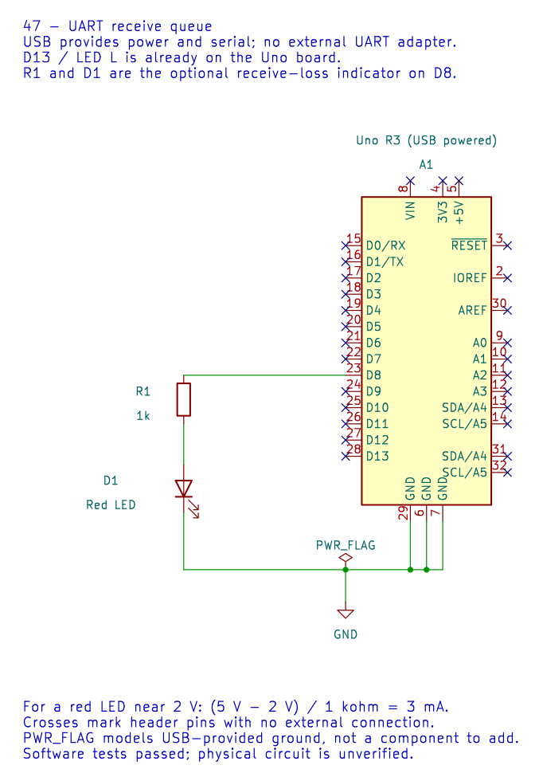

# Ring Buffers and Interrupt Ownership

## Why a Queue Helps

Serial bytes can arrive while foreground code is checking a switch or formatting
a message. A receive ISR can quickly move each byte into a bounded queue and
return. Foreground later removes bytes and performs slower work. A queue absorbs a
temporary mismatch in service rates; it cannot solve a permanently slower consumer.

This lesson explains the 63-byte usable capacity, one-producer/one-consumer rule
and explicit loss counters in the [UART RX API](https://github.com/arnabdasbwn/atmega328p-hal/blob/main/include/avr_hal/uart_rx.h).
Read [volatile and atomic access](volatile-atomic.md) first.



## Head, Tail and the Unused Slot

`head` is the next ISR write slot; `tail` is the oldest unread slot. Equal indices
mean empty. Before storing a byte, the producer computes its next index. If that
next index equals tail, the queue is full. Reserving one slot avoids another shared
count variable: a 64-slot array therefore holds **63 bytes**.

Because 64 is a power of two, `(index + 1) & 63` wraps from 63 to 0. This expression
is not a general modulo replacement for arbitrary queue sizes. Changing the slot
count requires checking the algorithm and tests, not merely editing a define.

| Situation | Head | Tail | Interpretation |
| --- | --- | --- | --- |
| Just initialized | 0 | 0 | Empty |
| Three bytes queued | 3 | 0 | Slots 0, 1 and 2 contain unread bytes |
| Two consumed | 3 | 2 | Only slot 2 remains unread |
| Wrapped empty | 63 | 63 | Empty at a different position |
| One byte after wrap | 0 | 63 | Slot 63 contains the next unread byte |

## Publish in the Right Order

The ISR stores the payload before changing head. Foreground reads the payload
before advancing tail. In this AVR-specific implementation, these shared accesses
are volatile bytes with one writer per index. No other foreground task may also
consume the queue. The two 16-bit loss counters are copied in a short atomic block.
This is not a claim that the same code is a portable multicore C queue.

The ISR reads UCSR0A before UDR0 because receive error flags describe that frame.
Frames with parity, framing or hardware overrun flags are discarded and counted.
A full software queue discards the **new** byte, preserving older queued data.
Both counters saturate at 65535. A hardware-overrun event does not count exactly
how many characters were lost; a protocol must detect missing messages separately.

## Build the Demonstration

```powershell
python "atmega328p-labs/tools/build.py" 47-uart-buffer --compiler gcc
python "atmega328p-labs/tools/build.py" 47-uart-buffer --compiler xc8
```

The [complete source](<https://github.com/arnabdasbwn/atmega328p-labs/blob/main/examples/47-uart-buffer/main.c>) uses the
Uno USB serial connection at 9600 8N1 and LED L on D13. An optional error indicator
connects D8 through a 1 kohm resistor to an LED anode, with its cathode to GND.
The editable schematic and its generated images are available below. KiCad ERC
reports no violations, and netlist checks confirm the series path and LED polarity.
This does not establish physical operation.



Open the editable KiCad schematic.
With a red LED drop near 2 V, a 1 kohm resistor gives approximately `(5 - 2)/1000`
= **3 mA**. The module symbol's numbered pads are library identifiers: use the
**D8** header name when wiring the Uno, not the schematic pad number 23.

The lab explicitly links the Timer0 tick ISR and USART RX ISR. Initialize the UART,
queue and tick before enabling global interrupts. Do not link another USART RX
handler or call the polling `avr_uart_get` while this queue owns receive data.
Foreground transmission still uses a bounded polling API.

After upload, typed characters should echo while LED L changes every 500 ms. The
optional D8 LED latches on after a recorded receive loss. A normal short message
may cause no loss; deliberately ignoring input is a separate software fixture.
Physical observations have not yet been recorded for this circuit.

## Capacity Calculation and Test Fixture

At 9600 baud with 8N1 framing, one byte requires ten bits, or approximately 1.042 ms.
Sixty-three queued bytes represent about **65.6 ms** of continuous traffic. Hardware
receive buffering, interrupt latency and scheduling still impose their own limits.

`91-uart-buffer-test` intentionally delays foreground consumption for 120 ms. The
simulator sends two separate 80-byte bursts. For each burst, 63 bytes should remain
in FIFO order and 17 should be counted as discarded. The second burst also crosses
the ring's index boundary. This checks the actual compiled ISR and queue code; it
does not measure USB latency or physical UART noise.

## Exercises with Answers

1. Why not silently overwrite the oldest byte when full? **Answer:** that changes
   the policy and requires modifying the consumer's tail from the ISR, invalidating
   the current ownership proof. A different design can do it, but needs different tests.
2. If input averages 960 bytes/s and the consumer handles 500, will a bigger finite
   queue solve the problem? **Answer:** no. It only postpones overflow.
3. Is an empty return an error requiring a reset? **Answer:** no. `AVR_ERROR_BUSY`
   here means no byte is currently available; the foreground loop can do other work.

For current device details, use the [Microchip ATmega328P documentation](https://www.microchip.com/en-us/product/ATMEGA328P). Check the document listed for your exact device and package; board-level pin labels and circuitry are covered by the [Uno R3 pinout](https://www.arnabkumardas.com/pinout/arduino-uno-r3/).

## Code Walkthrough


**Example code on GitHub:**
- [UART Receive-Buffer Software Fixture (`91-uart-buffer-test`)](https://github.com/arnabdasbwn/atmega328p-labs/blob/main/examples/91-uart-buffer-test/main.c)

### Interrupt-driven USART receive queue
The example's `main()` configures its peripherals, runs the algorithm and reports or displays the result. These source operations are listed in execution order:

- `if ((avr_uart_init(9600UL) != AVR_OK) || (avr_uart_rx_start() != AVR_OK))` - This checks for any setup or transfer error before the program continues. Configures USART0 for asynchronous 8N1. It chooses a baud divisor and normal/double-speed mode, programs UBRR0/UCSR0A/UCSR0C, then enables receive and transmit in UCSR0B. Enables the interrupt-driven USART receive queue. Start it after UART setup and enable global interrupts only when shared state is ready.
- `return 1;` - Stops this path and returns the indicated status when setup or validation cannot continue.
- `(void)avr_gpio_mode(13U, AVR_GPIO_OUTPUT);` - Maps the Uno header pin to its AVR port, sets its DDR direction bit and prepares the PORT latch for the requested initial level or pull-up.
- `(void)avr_gpio_mode(8U, AVR_GPIO_OUTPUT);` - Maps the Uno header pin to its AVR port, sets its DDR direction bit and prepares the PORT latch for the requested initial level or pull-up.
- `avr_tick_init();` - Configures the course millisecond tick interrupt source; it does not enable global interrupts itself.
- `uint32_t previous = 0UL;` - Clears the state/counter after its threshold is reached so the next interval starts from zero.
- `sei();` - Enables global interrupts after the example has configured its sources and shared state.
- `for (;;)` - Repeats the foreground task indefinitely; each pass checks inputs, advances the calculation or services the peripheral shown below.
- `if (avr_uart_rx_get(&value) == AVR_OK)` - The operation runs only after this API reports AVR_OK. Removes one byte from the receive queue without blocking; an empty queue returns a busy status.
- `(void)avr_uart_put(value, AVR_POLL_BUDGET);` - Waits for the USART transmit buffer within its poll budget, then writes the byte to UDR0.
- `uint32_t now = avr_tick_ms();` - Use the linked public header for this function's parameters, register ownership, blocking behavior and status values.
- `if (avr_elapsed(now, previous, 500UL))` - Tests this condition to choose which algorithm path runs.
- `previous = now;` - Stores this intermediate value for the next step of the algorithm; check the operands and units.
- `(void)avr_gpio_toggle(13U);` - Atomically toggles the selected pin output latch.
- `avr_uart_rx_stats_t stats;` - Use the linked public header for this function's parameters, register ownership, blocking behavior and status values.
- `(void)avr_uart_rx_stats(&stats);` - Use the linked public header for this function's parameters, register ownership, blocking behavior and status values.
- `if ((stats.dropped != 0U) || (stats.errors != 0U))` - Tests the stated condition; the following block handles the matching case and the other path is skipped.
- `(void)avr_gpio_write(8U, true);` - Changes the pin's PORT output latch; for an input pin this selects its pull-up state.

Algorithm: A finite single-producer/single-consumer queue separates the ISR from foreground processing; one slot distinguishes full from empty.
Expected behaviour: Echo received bytes while LED L toggles; D8 latches high after receive loss
**HAL source files in this repository:** [ATmega328P HAL on GitHub](https://github.com/arnabdasbwn/atmega328p-hal)

- [`include/avr_hal/gpio.h`](https://github.com/arnabdasbwn/atmega328p-hal/blob/main/include/avr_hal/gpio.h)
- [`include/avr_hal/tick.h`](https://github.com/arnabdasbwn/atmega328p-hal/blob/main/include/avr_hal/tick.h)
- [`include/avr_hal/uart.h`](https://github.com/arnabdasbwn/atmega328p-hal/blob/main/include/avr_hal/uart.h)
- [`include/avr_hal/uart_rx.h`](https://github.com/arnabdasbwn/atmega328p-hal/blob/main/include/avr_hal/uart_rx.h)
- [`lib/interrupts/tick.c`](https://github.com/arnabdasbwn/atmega328p-hal/blob/main/lib/interrupts/tick.c)
- [`lib/interrupts/uart_rx.c`](https://github.com/arnabdasbwn/atmega328p-hal/blob/main/lib/interrupts/uart_rx.c)
- [`src/gpio.c`](https://github.com/arnabdasbwn/atmega328p-hal/blob/main/src/gpio.c)
- [`src/uart.c`](https://github.com/arnabdasbwn/atmega328p-hal/blob/main/src/uart.c)


### UART Receive-Buffer Software Fixture
The example's `main()` configures its peripherals, runs the algorithm and reports or displays the result. These source operations are listed in execution order:

- `check(avr_uart_init(9600UL) == AVR_OK);` - Configures USART0 for asynchronous 8N1. It chooses a baud divisor and normal/double-speed mode, programs UBRR0/UCSR0A/UCSR0C, then enables receive and transmit in UCSR0B.
- `check(avr_uart_rx_start() == AVR_OK);` - Enables the interrupt-driven USART receive queue. Start it after UART setup and enable global interrupts only when shared state is ready.
- `uint8_t value = 0xA5U;` - Stores this intermediate or output value for the next algorithm step. Check the units and range represented by each operand.
- `check(avr_uart_rx_get(NULL) == AVR_ERROR_ARGUMENT);` - Removes one byte from the receive queue without blocking; an empty queue returns a busy status.
- `check(avr_uart_rx_get(&value) == AVR_ERROR_BUSY && value == 0xA5U);` - Removes one byte from the receive queue without blocking; an empty queue returns a busy status.
- `check(avr_uart_rx_stats(NULL) == AVR_ERROR_ARGUMENT);` - Use the linked public header for this function's parameters, register ownership, blocking behavior and status values.
- `sei();` - Enables global interrupts after the example has configured its sources and shared state.
- `for (uint8_t burst_index = 0U; burst_index < 2U; ++burst_index)` - Repeats while `burst_index < 2U` is true; `uint8_t burst_index = 0U` sets the starting state and `++burst_index` advances it each pass.
- `if (burst_index == 0U)` - Checks whether the counter or status has reached zero before taking the next action.
- `(void)avr_uart_write((const uint8_t *)"READY\n", 6U, AVR_POLL_BUDGET);` - Sends the specified bytes through USART0; a timeout can occur after a prefix has already been sent.
- `(void)avr_uart_write((const uint8_t *)"WRAP\n", 5U, AVR_POLL_BUDGET);` - Calls `avr_uart_write()`; its public HAL header defines the arguments, register ownership, blocking behavior and status results.
- `_delay_ms(120);` - Blocks the foreground for the stated interval.
- `avr_uart_rx_stats_t stats;` - Use the linked public header for this function's parameters, register ownership, blocking behavior and status values.
- `check(avr_uart_rx_stats(&stats) == AVR_OK);` - Calls `avr_uart_rx_stats()`; its public HAL header defines the arguments, register ownership, blocking behavior and status results.
- `check(stats.dropped == (uint16_t)(17U * (burst_index + 1U)) && stats.errors == 0U);` - Checks the expected status or state; a failed assertion is reported by this test fixture.
- `for (uint8_t i = 0U; i < 63U; ++i)` - Repeats while `i < 63U` is true; `uint8_t i = 0U` initializes the loop and `++i` advances it.
- `check(avr_uart_rx_get(&value) == AVR_OK);` - Calls `avr_uart_rx_get()`; its public HAL header defines the arguments, register ownership, blocking behavior and status results.
- `check(value == (uint8_t)(burst_index * 80U + i));` - Asserts the expected return value or state; a failed assertion is recorded by the test fixture.
- `check(avr_uart_rx_get(&value) == AVR_ERROR_BUSY);` - Removes one byte from the receive queue without blocking; an empty queue returns a busy status.
- `(void)avr_uart_write((const uint8_t *)"PASS\n", 5U, AVR_POLL_BUDGET);` - Sends the specified bytes through USART0; a timeout can occur after a prefix has already been sent.
- `for (;;)` - Repeats the foreground task indefinitely; each pass checks inputs, advances the calculation or services the peripheral shown below.

Algorithm: A receive interrupt can move bytes into a bounded ring buffer while foreground code reads them without waiting for a full response.
Expected behaviour: The fixture prints PASS after checking buffer push/pop, wraparound and overflow handling
**HAL source files in this repository:** [ATmega328P HAL on GitHub](https://github.com/arnabdasbwn/atmega328p-hal)

- [`include/avr_hal/uart.h`](https://github.com/arnabdasbwn/atmega328p-hal/blob/main/include/avr_hal/uart.h)
- [`include/avr_hal/uart_rx.h`](https://github.com/arnabdasbwn/atmega328p-hal/blob/main/include/avr_hal/uart_rx.h)
- [`lib/interrupts/uart_rx.c`](https://github.com/arnabdasbwn/atmega328p-hal/blob/main/lib/interrupts/uart_rx.c)
- [`src/uart.c`](https://github.com/arnabdasbwn/atmega328p-hal/blob/main/src/uart.c)
