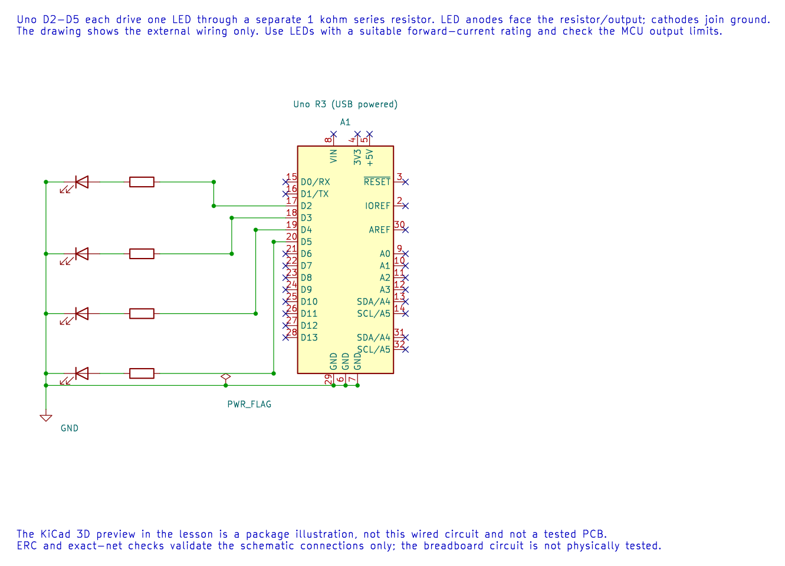
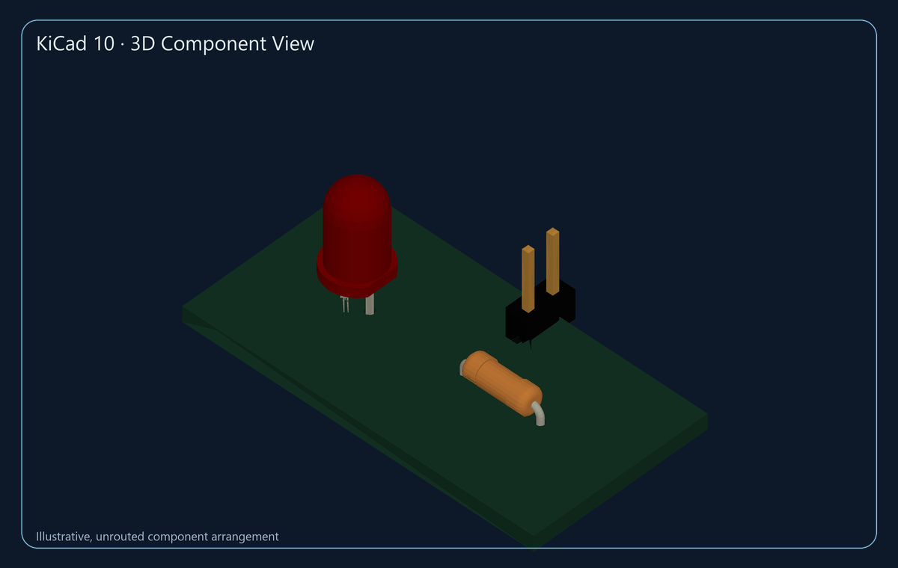

# Build a Running LED Pattern

## Objectives and Prerequisites

This lab lights four LEDs in sequence using Uno pins D2–D5. You will practise configuring several outputs and work through a simple resistor estimate. Review [GPIO programming](gpio-programming.md) and [safe circuit setup](requirements.md).

## Parts and Wiring

Use four LEDs, four **separate** 1 kΩ resistors, a breadboard and jumper wires.

| Uno pin | Series connection |
| --- | --- |
| D2, D3, D4 and D5 | One 1 kΩ resistor, then one LED anode |
| GND | Each LED cathode |

Check LED polarity: the anode connects towards the resistor/output, and the cathode connects to ground. Use a separate resistor for every LED.

The editable KiCad schematic shows one current-limiting resistor per LED. Its ERC and exact-net checks pass; the breadboard circuit has not been physically tested.

### KiCad 3D Component Preview

This image is rendered from KiCad’s exported 3D model. It helps identify the component packages, but the small board is only a visual arrangement: it has no routed connections and is not the breadboard circuit above. The editable KiCad board and GLB model remain in the private authoring workspace; the public lesson uses this rendered preview only.

## Estimate the LED Current

For a 5 V output, an LED forward drop of 2 V and a 1 kΩ resistor, the approximate current is:

`I = (5 V - 2 V) / 1000 Ω = 0.003 A = 3 mA`

This is a first-order estimate. The actual forward voltage depends on the LED current and part, and the output voltage is not an ideal fixed source. Check the ATmega328P and LED data sheets and keep current within their recommended limits. A separate resistor prevents one LED's forward voltage from setting the current in all the others.

## Build and Observe

The [complete running-light example](<https://github.com/arnabdasbwn/atmega328p-labs/blob/main/examples/04-running-led/main.c>) configures D2–D5 as outputs. It lights one output for 150 ms, turns it off and proceeds to the next pin, then repeats. Build it with `python "atmega328p-labs/tools/build.py" 04-running-led --compiler xc8`.

After a verified upload, one LED at a time should light in order. This example uses `_delay_ms()` to keep the first sequence easy to follow. It blocks foreground work; later timer and scheduling lessons show how to create periodic tasks without waiting in a delay loop.

## Troubleshooting and Exercise

If an LED never lights, check its polarity, resistor path, ground and pin number. If a pin is unexpectedly dim or behaves oddly, confirm that each LED has its own resistor and that the total load is suitable.

Why should parallel LEDs not share one series resistor?

**Answer:** Their forward voltages differ, so the current may not divide evenly. Each LED needs its own resistor to limit its branch current.

## Code Walkthrough

### Running LED pattern
The example's `main()` configures its peripherals, runs the algorithm and reports or displays the result. These source operations are listed in execution order:

- `for (uint8_t pin = 2U; pin <= 5U; ++pin)` - Repeats while `pin <= 5U` is true; `uint8_t pin = 2U` sets the starting state and `++pin` advances it each pass.
- `(void)avr_gpio_mode(pin, AVR_GPIO_OUTPUT);` - Maps the Uno header pin to its AVR port, sets its DDR direction bit and prepares the PORT latch for the requested initial level or pull-up.
- `for (;;)` - Repeats the foreground task indefinitely; each pass checks inputs, advances the calculation or services the peripheral shown below.
- `(void)avr_gpio_write(pin, true);` - Changes the pin's PORT output latch; for an input pin this selects its pull-up state.
- `_delay_ms(150);` - Waits for the stated interval; the foreground does no other work during this blocking delay.
- `(void)avr_gpio_write(pin, false);` - Changes the pin's PORT output latch; for an input pin this selects its pull-up state.

Algorithm: A 1 kohm resistor with a 2 V LED at 5 V gives approximately 3 mA. Each LED needs its own resistor.
Expected behaviour: Four LEDs light in sequence, one at a time
**HAL source files in this repository:** [ATmega328P HAL on GitHub](https://github.com/arnabdasbwn/atmega328p-hal)

- [`include/avr_hal/gpio.h`](https://github.com/arnabdasbwn/atmega328p-hal/blob/main/include/avr_hal/gpio.h)
- [`src/gpio.c`](https://github.com/arnabdasbwn/atmega328p-hal/blob/main/src/gpio.c)

## References

- [Running LED lab source and wiring record](<https://github.com/arnabdasbwn/atmega328p-labs/blob/main/examples/04-running-led/main.c>)
- [ATmega328P product documentation](https://www.microchip.com/en-us/product/ATMEGA328P)
- [GPIO concepts](gpio-concepts.md)
