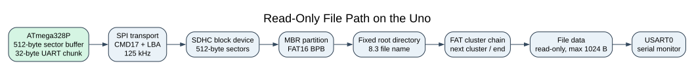
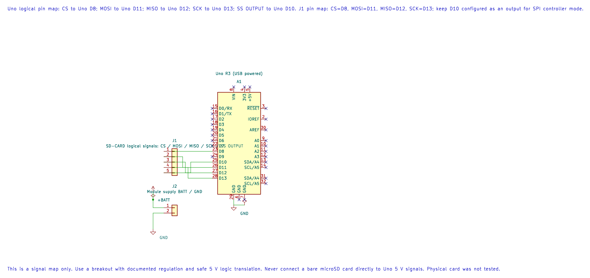
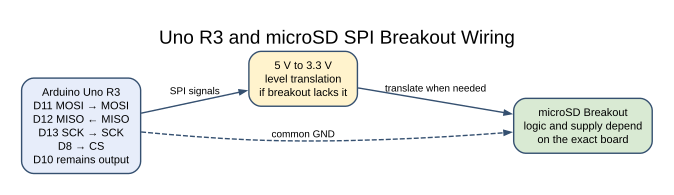

# SPI Microsd Card and FAT16 Files

## Learning Goals

This lesson builds the storage path in small steps. First, the Uno starts an SDHC card over SPI. It then reads 512-byte sectors, finds a FAT16 partition, locates one root-directory file and streams its contents to the serial monitor.

By the end, you should be able to:

- Explain the difference between card start-up, block access and a filesystem.
- Trace how a FAT16 file's directory entry leads to its cluster chain.
- Estimate the SRAM cost of a sector buffer on the Uno.
- Run a read-only example with clear limits on supported cards and filenames.

## Three Layers of Storage

SPI moves bytes between the microcontroller and the card. The SD command protocol turns those bytes into operations such as initialisation and reading a block. The filesystem then interprets blocks as partitions, directories and files.

The first lab checks the version 2 SDHC start-up sequence: CMD0, CMD8, CMD55/ACMD41 and CMD58. The next example uses CMD17 to read one 512-byte logical block. The FAT16 reader sits above that block interface. It never sends a write command.





The editable KiCad pin map records the SPI assignments, including D10 as an output. Use a breakout with documented regulation and safe 5 V logic translation; never connect a bare card to 5 V.

An SDHC block address is a sector number. It is not a byte address. SDHC sectors have a fixed 512-byte size, so block 10 begins at byte offset `10 × 512 = 5120` on the card. The card receives the block number in CMD17; the driver does not multiply it by 512.

## What the FAT16 Reader Supports

FAT16 divides a volume into a reserved region, one or more File Allocation Tables, a fixed-size root directory and a data region. Each regular file's root-directory entry records its first cluster and byte length. A FAT entry either points to the next cluster or marks the end of the chain.

The course reader is intentionally small. It accepts a FAT16 primary MBR partition and regular files directly in the root directory. Names use the traditional 8.3 form. It does not support FAT12, FAT32, exFAT, super-floppy layouts, extended/logical partitions, long filenames, subdirectories or writes. The example prints `COURSE.TXT` only when its declared size is at most 1024 bytes.

The volume object contains one 512-byte sector buffer. That buffer alone uses `512 / 2048 = 25%` of the Uno's SRAM. The application uses a separate 32-byte output chunk; it does not allocate a second sector or a full-file buffer. Keep the volume object alive while reading, and leave space for the stack and any other modules.

## Parts and Wiring

Use an Uno R3, a microSD breakout with documented supply and logic levels, and a card prepared with a FAT16 primary partition. A bare card is a 3.3 V device. A breakout that accepts 5 V power may still require level translation on its signal pins. Check the exact board documentation before connecting it.

| Arduino Uno R3 | Breakout or Part | Purpose |
| --- | --- | --- |
| D13 / SCK | SCK / CLK | SPI clock |
| D11 / MOSI | MOSI / DI | Uno-to-card data |
| D12 / MISO | MISO / DO | Card-to-Uno data |
| D8 | CS | Card select; active low |
| D10 | Not connected | Keep as output for AVR SPI controller mode |
| GND | GND | Common signal reference |
| Documented supply | VCC | Follow the breakout's voltage and current requirements |
| D0 / RX and D1 / TX | USB serial connection | 9600 baud, 8N1 status and file output |
| D4 through 1 kΩ | LED anode; LED cathode to GND | File-read success indicator |



The [rendered wiring diagram](../assets/diagrams/sd-card-wiring.svg) shows the signals and level-translation boundary. For an Uno header reference, see the [Uno R3 pinout](https://www.arnabkumardas.com/pinout/arduino-uno-r3/).

## Prepare the Test File

Back up the card before changing its partitions or formatting it. Use a card and formatter that can create a FAT16 primary partition supported by this reader. Add a small text file named `COURSE.TXT` in the partition's root directory and keep it at or below 1024 bytes. FAT16 is an older format, so current operating systems may not offer it for every card size by default.

The firmware looks up the eleven-byte 8.3 name `COURSE  TXT`: eight base-name bytes (`COURSE` followed by two spaces), then the three extension bytes (`TXT`). The lookup does not use a long filename entry. The card driver initialises at 125 kHz and keeps that conservative SPI rate for reads.

## Build and Run the Examples

Build the three programs from the course checkout. The first demonstrates card start-up; the second prints the file; the third is a software fixture for the filesystem parser.

```powershell
python atmega328p-labs/tools/build.py 63-sd-card-init --compiler gcc
python atmega328p-labs/tools/build.py 101-sd-fat16-readonly --compiler gcc
python atmega328p-labs/tools/build.py 102-fat16-parser-test --compiler gcc
python atmega328p-labs/tools/build.py 63-sd-card-init --compiler xc8
python atmega328p-labs/tools/build.py 101-sd-fat16-readonly --compiler xc8
python atmega328p-labs/tools/build.py 102-fat16-parser-test --compiler xc8
```

These commands compile and link; they do not upload firmware. To try the card example, follow the course's serial bootloader instructions. Open the serial monitor at **9600 baud, 8 data bits, no parity, 1 stop bit**. Disconnect other equipment using D0/D1.

After a complete read, the monitor shows the exact contents of `COURSE.TXT`, followed by `[EOF]`, and D4 lights. On a setup or read error, the monitor prints a short error and D4 remains off. The program does not report a success merely because a card answered the initialisation commands.

## Follow One File Read

The FAT reader checks the MBR signature and looks for a primary partition of a supported FAT16 type. It reads the volume's BIOS Parameter Block (BPB), checks the 512-byte sector size, cluster size, FAT capacity and region boundaries, then scans the fixed root directory for the exact 8.3 name.

When it finds the file, it reads the first data sector into the shared 512-byte buffer. As the application copies small chunks to the UART, the reader tracks the byte offset and bytes remaining. At a cluster boundary, it reads the next cluster number from the FAT, loads that cluster's sector and continues. It stops at the file size recorded in the directory entry, even if the final sector contains unused bytes.

The filesystem callback is separate from the storage driver. This allows Lab 102 to supply a synthetic block device and check partition parsing, directory lookup and a two-cluster file without pretending to model an SD card's SPI electrical behaviour.

## Code Walkthrough

### SPI microSD Version 2 Start-Up Check
The example's `main()` configures its peripherals, runs the algorithm and reports or displays the result. These source operations are listed in execution order:

- `avr_sd_card_t card;` - Use the linked public header for this function's parameters, register ownership, blocking behavior and status values.
- `if (avr_gpio_mode(AVR_SD_STATUS_LED_PIN, AVR_GPIO_OUTPUT) != AVR_OK)` - This checks for any setup or transfer error before the program continues. Maps the Uno header pin to its AVR port, sets its DDR direction bit and prepares the PORT latch for the requested initial level or pull-up.
- `return 1;` - Stops this path and returns the indicated status when setup or validation cannot continue.
- `(void)avr_gpio_write(AVR_SD_STATUS_LED_PIN, false);` - Changes the pin's PORT output latch; for an input pin this selects its pull-up state.
- `if (avr_sd_card_init(&card, AVR_SD_CHIP_SELECT_PIN, AVR_SD_SPI_POLL_BUDGET,` - This condition chooses the next path based on the API result. Initialises the SD card over SPI with finite transfer and response polling limits.
- `AVR_SD_RESPONSE_POLL_LIMIT) != AVR_OK)` - This statement participates in the operation sequence; follow its expression to see which state or output changes.
- `for (;;)` - Repeats the foreground task indefinitely; each pass checks inputs, advances the calculation or services the peripheral shown below.
- `if (avr_gpio_write(AVR_SD_STATUS_LED_PIN, true) != AVR_OK)` - This checks for any setup or transfer error before the program continues. Changes the pin's PORT output latch; for an input pin this selects its pull-up state.

Algorithm: The driver sends explicit start-up commands using bounded polling. It confirms the version 2 SDHC block-addressing mode; block and filesystem APIs are taught in later experiments.
Expected behaviour: D4 lights after the version 2 card completes CMD0, CMD8, ACMD41 and CMD58 with the SDHC CCS bit set
**HAL source files in this repository:** [ATmega328P HAL on GitHub](https://github.com/arnabdasbwn/atmega328p-hal)

- [`include/avr_hal/gpio.h`](https://github.com/arnabdasbwn/atmega328p-hal/blob/main/include/avr_hal/gpio.h)
- [`lib/drivers/sd_card.c`](https://github.com/arnabdasbwn/atmega328p-hal/blob/main/lib/drivers/sd_card.c)
- [`lib/drivers/sd_card.h`](https://github.com/arnabdasbwn/atmega328p-hal/blob/main/lib/drivers/sd_card.h)
- [`src/gpio.c`](https://github.com/arnabdasbwn/atmega328p-hal/blob/main/src/gpio.c)


### Read a FAT16 File over SPI
The example's `main()` configures its peripherals, runs the algorithm and reports or displays the result. These source operations are listed in execution order:

- `static const uint8_t target_name[11] = {'C', 'O', 'U', 'R', 'S', 'E', ' ', ' ', 'T', 'X', 'T'};` - Stores this intermediate or output value for the next algorithm step. Check the units and range represented by each operand.
- `static const uint8_t complete_message[] = "\r\n[EOF]\r\n";` - Stores this intermediate or output value for the next algorithm step. Check the units and range represented by each operand.
- `if ((avr_gpio_mode(AVR_SD_STATUS_LED_PIN, AVR_GPIO_OUTPUT) != AVR_OK) ||` - This checks for any setup or transfer error before the program continues. Maps the Uno header pin to its AVR port, sets its DDR direction bit and prepares the PORT latch for the requested initial level or pull-up.
- `(avr_uart_init(UINT32_C(9600)) != AVR_OK))` - Configures USART0 for asynchronous 8N1. It chooses a baud divisor and normal/double-speed mode, programs UBRR0/UCSR0A/UCSR0C, then enables receive and transmit in UCSR0B.
- `return 1;` - Stops this path and returns the indicated status when setup or validation cannot continue.
- `(void)avr_gpio_write(AVR_SD_STATUS_LED_PIN, false);` - Changes the pin's PORT output latch; for an input pin this selects its pull-up state.
- `if (avr_sd_card_init(&avr_sd_card, AVR_SD_CHIP_SELECT_PIN, AVR_SD_SPI_POLL_BUDGET,` - This condition chooses the next path based on the API result. Initialises the SD card over SPI with finite transfer and response polling limits.
- `AVR_SD_RESPONSE_POLL_LIMIT) != AVR_OK)` - This statement participates in the operation sequence; follow its expression to see which state or output changes.
- `return avr_sd_report_failure("SD init failed\r\n");` - Use the linked public header for this function's parameters, register ownership, blocking behavior and status values.
- `if (avr_fat16_mount(&avr_fat16_volume, avr_sd_fat_read, &avr_sd_card) != AVR_OK)` - This checks for any setup or transfer error before the program continues. Checks the block-read callback and mounts a supported FAT16 volume.
- `return avr_sd_report_failure("FAT16 mount failed\r\n");` - Calls `avr_sd_report_failure()`; its public HAL header defines the arguments, register ownership, blocking behavior and status results.
- `if (avr_fat16_open_root(&avr_fat16_volume, &avr_fat16_file, target_name) != AVR_OK)` - Takes the error path if setup or transfer fails.
- `return avr_sd_report_failure("COURSE.TXT not found\r\n");` - Calls `avr_sd_report_failure()`; its public HAL header defines the arguments, register ownership, blocking behavior and status results.
- `if (avr_fat16_file.file_size > AVR_SD_FILE_SIZE_MAX)` - Tests this condition to choose which algorithm path runs.
- `return avr_sd_report_failure("COURSE.TXT exceeds 1024 bytes\r\n");` - Calls `avr_sd_report_failure()`; its public HAL header defines the arguments, register ownership, blocking behavior and status results.
- `while (avr_fat16_file.bytes_remaining != 0U)` - Waits for this condition to change; the nearby counter or timeout limits how long it can block.
- `size_t bytes_read = 0U;` - Stores this intermediate value for the next step of the algorithm; check the operands and units.
- `const avr_status_t status =` - This statement advances the operation sequence; follow its expression to see the state change.
- `avr_fat16_read(&avr_fat16_volume, &avr_fat16_file, output, sizeof(output), &bytes_read);` - Calls `avr_fat16_read()`; its public HAL header defines the arguments, register ownership, blocking behavior and status results.
- `if ((status != AVR_OK) || (bytes_read == 0U) ||` - Takes the error path if setup or transfer fails.
- `(avr_uart_write(output, bytes_read, AVR_SD_UART_POLL_BUDGET) != AVR_OK))` - Calls `avr_uart_write()`; its public HAL header defines the arguments, register ownership, blocking behavior and status results.
- `return avr_sd_report_failure("File read failed\r\n");` - Use the linked public header for this function's parameters, register ownership, blocking behavior and status values.
- `if ((avr_uart_write(complete_message, sizeof(complete_message) - 1U, AVR_SD_UART_POLL_BUDGET) !=` - This condition chooses the next path based on the API result. Sends the specified bytes through USART0; a timeout can occur after a prefix has already been sent.
- `(avr_gpio_write(AVR_SD_STATUS_LED_PIN, true) != AVR_OK))` - Changes the pin's PORT output latch; for an input pin this selects its pull-up state.
- `for (;;)` - Repeats the foreground task indefinitely; each pass checks inputs, advances the calculation or services the peripheral shown below.

Algorithm: The program reads one 512-byte sector buffer at a time, follows a FAT16 cluster chain, and streams a bounded 8.3 root-directory file without a heap or second sector buffer.
Expected behaviour: The serial monitor prints the contents of root file COURSE.TXT followed by [EOF]; D4 lights after the complete file is read
**HAL source files in this repository:** [ATmega328P HAL on GitHub](https://github.com/arnabdasbwn/atmega328p-hal)

- [`include/avr_hal/gpio.h`](https://github.com/arnabdasbwn/atmega328p-hal/blob/main/include/avr_hal/gpio.h)
- [`include/avr_hal/uart.h`](https://github.com/arnabdasbwn/atmega328p-hal/blob/main/include/avr_hal/uart.h)
- [`lib/drivers/sd_card.c`](https://github.com/arnabdasbwn/atmega328p-hal/blob/main/lib/drivers/sd_card.c)
- [`lib/drivers/sd_card.h`](https://github.com/arnabdasbwn/atmega328p-hal/blob/main/lib/drivers/sd_card.h)
- [`lib/filesystems/fat16.c`](https://github.com/arnabdasbwn/atmega328p-hal/blob/main/lib/filesystems/fat16.c)
- [`lib/filesystems/fat16.h`](https://github.com/arnabdasbwn/atmega328p-hal/blob/main/lib/filesystems/fat16.h)
- [`src/gpio.c`](https://github.com/arnabdasbwn/atmega328p-hal/blob/main/src/gpio.c)
- [`src/uart.c`](https://github.com/arnabdasbwn/atmega328p-hal/blob/main/src/uart.c)


### FAT16 Parser Two-Cluster Fixture
The example's `main()` configures its peripherals, runs the algorithm and reports or displays the result. These source operations are listed in execution order:

- `static const uint8_t absent_name[11] = {'M', 'I', 'S', 'S', 'I', 'N', 'G', ' ', 'T', 'X', 'T'};` - Stores this intermediate or output value for the next algorithm step. Check the units and range represented by each operand.
- `static const uint8_t filename[11] = {'C', 'O', 'U', 'R', 'S', 'E', ' ', ' ', 'T', 'X', 'T'};` - Stores this intermediate or output value for the next algorithm step. Check the units and range represented by each operand.
- `static const uint8_t pass[] = "PASS\n";` - Stores this intermediate or output value for the next algorithm step. Check the units and range represented by each operand.
- `static const uint8_t fail[] = "FAIL\n";` - Stores this intermediate or output value for the next algorithm step. Check the units and range represented by each operand.
- `static avr_fat16_volume_t volume;` - Use the linked public header for this function's parameters, register ownership, blocking behavior and status values.
- `static avr_fat16_file_t file;` - Use the linked public header for this function's parameters, register ownership, blocking behavior and status values.
- `uint32_t total = 0U;` - Clears the state/counter after its threshold is reached so the next interval starts from zero.
- `if (avr_uart_init(UINT32_C(9600)) != AVR_OK)` - This checks for any setup or transfer error before the program continues. Configures USART0 for asynchronous 8N1. It chooses a baud divisor and normal/double-speed mode, programs UBRR0/UCSR0A/UCSR0C, then enables receive and transmit in UCSR0B.
- `return 1;` - Stops this path and returns the indicated status when setup or validation cannot continue.
- `bool valid = avr_fat16_mount(&volume, avr_test_read_sector, NULL) == AVR_OK;` - Checks the block-read callback and mounts a supported FAT16 volume.
- `if (valid)` - Tests this condition to choose which algorithm path runs.
- `valid = avr_fat16_open_root(&volume, &file, absent_name) == AVR_ERROR_UNSUPPORTED;` - Calls `avr_fat16_open_root()`; its public HAL header defines the arguments, register ownership, blocking behavior and status results.
- `valid = avr_fat16_open_root(&volume, &file, filename) == AVR_OK;` - Calls `avr_fat16_open_root()`; its public HAL header defines the arguments, register ownership, blocking behavior and status results.
- `while (valid && (file.bytes_remaining != 0U))` - Waits for this condition to change; the nearby counter or timeout limits how long it can block.
- `size_t bytes_read = 0U;` - Stores this intermediate value for the next step of the algorithm; check the operands and units.
- `if ((avr_fat16_read(&volume, &file, output, sizeof(output), &bytes_read) != AVR_OK) ||` - Takes the error path if setup or transfer fails.
- `(bytes_read == 0U))` - This statement advances the operation sequence; follow its expression to see the state change.
- `valid = false;` - Stores this intermediate value for the next step of the algorithm; check the operands and units.
- `for (size_t index = 0U; valid && (index < bytes_read); index++)` - Repeats while `valid && (index < bytes_read)` is true; `size_t index = 0U` initializes the loop and `index++` advances it.
- `if (output[index] != (uint8_t)('A' + ((total + index) % 26U)))` - Tests this condition to choose which algorithm path runs.
- `total += (uint32_t)bytes_read;` - This statement advances the operation sequence; follow its expression to see the state change.
- `valid = valid && (total == AVR_TEST_FILE_LENGTH) && (file.bytes_remaining == 0U);` - Stores this intermediate value for the next step of the algorithm; check the operands and units.
- `const uint8_t *result = pass;` - Stores this intermediate value for the next step of the algorithm; check the operands and units.
- `if (!valid)` - Tests this condition to choose which algorithm path runs.
- `result = fail;` - Stores this intermediate or output value for the next algorithm step. Check the units and range represented by each operand.
- `const size_t result_length = sizeof(pass) - 1U;` - Stores this intermediate or output value for the next algorithm step. Check the units and range represented by each operand.
- `(void)avr_uart_write(result, result_length, AVR_TEST_UART_BUDGET);` - Sends the specified bytes through USART0; a timeout can occur after a prefix has already been sent.
- `for (;;)` - Repeats the foreground task indefinitely; each pass checks inputs, advances the calculation or services the peripheral shown below.

Algorithm: Separate filesystem parser behavior from the SD electrical/protocol model by injecting a deterministic block-reader callback.
Expected behaviour: The instruction-level test fixture emits PASS after validating a synthetic 700-byte file across two FAT16 clusters
**HAL source files in this repository:** [ATmega328P HAL on GitHub](https://github.com/arnabdasbwn/atmega328p-hal)

- [`include/avr_hal/uart.h`](https://github.com/arnabdasbwn/atmega328p-hal/blob/main/include/avr_hal/uart.h)
- [`lib/filesystems/fat16.c`](https://github.com/arnabdasbwn/atmega328p-hal/blob/main/lib/filesystems/fat16.c)
- [`lib/filesystems/fat16.h`](https://github.com/arnabdasbwn/atmega328p-hal/blob/main/lib/filesystems/fat16.h)
- [`src/uart.c`](https://github.com/arnabdasbwn/atmega328p-hal/blob/main/src/uart.c)


## Common Problems

- **Card initialisation fails:** Confirm the breakout supply, shared ground, CS pin D8, SPI wiring and 5 V to 3.3 V translation. The driver supports version 2 SDHC cards, not every SD card generation.
- **FAT16 mount fails:** Check that the card has an MBR partition of a supported FAT16 type and that the volume is not FAT32 or exFAT. The reader does not support super-floppy or extended-partition layouts.
- **`COURSE.TXT` is not found:** Place the file in the partition root. Keep the name to 8.3 characters; the reader skips directories and long-filename records.
- **A file read stops early:** Check the card for filesystem errors and avoid removing it while powered. A corrupt or prematurely terminated cluster chain returns an error.
- **Serial text is garbled:** Confirm 9600 baud and make sure another program is not using the Uno's serial port.
- **The Uno resets during card access:** Check the breakout's supply capability and local decoupling. The radio/card supply should not be taken from a GPIO pin.

## Check Your Understanding

1. Why does the SDHC driver send a block number rather than a byte address in CMD17?
2. What do the directory entry and FAT each contribute to reading a file?
3. What percentage of the Uno's 2 KB SRAM is used by one 512-byte sector buffer?
4. Why does Lab 102 not prove that a physical SD card works?

**Suggested answers:** SDHC uses fixed 512-byte blocks, so the command argument is a logical block address. The directory entry gives the first cluster and file size; the FAT links each cluster to the next. One sector buffer uses 25% of SRAM. Lab 102 tests the filesystem code with synthetic sectors and has no SD card or electrical model.

## Source and Further Reading

- [SD Association, Physical Layer Simplified Specification, Version 6.00](https://www.sdcard.org/cms/wp-content/themes/sdcard-org/dl.php?f=Part1_Physical_Layer_Simplified_Specification_Ver6.00.pdf), including SPI command, response, data-token and fixed SDHC block-size details.
- [Microsoft FAT Specification](https://www.scs.stanford.edu/~zyedidia/docs/_other/fat.pdf), especially the volume layout, BPB, root-directory and cluster-chain sections.
- [ATmega328P Device Documentation](https://www.microchip.com/en-us/product/ATMEGA328P), for SPI and memory limits.
- Driver sources: [SDHC block reader](https://github.com/arnabdasbwn/atmega328p-hal/blob/main/lib/drivers/sd_card.h) and [FAT16 reader](https://github.com/arnabdasbwn/atmega328p-hal/blob/main/lib/filesystems/fat16.h).
- Experiments: [card start-up](<https://github.com/arnabdasbwn/atmega328p-labs/blob/main/examples/63-sd-card-init/main.c>), [read-only file example](<https://github.com/arnabdasbwn/atmega328p-labs/blob/main/examples/101-sd-fat16-readonly/main.c>) and [parser fixture](<https://github.com/arnabdasbwn/atmega328p-labs/blob/main/examples/102-fat16-parser-test/main.c>).

**Validation status:** Both compilers build the examples. The parser fixture checks a synthetic two-cluster file. A physical card, breakout, level translation and actual SDHC response remain unverified.
