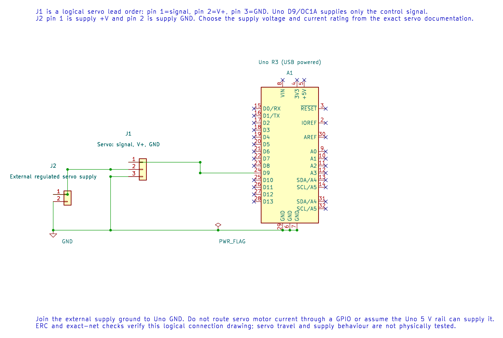

# Drive an SG90 Servo with Timer1

## Servo Signal and Power

A hobby servo typically reads a repeating pulse to request a position. This lab produces a 20 ms frame (50 Hz) with a pulse near 1 ms, 1.5 ms or 2 ms. The exact useful range differs between servos. Start conservatively and do not force the horn against a mechanical stop.

The Uno pin provides only the signal. Power the SG90 from a regulated supply rated for the servo's current, and connect the supply ground to Uno GND. The motor supply should not be routed through a GPIO pin.

| Uno or supply | Servo lead |
| --- | --- |
| D9 / OC1A | Signal |
| External regulated 5 V supply | V+ only if the servo permits that voltage |
| Supply GND and Uno GND | Ground |

The editable KiCad schematic keeps the servo supply separate from the Uno logic supply. Check the exact servo and supply ratings before wiring.

## Convert Timer Ticks to Pulse Time

With a 16 MHz clock and divide-by-8, each Timer1 tick is 0.5 µs. Therefore, 3,000 ticks produce `3,000 × 0.5 µs = 1,500 µs`. A 20 ms frame contains 40,000 ticks, so TOP is 39,999 when counting from zero.

The [servo lab](<https://github.com/arnabdasbwn/atmega328p-labs/blob/main/examples/12-servo/main.c>) configures Timer1 mode 14 with D9/OC1A. Build it with `python "atmega328p-labs/tools/build.py" 12-servo --compiler xc8`. Timer1 is fully owned by this PWM setup; the input-capture or motor Timer1 example cannot be enabled at the same time.

## Troubleshooting and Exercise

If the servo jitters or resets the Uno, check the supply current, grounding and wire length. If the motion reaches a hard stop, disconnect power and reduce the pulse range. Servo angle is not a direct property of OCR ticks; the mechanical response varies by unit.

Why does `high_ticks=3000` request a 1.5 ms pulse at this timer setting?

**Answer:** Each tick lasts 0.5 µs, so 3,000 ticks last 1,500 µs. OCR values are timer counts, not degrees.

## Code Walkthrough

### SG90 servo pulse generation
The example's `main()` configures its peripherals, runs the algorithm and reports or displays the result. These source operations are listed in execution order:

- `(void)avr_timer1_pwm(8U, 40000U, 3000U);` - Configures Timer1 mode 14 with prescaler 8; ICR1 becomes 39999, giving a 20 ms frame, and OCR1A starts at 3000 ticks (1500 us high).
- `for (;;)` - Repeats the foreground task indefinitely; each pass checks inputs, advances the calculation or services the peripheral shown below.
- `OCR1A = 2000U;` - Loads 2000 timer ticks for a 1 ms high pulse; Timer1 ticks at 0.5 us with the divide-by-8 prescaler.
- `_delay_ms(1000);` - Waits for the stated interval; the foreground does no other work during this blocking delay.
- `OCR1A = 3000U;` - Loads 3000 timer ticks for a 1.5 ms high pulse; this is the nominal servo centre position.
- `OCR1A = 4000U;` - Loads 4000 timer ticks for a 2 ms high pulse; the servo endpoint depends on the actual servo.

Algorithm: At divide-by-8 each tick is 0.5 us. 40000 ticks make a 20 ms frame. Servo angle and safe travel depend on the actual unit; do not force a mechanical stop.
Expected behaviour: Servo alternates approximately between 1, 1.5 and 2 ms pulse positions
**HAL source files in this repository:** [ATmega328P HAL on GitHub](https://github.com/arnabdasbwn/atmega328p-hal)

- [`include/avr_hal/timer.h`](https://github.com/arnabdasbwn/atmega328p-hal/blob/main/include/avr_hal/timer.h)
- [`src/timer.c`](https://github.com/arnabdasbwn/atmega328p-hal/blob/main/src/timer.c)

## References

- [Servo source and wiring record](<https://github.com/arnabdasbwn/atmega328p-labs/blob/main/examples/12-servo/main.c>)
- [TowerPro SG90 Digital product information](https://towerpro.com.tw/product/sg90-7/); this is one manufacturer's variant and does not establish the ratings of every servo sold as SG90.
- [Timer1](timer1.md) and [PWM motor safety](pwm-motor.md)
- Follow the exact servo manufacturer's voltage and pulse-range data.
