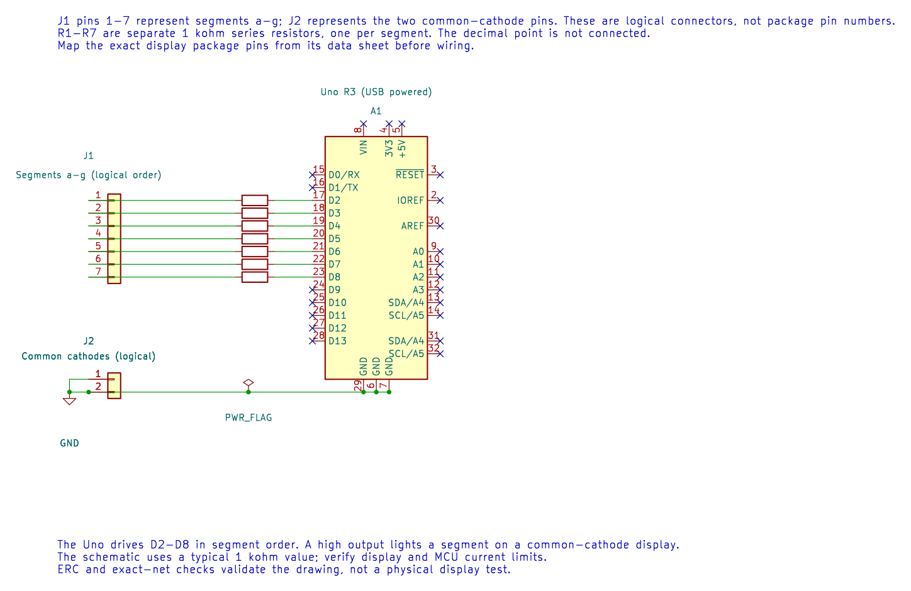

# Interfacing a Seven-Segment Display

## Objectives and Prerequisites

A seven-segment display is seven LEDs arranged to form digits. This lab uses a **common-cathode** single-digit display and GPIO pins D2 through D8. Read [GPIO programming](gpio-programming.md) and [binary masks](binary.md) first.

## Parts and Wiring

Use a common-cathode display, seven 1 kΩ resistors and jumper wires. Follow the package data sheet to identify the segment pins; segment letters are not package pin numbers.

| Uno connection | Display connection |
| --- | --- |
| D2 through D8, each through its own 1 kΩ resistor | Segments a through g, in order |
| GND | Common-cathode pin or pins |
| Not connected | Decimal point |

The resistor belongs in series with each segment. The display package may have two common pins; confirm their function in its pin diagram. Never assume the segment order from the physical pin layout.

The editable KiCad schematic uses logical connectors: J1 pins 1-7 are segments a-g, and J2 represents the common-cathode pins. They are not display package pin numbers. KiCad ERC and exact-net checks pass; the display circuit has not been physically tested.

## How the Bitmap Selects a Digit

The program stores one seven-bit pattern for each numeral. Bit 0 represents segment a and bit 6 represents segment g. In this mapping, `0x06` is binary `0000110`, which turns on b and c to show the digit 1. Since the display is common-cathode, a high output turns on the corresponding segment through its resistor.

The [complete example](<https://github.com/arnabdasbwn/atmega328p-labs/blob/main/examples/05-seven-segment/main.c>) configures D2–D8 as outputs, writes the bitmap for each digit and holds it for 500 ms. It counts from 0 to 9. This simple version uses busy delays; a timer-driven update is a better approach when other tasks must remain responsive.

## Build and Expected Result

Build from the course root with `python "atmega328p-labs/tools/build.py" 05-seven-segment --compiler xc8`. After wiring and a verified upload, the display should count from 0 to 9, changing twice per second. The code builds with XC8 and AVR GCC; its display circuit has not been physically tested.

## Troubleshooting and Exercise

If segments are incorrect, verify the display type, common pins, resistor connections and a–g mapping. A common-anode display needs the opposite logic and a different circuit arrangement; this example is not directly interchangeable.

Which segments are on in bitmap `0x06`?

**Answer:** Bits 1 and 2 are set, so segments b and c are on. With the stated mapping, the numeral shown is 1.

## Code Walkthrough

### Common-cathode seven-segment display
The example's `main()` configures its peripherals, runs the algorithm and reports or displays the result. These source operations are listed in execution order:

- `for (uint8_t i = 0U; i < 7U; ++i)` - Repeats while `i < 7U` is true; `uint8_t i = 0U` sets the starting state and `++i` advances it each pass.
- `(void)avr_gpio_mode((uint8_t)(i + 2U), AVR_GPIO_OUTPUT);` - Maps the Uno header pin to its AVR port, sets its DDR direction bit and prepares the PORT latch for the requested initial level or pull-up.
- `for (;;)` - Repeats the foreground task indefinitely; each pass checks inputs, advances the calculation or services the peripheral shown below.
- `for (uint8_t d = 0U; d < 10U; ++d)` - Repeats while `d < 10U` is true; `uint8_t d = 0U` sets the starting state and `++d` advances it each pass.
- `for (uint8_t s = 0U; s < 7U; ++s)` - Repeats while `s < 7U` is true; `uint8_t s = 0U` sets the starting state and `++s` advances it each pass.
- `(void)avr_gpio_write((uint8_t)(s + 2U), (digits[d] & (uint8_t)(1U << s)) != 0U);` - Changes the pin's PORT output latch; for an input pin this selects its pull-up state.
- `_delay_ms(500);` - Waits for the stated interval; the foreground does no other work during this blocking delay.

Algorithm: The table is a bitmap: bit zero controls a, bit six controls g. Check the package pinout; segment letters are not pin numbers.
Expected behaviour: Display counts 0 through 9 at two digits per second
**HAL source files in this repository:** [ATmega328P HAL on GitHub](https://github.com/arnabdasbwn/atmega328p-hal)

- [`include/avr_hal/gpio.h`](https://github.com/arnabdasbwn/atmega328p-hal/blob/main/include/avr_hal/gpio.h)
- [`src/gpio.c`](https://github.com/arnabdasbwn/atmega328p-hal/blob/main/src/gpio.c)

## References

- [Seven-segment lab source and wiring record](<https://github.com/arnabdasbwn/atmega328p-labs/blob/main/examples/05-seven-segment/main.c>)
- [GPIO registers](gpio-registers.md)
- Use the display manufacturer's data sheet to confirm the package pinout and current limits.
