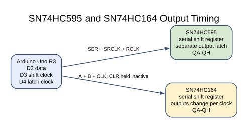
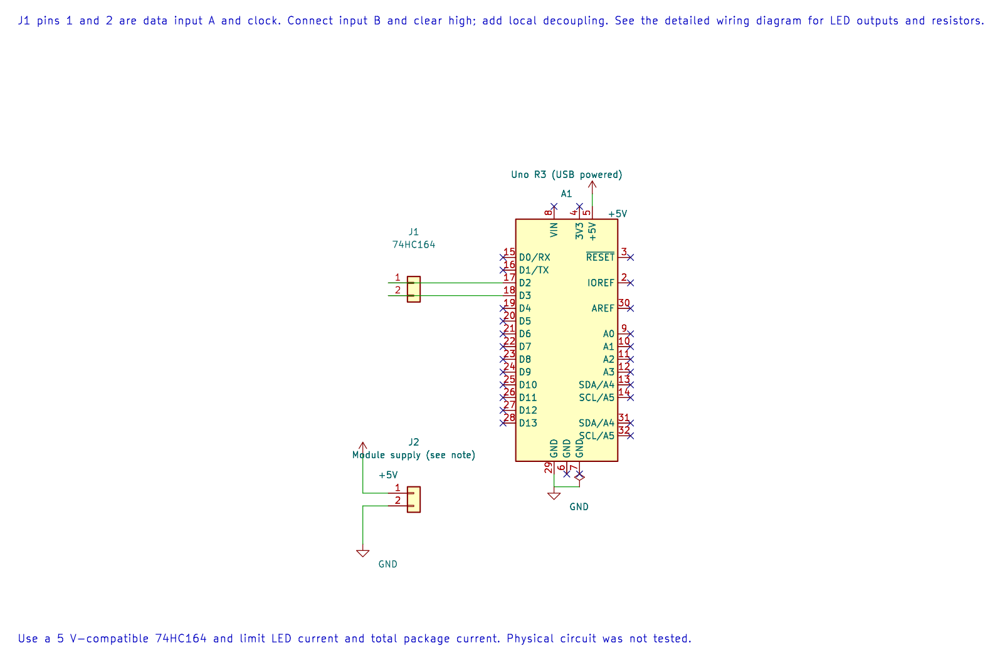

# SN74HC164 Serial-In Shift Register

## What You Will Learn

The SN74HC164 shifts serial bits into an eight-bit register and presents them directly on its outputs. It has no separate output latch. As each clock edge arrives, the visible outputs change, so an intermediate pattern appears while the byte is being shifted.

This differs from the SN74HC595, which has a storage latch that can update its eight outputs together after the byte is complete.

## Parts and Wiring

Use a 74HC164, eight LEDs with separate current-limiting resistors, and a 100 nF bypass capacitor near the IC. Read the pinout for the package you have; do not rely on a picture for a different package.

| Uno R3 | 74HC164 signal | Purpose |
| --- | --- | --- |
| D2 | A | First serial-data input |
| 5 V | B | Second serial-data input; both inputs are logically ANDed |
| D3 | CLK | Shift clock |
| 5 V | CLR | Keep the active-low asynchronous clear inactive |
| 5 V | VCC | Supply |
| GND | GND | Shared reference |
| QA–QH | Each through 2.2 kΩ resistor to LED, then GND | Visible outputs |

Use resistor values that keep the output and package current within the selected 74HC164 datasheet limits. Tie the unused logic inputs to known levels; a floating CMOS input can switch unpredictably.

## Why the Outputs Glitch While Shifting





The editable KiCad connection sheet records the Uno signal and supply pins. Connect input B and clear as described above; the output LEDs and their resistors are not drawn.

The program puts one data bit on D2, then pulses D3. Every rising edge shifts the register and changes its outputs. With a walking-one pattern, the high bit moves through the eight positions. The pattern can briefly show a different state between completed bytes; the 164 provides no latch to hide that transition.

The two serial inputs are combined internally. Holding B high lets A act as the serial data input. If B is low, the next shifted-in bit is low regardless of A.

## Build and Try the Lab

```powershell
python atmega328p-labs/tools/build.py 30-shift-164 --compiler gcc
python atmega328p-labs/tools/build.py 30-shift-164 --compiler xc8
```

After uploading, check that one LED advances across the outputs. Assert CLR low briefly and confirm that all outputs clear immediately, even if the clock does not move. Compare the output transition with the latched SN74HC595 lab.

Build validation passes; the board-level circuit has not been physically tested.

## Code Walkthrough

### SN74HC164 serial outputs
The example's `main()` configures its peripherals, runs the algorithm and reports or displays the result. These source operations are listed in execution order:

- `(void)avr_gpio_mode(2U, AVR_GPIO_OUTPUT);` - Maps the Uno header pin to its AVR port, sets its DDR direction bit and prepares the PORT latch for the requested initial level or pull-up.
- `(void)avr_gpio_mode(3U, AVR_GPIO_OUTPUT);` - Maps the Uno header pin to its AVR port, sets its DDR direction bit and prepares the PORT latch for the requested initial level or pull-up.
- `for (;;)` - Repeats the foreground task indefinitely; each pass checks inputs, advances the calculation or services the peripheral shown below.
- `for (uint8_t b = 0U; b < 8U; ++b)` - Repeats while `b < 8U` is true; `uint8_t b = 0U` sets the starting state and `++b` advances it each pass.
- `(void)avr_gpio_write(2U, b == 0U);` - Changes the pin's PORT output latch; for an input pin this selects its pull-up state.
- `(void)avr_gpio_write(3U, true);` - Changes the pin's PORT output latch; for an input pin this selects its pull-up state.
- `(void)avr_gpio_write(3U, false);` - Changes the pin's PORT output latch; for an input pin this selects its pull-up state.
- `_delay_ms(150);` - Waits for the stated interval; the foreground does no other work during this blocking delay.

Algorithm: Unlike the HC595, the HC164 has no separate output latch. Each clock immediately changes visible outputs; this matters when controlling displays or actuators.
Expected behaviour: A single high bit moves through the outputs
**HAL source files in this repository:** [ATmega328P HAL on GitHub](https://github.com/arnabdasbwn/atmega328p-hal)

- [`include/avr_hal/gpio.h`](https://github.com/arnabdasbwn/atmega328p-hal/blob/main/include/avr_hal/gpio.h)
- [`src/gpio.c`](https://github.com/arnabdasbwn/atmega328p-hal/blob/main/src/gpio.c)


## Common Problems

- **No output changes:** Confirm CLR is high, B is high, grounds are connected and D2/D3 are not swapped.
- **Unpredictable output:** Tie both serial inputs and CLR to defined levels.
- **LEDs appear in reverse order:** Check which physical output you connected to each LED and the code's bit order.
- **A display briefly shows an unwanted pattern:** This is expected during shifting. Use a device with an output latch, such as the 595, if that transition is not acceptable.

## Check Your Understanding

1. What happens to the next serial bit if input B is held low?
2. Why can a visible pattern change during the eight clock pulses?
3. How does the SN74HC595 avoid this effect?

**Suggested answers:** A low B forces the combined serial input low. The 164 connects the shift register directly to its outputs. The 595 holds a separate output register and copies the new byte only when its latch is clocked.

## Source and Further Reading

- [Lab 30 source](<https://github.com/arnabdasbwn/atmega328p-labs/blob/main/examples/30-shift-164/main.c>)
- [Texas Instruments SN74HC164 Datasheet](https://www.ti.com/product/SN74HC164)
- [ATmega328P Documentation](https://www.microchip.com/en-us/product/ATMEGA328P)
