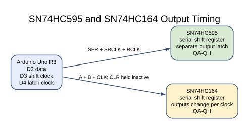
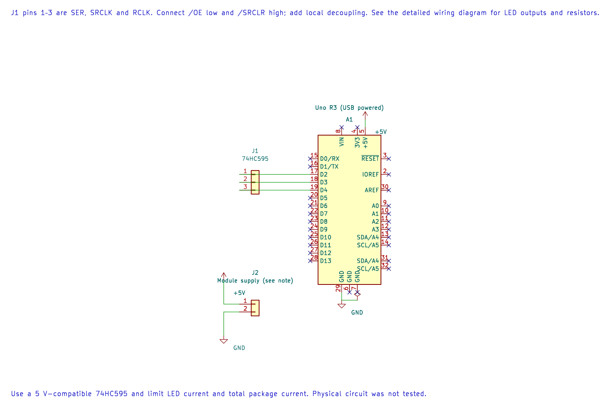

# SN74HC595 Serial-In Shift Register

## What You Will Learn

The SN74HC595 shifts serial bits into an internal register. A separate storage latch copies all eight bits to its output pins together. The Uno can therefore change a group of outputs after the complete byte has arrived. The 595 adds outputs; it does not read input signals.

## Parts and Wiring

Use one 74HC595, eight LEDs, one current-limiting resistor per LED and a 100 nF bypass capacitor close to the IC. Check the pinout for your package before wiring.

| Uno R3 | 74HC595 signal | Purpose |
| --- | --- | --- |
| D2 | SER / DS | Serial data |
| D3 | SRCLK / SHCP | Shift-register clock |
| D4 | RCLK / STCP | Storage-latch clock |
| 5 V | VCC | Supply |
| GND | GND | Shared reference |
| GND | OE low | Enable outputs; active-low control |
| 5 V | SRCLR high | Keep active-low shift-register clear inactive |
| QA–QH | Each through 2.2 kΩ resistor to LED, then GND | Eight visible outputs |

At 5 V, the selected 74HC logic input thresholds suit the Uno's 5 V outputs. Follow the part datasheet's output-current and aggregate package-current limits. Do not treat the chip as eight unrestricted LED drivers.

## Shift and Latch Sequence





The editable KiCad connection sheet records the Uno signal and supply pins. The package control pins, output resistors and LEDs are described in the wiring table and should be connected as shown there.

For each bit, Lab 29 sets D2, pulses D3 high and then low. After all eight bits are shifted, it pulses D4. Only that latch edge updates QA–QH, so intermediate shift-register values are not shown on the LEDs.

The example sends a walking-one pattern, one bit at a time. When `0x01` is sent least-significant bit first, QA becomes high after the latch. Then `0x02` lights the next output, continuing through the byte. Exact LED order depends on the package output wiring.

## Build and Try the Lab

```powershell
python atmega328p-labs/tools/build.py 29-shift-595 --compiler gcc
python atmega328p-labs/tools/build.py 29-shift-595 --compiler xc8
```

After wiring and uploading through the serial bootloader, observe that the LEDs change together at the latch pulse. Change the walking-one value to walking-zero and note the visible sequence. Only add a second cascaded 595 after the first is behaving correctly.

## Code Walkthrough

### SN74HC595 shift and latch
The example's `main()` configures its peripherals, runs the algorithm and reports or displays the result. These source operations are listed in execution order:

- `for (uint8_t pin = 2U; pin < 5U; ++pin)` - Repeats while `pin < 5U` is true; `uint8_t pin = 2U` sets the starting state and `++pin` advances it each pass.
- `(void)avr_gpio_mode(pin, AVR_GPIO_OUTPUT);` - Maps the Uno header pin to its AVR port, sets its DDR direction bit and prepares the PORT latch for the requested initial level or pull-up.
- `for (;;)` - Repeats the foreground task indefinitely; each pass checks inputs, advances the calculation or services the peripheral shown below.
- `for (uint8_t b = 0U; b < 8U; ++b)` - Repeats while `b < 8U` is true; `uint8_t b = 0U` sets the starting state and `++b` advances it each pass.
- `_delay_ms(150);` - Waits for the stated interval; the foreground does no other work during this blocking delay.

Algorithm: The shift register changes internally during clocks; a separate latch edge updates outputs together. Respect aggregate package current limits, not just each output rating.
Expected behaviour: One LED advances across eight latched outputs
**HAL source files in this repository:** [ATmega328P HAL on GitHub](https://github.com/arnabdasbwn/atmega328p-hal)

- [`include/avr_hal/gpio.h`](https://github.com/arnabdasbwn/atmega328p-hal/blob/main/include/avr_hal/gpio.h)
- [`src/gpio.c`](https://github.com/arnabdasbwn/atmega328p-hal/blob/main/src/gpio.c)


## Common Problems

- **No LEDs light:** Check VCC/GND, OE low, SRCLR high and each LED's polarity.
- **The wrong order lights:** Check whether your code shifts most-significant or least-significant bit first and trace the output wiring.
- **Outputs change during shifting:** Check that the latch pin is D4 and is pulsed only after all eight data bits.
- **The IC or LEDs get warm:** Increase resistor values and review per-pin and total-current ratings.

## Check Your Understanding

1. Why does the 595 have separate shift and storage registers?
2. What does OE do when it is high?
3. Does the 595 provide eight extra input pins?

**Suggested answers:** The storage register hides intermediate bits and updates the outputs together. OE high disables the tri-state outputs. No; this device is an output expander and does not read inputs.

## Source and Further Reading

- [Lab 29 source](<https://github.com/arnabdasbwn/atmega328p-labs/blob/main/examples/29-shift-595/main.c>)
- [Texas Instruments SN74HC595 Datasheet](https://www.ti.com/product/SN74HC595)
- [ATmega328P Documentation](https://www.microchip.com/en-us/product/ATMEGA328P)
