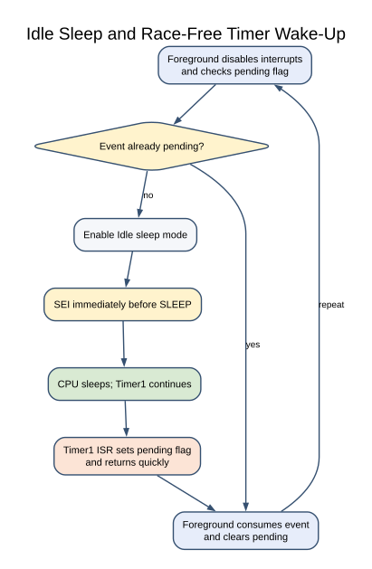

# Idle Sleep with a Timer Wake-Up

## What You Will Learn

In idle sleep, the CPU stops executing instructions while selected peripheral clocks continue running. Lab 43 uses Timer1 to wake the Uno about once per second. The timer interrupt sets a small flag, and the foreground loop toggles the onboard LED after it sees that flag.

Idle mode is chosen because Timer1 must continue counting. Deeper sleep modes can stop clocks needed by a wake source. The Uno board also contains a USB interface and regulator, so measuring MCU sleep alone does not give the current drawn by the complete board.

## Wiring and Peripheral Ownership

No external wiring is required; the example toggles the Uno's onboard D13 LED. Remove other modules if you later measure current. Timer1 and its compare-A interrupt belong to this application; do not link another Timer1 owner at the same time.

At 16 MHz with a prescaler of 256, Timer1 ticks at 62,500 Hz. A compare count of 62,500 ticks gives approximately one second. The CTC configuration uses top count 62,499 because the counter includes zero.

## The Lost-Wake-Up Problem



The foreground code checks a `pending` flag and then enters sleep. If an interrupt arrives between those two actions, the CPU could go to sleep after the event has already been handled and remain asleep until another event.

Lab 43 briefly disables interrupts while it checks the flag and enables the sleep instruction. It then enables interrupts immediately before executing the sleep instruction. The AVR guarantees the instruction after `SEI` runs before a pending interrupt is serviced, which closes this check-to-sleep gap. The ISR stays short: it only sets the one-byte flag.

Several timer events may coalesce while the foreground is busy because `pending` stores only zero or one. This is suitable for a periodic LED demonstration, not for counting every elapsed second under arbitrary foreground load.

## Build and Try the Lab

```powershell
python atmega328p-labs/tools/build.py 43-sleep --compiler gcc
python atmega328p-labs/tools/build.py 43-sleep --compiler xc8
```

After uploading, the onboard LED should toggle after each timer wake event. The firmware build passes, but this course has not physically measured the wake interval or current draw.

## Common Problems and Limits

- **The CPU does not wake:** Check that Timer1 compare-A interrupt is enabled and the selected sleep mode leaves Timer1 running.
- **The LED toggles slower under load:** The one-bit pending flag coalesces multiple wake events.
- **A deeper mode never wakes:** Confirm the chosen peripheral clock remains available in that mode.
- **Measured board current remains high:** USB bridge, regulator, power LED and connected modules also consume current.
- **The application enters sleep immediately:** Ensure the flag check and sleep enable remain within the protected sequence.

## Code Walkthrough

### Race-free idle sleep with tick wakeup
The example's `main()` configures its peripherals, runs the algorithm and reports or displays the result. These source operations are listed in execution order:

- `(void)avr_gpio_mode(13U, AVR_GPIO_OUTPUT);` - Maps the Uno header pin to its AVR port, sets its DDR direction bit and prepares the PORT latch for the requested initial level or pull-up.
- `(void)avr_timer_ctc(AVR_TIMER1, 256U, 62499U);` - Configures 1 in CTC mode with prescaler 256 and OCRnA TOP 62499; event rate is 16 MHz / (256 x (62499 + 1)) = 1 Hz. The HAL disables this timer's interrupt sources and leaves flag polling to the caller.
- `TIMSK1 = _BV(OCIE1A);` - Controls Timer1 interrupt enables; only the selected event sources can request an interrupt.
- `SMCR = 0U;` - Selects idle sleep mode and leaves sleep-enable clear until the race-free sleep sequence.
- `sei();` - Enables global interrupts after the example has configured its sources and shared state.
- `for (;;)` - Repeats the foreground task indefinitely; each pass checks inputs, advances the calculation or services the peripheral shown below.
- `cli();` - Disables global interrupts briefly so the following shared-state check cannot race an ISR.
- `if (pending == 0U)` - Checks whether the counter or status has reached zero before taking the next action.
- `sleep_enable();` - This statement participates in the operation sequence; follow its expression to see which state or output changes.
- `sleep_cpu();` - Enters the selected sleep state; a configured interrupt wakes the CPU and execution resumes after this instruction.
- `sleep_disable();` - This statement participates in the operation sequence; follow its expression to see which state or output changes.
- `pending = 0U;` - Clears the state/counter after its threshold is reached so the next interval starts from zero.
- `(void)avr_gpio_toggle(13U);` - Atomically toggles the selected pin output latch.

Algorithm: The test of the pending flag and sleep enable are protected. The instruction after SEI executes before a pending interrupt is serviced, closing the lost-wakeup window. Uno board circuitry still consumes power.
Expected behaviour: CPU sleeps between one-second Timer1 wake events
**HAL source files in this repository:** [ATmega328P HAL on GitHub](https://github.com/arnabdasbwn/atmega328p-hal)

- [`include/avr_hal/gpio.h`](https://github.com/arnabdasbwn/atmega328p-hal/blob/main/include/avr_hal/gpio.h)
- [`include/avr_hal/timer.h`](https://github.com/arnabdasbwn/atmega328p-hal/blob/main/include/avr_hal/timer.h)
- [`src/gpio.c`](https://github.com/arnabdasbwn/atmega328p-hal/blob/main/src/gpio.c)
- [`src/timer.c`](https://github.com/arnabdasbwn/atmega328p-hal/blob/main/src/timer.c)


## Check Your Understanding

1. Why does Lab 43 use idle mode rather than a deeper sleep mode?
2. What does the one-byte `pending` flag do if two timer events occur before the foreground handles either one?
3. Why is the flag check protected with interrupts disabled?

**Suggested answers:** Timer1 must continue counting to wake the CPU. Two events coalesce into one pending indication. The protected check-and-sleep sequence prevents the CPU from missing an event in the short interval before sleep.

## Source and Further Reading

- [Lab 43 source](<https://github.com/arnabdasbwn/atmega328p-labs/blob/main/examples/43-sleep/main.c>)
- [ATmega328P Documentation](https://www.microchip.com/en-us/product/ATMEGA328P), sleep and Timer1 sections.
- Measure the complete board's current separately from the microcontroller's datasheet current.
