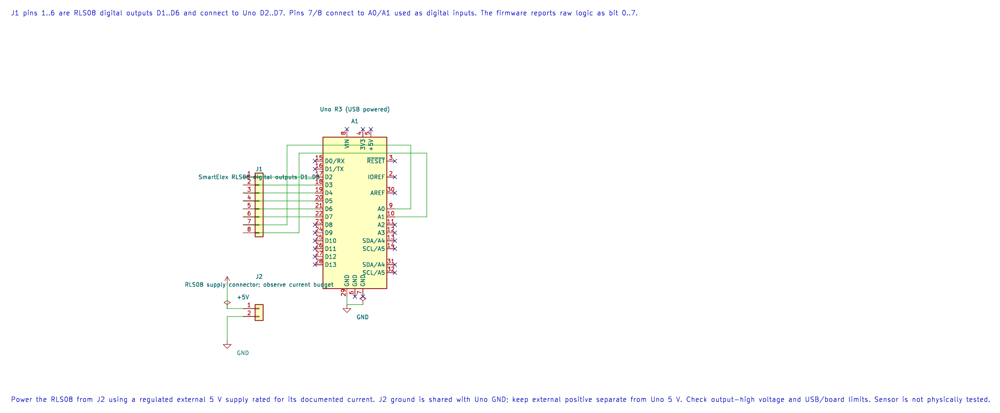

# Smartelex RLS08 Eight-Channel Line Sensor

## What You Will Learn

- Identify the analog and digital outputs on an RLS08 eight-sensor board.
- Read eight digital channels as one bit mask using Uno GPIO.
- Adjust the individual comparators and record the real output polarity.
- Keep the sensor supply and its logic outputs within the Uno's limits.

## How the Sensor Array Works

The SmartElex RLS08 has eight infrared emitter/receiver pairs. Its board exposes analog sensor voltages and comparator outputs. Each small trimmer changes a channel's comparison threshold. The analog signal varies with the reflected light; the digital output changes state around its adjusted threshold.

The supplied board manual lists a 4.5–5.0 V supply, about 150 mA current, and a recommended sensor height around 3 mm, with 6 mm as the maximum recommended distance. Those figures refer to that manual's board revision; check the markings and instructions for the exact unit you have. Its eight channels are spaced about 15 mm apart.

## Wiring Lab 76

The example uses the digital header only. It reads channels D1–D6 on Uno D2–D7, then channels D7 and D8 on Uno A0 and A1 as digital inputs. The Uno's analog header pins can also act as GPIO.



| RLS08 Signal | Uno R3 | Purpose |
| --- | --- | --- |
| Digital D1 | D2 | Channel 1 input, reported in bit 0 |
| Digital D2–D6 | D3–D7 | Channels 2–6 inputs |
| Digital D7, D8 | A0, A1 | Channels 7–8 inputs |
| +5 V | External regulated 5 V supply | Power the array; allow for its current draw |
| GND | Supply ground and Uno GND | Shared reference |
| Serial USB | Terminal, 9600 baud, 8N1 | Shows the raw mask |

Power the RLS08 from its own regulated 5 V supply rated for the documented current. Join supply ground to Uno GND, but keep the external positive rail separate from the Uno 5 V pin. Do not connect two 5 V supplies together. Before attaching the eight outputs, check the board's output-high voltage. The manual describes an LM358 comparator output; confirm it reaches the Uno's valid input-high range at your supply voltage.

## Build, Calibrate and Read the Mask

```powershell
python "atmega328p-labs/tools/build.py" 76-rls08-digital --compiler gcc
python "atmega328p-labs/tools/build.py" 76-rls08-digital --compiler xc8
```

The firmware prints one hexadecimal byte every 50 ms. A high electrical level sets the corresponding bit, regardless of whether that level means black or white. For example, `0x01` means channel 1 was high and the other seven were low. Turn off local echo in the serial terminal so the displayed bytes are not duplicated.

Position the board at a fixed height above a white surface. Move a narrow dark strip under each channel in turn, and record which bit changes and in what direction. Adjust that sensor's trimmer until the output changes consistently near the intended boundary. Repeat under the lighting and surface conditions of the final robot.

This is a sensor-reading exercise, not a line-following controller. A robot also needs calibrated sensor position, a policy for intersections and lost lines, and motor-control feedback.

## Code Walkthrough

### SmartElex RLS08 digital sensor mask
The example's `main()` configures its peripherals, runs the algorithm and reports or displays the result. These source operations are listed in execution order:

- `static const uint8_t pins[8] = {2U, 3U, 4U, 5U, 6U, 7U, 14U, 15U};` - Stores this intermediate or output value for the next algorithm step. Check the units and range represented by each operand.
- `for (uint8_t index = 0U; index < 8U; ++index)` - Repeats while `index < 8U` is true; `uint8_t index = 0U` sets the starting state and `++index` advances it each pass.
- `if (avr_gpio_mode(pins[index], AVR_GPIO_INPUT) != AVR_OK)` - This checks for any setup or transfer error before the program continues. Maps the Uno header pin to its AVR port, sets its DDR direction bit and prepares the PORT latch for the requested initial level or pull-up.
- `for (;;)` - Repeats the foreground task indefinitely; each pass checks inputs, advances the calculation or services the peripheral shown below.
- `if (avr_uart_init(9600UL) != AVR_OK)` - This checks for any setup or transfer error before the program continues. Configures USART0 for asynchronous 8N1. It chooses a baud divisor and normal/double-speed mode, programs UBRR0/UCSR0A/UCSR0C, then enables receive and transmit in UCSR0B.
- `uint8_t mask = 0U;` - Clears the state/counter after its threshold is reached so the next interval starts from zero.
- `avr_status_t status = read_sensor_mask(&mask);` - Use the linked public header for this function's parameters, register ownership, blocking behavior and status values.
- `if (status == AVR_OK)` - Only enters the following block when the operation reports success.
- `status = print_hex_byte(mask);` - Stores this intermediate or output value for the next algorithm step. Check the units and range represented by each operand.
- `status = avr_uart_write((const uint8_t *)"\r\n", 2U, AVR_POLL_BUDGET);` - Sends the specified bytes through USART0; a timeout can occur after a prefix has already been sent.
- `if (status != AVR_OK)` - Tests the stated condition; the following block handles the matching case and the other path is skipped.
- `_delay_ms(50);` - Waits for the stated interval; the foreground does no other work during this blocking delay.

Algorithm: An eight-channel reflectance board exposes both analog and thresholded digital signals. The board trimmers set the comparator thresholds; raw logic polarity must be observed for the exact sensor, surface and adjustment.
Expected behaviour: The terminal prints one hexadecimal byte every 50 ms. Each bit is HIGH when the matching array output is electrically high; the bit order is channel 1 in bit 0 through channel 8 in bit 7
**HAL source files in this repository:** [ATmega328P HAL on GitHub](https://github.com/arnabdasbwn/atmega328p-hal)

- [`include/avr_hal/gpio.h`](https://github.com/arnabdasbwn/atmega328p-hal/blob/main/include/avr_hal/gpio.h)
- [`include/avr_hal/uart.h`](https://github.com/arnabdasbwn/atmega328p-hal/blob/main/include/avr_hal/uart.h)
- [`src/gpio.c`](https://github.com/arnabdasbwn/atmega328p-hal/blob/main/src/gpio.c)
- [`src/uart.c`](https://github.com/arnabdasbwn/atmega328p-hal/blob/main/src/uart.c)


## Common Problems

- **No bits change:** Check array power, common ground, channel order, target distance and each trimmer.
- **The mask is reversed:** The firmware reports electrical HIGH as one. It does not label black or white.
- **Channels respond differently:** Adjust each comparator and keep sensor height and ambient light stable.
- **Uno inputs do not read HIGH reliably:** Measure the board output voltage and compare it with the ATmega328P's input thresholds before direct connection.
- **The array resets or the 5 V rail falls:** The sensor current may be too high for the chosen supply arrangement.

## Try It Yourself

Why does the example report a raw bit mask instead of hard-coding one value as “line detected”?

**Answer:** The comparator threshold, optical height, surface and output polarity affect the result. First observe the actual board and adjust its trimmers; then write the robot policy for that setup.

## References

- [SmartElex RLS08 board manual](https://robu.in/wp-content/uploads/2018/06/SmartElex-RLS08_manual-1.pdf)
- [Lab 76 source and wiring metadata](<https://github.com/arnabdasbwn/atmega328p-labs/blob/main/examples/76-rls08-digital/main.c>)
- [AVR GPIO concepts](gpio-concepts.md)
- [ATmega328P documentation](https://www.microchip.com/en-us/product/ATMEGA328P)
