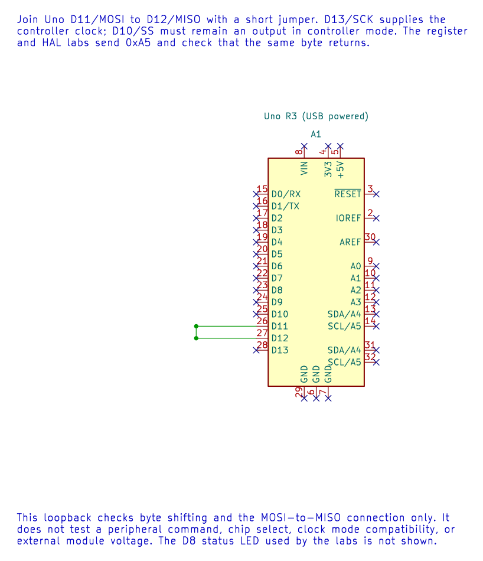

# SPI Concepts

## Objectives and Prerequisites

Serial Peripheral Interface (SPI) moves bits between a controller and one or more peripherals. You will identify the four common signals, explain why a clock mode matters and plan a simple transaction. Review [GPIO concepts](gpio-concepts.md) and [logic levels and safe loads](electrical.md).

## Four Signals

| Signal | Uno R3 pin | Direction in controller mode | Purpose |
| --- | --- | --- | --- |
| SCK | D13 | Out | Clock generated by the controller |
| MOSI / COPI | D11 | Out | Data from controller to peripheral |
| MISO / CIPO | D12 | In | Data from peripheral to controller |
| SS / CS | D10 or another GPIO | Out | Select one peripheral; usually active low |

Names MOSI/MISO and COPI/CIPO describe the same data directions. A single SPI bus can share SCK, MOSI and MISO across peripherals, with a separate chip-select signal for each. Unselected peripherals must release MISO as their data sheet specifies.



For the first test, a jumper connects D11 directly to D12. Every transmitted bit then returns to the controller. This confirms a basic byte transfer, but it does not test a peripheral protocol.

## Full-Duplex Shifting

An SPI transfer shifts one bit out while one bit shifts in. Even when the application only wants to send a command, the controller receives a byte during the same clocks. Chip select frames the command and response: assert it, transfer the required bytes, then release it according to the peripheral timing requirements.

SPI has no single universal clock mode. CPOL selects the idle clock level; CPHA selects which clock edge samples data. The peripheral data sheet specifies the required mode and maximum clock rate. If mode or edge timing is wrong, the received bits can be shifted or corrupted.

| SPI Mode | CPOL | CPHA | SCK Idle Level | Sample Edge |
| --- | --- | --- | --- | --- |
| 0 | 0 | 0 | Low | First edge: rising |
| 1 | 0 | 1 | Low | Second edge: falling |
| 2 | 1 | 0 | High | First edge: falling |
| 3 | 1 | 1 | High | Second edge: rising |

The **first edge** is the first transition away from the idle level. Confirm the peripheral's timing diagram because its data sheet may describe the edge from the peripheral's point of view.

SPI does not define a universal packet format, acknowledgement or error recovery. Those rules belong to each peripheral protocol. Check the device's command bytes, address format, timing, reset sequence and response behaviour.

## Worked Clock Calculation

For the Uno's 16 MHz clock and a divider of 16:

`f_SCK = 16 MHz / 16 = 1 MHz`

The peripheral must support that clock under the actual supply and operating conditions. The course SPI HAL supports the AVR dividers 2, 4, 8, 16, 32, 64 and 128 and SPI modes 0 to 3.

The register-level and HAL loopback programs use mode 0 at 1 MHz. They send `0xA5`; with D11 joined to D12, the received byte should also be `0xA5`. This is a useful first check before adding a device-specific command protocol.

Build the two loopback examples from the course root:

```powershell
python atmega328p-labs/tools/build.py 70-spi-register-loopback --compiler xc8
python atmega328p-labs/tools/build.py 21-spi-loopback --compiler gcc
```

These are software build checks. They do not test a physical jumper or peripheral.

## Exercise with Answer

Two SPI peripherals share D11 and D13. How can the controller address one peripheral at a time?

**Answer:** Give each peripheral its own chip-select GPIO. Keep both deselected, assert only the intended device's CS for its transaction, then release it. Confirm that the other device does not drive MISO while unselected.

## Code Walkthrough

### SPI Register-Level Controller Loopback
The example's `main()` configures its peripherals, runs the algorithm and reports or displays the result. These source operations are listed in execution order:

- `uint8_t received = 0U;` - Clears the state/counter after its threshold is reached so the next interval starts from zero.
- `for (;;)` - Repeats the foreground task indefinitely; each pass checks inputs, advances the calculation or services the peripheral shown below.
- `spi_result_t result = spi_transfer(0xA5U, &received);` - Stores this intermediate or output value for the next algorithm step. Check the units and range represented by each operand.
- `bool passed = (result == SPI_RESULT_OK) && (received == 0xA5U);` - Stores this intermediate or output value for the next algorithm step. Check the units and range represented by each operand.
- `if (passed)` - Tests the stated condition; the following block handles the matching case and the other path is skipped.
- `PORTB |= _BV(PORTB0);` - Sets or clears the Port B output latch. When the pin is an output, this determines its output level; on an input, it controls the pull-up.
- `PORTB &= (uint8_t)~_BV(PORTB0);` - Sets or clears the Port B output latch. When the pin is an output, this determines its output level; on an input, it controls the pull-up.
- `_delay_ms(100);` - Waits for the stated interval; the foreground does no other work during this blocking delay.

Algorithm: Directly configures SPCR/SPSR for mode 0 at 16 MHz / 16 = 1 MHz, polls SPIF with a finite iteration budget, reads SPSR before SPDR and checks the returned byte.
Expected behaviour: The D8 result LED lights while 0xA5 is received correctly and turns off after a transfer error
**HAL source files in this repository:** [ATmega328P HAL on GitHub](https://github.com/arnabdasbwn/atmega328p-hal)


### SPI controller loopback
The example's `main()` configures its peripherals, runs the algorithm and reports or displays the result. These source operations are listed in execution order:

- `(void)avr_spi_init(0U, 16U);` - Configures SPI controller mode and clock divider and prepares the Uno SPI pins. Check the call arguments and spi.h for the exact clock setting and pin ownership.
- `(void)avr_gpio_mode(8U, AVR_GPIO_OUTPUT);` - Maps the Uno header pin to its AVR port, sets its DDR direction bit and prepares the PORT latch for the requested initial level or pull-up.
- `for (;;)` - Repeats the foreground task indefinitely; each pass checks inputs, advances the calculation or services the peripheral shown below.
- `avr_status_t status = avr_spi_transfer(0xA5U, &received, AVR_POLL_BUDGET);` - Writes one byte to SPDR, waits within the poll budget for completion and returns the simultaneously received byte.
- `(void)avr_gpio_write(8U, (status == AVR_OK) && (received == 0xA5U));` - Changes the pin's PORT output latch; for an input pin this selects its pull-up state.
- `_delay_ms(100);` - Waits for the stated interval; the foreground does no other work during this blocking delay.

Algorithm: At divider 16, SCK=1 MHz. Loopback verifies shifting and wiring but does not verify a peripheral command set or chip-select timing.
Expected behaviour: D8 LED lights if 0xA5 returns correctly
**HAL source files in this repository:** [ATmega328P HAL on GitHub](https://github.com/arnabdasbwn/atmega328p-hal)

- [`include/avr_hal/gpio.h`](https://github.com/arnabdasbwn/atmega328p-hal/blob/main/include/avr_hal/gpio.h)
- [`include/avr_hal/spi.h`](https://github.com/arnabdasbwn/atmega328p-hal/blob/main/include/avr_hal/spi.h)
- [`src/gpio.c`](https://github.com/arnabdasbwn/atmega328p-hal/blob/main/src/gpio.c)
- [`src/spi.c`](https://github.com/arnabdasbwn/atmega328p-hal/blob/main/src/spi.c)


### MAX7219 8x8 LED matrix
The example's `main()` configures its peripherals, runs the algorithm and reports or displays the result. These source operations are listed in execution order:

- `avr_status_t status = matrix_show_a();` - Use the linked public header for this function's parameters, register ownership, blocking behavior and status values.
- `if (status != AVR_OK)` - Tests the stated condition; the following block handles the matching case and the other path is skipped.
- `(void)avr_gpio_write(MATRIX_CS_PIN, true);` - Changes the pin's PORT output latch; for an input pin this selects its pull-up state.
- `for (;;)` - Repeats the foreground task indefinitely; each pass checks inputs, advances the calculation or services the peripheral shown below.

Algorithm: The MAX7219 scans the matrix internally and accepts addressed register writes over SPI mode 0.
Expected behaviour: The matrix displays a capital A; orientation may differ by module
**HAL source files in this repository:** [ATmega328P HAL on GitHub](https://github.com/arnabdasbwn/atmega328p-hal)

- [`include/avr_hal/gpio.h`](https://github.com/arnabdasbwn/atmega328p-hal/blob/main/include/avr_hal/gpio.h)
- [`include/avr_hal/spi.h`](https://github.com/arnabdasbwn/atmega328p-hal/blob/main/include/avr_hal/spi.h)
- [`src/gpio.c`](https://github.com/arnabdasbwn/atmega328p-hal/blob/main/src/gpio.c)
- [`src/spi.c`](https://github.com/arnabdasbwn/atmega328p-hal/blob/main/src/spi.c)


## References

- Microchip, [ATmega328P product documentation](https://www.microchip.com/en-us/product/ATMEGA328P), SPI serial interface chapter.
- [ATmega328P SPI loopback lab](<https://github.com/arnabdasbwn/atmega328p-labs/blob/main/examples/21-spi-loopback/main.c>)
- [Register-level loopback lab](<https://github.com/arnabdasbwn/atmega328p-labs/blob/main/examples/70-spi-register-loopback/main.c>)
- [MAX7219 matrix lab](<https://github.com/arnabdasbwn/atmega328p-labs/blob/main/examples/48-led-matrix-max7219/main.c>)
- [SPI registers](spi-registers.md)
- SPI loopback schematic, ERC report and netlist
- [Rendered loopback diagram](../assets/circuits/spi-loopback/spi-loopback.svg)
