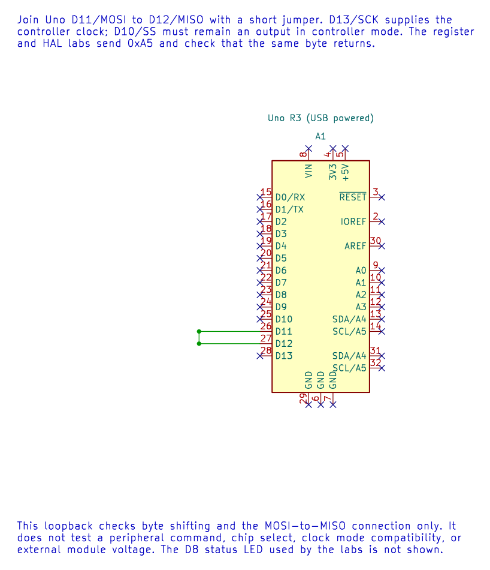

# Using the SPI HAL

## Public Interface

The SPI interface is declared in [`avr_hal/spi.h`](https://github.com/arnabdasbwn/atmega328p-hal/blob/main/include/avr_hal/spi.h) and implemented in [`spi.c`](https://github.com/arnabdasbwn/atmega328p-hal/blob/main/src/spi.c). `avr_spi_init(mode, divider)` configures the AVR controller for MSB-first transfers. `avr_spi_transfer(transmit, &receive, budget)` shifts one byte in and one byte out.

The supported mode values are 0 to 3. Supported clock dividers are 2, 4, 8, 16, 32, 64 and 128. The transfer requires a non-null receive pointer and an initialized controller. It reports explicit statuses for an invalid argument, disabled controller, timeout or write collision.

## Pin and Transaction Ownership

The HAL configures D10/SS as an output high, D11/MOSI and D13/SCK as outputs, and D12/MISO as an input. It does not select a peripheral: the application owns each device's CS signal and must assert and release it around the correct bytes.

Transfers are foreground-only, bounded and nonreentrant. If a timeout occurs, the shift may still be active; deassert CS and reinitialize the peripheral before retrying. Do not call this blocking byte-transfer function from an ISR.

## Compare the Consumers

The [register-level loopback lab](<https://github.com/arnabdasbwn/atmega328p-labs/blob/main/examples/70-spi-register-loopback/main.c>) shows the peripheral setup and byte sequence. The [HAL loopback lab](<https://github.com/arnabdasbwn/atmega328p-labs/blob/main/examples/21-spi-loopback/main.c>) checks whether `0xA5` returns over a jumper wire through the reusable interface. The [MAX7219 matrix example](<https://github.com/arnabdasbwn/atmega328p-labs/blob/main/examples/48-led-matrix-max7219/main.c>) uses the same byte interface to send a device-specific register address and value. The HAL knows how to shift a byte; it does not interpret a MAX7219 command.



Build `21-spi-loopback` or `48-led-matrix-max7219` with the course build script. Inspect the public header for the exact timeout-budget unit and post-error behaviour before writing a new driver.

For example, build both the loopback consumer and MAX7219 consumer with XC8:

```powershell
python atmega328p-labs/tools/build.py 21-spi-loopback --compiler xc8
python atmega328p-labs/tools/build.py 48-led-matrix-max7219 --compiler xc8
```

The loopback return-byte check is suitable for a jumper test. It is not evidence that a MAX7219 module, its supply or its display wiring works.

## Exercise with Answer

Does `avr_spi_transfer()` automatically toggle the selected display's chip-select pin?

**Answer:** No. The application owns the peripheral CS line. The HAL provides the shared SPI pins and one-byte transfer operation, while the device driver implements the peripheral's transaction rules.

## Code Walkthrough

### SPI Register-Level Controller Loopback
The example's `main()` configures its peripherals, runs the algorithm and reports or displays the result. These source operations are listed in execution order:

- `uint8_t received = 0U;` - Clears the state/counter after its threshold is reached so the next interval starts from zero.
- `for (;;)` - Repeats the foreground task indefinitely; each pass checks inputs, advances the calculation or services the peripheral shown below.
- `spi_result_t result = spi_transfer(0xA5U, &received);` - Stores this intermediate or output value for the next algorithm step. Check the units and range represented by each operand.
- `bool passed = (result == SPI_RESULT_OK) && (received == 0xA5U);` - Stores this intermediate or output value for the next algorithm step. Check the units and range represented by each operand.
- `if (passed)` - Tests the stated condition; the following block handles the matching case and the other path is skipped.
- `PORTB |= _BV(PORTB0);` - Sets or clears the Port B output latch. When the pin is an output, this determines its output level; on an input, it controls the pull-up.
- `PORTB &= (uint8_t)~_BV(PORTB0);` - Sets or clears the Port B output latch. When the pin is an output, this determines its output level; on an input, it controls the pull-up.
- `_delay_ms(100);` - Waits for the stated interval; the foreground does no other work during this blocking delay.

Algorithm: Directly configures SPCR/SPSR for mode 0 at 16 MHz / 16 = 1 MHz, polls SPIF with a finite iteration budget, reads SPSR before SPDR and checks the returned byte.
Expected behaviour: The D8 result LED lights while 0xA5 is received correctly and turns off after a transfer error
**HAL source files in this repository:** [ATmega328P HAL on GitHub](https://github.com/arnabdasbwn/atmega328p-hal)


### SPI controller loopback
The example's `main()` configures its peripherals, runs the algorithm and reports or displays the result. These source operations are listed in execution order:

- `(void)avr_spi_init(0U, 16U);` - Configures SPI controller mode and clock divider and prepares the Uno SPI pins. Check the call arguments and spi.h for the exact clock setting and pin ownership.
- `(void)avr_gpio_mode(8U, AVR_GPIO_OUTPUT);` - Maps the Uno header pin to its AVR port, sets its DDR direction bit and prepares the PORT latch for the requested initial level or pull-up.
- `for (;;)` - Repeats the foreground task indefinitely; each pass checks inputs, advances the calculation or services the peripheral shown below.
- `avr_status_t status = avr_spi_transfer(0xA5U, &received, AVR_POLL_BUDGET);` - Writes one byte to SPDR, waits within the poll budget for completion and returns the simultaneously received byte.
- `(void)avr_gpio_write(8U, (status == AVR_OK) && (received == 0xA5U));` - Changes the pin's PORT output latch; for an input pin this selects its pull-up state.
- `_delay_ms(100);` - Waits for the stated interval; the foreground does no other work during this blocking delay.

Algorithm: At divider 16, SCK=1 MHz. Loopback verifies shifting and wiring but does not verify a peripheral command set or chip-select timing.
Expected behaviour: D8 LED lights if 0xA5 returns correctly
**HAL source files in this repository:** [ATmega328P HAL on GitHub](https://github.com/arnabdasbwn/atmega328p-hal)

- [`include/avr_hal/gpio.h`](https://github.com/arnabdasbwn/atmega328p-hal/blob/main/include/avr_hal/gpio.h)
- [`include/avr_hal/spi.h`](https://github.com/arnabdasbwn/atmega328p-hal/blob/main/include/avr_hal/spi.h)
- [`src/gpio.c`](https://github.com/arnabdasbwn/atmega328p-hal/blob/main/src/gpio.c)
- [`src/spi.c`](https://github.com/arnabdasbwn/atmega328p-hal/blob/main/src/spi.c)


### MAX7219 8x8 LED matrix
The example's `main()` configures its peripherals, runs the algorithm and reports or displays the result. These source operations are listed in execution order:

- `avr_status_t status = matrix_show_a();` - Use the linked public header for this function's parameters, register ownership, blocking behavior and status values.
- `if (status != AVR_OK)` - Tests the stated condition; the following block handles the matching case and the other path is skipped.
- `(void)avr_gpio_write(MATRIX_CS_PIN, true);` - Changes the pin's PORT output latch; for an input pin this selects its pull-up state.
- `for (;;)` - Repeats the foreground task indefinitely; each pass checks inputs, advances the calculation or services the peripheral shown below.

Algorithm: The MAX7219 scans the matrix internally and accepts addressed register writes over SPI mode 0.
Expected behaviour: The matrix displays a capital A; orientation may differ by module
**HAL source files in this repository:** [ATmega328P HAL on GitHub](https://github.com/arnabdasbwn/atmega328p-hal)

- [`include/avr_hal/gpio.h`](https://github.com/arnabdasbwn/atmega328p-hal/blob/main/include/avr_hal/gpio.h)
- [`include/avr_hal/spi.h`](https://github.com/arnabdasbwn/atmega328p-hal/blob/main/include/avr_hal/spi.h)
- [`src/gpio.c`](https://github.com/arnabdasbwn/atmega328p-hal/blob/main/src/gpio.c)
- [`src/spi.c`](https://github.com/arnabdasbwn/atmega328p-hal/blob/main/src/spi.c)


## References

- [SPI HAL header](https://github.com/arnabdasbwn/atmega328p-hal/blob/main/include/avr_hal/spi.h) and [implementation](https://github.com/arnabdasbwn/atmega328p-hal/blob/main/src/spi.c)
- [SPI programming](spi-programming.md)
The current HAL headers and implementation are documented in the HAL Library README and API comments.
- SPI loopback schematic and verified netlist
- [Rendered loopback diagram](../assets/circuits/spi-loopback/spi-loopback.svg)
