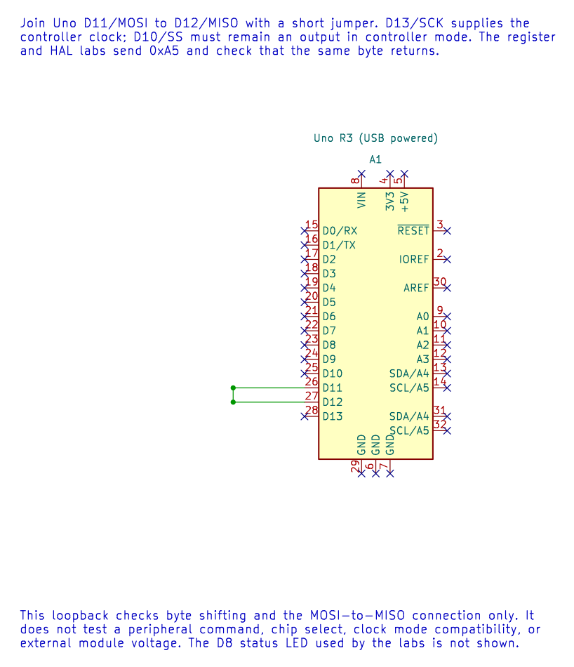

# Programming an SPI Transaction

## Start with a Loopback

Before adding a peripheral protocol, the [SPI loopback lab](<https://github.com/arnabdasbwn/atmega328p-labs/blob/main/examples/21-spi-loopback/main.c>) connects Uno D11/MOSI to D12/MISO. It transmits `0xA5` and checks whether the same byte returns. An LED on D8 shows a passing transfer, while D10 stays configured as an output and SCK is on D13.

[Lab 70](<https://github.com/arnabdasbwn/atmega328p-labs/blob/main/examples/70-spi-register-loopback/main.c>) performs the same test using `SPCR`, `SPSR` and `SPDR` directly. [Lab 21](<https://github.com/arnabdasbwn/atmega328p-labs/blob/main/examples/21-spi-loopback/main.c>) repeats it through the SPI HAL. Compare the two implementations before connecting a display or sensor.

Loopback checks the controller's byte transfer and basic wiring. It does not prove that a sensor, display or memory chip understands a command sequence. For that, the target peripheral and its exact data sheet are required.



## A Transaction Has a Clear Boundary

For a typical peripheral transaction:

1. Configure the SPI mode and clock required by its data sheet.
2. Configure its CS pin as an output and leave it inactive.
3. Assert CS.
4. Send command and data bytes in the documented order, collecting response bytes if required.
5. Release CS even when a transfer reports an error.
6. Handle timeout or peripheral-specific error status before retrying.

The CS setup and hold times, byte count and response meaning vary by device. The MAX7219 lesson is a complete example: it writes an address byte and a data byte per selected transaction. The HAL bounds each byte transfer, but the caller still owns the peripheral protocol and CS timing.

## Build and Check

Build both loopback versions and the MAX7219 example with GCC or XC8:

```powershell
python atmega328p-labs/tools/build.py 70-spi-register-loopback --compiler gcc
python atmega328p-labs/tools/build.py 70-spi-register-loopback --compiler xc8
python atmega328p-labs/tools/build.py 21-spi-loopback --compiler gcc
python atmega328p-labs/tools/build.py 21-spi-loopback --compiler xc8
python atmega328p-labs/tools/build.py 48-led-matrix-max7219 --compiler gcc
python atmega328p-labs/tools/build.py 48-led-matrix-max7219 --compiler xc8
```

Read each lab's wiring before attaching hardware. Build checks do not establish physical loopback or external display behaviour.

Why is loopback not enough to claim that an SPI display works?

**Answer:** Loopback sends the controller's output wire directly back to its input. It never tests the display's chip select, command format, register addresses, timing or response behaviour.

## Code Walkthrough

### SPI Register-Level Controller Loopback
The example's `main()` configures its peripherals, runs the algorithm and reports or displays the result. These source operations are listed in execution order:

- `uint8_t received = 0U;` - Clears the state/counter after its threshold is reached so the next interval starts from zero.
- `for (;;)` - Repeats the foreground task indefinitely; each pass checks inputs, advances the calculation or services the peripheral shown below.
- `spi_result_t result = spi_transfer(0xA5U, &received);` - Stores this intermediate or output value for the next algorithm step. Check the units and range represented by each operand.
- `bool passed = (result == SPI_RESULT_OK) && (received == 0xA5U);` - Stores this intermediate or output value for the next algorithm step. Check the units and range represented by each operand.
- `if (passed)` - Tests the stated condition; the following block handles the matching case and the other path is skipped.
- `PORTB |= _BV(PORTB0);` - Sets or clears the Port B output latch. When the pin is an output, this determines its output level; on an input, it controls the pull-up.
- `PORTB &= (uint8_t)~_BV(PORTB0);` - Sets or clears the Port B output latch. When the pin is an output, this determines its output level; on an input, it controls the pull-up.
- `_delay_ms(100);` - Waits for the stated interval; the foreground does no other work during this blocking delay.

Algorithm: Directly configures SPCR/SPSR for mode 0 at 16 MHz / 16 = 1 MHz, polls SPIF with a finite iteration budget, reads SPSR before SPDR and checks the returned byte.
Expected behaviour: The D8 result LED lights while 0xA5 is received correctly and turns off after a transfer error
**HAL source files in this repository:** [ATmega328P HAL on GitHub](https://github.com/arnabdasbwn/atmega328p-hal)


### SPI controller loopback
The example's `main()` configures its peripherals, runs the algorithm and reports or displays the result. These source operations are listed in execution order:

- `(void)avr_spi_init(0U, 16U);` - Configures SPI controller mode and clock divider and prepares the Uno SPI pins. Check the call arguments and spi.h for the exact clock setting and pin ownership.
- `(void)avr_gpio_mode(8U, AVR_GPIO_OUTPUT);` - Maps the Uno header pin to its AVR port, sets its DDR direction bit and prepares the PORT latch for the requested initial level or pull-up.
- `for (;;)` - Repeats the foreground task indefinitely; each pass checks inputs, advances the calculation or services the peripheral shown below.
- `avr_status_t status = avr_spi_transfer(0xA5U, &received, AVR_POLL_BUDGET);` - Writes one byte to SPDR, waits within the poll budget for completion and returns the simultaneously received byte.
- `(void)avr_gpio_write(8U, (status == AVR_OK) && (received == 0xA5U));` - Changes the pin's PORT output latch; for an input pin this selects its pull-up state.
- `_delay_ms(100);` - Waits for the stated interval; the foreground does no other work during this blocking delay.

Algorithm: At divider 16, SCK=1 MHz. Loopback verifies shifting and wiring but does not verify a peripheral command set or chip-select timing.
Expected behaviour: D8 LED lights if 0xA5 returns correctly
**HAL source files in this repository:** [ATmega328P HAL on GitHub](https://github.com/arnabdasbwn/atmega328p-hal)

- [`include/avr_hal/gpio.h`](https://github.com/arnabdasbwn/atmega328p-hal/blob/main/include/avr_hal/gpio.h)
- [`include/avr_hal/spi.h`](https://github.com/arnabdasbwn/atmega328p-hal/blob/main/include/avr_hal/spi.h)
- [`src/gpio.c`](https://github.com/arnabdasbwn/atmega328p-hal/blob/main/src/gpio.c)
- [`src/spi.c`](https://github.com/arnabdasbwn/atmega328p-hal/blob/main/src/spi.c)


### MAX7219 8x8 LED matrix
The example's `main()` configures its peripherals, runs the algorithm and reports or displays the result. These source operations are listed in execution order:

- `avr_status_t status = matrix_show_a();` - Use the linked public header for this function's parameters, register ownership, blocking behavior and status values.
- `if (status != AVR_OK)` - Tests the stated condition; the following block handles the matching case and the other path is skipped.
- `(void)avr_gpio_write(MATRIX_CS_PIN, true);` - Changes the pin's PORT output latch; for an input pin this selects its pull-up state.
- `for (;;)` - Repeats the foreground task indefinitely; each pass checks inputs, advances the calculation or services the peripheral shown below.

Algorithm: The MAX7219 scans the matrix internally and accepts addressed register writes over SPI mode 0.
Expected behaviour: The matrix displays a capital A; orientation may differ by module
**HAL source files in this repository:** [ATmega328P HAL on GitHub](https://github.com/arnabdasbwn/atmega328p-hal)

- [`include/avr_hal/gpio.h`](https://github.com/arnabdasbwn/atmega328p-hal/blob/main/include/avr_hal/gpio.h)
- [`include/avr_hal/spi.h`](https://github.com/arnabdasbwn/atmega328p-hal/blob/main/include/avr_hal/spi.h)
- [`src/gpio.c`](https://github.com/arnabdasbwn/atmega328p-hal/blob/main/src/gpio.c)
- [`src/spi.c`](https://github.com/arnabdasbwn/atmega328p-hal/blob/main/src/spi.c)


## References

- [SPI concepts](spi-concepts.md) and [SPI registers](spi-registers.md)
- [SPI loopback lab](<https://github.com/arnabdasbwn/atmega328p-labs/blob/main/examples/21-spi-loopback/main.c>)
- [MAX7219 LED matrix lab](<https://github.com/arnabdasbwn/atmega328p-labs/blob/main/examples/48-led-matrix-max7219/main.c>)
- Editable loopback schematic, ERC report and netlist
- [Rendered loopback diagram](../assets/circuits/spi-loopback/spi-loopback.svg)
