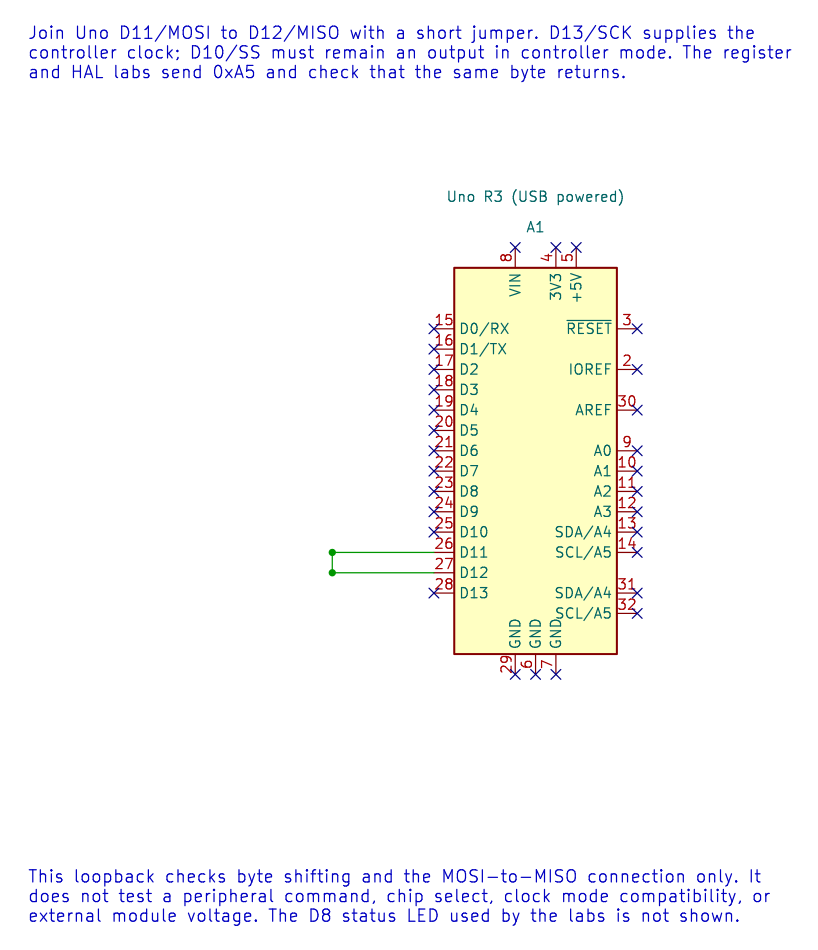

# SPI Questions and Answers

## Questions

Use the [SPI signal table](spi-concepts.md) and the [D11-to-D12 loopback drawing](../assets/circuits/spi-loopback/spi-loopback.svg) if you need to trace the pins before answering.

1. Which Uno pin generates SCK in controller mode?
2. What does CPOL control, and what does CPHA control?
3. At 16 MHz, what is SCK with a divider of 8?
4. Two devices share MOSI and SCK. How does the controller select one?
5. Why does the controller receive a byte during a send-only SPI transfer?
6. What does a successful MOSI-to-MISO loopback establish, and what does it leave untested?

## Answers

1. D13, which maps to the ATmega328P SCK signal on the Uno R3.
2. CPOL sets the idle clock level. CPHA selects the clock edge used to sample data. Read the peripheral timing diagram to choose both.
3. `16 MHz / 8 = 2 MHz`. The peripheral must support that SCK frequency.
4. Give each device a separate chip-select output. Assert only the intended device's select line during its transaction.
5. SPI shifts data in both directions on the same clocks. The received byte may be ignored, but the clocking operation still captures it in the peripheral's data register.
6. It checks the controller's shift path and the connected MOSI/MISO wires. It does not test a real peripheral's command format, timing, chip select or electrical behaviour.

## Continue Learning

Choose a peripheral data sheet, find its SPI mode and maximum clock, and write those requirements beside the code before connecting the device. Then compare the transaction with the [MAX7219 matrix example](<https://github.com/arnabdasbwn/atmega328p-labs/blob/main/examples/48-led-matrix-max7219/main.c>).

The loopback's KiCad source, ERC report and exported netlist are available for review. They verify the drawing's net connections, not a physical Uno or display.

## Code Walkthrough

**Example code on GitHub:**
- [SPI Register-Level Controller Loopback (`70-spi-register-loopback`)](https://github.com/arnabdasbwn/atmega328p-labs/blob/main/examples/70-spi-register-loopback/main.c)
- [SPI controller loopback (`21-spi-loopback`)](https://github.com/arnabdasbwn/atmega328p-labs/blob/main/examples/21-spi-loopback/main.c)

### SPI Register-Level Controller Loopback
The example's `main()` configures its peripherals, runs the algorithm and reports or displays the result. These source operations are listed in execution order:

- `uint8_t received = 0U;` - Clears the state/counter after its threshold is reached so the next interval starts from zero.
- `for (;;)` - Repeats the foreground task indefinitely; each pass checks inputs, advances the calculation or services the peripheral shown below.
- `spi_result_t result = spi_transfer(0xA5U, &received);` - Stores this intermediate or output value for the next algorithm step. Check the units and range represented by each operand.
- `bool passed = (result == SPI_RESULT_OK) && (received == 0xA5U);` - Stores this intermediate or output value for the next algorithm step. Check the units and range represented by each operand.
- `if (passed)` - Tests the stated condition; the following block handles the matching case and the other path is skipped.
- `PORTB |= _BV(PORTB0);` - Sets or clears the Port B output latch. When the pin is an output, this determines its output level; on an input, it controls the pull-up.
- `PORTB &= (uint8_t)~_BV(PORTB0);` - Sets or clears the Port B output latch. When the pin is an output, this determines its output level; on an input, it controls the pull-up.
- `_delay_ms(100);` - Waits for the stated interval; the foreground does no other work during this blocking delay.

Algorithm: Directly configures SPCR/SPSR for mode 0 at 16 MHz / 16 = 1 MHz, polls SPIF with a finite iteration budget, reads SPSR before SPDR and checks the returned byte.
Expected behaviour: The D8 result LED lights while 0xA5 is received correctly and turns off after a transfer error
**HAL source files in this repository:** [ATmega328P HAL on GitHub](https://github.com/arnabdasbwn/atmega328p-hal)

### SPI controller loopback
The example's `main()` configures its peripherals, runs the algorithm and reports or displays the result. These source operations are listed in execution order:

- `(void)avr_spi_init(0U, 16U);` - Configures SPI controller mode and clock divider and prepares the Uno SPI pins. Check the call arguments and spi.h for the exact clock setting and pin ownership.
- `(void)avr_gpio_mode(8U, AVR_GPIO_OUTPUT);` - Maps the Uno header pin to its AVR port, sets its DDR direction bit and prepares the PORT latch for the requested initial level or pull-up.
- `for (;;)` - Repeats the foreground task indefinitely; each pass checks inputs, advances the calculation or services the peripheral shown below.
- `avr_status_t status = avr_spi_transfer(0xA5U, &received, AVR_POLL_BUDGET);` - Writes one byte to SPDR, waits within the poll budget for completion and returns the simultaneously received byte.
- `(void)avr_gpio_write(8U, (status == AVR_OK) && (received == 0xA5U));` - Changes the pin's PORT output latch; for an input pin this selects its pull-up state.
- `_delay_ms(100);` - Waits for the stated interval; the foreground does no other work during this blocking delay.

Algorithm: At divider 16, SCK=1 MHz. Loopback verifies shifting and wiring but does not verify a peripheral command set or chip-select timing.
Expected behaviour: D8 LED lights if 0xA5 returns correctly
**HAL source files in this repository:** [ATmega328P HAL on GitHub](https://github.com/arnabdasbwn/atmega328p-hal)

- [`include/avr_hal/gpio.h`](https://github.com/arnabdasbwn/atmega328p-hal/blob/main/include/avr_hal/gpio.h)
- [`include/avr_hal/spi.h`](https://github.com/arnabdasbwn/atmega328p-hal/blob/main/include/avr_hal/spi.h)
- [`src/gpio.c`](https://github.com/arnabdasbwn/atmega328p-hal/blob/main/src/gpio.c)
- [`src/spi.c`](https://github.com/arnabdasbwn/atmega328p-hal/blob/main/src/spi.c)
