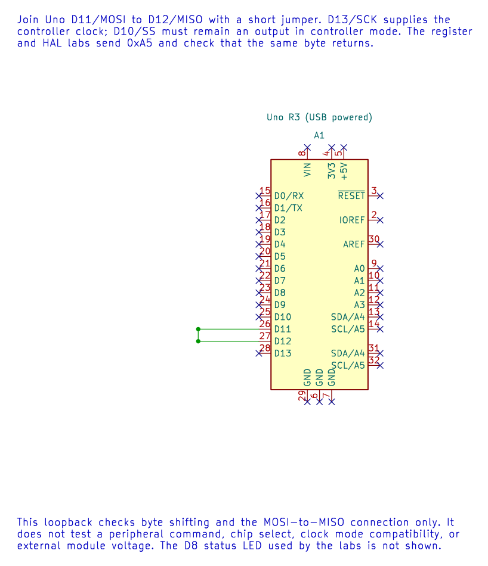

# ATmega328P SPI Registers

## The Main Register Set

The ATmega328P SPI peripheral uses three registers:

| Register | Role |
| --- | --- |
| `SPCR` | Enables SPI, selects controller/device mode, data order, mode and base clock divider |
| `SPSR` | Reports transfer status and the SPI double-speed clock bit |
| `SPDR` | Holds the byte being transmitted or the byte received |

In controller mode, set the Uno SS pin D10 as an output so the hardware does not unexpectedly leave controller mode if SS is sampled low as an input. Configure MOSI and SCK as outputs and MISO as an input. The `MSTR`, `SPE`, `DORD`, `CPOL`, `CPHA`, `SPR1:SPR0` and `SPI2X` bits select the operating mode and clock.

The loopback drawing connects D11/MOSI to D12/MISO. For the register lab, also leave D10/SS configured as an output and connect the LED circuit described in the lab file.



At 16 MHz, the clock-divider bits select these SCK rates:

| `SPI2X` | `SPR1:SPR0` | Divider | SCK |
| --- | --- | --- | --- |
| 0 | 00 | 4 | 4 MHz |
| 0 | 01 | 16 | 1 MHz |
| 0 | 10 | 64 | 250 kHz |
| 0 | 11 | 128 | 125 kHz |
| 1 | 00 | 2 | 8 MHz |
| 1 | 01 | 8 | 2 MHz |
| 1 | 10 | 32 | 500 kHz |
| 1 | 11 | 64 | 250 kHz |

## Transfer Completion and Flags

Write a byte to `SPDR` to start shifting. `SPIF` in `SPSR` indicates completion. The HAL polls this flag with a finite iteration budget, then reads status before reading `SPDR` to clear the completion/collision condition as described by the device documentation. `WCOL` indicates a write collision.

Status flags do not all clear by writing zero. Follow the datasheet's prescribed access sequence; do not apply a generic read-modify-write to peripheral status registers. A finite polling budget bounds how many checks the code makes. It is not an elapsed-time deadline unless the clock and generated code are also accounted for.

## Read the Mode from the Peripheral Data Sheet

For SPI mode 0, `CPOL=0` and `CPHA=0`. The clock idles low and data is sampled on the leading edge. The HAL call `avr_spi_init(0U, 16U)` selects mode 0 and a 16 MHz / 16 = 1 MHz clock on the course Uno. Do not choose mode 0 merely because it is the default in an example; verify the peripheral's timing diagram.

## Configure Mode 0 at Register Level

For the Uno R3, PB3/MOSI is D11, PB4/MISO is D12, PB5/SCK is D13 and PB2/SS is D10. Set SS as an output and hold it high when no device is selected. If hardware samples SS as a low input while the controller is enabled, it clears `MSTR` and the AVR leaves controller mode.

This register setup selects controller mode, mode 0, MSB-first order and a clock divider of 16:

```c
PORTB |= _BV(PORTB2); /* Keep D10/SS inactive before enabling its driver. */
DDRB |= _BV(DDB2) | _BV(DDB3) | _BV(DDB5); /* SS, MOSI and SCK outputs. */
DDRB &= (uint8_t)~_BV(DDB4); /* MISO input. */
SPSR = 0U; /* SPI2X = 0. */
SPCR = _BV(SPE) | _BV(MSTR) | _BV(SPR0); /* Mode 0, divider 16. */
```

To begin a byte transfer, write `SPDR`; then wait for `SPIF` with a finite budget, read `SPSR`, and read `SPDR`. The course's [register-level loopback lab](<https://github.com/arnabdasbwn/atmega328p-labs/blob/main/examples/70-spi-register-loopback/main.c>) shows this sequence and checks that `0xA5` returns over the D11-to-D12 jumper. Compare it with the HAL version in [Lab 21](<https://github.com/arnabdasbwn/atmega328p-labs/blob/main/examples/21-spi-loopback/main.c>).

Build the register example with either supported compiler:

```powershell
python atmega328p-labs/tools/build.py 70-spi-register-loopback --compiler gcc
python atmega328p-labs/tools/build.py 70-spi-register-loopback --compiler xc8
```

## Exercise with Answer

At 16 MHz, what SCK frequency results from a divider of 64?

**Answer:** `16 MHz / 64 = 250 kHz`. Check that the selected mode and peripheral maximum clock also match the device data sheet.

## Code Walkthrough

### SPI Register-Level Controller Loopback
The example's `main()` configures its peripherals, runs the algorithm and reports or displays the result. These source operations are listed in execution order:

- `uint8_t received = 0U;` - Clears the state/counter after its threshold is reached so the next interval starts from zero.
- `for (;;)` - Repeats the foreground task indefinitely; each pass checks inputs, advances the calculation or services the peripheral shown below.
- `spi_result_t result = spi_transfer(0xA5U, &received);` - Stores this intermediate or output value for the next algorithm step. Check the units and range represented by each operand.
- `bool passed = (result == SPI_RESULT_OK) && (received == 0xA5U);` - Stores this intermediate or output value for the next algorithm step. Check the units and range represented by each operand.
- `if (passed)` - Tests the stated condition; the following block handles the matching case and the other path is skipped.
- `PORTB |= _BV(PORTB0);` - Sets or clears the Port B output latch. When the pin is an output, this determines its output level; on an input, it controls the pull-up.
- `PORTB &= (uint8_t)~_BV(PORTB0);` - Sets or clears the Port B output latch. When the pin is an output, this determines its output level; on an input, it controls the pull-up.
- `_delay_ms(100);` - Waits for the stated interval; the foreground does no other work during this blocking delay.

Algorithm: Directly configures SPCR/SPSR for mode 0 at 16 MHz / 16 = 1 MHz, polls SPIF with a finite iteration budget, reads SPSR before SPDR and checks the returned byte.
Expected behaviour: The D8 result LED lights while 0xA5 is received correctly and turns off after a transfer error
**HAL source files in this repository:** [ATmega328P HAL on GitHub](https://github.com/arnabdasbwn/atmega328p-hal)


### SPI controller loopback
The example's `main()` configures its peripherals, runs the algorithm and reports or displays the result. These source operations are listed in execution order:

- `(void)avr_spi_init(0U, 16U);` - Configures SPI controller mode and clock divider and prepares the Uno SPI pins. Check the call arguments and spi.h for the exact clock setting and pin ownership.
- `(void)avr_gpio_mode(8U, AVR_GPIO_OUTPUT);` - Maps the Uno header pin to its AVR port, sets its DDR direction bit and prepares the PORT latch for the requested initial level or pull-up.
- `for (;;)` - Repeats the foreground task indefinitely; each pass checks inputs, advances the calculation or services the peripheral shown below.
- `avr_status_t status = avr_spi_transfer(0xA5U, &received, AVR_POLL_BUDGET);` - Writes one byte to SPDR, waits within the poll budget for completion and returns the simultaneously received byte.
- `(void)avr_gpio_write(8U, (status == AVR_OK) && (received == 0xA5U));` - Changes the pin's PORT output latch; for an input pin this selects its pull-up state.
- `_delay_ms(100);` - Waits for the stated interval; the foreground does no other work during this blocking delay.

Algorithm: At divider 16, SCK=1 MHz. Loopback verifies shifting and wiring but does not verify a peripheral command set or chip-select timing.
Expected behaviour: D8 LED lights if 0xA5 returns correctly
**HAL source files in this repository:** [ATmega328P HAL on GitHub](https://github.com/arnabdasbwn/atmega328p-hal)

- [`include/avr_hal/gpio.h`](https://github.com/arnabdasbwn/atmega328p-hal/blob/main/include/avr_hal/gpio.h)
- [`include/avr_hal/spi.h`](https://github.com/arnabdasbwn/atmega328p-hal/blob/main/include/avr_hal/spi.h)
- [`src/gpio.c`](https://github.com/arnabdasbwn/atmega328p-hal/blob/main/src/gpio.c)
- [`src/spi.c`](https://github.com/arnabdasbwn/atmega328p-hal/blob/main/src/spi.c)


## References

- Microchip, [ATmega328P datasheet and device documents](https://www.microchip.com/en-us/product/ATMEGA328P), SPI register descriptions and transfer timing.
- [`avr_hal/spi.h`](https://github.com/arnabdasbwn/atmega328p-hal/blob/main/include/avr_hal/spi.h) and [`spi.c`](https://github.com/arnabdasbwn/atmega328p-hal/blob/main/src/spi.c).
- [Register-level loopback source](<https://github.com/arnabdasbwn/atmega328p-labs/blob/main/examples/70-spi-register-loopback/main.c>) and [HAL loopback source](<https://github.com/arnabdasbwn/atmega328p-labs/blob/main/examples/21-spi-loopback/main.c>).
- [SPI concepts](spi-concepts.md)
- Editable SPI loopback schematic and KiCad checks
- [Rendered loopback diagram](../assets/circuits/spi-loopback/spi-loopback.svg)
