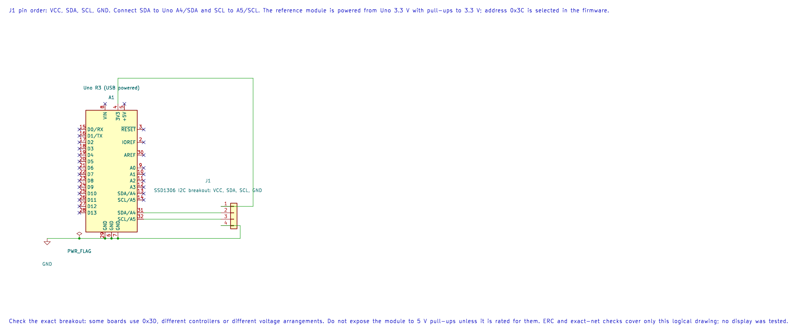

# 0.96-Inch SSD1306 OLED Display

## What You Will Learn

- Connect a four-wire SSD1306 I2C display to the Uno's TWI pins.
- Understand how controller commands and pixel data travel over the bus.
- Render a simple frame without reserving a full screen buffer in SRAM.
- Check the display module's logic voltage and address before connecting it.

This lesson targets a common 128x64, four-pin SSD1306 breakout using I2C at address `0x3C`. Some displays use `0x3D`; some look similar but have an SH1106 controller, different resolution, or different power and pull-up arrangements. Read the exact board documentation before applying power.

## Display Memory and Uno SRAM

A monochrome 128x64 image needs:

```text
128 columns x 64 rows / 8 pixels per byte = 1024 bytes
```

That is half of the ATmega328P's 2048 bytes of SRAM. The display controller already has its own graphics RAM, so the driver in this course sends one 8-pixel-high page at a time. Each page uses 128 bytes of stack instead of holding a second, full-screen copy in the Uno.

The driver supports basic 128x64 I2C initialization, page writes and clearing. It is deliberately small: it does not provide fonts, text layout or a retained software framebuffer.

## Wiring and Voltage Levels



| Uno R3 | OLED Breakout | Purpose |
| --- | --- | --- |
| A4 / SDA | SDA | TWI data |
| A5 / SCL | SCL | TWI clock |
| 3.3 V | VCC | Reference module supply; only if the board accepts 3.3 V |
| GND | GND | Common reference |

The reference circuit assumes a module with its I2C pull-ups connected to 3.3 V. If the board has no pull-ups, add suitable resistors to 3.3 V. Do not use 5 V pull-ups unless the exact module supports them. The Uno at 5 V can read a 3.3 V logic high, but the display controller's I2C pins must not be driven above their ratings.

## Build and Draw the Frame

```powershell
python "atmega328p-labs/tools/build.py" 77-ssd1306-demo --compiler gcc
python "atmega328p-labs/tools/build.py" 77-ssd1306-demo --compiler xc8
```

The application starts the TWI controller at 100 kHz, sends the initialization command sequence, and writes eight pages containing the outline. Each page transfer checks the TWI status and returns on NACK, timeout or arbitration loss. The firmware stops if a transfer fails rather than treating a partial picture as success.

<!-- source: atmega328p-labs/examples/77-ssd1306-demo/main.c -->

```c
/**
 * @file main.c
 * @brief Draw a framed pattern on a 128x64 SSD1306 OLED.
 * @details Uno R3 at 16 MHz. TWI uses A4/SDA and A5/SCL. The reference display is a four-pin
 * SSD1306 I2C module at 0x3C with 3.3 V pull-ups; verify the actual board and voltage limits.
 * Eight-page rendering uses one 128-byte stack buffer rather than a 1024-byte framebuffer.
 * Expected observation: a rectangular outline appears and remains on the display. Hardware is
 * untested; build and simulated TWI results are not panel verification.
 * @copyright Copyright (c) 2026 Arnab Kumar Das. CC-BY-SA-3.0.
 */
#include "avr_hal/twi.h"
#include "drivers/ssd1306.h"

/**
 * @brief Draw a one-pixel rectangular outline.
 * @param[in] address Unshifted 7-bit display address.
 * @param[in] budget TWI unsuccessful-poll budget per state.
 * @retval AVR_OK All eight page writes were acknowledged.
 * @retval AVR_ERROR_ARGUMENT Invalid address or budget.
 * @retval AVR_ERROR_NACK Display did not acknowledge a transfer.
 * @retval AVR_ERROR_TIMEOUT A TWI state timed out.
 * @retval AVR_ERROR_IO TWI is not initialized or returned an unexpected status.
 * @retval AVR_ERROR_ARBITRATION Another controller won arbitration.
 * @details Sends one page at a time, with 128 bytes of local column data. A failed transfer may
 * leave part of the outline visible; the caller must not claim a complete drawing on failure.
 */
static avr_status_t draw_frame(uint8_t address, uint32_t budget)
{
    uint8_t page_data[128] = {0U};
    for (uint8_t page = 0U; page < 8U; ++page)
    {
        for (uint8_t column = 0U; column < 128U; ++column)
        {
            bool border = (page == 0U) || (page == 7U) || (column == 0U) || (column == 127U);
            page_data[column] = border ? 0xFFU : 0x00U;
        }
        avr_status_t status = avr_ssd1306_write_page(address, page, page_data, budget);
        if (status != AVR_OK)
        {
            return status;
        }
    }
    return AVR_OK;
}

/**
 * @brief Initialize TWI and draw a rectangular display frame.
 * @return Does not return after successful initialization and rendering.
 * @details Runs TWI at 100 kHz and targets 0x3C. On any bus error it enters a terminal loop so an
 * incomplete transfer is not silently treated as success. It uses no global interrupt or timer.
 */
int main(void)
{
    if (avr_twi_init(100000UL) != AVR_OK)
    {
        for (;;)
        {
        }
    }
    if (avr_ssd1306_init(0x3CU, AVR_POLL_BUDGET) != AVR_OK)
    {
        for (;;)
        {
        }
    }
    if (draw_frame(0x3CU, AVR_POLL_BUDGET) != AVR_OK)
    {
        for (;;)
        {
        }
    }
    for (;;)
    {
        /* The SSD1306 retains the rendered page data in its own display RAM. */
    }
}
```

<!-- /source -->

These builds do not prove the display address, controller variant or voltage wiring. No OLED hardware test has been performed.

## Code Walkthrough

### SSD1306 128x64 OLED frame
The example's `main()` configures its peripherals, runs the algorithm and reports or displays the result. These source operations are listed in execution order:

- `if (avr_twi_init(100000UL) != AVR_OK)` - This checks for any setup or transfer error before the program continues. Configures TWI for the requested bus rate and enables the peripheral. The bus still requires suitable external pull-ups and compatible signal voltage.
- `for (;;)` - Repeats the foreground task indefinitely; each pass checks inputs, advances the calculation or services the peripheral shown below.
- `if (avr_ssd1306_init(0x3CU, AVR_POLL_BUDGET) != AVR_OK)` - This checks for any setup or transfer error before the program continues. Use the linked public header for this function's parameters, register ownership, blocking behavior and status values.
- `if (draw_frame(0x3CU, AVR_POLL_BUDGET) != AVR_OK)` - Tests the stated condition; the following block handles the matching case and the other path is skipped.

Algorithm: The display stores 1024 bytes for 128x64 monochrome pixels. This driver transfers one 128-byte page at a time, so the Uno avoids a full 1024-byte framebuffer and still has stack/other SRAM needs.
Expected behaviour: A one-pixel rectangular outline appears on the 128x64 screen after initialization. The SSD1306 then retains the pixels in its own display RAM
**HAL source files in this repository:** [ATmega328P HAL on GitHub](https://github.com/arnabdasbwn/atmega328p-hal)

- [`include/avr_hal/twi.h`](https://github.com/arnabdasbwn/atmega328p-hal/blob/main/include/avr_hal/twi.h)
- [`lib/drivers/ssd1306.c`](https://github.com/arnabdasbwn/atmega328p-hal/blob/main/lib/drivers/ssd1306.c)
- [`lib/drivers/ssd1306.h`](https://github.com/arnabdasbwn/atmega328p-hal/blob/main/lib/drivers/ssd1306.h)
- [`src/twi.c`](https://github.com/arnabdasbwn/atmega328p-hal/blob/main/src/twi.c)


## Common Problems

- **The display does not acknowledge:** Check the address, pull-ups, A4/A5 wiring, ground and TWI rate.
- **The board heats or stops responding:** Disconnect it and verify its supply and logic voltage limits.
- **The image is rotated or mirrored:** Breakout glass orientation may require different segment-remap or COM-scan commands.
- **Only part of the frame appears:** Check bus errors and the module's actual controller. The current driver targets SSD1306, not SH1106.
- **A larger program runs out of SRAM:** Count global buffers, local arrays and worst-case stack. Do not add a 1024-byte framebuffer without revisiting the memory budget.

## Try It Yourself

If you update a 128-byte page at 100 kHz, why can a full-screen redraw still take noticeable time?

**Answer:** I2C transfers each data byte with address/control and acknowledgement clock periods. Sending 1024 bytes needs far more than 8192 clock edges, and software also sends commands and handles every TWI state.

## References

- [Solomon Systech SSD1306 datasheet](https://www.sunrom.com/download/SSD1306.pdf)
- [Solomon Systech display-driver catalogue](https://www.solomon-systech.com/product-search)
- [Lab 77 application](<https://github.com/arnabdasbwn/atmega328p-labs/blob/main/examples/77-ssd1306-demo/main.c>) and [HAL driver header](https://github.com/arnabdasbwn/atmega328p-hal/blob/main/lib/drivers/ssd1306.h)
- [TWI concepts](twi-concepts.md) and [ATmega328P memory architecture](memory-architecture.md)
