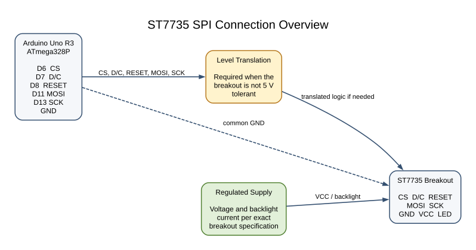
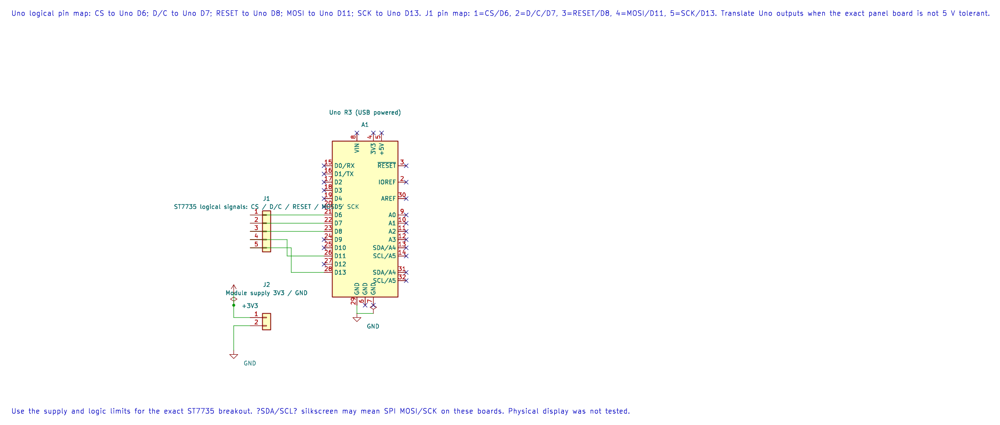

# ST7735 TFT Display

## Learning Goals

After this lesson, you should be able to explain the SPI signals used by an ST7735 panel, calculate the memory needed for an RGB565 image, and stream a solid rectangle without keeping the whole image in Uno SRAM.

The ST7735 is a display controller used in several small colour TFT modules. A controller name does not identify the complete module: dimensions, row and column offsets, colour order, power circuitry, and logic voltage can differ. The example uses one common 128 × 160 ST7735R profile. Check your breakout before connecting it.

## How Pixels Reach the Screen

The Uno sends a command to select an address window, then streams pixel bytes to the controller's display RAM. A 16-bit RGB565 pixel uses five red bits, six green bits, and five blue bits. For example, pure red is `0xF800`; the example transmits its high byte `0xF8` followed by low byte `0x00`.

A complete 128 × 160 image needs:

`128 × 160 pixels × 2 bytes per pixel = 40,960 bytes`

The ATmega328P has only 2,048 bytes of SRAM, shared by variables, buffers, and the stack. The controller has its own display memory, so the Uno can set a window and stream repeated pixel values directly. Lab 57 draws three solid rectangles this way and uses no framebuffer.

## Parts and Wiring

Use an Uno R3 and a breakout that identifies its supply and logic requirements. The bare ST7735 controller uses low-voltage logic. Some boards add a regulator and level shifters; others do not. Do not assume that a breakout accepts 5 V merely because it has a pin marked `VCC`.

| Uno R3 Pin | Display Signal | Purpose |
| --- | --- | --- |
| D6 | CS | Selects the display; active low. |
| D7 | D/C or A0 | Low for commands, high for pixel or parameter data. |
| D8 | RESET or RST | Hardware reset input. |
| D11 / MOSI | SDA, DIN, or MOSI | Serial data from Uno to display. |
| D13 / SCK | SCL or SCK | Serial clock. |
| GND | GND | Shared signal reference. |
| Suitable supply | VCC and backlight | Follow the exact breakout specification. |

D12/MISO is not used by this write-only example. Keep D10 configured as an output because the ATmega328P uses it as the hardware SPI controller's SS pin. The HAL configures D10 and owns D10–D13; this lab uses D6 as the display's separate CS signal.





The editable KiCad pin map records the Uno-side signal assignments. The module wiring diagram and the exact breakout documentation determine the required level translation.

### Connection Sketch

```text
Uno R3                         ST7735 Breakout
D6  -------------------------- CS
D7  -------------------------- D/C
D8  -------------------------- RESET
D11 / MOSI ------------------- SDA / DIN
D13 / SCK -------------------- SCL / SCK
GND -------------------------- GND
Regulated supply ------------ VCC / LED (as specified by the board)
```

Add level translation to every Uno output if the selected breakout is not 5 V tolerant. Keep display power current out of the Uno GPIO pins. Use short connections for SPI and avoid connecting MISO unless the board documents a supported readback path.

## Build and Run the Example

The maintained driver is [`st7735.h`](https://github.com/arnabdasbwn/atmega328p-hal/blob/main/lib/drivers/st7735.h) and [`st7735.c`](https://github.com/arnabdasbwn/atmega328p-hal/blob/main/lib/drivers/st7735.c). The complete example is [`57-st7735`](https://github.com/arnabdasbwn/atmega328p-labs/blob/main/examples/57-st7735/main.c). It initializes SPI mode 0 at 4 MHz, configures a common ST7735R profile as 128 × 160 with offsets 2 and 1, then draws red, green, and blue bands.

Build it with AVR GCC or XC8 from the course root:

```powershell
python atmega328p-labs/tools/build.py 57-st7735 --compiler gcc
python atmega328p-labs/tools/build.py 57-st7735 --compiler xc8
```

The `avr_st7735_fill_rect()` function first checks that the requested rectangle fits the visible display. It sends the inclusive column and row boundaries, issues the RAM-write command, and transfers the high and low byte of the colour for each pixel. It does not allocate a line buffer or framebuffer. The function blocks until each byte is shifted out; large areas take longer than a small status mark.

This is a teaching initialization profile, not a universal sequence for all ST7735 modules. The code accepts dimensions, offsets, and BGR order as configuration, but those settings must match the actual panel. Manufacturer init sequences can also include gamma, inversion, and power values specific to a module.

## Observe and Troubleshoot

With a compatible panel, the visible area should show three vertical colour bands. The panel controller retains the pixels after the Uno stops sending them. This workspace had no ST7735 panel available, so that visual result is an expected observation, not a physical test result.

If the screen is blank or white, check supply voltage, ground, RESET, CS polarity, D/C wiring, MOSI/SCK pins, and whether the panel requires a different initialization profile. If the bands are shifted or clipped, verify the module's row/column offsets and resolution. If red and blue appear exchanged, check RGB/BGR order. Avoid increasing SPI speed until the basic connections and panel settings are correct.

## Exercises

1. How many bytes does one RGB565 pixel require, and how many bytes are needed for a 128 × 160 framebuffer?
2. Why does D10 need to remain an output even though the example uses D6 as display CS?
3. If you draw a 16 × 8 rectangle, how many pixel data bytes does the driver send?

**Suggested answers:** One pixel uses two bytes, so a 128 × 160 image requires 40,960 bytes. D10 is the AVR hardware SPI SS pin and must remain an output to keep the peripheral in controller mode. The small rectangle sends `16 × 8 × 2 = 256` pixel data bytes, plus its command and address-window bytes.

## Validation and References

Lab 57 builds with AVR GCC and XC8. The build validates C compilation, resource budgets, and linking only. No panel or external-device simulator was available, so SPI electrical behaviour, initialization compatibility, orientation, and displayed colours remain unverified.

- [Sitronix ST7735S Controller Datasheet](https://cdn.sparkfun.com/assets/9/0/2/5/8/ST7735S_v1.1.pdf)
- [Adafruit ST7735 Initialization Profiles](https://github.com/adafruit/Adafruit-ST7735-Library/blob/master/Adafruit_ST7735.cpp)
- [ATmega328P Device Documentation](https://www.microchip.com/en-us/product/ATMEGA328P)
- [Uno R3 Pinout](https://www.arnabkumardas.com/pinout/arduino-uno-r3/)

## Code Walkthrough

### ST7735 RGB565 Rectangle Drawing
The example's `main()` configures its peripherals, runs the algorithm and reports or displays the result. These source operations are listed in execution order:

- `avr_st7735_t display;` - Use the linked public header for this function's parameters, register ownership, blocking behavior and status values.
- `if (avr_st7735_init(&display, 6U, 7U, 8U, 128U, 160U, 2U, 1U, true) != AVR_OK)` - This checks for any setup or transfer error before the program continues. Use the linked public header for this function's parameters, register ownership, blocking behavior and status values.
- `return 1;` - Stops this path and returns the indicated status when setup or validation cannot continue.
- `if ((avr_st7735_fill_rect(&display, 0U, 0U, 42U, 160U, AVR_ST7735_RED) != AVR_OK) ||` - This checks for any setup or transfer error before the program continues. Use the linked public header for this function's parameters, register ownership, blocking behavior and status values.
- `(avr_st7735_fill_rect(&display, 42U, 0U, 43U, 160U, AVR_ST7735_GREEN) != AVR_OK) ||` - Use the linked public header for this function's parameters, register ownership, blocking behavior and status values.
- `(avr_st7735_fill_rect(&display, 85U, 0U, 43U, 160U, AVR_ST7735_BLUE) != AVR_OK))` - Use the linked public header for this function's parameters, register ownership, blocking behavior and status values.
- `for (;;)` - Repeats the foreground task indefinitely; each pass checks inputs, advances the calculation or services the peripheral shown below.

Algorithm: A 40,960-byte RGB565 framebuffer does not fit in 2 KB SRAM, so write solid rectangles directly to controller RAM.
Expected behaviour: A 128 by 160 panel displays red, green and blue vertical bands after initialization
**HAL source files in this repository:** [ATmega328P HAL on GitHub](https://github.com/arnabdasbwn/atmega328p-hal)

- [`lib/drivers/st7735.c`](https://github.com/arnabdasbwn/atmega328p-hal/blob/main/lib/drivers/st7735.c)
- [`lib/drivers/st7735.h`](https://github.com/arnabdasbwn/atmega328p-hal/blob/main/lib/drivers/st7735.h)
