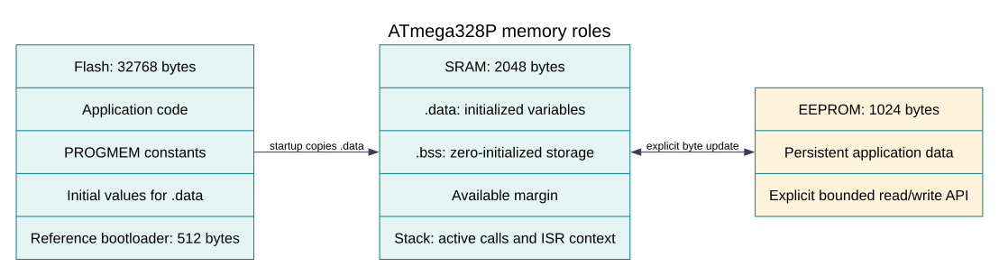

# Startup, Stack and Memory Budgets

## Three Small Memories

The ATmega328P has 32 KiB Flash, 2 KiB SRAM and 1 KiB EEPROM. They serve different
purposes. Flash holds instructions and constants stored for program-memory access.
SRAM holds live variables and the call stack. EEPROM retains small data through a
power cycle and has different write timing and endurance rules.

The reference Uno configuration reserves the upper 512 Flash bytes for its normal
Optiboot bootloader, leaving **32256 bytes** for an application. That is a build
assumption about this board configuration, not an intrinsic reduction in the chip's
physical Flash. Do not change it without checking the installed bootloader and
fuse configuration through a controlled programming workflow.

## Before `main`

The linked startup code prepares the C runtime before calling `main`. It arranges
the stack, copies initialized writable data from its Flash load image to SRAM,
and clears zero-initialized static storage. On a bootloader-equipped board, code
in the boot section may run before the application startup. Reset entry behavior
depends on board programming configuration; C source alone cannot establish it.

| C object example | Typical storage responsibility |
| --- | --- |
| File-scope `uint8_t mode = 3;` | `.data`: live SRAM plus initial Flash bytes |
| File-scope `uint8_t buffer[100];` | `.bss`: SRAM cleared at startup |
| Ordinary automatic local array | Usually stack while its function is active |
| Code | `.text` in Flash |
| Explicit `PROGMEM` table | Flash, read with program-memory accessors |

The compiler may optimize away an unused object or keep a local in registers.
Inspect the actual ELF/map rather than assuming every C declaration consumes the
size and section you predicted. On classic AVR, a plain `const` qualifier alone
does not provide a universal guarantee of SRAM-free storage and Flash access.

## Stack Is a Changing Cost

Calls store return information; local objects and saved registers can add more.
An interrupt can arrive during the deepest foreground call chain and push its own
context. The safe budget must include both, plus margin. Avoid recursion and large
automatic buffers in this teaching HAL to make the bound easier to reason about.

A 128 by 160 RGB565 framebuffer needs `128 * 160 * 2 = 40960` bytes. It cannot fit
in the Uno's 2048-byte SRAM. Drawing a display a line or pixel at a time changes
the memory requirement; a graphics API designed around a full framebuffer does
not become suitable just because its header compiles.

## Read a Flash Constant Correctly

[25-flash-constants/main.c](<https://github.com/arnabdasbwn/atmega328p-labs/blob/main/examples/25-flash-constants/main.c>)
uses `PROGMEM` and the appropriate byte accessor rather than dereferencing a normal
RAM pointer. Build it with both compilers and inspect its map and size report. The
example transmits text at 9600 baud after upload, but inspecting storage placement
does not require connecting external components.

## A Budget Calculation

Suppose buffers and other static objects consume 900 bytes, the worst foreground
stack estimate is 320, and interrupt context adds 80. The combined estimate is
1300 bytes, leaving 748 bytes of margin. Record how the stack estimate was derived;
“the program ran once” is not a bound. The builder's static-RAM limit reserves
space, but does not automatically prove the worst stack path fits.

## Exercises with Answers

1. Does a 100-byte `.bss` array require 100 initial Flash bytes? **Answer:** no;
   startup clears it. A nonzero initialized array normally needs a load image.
2. Why does moving a buffer from a local to file scope not create more SRAM?
   **Answer:** it changes lifetime/location accounting, not physical capacity.
3. Can a normal data pointer read a `PROGMEM` string correctly? **Answer:** not
   generally on this classic AVR target. Use the documented program-memory API.

For current device details, use the [Microchip ATmega328P documentation](https://www.microchip.com/en-us/product/ATMEGA328P). Check the document listed for your exact device and package; board-level pin labels and circuitry are covered by the [Uno R3 pinout](https://www.arnabkumardas.com/pinout/arduino-uno-r3/).

## Code Walkthrough

**Example code on GitHub:**
- [HAL Software Self-Test (`90-selftest`)](https://github.com/arnabdasbwn/atmega328p-labs/blob/main/examples/90-selftest/main.c)

### Read a lookup table from Flash
The example's `main()` configures its peripherals, runs the algorithm and reports or displays the result. These source operations are listed in execution order:

- `(void)avr_uart_init(9600UL);` - Configures USART0 for asynchronous 8N1. It chooses a baud divisor and normal/double-speed mode, programs UBRR0/UCSR0A/UCSR0C, then enables receive and transmit in UCSR0B.
- `for (uint8_t i = 0U; i < 8U; ++i)` - Repeats while `i < 8U` is true; `uint8_t i = 0U` sets the starting state and `++i` advances it each pass.
- `uint16_t value = pgm_read_word(&squares[i]);` - Reads the table entry with the AVR program-memory access function; ordinary data-space dereferencing is not used for this Flash table.
- `(void)avr_uart_u16(value);` - Formats an unsigned integer as decimal digits and sends them on USART0; it does not add a newline.
- `(void)avr_uart_put('\n', AVR_POLL_BUDGET);` - Waits for the USART transmit buffer within its poll budget, then writes the byte to UDR0.
- `for (;;)` - Repeats the foreground task indefinitely; each pass checks inputs, advances the calculation or services the peripheral shown below.

Algorithm: PROGMEM keeps the table in program memory; pgm_read_word uses the appropriate Flash access. A const qualifier alone does not describe the AVR storage/access mechanism in all toolchains.
Expected behaviour: Prints the squares of 0..7
**HAL source files in this repository:** [ATmega328P HAL on GitHub](https://github.com/arnabdasbwn/atmega328p-hal)

- [`include/avr_hal/uart.h`](https://github.com/arnabdasbwn/atmega328p-hal/blob/main/include/avr_hal/uart.h)
- [`src/uart.c`](https://github.com/arnabdasbwn/atmega328p-hal/blob/main/src/uart.c)

### HAL Software Self-Test
The example's `main()` configures its peripherals, runs the algorithm and reports or displays the result. These source operations are listed in execution order:

- `avr_debounce_t button;` - Use the linked public header for this function's parameters, register ownership, blocking behavior and status values.
- `uint8_t result = 0U;` - Clears the state/counter after its threshold is reached so the next interval starts from zero.
- `(void)avr_uart_init(9600UL);` - Configures USART0 for asynchronous 8N1. It chooses a baud divisor and normal/double-speed mode, programs UBRR0/UCSR0A/UCSR0C, then enables receive and transmit in UCSR0B.
- `CHECK(avr_gpio_mode(20U, AVR_GPIO_OUTPUT) == AVR_ERROR_ARGUMENT);` - Maps the Uno header pin to its AVR port, sets its DDR direction bit and prepares the PORT latch for the requested initial level or pull-up.
- `CHECK(avr_gpio_read(13U, NULL) == AVR_ERROR_ARGUMENT);` - Reads the electrical level through PINx without changing direction or the output latch.
- `CHECK(avr_timer_ctc(AVR_TIMER0, 32U, 100U) == AVR_ERROR_ARGUMENT);` - Configures 0 in CTC mode with prescaler 32 and OCRnA TOP 100; event rate is 16 MHz / (32 x (100 + 1)) = 4950.5 Hz. The HAL disables this timer's interrupt sources and leaves flag polling to the caller.
- `CHECK(avr_timer_ctc(AVR_TIMER0, 64U, 256U) == AVR_ERROR_ARGUMENT);` - Configures 0 in CTC mode with prescaler 64 and OCRnA TOP 256; event rate is 16 MHz / (64 x (256 + 1)) = 972.763 Hz. The HAL disables this timer's interrupt sources and leaves flag polling to the caller.
- `CHECK(avr_timer_ctc(AVR_TIMER2, 128U, 124U) == AVR_OK);` - Configures 2 in CTC mode with prescaler 128 and OCRnA TOP 124; event rate is 16 MHz / (128 x (124 + 1)) = 1000 Hz. The HAL disables this timer's interrupt sources and leaves flag polling to the caller.
- `CHECK((TCCR2B & 7U) == 5U);` - Selects Timer2 clock/prescaler and remaining waveform bits. Timer2 has distinct prescaler encodings.
- `CHECK(avr_timer1_pwm(8U, 40000U, 3000U) == AVR_OK);` - Configures Timer1 mode 14 with prescaler 8; ICR1 becomes 39999, giving a 20 ms frame, and OCR1A starts at 3000 ticks (1500 us high).
- `CHECK(ICR1 == 39999U && OCR1A == 3000U);` - Timer1 input-capture register and, in the selected PWM mode, the TOP value. Timer1 Compare A; it sets the match point or PWM pulse width.
- `CHECK(avr_adc_millivolts(512U, 5000U) == 2500U);` - Calls `avr_adc_millivolts()`; its public HAL header defines the arguments, register ownership, blocking behavior and status results.
- `CHECK(avr_adc_read(6U, NULL, 0U) == AVR_ERROR_ARGUMENT);` - Calls `avr_adc_read()`; its public HAL header defines the arguments, register ownership, blocking behavior and status results.
- `CHECK(avr_eeprom_read(1024U, &result, 0UL) == AVR_ERROR_ARGUMENT);` - Calls `avr_eeprom_read()`; its public HAL header defines the arguments, register ownership, blocking behavior and status results.
- `CHECK(avr_twi_transfer(0U, NULL, 0U, NULL, 0U, 0UL) == AVR_ERROR_ARGUMENT);` - Calls `avr_twi_transfer()`; its public HAL header defines the arguments, register ownership, blocking behavior and status results.
- `CHECK(avr_elapsed(5UL, UINT32_MAX - 4UL, 10UL));` - Calls `avr_elapsed()`; its public HAL header defines the arguments, register ownership, blocking behavior and status results.
- `CHECK(!avr_elapsed(5UL, UINT32_MAX - 4UL, 11UL));` - Calls `avr_elapsed()`; its public HAL header defines the arguments, register ownership, blocking behavior and status results.
- `avr_debounce_init(&button, true, UINT32_MAX - 10UL);` - Calls `avr_debounce_init()`; its public HAL header defines the arguments, register ownership, blocking behavior and status results.
- `CHECK(!avr_debounce_update(&button, false, UINT32_MAX - 9UL, 20U));` - Calls `avr_debounce_update()`; its public HAL header defines the arguments, register ownership, blocking behavior and status results.
- `CHECK(!avr_debounce_update(&button, false, 9UL, 20U));` - Calls `avr_debounce_update()`; its public HAL header defines the arguments, register ownership, blocking behavior and status results.
- `CHECK(avr_debounce_update(&button, false, 10UL, 20U));` - Accepts a changed input only after it remains stable for the requested interval, then reports that accepted change once.
- `CHECK(!avr_debounce_update(&button, false, 11UL, 20U));` - Accepts a changed input only after it remains stable for the requested interval, then reports that accepted change once.
- `(void)avr_uart_write((const uint8_t *)"PASS\n", 5U, AVR_POLL_BUDGET);` - Sends the specified bytes through USART0; a timeout can occur after a prefix has already been sent.
- `for (;;)` - Repeats the foreground task indefinitely; each pass checks inputs, advances the calculation or services the peripheral shown below.

Algorithm: A bounded self-test checks software contracts and links a second source file so header-owned definitions are detected.
Expected behaviour: The fixture prints PASS after argument, timer-range, debounce and independent-translation-unit checks; otherwise it prints FAIL and stops
**HAL source files in this repository:** [ATmega328P HAL on GitHub](https://github.com/arnabdasbwn/atmega328p-hal)

- [`include/avr_hal/adc.h`](https://github.com/arnabdasbwn/atmega328p-hal/blob/main/include/avr_hal/adc.h)
- [`include/avr_hal/common.h`](https://github.com/arnabdasbwn/atmega328p-hal/blob/main/include/avr_hal/common.h)
- [`include/avr_hal/eeprom.h`](https://github.com/arnabdasbwn/atmega328p-hal/blob/main/include/avr_hal/eeprom.h)
- [`include/avr_hal/gpio.h`](https://github.com/arnabdasbwn/atmega328p-hal/blob/main/include/avr_hal/gpio.h)
- [`include/avr_hal/timer.h`](https://github.com/arnabdasbwn/atmega328p-hal/blob/main/include/avr_hal/timer.h)
- [`include/avr_hal/twi.h`](https://github.com/arnabdasbwn/atmega328p-hal/blob/main/include/avr_hal/twi.h)
- [`include/avr_hal/uart.h`](https://github.com/arnabdasbwn/atmega328p-hal/blob/main/include/avr_hal/uart.h)
- [`lib/drivers/debounce.c`](https://github.com/arnabdasbwn/atmega328p-hal/blob/main/lib/drivers/debounce.c)
- [`lib/drivers/debounce.h`](https://github.com/arnabdasbwn/atmega328p-hal/blob/main/lib/drivers/debounce.h)
- [`src/adc.c`](https://github.com/arnabdasbwn/atmega328p-hal/blob/main/src/adc.c)
- [`src/common.c`](https://github.com/arnabdasbwn/atmega328p-hal/blob/main/src/common.c)
- [`src/eeprom.c`](https://github.com/arnabdasbwn/atmega328p-hal/blob/main/src/eeprom.c)
- [`src/gpio.c`](https://github.com/arnabdasbwn/atmega328p-hal/blob/main/src/gpio.c)
- [`src/timer.c`](https://github.com/arnabdasbwn/atmega328p-hal/blob/main/src/timer.c)
- [`src/twi.c`](https://github.com/arnabdasbwn/atmega328p-hal/blob/main/src/twi.c)
- [`src/uart.c`](https://github.com/arnabdasbwn/atmega328p-hal/blob/main/src/uart.c)
