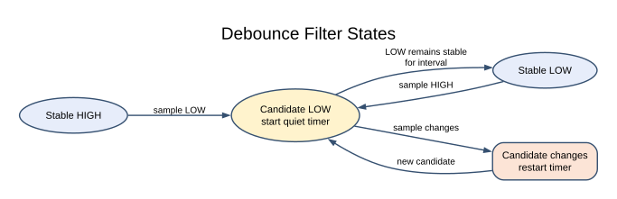

# State Machines and Cooperative Scheduling

## Replace Waiting with Remembering

A blocking delay prevents foreground code from doing useful work until it ends.
Interrupts may still run, but another foreground task cannot run through that same
loop. A state machine remembers what it is waiting for and returns control quickly.
The next loop iteration checks whether the required event or time has arrived.

The objective is to trace a debounce state machine and schedule two independent
periodic actions. You need [atomic snapshots](volatile-atomic.md). The scheduler
uses the onboard LED and USB serial connection; no external load is required.

## Debounce as a State Machine

A mechanical switch can alternate between high and low several times while its
contacts settle. A software debounce filter distinguishes the current candidate
level from the accepted stable level. A changed candidate restarts the quiet
interval. Once it stays unchanged long enough, it becomes the stable value.

The implementation is [debounce.c](https://github.com/arnabdasbwn/atmega328p-hal/blob/main/lib/drivers/debounce.c). With
an initially high switch and a 20 ms interval, trace these samples:

| Time | Sample | Candidate timestamp | Accepted stable level |
| --- | --- | --- | --- |
| 100 ms | Low | 100 ms | High |
| 103 ms | High | 103 ms | High |
| 106 ms | Low | 106 ms | High |
| 125 ms | Low | 106 ms | High: only 19 ms elapsed |
| 126 ms | Low | 106 ms | Low: 20 ms elapsed |

The driver does not sleep for 20 ms. Other work can execute between samples.
Sampling too slowly can miss an entire press; a debounce interval is not a promise
to detect arbitrarily short events. Choose the input rate and filter interval from
the application requirements and measured switch behavior.

## Two Periodic Tasks



[10-scheduler/main.c](<https://github.com/arnabdasbwn/atmega328p-labs/blob/main/examples/10-scheduler/main.c>) owns Timer0
through the optional tick module. The ISR increments a millisecond counter; the
foreground loop reads a consistent snapshot. One saved timestamp schedules LED
changes every 500 ms, another schedules serial reports every 1000 ms.

```powershell
python "atmega328p-labs/tools/build.py" 10-scheduler --compiler gcc
python "atmega328p-labs/tools/build.py" 10-scheduler --compiler xc8
```

After upload, LED L should toggle twice per second and the terminal should receive
an increasing seconds count at 9600 baud, 8 data bits, no parity and one stop bit.
The sample prints a 16-bit seconds value, so the displayed value wraps after
65535 seconds even though its internal millisecond counter is wider.

## Rollover and Scheduling Policy

Use unsigned `now - start >= interval`, not `now >= start + interval`. For an
eight-bit illustration, let start be 250 and now be 4 after rollover. Modulo-256
subtraction gives 10: ten ticks elapsed. The production helper uses 32-bit ticks
with documented interval and sampling assumptions. It cannot distinguish zero
elapsed time from one complete unobserved counter revolution.

The example saves `start = now` after performing a task. That avoids a burst of
catch-up actions after a long delay, but it introduces phase drift if service is
late. An alternative is `start += interval`, possibly with a bounded catch-up or
missed-period policy. The correct choice depends on whether preserving phase or
avoiding bursts matters more. Never allow unlimited catch-up work to starve input.

Cooperative scheduling requires every task to return promptly. The current serial
helper is bounded but can wait while transmitting bytes. At 9600 baud, a short
message costs milliseconds. A high-rate application needs buffered transmission
and measured worst-case service time, not only a faster loop syntax.

## Troubleshooting and Exercises

If both tasks stop, verify global interrupts were enabled **after** initialization.
If only the timing is wrong, check the 16 MHz definition and Timer0 ownership. Do
not link the optional tick ISR with another Timer0 COMPA handler or into an Arduino
core project that uses the same peripheral.

1. Why does every new bounce restart the timestamp? **Answer:** the candidate has
   not remained continuously stable for the required interval.
2. Can an ISR fix a 200 ms blocking foreground task? **Answer:** it can record an
   event, but foreground response can still be delayed by almost 200 ms.
3. What should happen if a task misses five periods? **Answer:** define a policy:
   skip, perform bounded catch-up, or report an overrun. There is no universal answer.

For current device details, use the [Microchip ATmega328P documentation](https://www.microchip.com/en-us/product/ATMEGA328P). Check the document listed for your exact device and package; board-level pin labels and circuitry are covered by the [Uno R3 pinout](https://www.arnabkumardas.com/pinout/arduino-uno-r3/).

## Code Walkthrough


**Example code on GitHub:**
- [Debounced push button (`03-button`)](https://github.com/arnabdasbwn/atmega328p-labs/blob/main/examples/03-button/main.c)

### Debounced push button
The example's `main()` configures its peripherals, runs the algorithm and reports or displays the result. These source operations are listed in execution order:

- `avr_debounce_t button;` - Use the linked public header for this function's parameters, register ownership, blocking behavior and status values.
- `bool level = true;` - Stores this intermediate or output value for the next algorithm step. Check the units and range represented by each operand.
- `bool led = false;` - Stores this intermediate or output value for the next algorithm step. Check the units and range represented by each operand.
- `(void)avr_gpio_mode(2U, AVR_GPIO_INPUT_PULLUP);` - Maps the Uno header pin to its AVR port, sets its DDR direction bit and prepares the PORT latch for the requested initial level or pull-up.
- `(void)avr_gpio_mode(13U, AVR_GPIO_OUTPUT);` - Maps the Uno header pin to its AVR port, sets its DDR direction bit and prepares the PORT latch for the requested initial level or pull-up.
- `avr_tick_init();` - Configures the course millisecond tick interrupt source; it does not enable global interrupts itself.
- `avr_debounce_init(&button, true, 0UL);` - Seeds the stable/candidate input state and timestamp so the next transition is timed consistently.
- `sei();` - Enables global interrupts after the example has configured its sources and shared state.
- `for (;;)` - Repeats the foreground task indefinitely; each pass checks inputs, advances the calculation or services the peripheral shown below.
- `(void)avr_gpio_read(2U, &level);` - Reads the electrical level through PINx without changing direction or the output latch.
- `if (avr_debounce_update(&button, level, avr_tick_ms(), 20U) && !button.stable)` - This condition chooses the next path based on the API result. Accepts a changed input only after it remains stable for the requested interval, then reports that accepted change once.
- `led = !led;` - Stores this intermediate or output value for the next algorithm step. Check the units and range represented by each operand.
- `(void)avr_gpio_write(13U, led);` - Changes the pin's PORT output latch; for an input pin this selects its pull-up state.

Algorithm: A candidate input must remain unchanged for 20 ms before becoming stable. No delay occurs inside an ISR.
Expected behaviour: Each press toggles L once; holding the button does not repeat
**HAL source files in this repository:** [ATmega328P HAL on GitHub](https://github.com/arnabdasbwn/atmega328p-hal)

- [`include/avr_hal/gpio.h`](https://github.com/arnabdasbwn/atmega328p-hal/blob/main/include/avr_hal/gpio.h)
- [`include/avr_hal/tick.h`](https://github.com/arnabdasbwn/atmega328p-hal/blob/main/include/avr_hal/tick.h)
- [`lib/drivers/debounce.c`](https://github.com/arnabdasbwn/atmega328p-hal/blob/main/lib/drivers/debounce.c)
- [`lib/drivers/debounce.h`](https://github.com/arnabdasbwn/atmega328p-hal/blob/main/lib/drivers/debounce.h)
- [`lib/interrupts/tick.c`](https://github.com/arnabdasbwn/atmega328p-hal/blob/main/lib/interrupts/tick.c)
- [`src/gpio.c`](https://github.com/arnabdasbwn/atmega328p-hal/blob/main/src/gpio.c)


### Interrupt tick and cooperative tasks
The example's `main()` configures its peripherals, runs the algorithm and reports or displays the result. These source operations are listed in execution order:

- `uint32_t led_start = 0UL, report_start = 0UL;` - Clears the state/counter after its threshold is reached so the next interval starts from zero.
- `(void)avr_gpio_mode(13U, AVR_GPIO_OUTPUT);` - Maps the Uno header pin to its AVR port, sets its DDR direction bit and prepares the PORT latch for the requested initial level or pull-up.
- `(void)avr_uart_init(9600UL);` - Configures USART0 for asynchronous 8N1. It chooses a baud divisor and normal/double-speed mode, programs UBRR0/UCSR0A/UCSR0C, then enables receive and transmit in UCSR0B.
- `avr_tick_init();` - Configures the course millisecond tick interrupt source; it does not enable global interrupts itself.
- `sei();` - Enables global interrupts after the example has configured its sources and shared state.
- `for (;;)` - Repeats the foreground task indefinitely; each pass checks inputs, advances the calculation or services the peripheral shown below.
- `uint32_t now = avr_tick_ms();` - Use the linked public header for this function's parameters, register ownership, blocking behavior and status values.
- `if (avr_elapsed(now, led_start, 500UL))` - This branch runs only after the requested interval has elapsed. Uses unsigned subtraction to test elapsed time safely across a 32-bit tick wraparound.
- `led_start = now;` - Stores this intermediate or output value for the next algorithm step. Check the units and range represented by each operand.
- `(void)avr_gpio_toggle(13U);` - Atomically toggles the selected pin output latch.
- `if (avr_elapsed(now, report_start, 1000UL))` - This branch runs only after the requested interval has elapsed. Uses unsigned subtraction to test elapsed time safely across a 32-bit tick wraparound.
- `report_start = now;` - Stores this intermediate or output value for the next algorithm step. Check the units and range represented by each operand.
- `(void)avr_uart_u16((uint16_t)(now / 1000UL));` - Formats an unsigned integer as decimal digits and sends them on USART0; it does not add a newline.
- `(void)avr_uart_put('\n', AVR_POLL_BUDGET);` - Waits for the USART transmit buffer within its poll budget, then writes the byte to UDR0.

Algorithm: The ISR increments a tick; foreground code snapshots it atomically. Unsigned subtraction remains valid across wraparound for the documented interval range.
Expected behaviour: LED toggles twice per second while elapsed seconds print independently
**HAL source files in this repository:** [ATmega328P HAL on GitHub](https://github.com/arnabdasbwn/atmega328p-hal)

- [`include/avr_hal/gpio.h`](https://github.com/arnabdasbwn/atmega328p-hal/blob/main/include/avr_hal/gpio.h)
- [`include/avr_hal/tick.h`](https://github.com/arnabdasbwn/atmega328p-hal/blob/main/include/avr_hal/tick.h)
- [`include/avr_hal/uart.h`](https://github.com/arnabdasbwn/atmega328p-hal/blob/main/include/avr_hal/uart.h)
- [`lib/interrupts/tick.c`](https://github.com/arnabdasbwn/atmega328p-hal/blob/main/lib/interrupts/tick.c)
- [`src/gpio.c`](https://github.com/arnabdasbwn/atmega328p-hal/blob/main/src/gpio.c)
- [`src/uart.c`](https://github.com/arnabdasbwn/atmega328p-hal/blob/main/src/uart.c)
