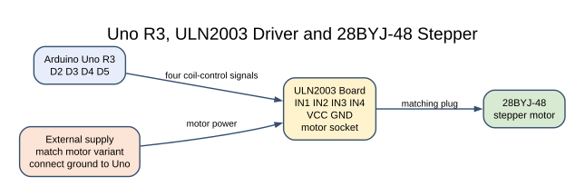
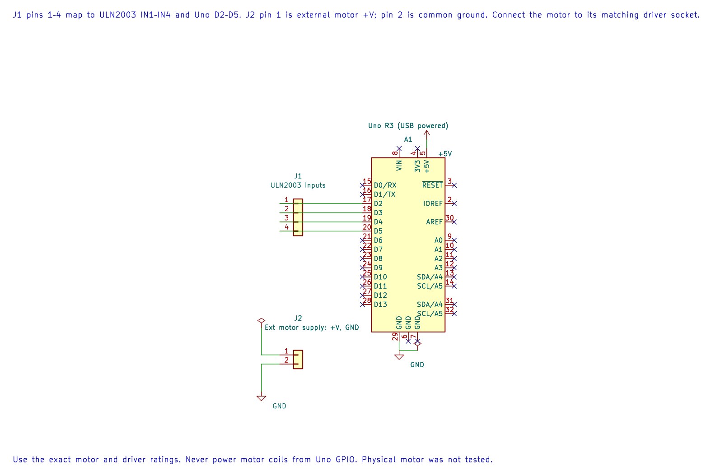

# 28BYJ-48 Stepper Motor with ULN2003

## What You Will Learn

A stepper motor moves through a sequence of coil states. The Uno selects the next pattern, while a ULN2003 transistor-array board supplies the coil current. Lab 27 uses an eight-state half-step pattern to rotate a common 28BYJ-48 motor.

The gearbox ratio and the number of steps per output revolution vary across motor variants. Do not treat the motor label as a calibrated positioning standard.

## Parts and Wiring

Use a 28BYJ-48 motor with its matching ULN2003 board. Power the motor board from a suitable external supply that matches the motor variant. Connect the Uno and motor supply grounds together.

| Uno R3 | ULN2003 board | Purpose |
| --- | --- | --- |
| D2 | IN1 | Coil driver input 1 |
| D3 | IN2 | Coil driver input 2 |
| D4 | IN3 | Coil driver input 3 |
| D5 | IN4 | Coil driver input 4 |
| External rated supply | ULN2003 VCC | Motor coil power |
| GND | ULN2003 GND | Common reference |
| Motor plug | Matching driver-board socket | Coil connection |

Do not connect motor coils directly to the Uno pins. Check the driver board's flyback-diode and supply connections before power-up.

## Half-Step Sequence





The editable KiCad connection sheet shows the four control lines and external motor supply reference. Join the supply ground to Uno ground; use the driver board that matches the motor.

Lab 27 uses these four-bit patterns in order:

```text
0001, 0011, 0010, 0110, 0100, 1100, 1000, 1001
```

The sequence alternates one-coil and two-coil states. Advancing through it rotates the field and pulls the rotor to the next position. Reversing the pattern reverses direction. Each state is held for about 3 ms; that delay limits the stepping rate but does not guarantee the motor can follow under load.

The example runs continuously and leaves the final coil state energised. That can hold the shaft in place but also consumes power and warms the motor. A complete application should define when to disable the coils and how to recover from a missed step.

## Build and Try the Lab

```powershell
python atmega328p-labs/tools/build.py 27-stepper --compiler gcc
python atmega328p-labs/tools/build.py 27-stepper --compiler xc8
```

After checking the supply and connector orientation, run the motor unloaded. Reverse the sequence to change direction. Measure actual steps per output revolution before using the motor for position control; open-loop stepping cannot detect a stalled or skipped step.

## Code Walkthrough

### 28BYJ-48 through ULN2003
The example's `main()` configures its peripherals, runs the algorithm and reports or displays the result. These source operations are listed in execution order:

- `for (uint8_t pin = 2U; pin < 6U; ++pin)` - Repeats while `pin < 6U` is true; `uint8_t pin = 2U` sets the starting state and `++pin` advances it each pass.
- `(void)avr_gpio_mode(pin, AVR_GPIO_OUTPUT);` - Maps the Uno header pin to its AVR port, sets its DDR direction bit and prepares the PORT latch for the requested initial level or pull-up.
- `for (;;)` - Repeats the foreground task indefinitely; each pass checks inputs, advances the calculation or services the peripheral shown below.
- `for (uint8_t step = 0U; step < 8U; ++step)` - Repeats while `step < 8U` is true; `uint8_t step = 0U` sets the starting state and `++step` advances it each pass.
- `for (uint8_t coil = 0U; coil < 4U; ++coil)` - Repeats while `coil < 4U` is true; `uint8_t coil = 0U` sets the starting state and `++coil` advances it each pass.
- `(void)avr_gpio_write((uint8_t)(coil + 2U),` - Changes the pin's PORT output latch; for an input pin this selects its pull-up state.
- `(sequence[step] & (uint8_t)(1U << coil)) != 0U);` - This statement participates in the operation sequence; follow its expression to see which state or output changes.
- `_delay_ms(3);` - Waits for the stated interval; the foreground does no other work during this blocking delay.

Algorithm: One/two-coil alternating patterns produce half steps. The nominal gearbox ratio is not a calibration standard; count actual steps per output revolution for precision applications.
Expected behaviour: Motor rotates through a repeating half-step sequence
**HAL source files in this repository:** [ATmega328P HAL on GitHub](https://github.com/arnabdasbwn/atmega328p-hal)

- [`include/avr_hal/gpio.h`](https://github.com/arnabdasbwn/atmega328p-hal/blob/main/include/avr_hal/gpio.h)
- [`src/gpio.c`](https://github.com/arnabdasbwn/atmega328p-hal/blob/main/src/gpio.c)


## Common Problems

- **Motor vibrates but does not turn:** Check the IN1–IN4 order and motor socket connection.
- **Motor misses steps:** Reduce the stepping rate or mechanical load and verify supply voltage at the driver.
- **Uno resets:** Do not draw motor current from the Uno supply; check common ground and supply decoupling.
- **Motor is warm while stopped:** The example leaves a coil pattern active. Disable the driver when holding torque is not needed.
- **Position drifts over several revolutions:** Calibrate the gearbox and account for missed steps; no feedback is present.

## Check Your Understanding

1. Why does the example use a ULN2003 board?
2. What does half-stepping change compared with energising one coil at a time?
3. Can this open-loop example detect a stalled rotor?

**Suggested answers:** It supplies and switches motor-coil current that GPIO pins cannot provide. The alternating single- and dual-coil pattern creates more intermediate positions. No; it needs an encoder or other feedback to detect lost motion.

## Source and Further Reading

- [Lab 27 source](<https://github.com/arnabdasbwn/atmega328p-labs/blob/main/examples/27-stepper/main.c>)
- Check the exact 28BYJ-48 motor and ULN2003 board documentation for supply, current and coil order.
- [ATmega328P Documentation](https://www.microchip.com/en-us/product/ATMEGA328P), GPIO section.
