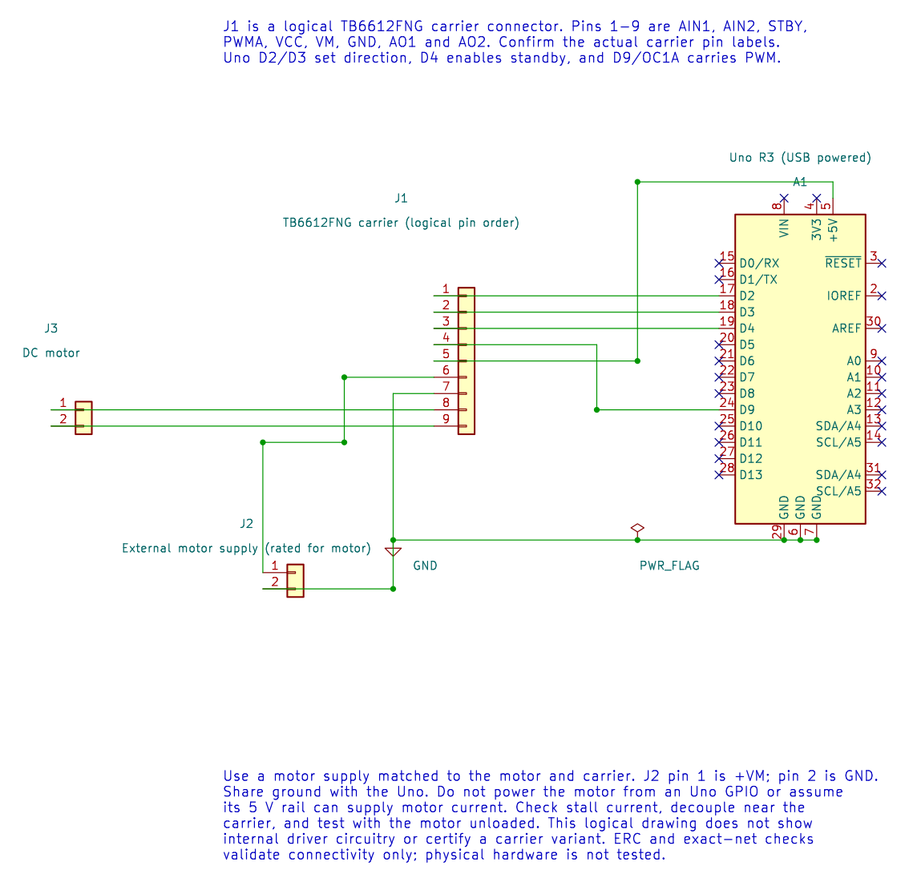

# TB6612FNG Motor Driver Interfacing

## What You Will Learn

- Separate the carrier's logic supply from its motor supply.
- Use two direction inputs, standby, and PWM to control one brushed motor.
- Calculate PWM frequency and understand why duty is not a direct speed command.
- Check the motor, carrier, supply, wiring and Timer1 ownership before powering the circuit.

## Choose the Carrier Carefully

Lab 28 targets a TB6612FNG breakout with pins labelled VCC, VM, GND, AIN1, AIN2, PWMA, STBY, AO1, and AO2. A different breakout may place those labels in a different order. Use the board's pin names, not a copied physical header layout.



| Uno Or Supply | TB6612FNG Signal | Purpose |
| --- | --- | --- |
| D2 | AIN1 | Direction input 1 |
| D3 | AIN2 | Direction input 2 |
| D4 | STBY | High enables the bridge |
| D9 / OC1A | PWMA | Timer1 PWM enable |
| Uno 5 V | VCC | Carrier logic supply, only if the module is rated for it |
| External motor supply positive | VM | Motor bridge supply |
| Uno GND and supply negative | GND | Shared logic reference |
| AO1 and AO2 | Motor leads | One motor output |

The motor supply must match the motor and carrier. Check the motor stall current, not only its free-running current. Do not draw motor current from an Uno pin. If the breakout does not include suitable decoupling, fit capacitors as recommended by its schematic and the driver datasheet.

## Understand the PWM Example

Lab 28 sets AIN1 high, AIN2 low and STBY high, then writes 128 to OCR1A for one second and zero for one second. With Fast PWM and prescaler 64:

```text
PWM frequency = 16 MHz / (64 x 256) = 976.6 Hz
Duty at OCR1A = 128 = approximately 50 percent
```

The low-duty interval is not necessarily a full electrical disconnect or an active brake. The carrier's bridge state and motor mechanics determine whether it coasts or slows quickly. Direction reversal needs its own current and timing plan; this example does not reverse the motor.

Build the source under either supported compiler:

```powershell
python "atmega328p-labs/tools/build.py" 28-motor --compiler gcc
python "atmega328p-labs/tools/build.py" 28-motor --compiler xc8
```

These are software checks. No motor was attached for physical validation. If you assemble the circuit, secure the unloaded motor and use a current-limited supply. Measure the carrier supply and check temperature during a short test.

## Code Walkthrough

### TB6612FNG DC motor PWM
The example's `main()` configures its peripherals, runs the algorithm and reports or displays the result. These source operations are listed in execution order:

- `(void)avr_gpio_mode(2U, AVR_GPIO_OUTPUT);` - Maps the Uno header pin to its AVR port, sets its DDR direction bit and prepares the PORT latch for the requested initial level or pull-up.
- `(void)avr_gpio_mode(3U, AVR_GPIO_OUTPUT);` - Maps the Uno header pin to its AVR port, sets its DDR direction bit and prepares the PORT latch for the requested initial level or pull-up.
- `(void)avr_gpio_mode(4U, AVR_GPIO_OUTPUT);` - Maps the Uno header pin to its AVR port, sets its DDR direction bit and prepares the PORT latch for the requested initial level or pull-up.
- `(void)avr_timer_pwm8(AVR_TIMER1, 64U, 0U, 0U);` - Selects 8-bit fast PWM, connects the chosen timer compare outputs, loads OCRnA/OCRnB and starts the prescaled clock. This takes ownership of that timer and its output pins.
- `(void)avr_gpio_write(2U, true);` - Changes the pin's PORT output latch; for an input pin this selects its pull-up state.
- `(void)avr_gpio_write(3U, false);` - Changes the pin's PORT output latch; for an input pin this selects its pull-up state.
- `(void)avr_gpio_write(4U, true);` - Changes the pin's PORT output latch; for an input pin this selects its pull-up state.
- `for (;;)` - Repeats the foreground task indefinitely; each pass checks inputs, advances the calculation or services the peripheral shown below.
- `OCR1A = 128U;` - Timer1 Compare A sets the match point or PWM pulse width, depending on the selected mode.
- `_delay_ms(1000);` - Waits for the stated interval; the foreground does no other work during this blocking delay.
- `OCR1A = 0U;` - Timer1 Compare A sets the match point or PWM pulse width, depending on the selected mode.

Algorithm: PWM controls applied average voltage; it does not directly regulate speed. Check stall current against the driver and supply. Direction changes require a deliberate stop/dead-time policy.
Expected behaviour: Motor runs forward for one second then stops for one second
**HAL source files in this repository:** [ATmega328P HAL on GitHub](https://github.com/arnabdasbwn/atmega328p-hal)

- [`include/avr_hal/gpio.h`](https://github.com/arnabdasbwn/atmega328p-hal/blob/main/include/avr_hal/gpio.h)
- [`include/avr_hal/timer.h`](https://github.com/arnabdasbwn/atmega328p-hal/blob/main/include/avr_hal/timer.h)
- [`src/gpio.c`](https://github.com/arnabdasbwn/atmega328p-hal/blob/main/src/gpio.c)
- [`src/timer.c`](https://github.com/arnabdasbwn/atmega328p-hal/blob/main/src/timer.c)


## Common Problems

- **No motion:** Check STBY, both direction lines, PWMA, the carrier pin labels, and VM.
- **Uno resets:** Check supply sag, shared grounding and noise from the motor wires.
- **Driver heating:** Stop and check stall current, load, supply and carrier cooling.
- **Timer conflict:** D9/OC1A and Timer1 are owned by this PWM example. Do not combine it with the servo lesson unchanged.

## Try It Yourself

At what PWM duty should the motor rotate at half its no-load speed?

**Answer:** The duty alone cannot give that answer. Speed depends on motor voltage, driver drop, load, friction and motor construction. Measure speed and use feedback if a particular speed is required.

## References

- [Lab 28 source and wiring metadata](<https://github.com/arnabdasbwn/atmega328p-labs/blob/main/examples/28-motor/main.c>)
- [Toshiba TB6612FNG product page and datasheet](https://toshiba.semicon-storage.com/ap-en/semiconductor/product/motor-driver-ics/brushed-dc-motor-driver-ics/detail.TB6612FNG.html)
- [Compare the TB6612FNG and L298](motor-drivers.md)
- [Timer1 PWM ownership](timer1.md)
