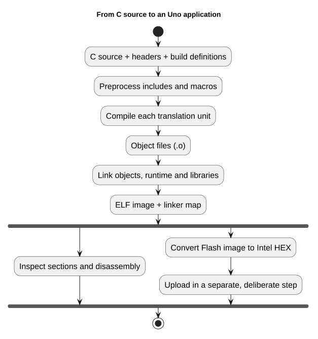

# Firmware Testing, Documentation and Git



## Specify the Behavior Before the Test

A useful test distinguishes a correct implementation from a plausible mistake.
For a GPIO API, that can mean rejecting an invalid pin without changing a register.
For a debounce filter, it means accepting a level only after a quiet interval,
including across counter rollover. Merely calling a function and observing that
the program continues is weak evidence.

The objective is to read an API contract, exercise its boundaries, and leave a
reviewable record of what was and was not checked. No external hardware is needed
for the software fixture; physical tests are a separate later step.

## Documentation Is Part of the Interface

Open [gpio.h](https://github.com/arnabdasbwn/atmega328p-hal/blob/main/include/avr_hal/gpio.h). A public function's Doxygen
comment states its purpose, valid parameters, output validity and possible errors.
The reader should not have to reverse-engineer its C implementation to discover
whether it accepts NULL or enables interrupts. The implementation adds comments
where register ordering or a critical section needs explanation.

The course coding rules apply to headers, source,
private helpers, examples, tests and generated code. Each C file begins with
`@file`, `@brief`, `@details` and licensing information. Functions document their
inputs and results. Shared state describes its owner. Avoid comments such as
“increment i” when the important fact is *why that count is bounded*.

Run `python tools/check_docs.py` from the parent course to generate API HTML and
check missing contracts. Run `python tools/check_format.py` for the common style.
An automatic check can detect a missing description; it cannot establish that a
description matches the hardware. Review source and comments together.

## Three Levels of Evidence

| Evidence | What it establishes | What it does not establish |
| --- | --- | --- |
| Compiler/linker | Source accepted for a specified target and flags | Correct wiring or application behavior |
| Software simulation | Selected assertions hold under a named model | Analog characteristics or all peripheral edge cases |
| Physical measurement | Observations on a recorded board/circuit | All conditions, temperatures or future revisions |

Static analysis is another useful check, with its own assumptions. The course
Cppcheck runner uses AVR integer widths and documents narrowly scoped exceptions.
No combination of these checks is advertised as MISRA compliance.

## Run the Software Fixture

```powershell
python "atmega328p-labs/tools/build.py" 90-selftest --compiler gcc
python "atmega328p-labs/tools/build.py" 90-selftest --compiler xc8
npm.cmd run test:firmware
```

The simulator command also needs existing builds of `01-blink-register` and
`02-blink-hal` for both compilers. It does not compile them automatically. The
fixture reports PASS over simulated USART only after its assertions succeed.
Read [main.c](<https://github.com/arnabdasbwn/atmega328p-labs/blob/main/examples/90-selftest/main.c>) to see exactly which
cases are covered. Its second C file helps catch accidental header-owned external
definitions. Tests for external bus errors and all device drivers remain separate
work; this fixture does not imply complete peripheral coverage.

## Review a Small Change

Suppose you change a debounce interval. First predict which sample should become
accepted. Update the relevant test and explanation, build both toolchains, run
the bounded fixture, then inspect the diff. For a hardware change, record the exact
board, supply, pin mapping, instrument setup and expected waveform before testing.

Use a branch for a coherent change. Review `git diff` before committing. Keep tool
installations, build output and personal absolute paths outside source control.
With submodules, a parent commit records a child commit ID, not every uncommitted
child edit. Commit and publish the child revision before pointing a published
parent release at it. The HAL and lab submodules use their public GitHub URLs.
The course parent repository still needs its own remote before a hosted recursive
clone can be checked. Fresh-clone validation is recorded in the repository's
validation log.

## Exercises with Answers

1. A test passes for debounce at 100 ms. What boundary is missing? **Answer:** at
   least just before/at the interval, candidate bouncing, and counter rollover.
2. A comment says “nonblocking” but polls until a flag changes. What should change?
   **Answer:** document the bounded wait and its units, or change the design to a
   genuinely nonblocking state machine. Do not retain the inaccurate guarantee.
3. Why record compiler versions? **Answer:** code generation, diagnostics and
   runtime support can change, so another reviewer needs the actual environment.

References: repository `CodingGuideline.md`, the committed test runner, generated
build reports and [AVR8js upstream](https://github.com/wokwi/avr8js). Hardware status
remains explicitly unverified until measurements are recorded.

## Code Walkthrough

### HAL Software Self-Test
The example's `main()` configures its peripherals, runs the algorithm and reports or displays the result. These source operations are listed in execution order:

- `avr_debounce_t button;` - Use the linked public header for this function's parameters, register ownership, blocking behavior and status values.
- `uint8_t result = 0U;` - Clears the state/counter after its threshold is reached so the next interval starts from zero.
- `(void)avr_uart_init(9600UL);` - Configures USART0 for asynchronous 8N1. It chooses a baud divisor and normal/double-speed mode, programs UBRR0/UCSR0A/UCSR0C, then enables receive and transmit in UCSR0B.
- `CHECK(avr_gpio_mode(20U, AVR_GPIO_OUTPUT) == AVR_ERROR_ARGUMENT);` - Maps the Uno header pin to its AVR port, sets its DDR direction bit and prepares the PORT latch for the requested initial level or pull-up.
- `CHECK(avr_gpio_read(13U, NULL) == AVR_ERROR_ARGUMENT);` - Reads the electrical level through PINx without changing direction or the output latch.
- `CHECK(avr_timer_ctc(AVR_TIMER0, 32U, 100U) == AVR_ERROR_ARGUMENT);` - Configures 0 in CTC mode with prescaler 32 and OCRnA TOP 100; event rate is 16 MHz / (32 x (100 + 1)) = 4950.5 Hz. The HAL disables this timer's interrupt sources and leaves flag polling to the caller.
- `CHECK(avr_timer_ctc(AVR_TIMER0, 64U, 256U) == AVR_ERROR_ARGUMENT);` - Configures 0 in CTC mode with prescaler 64 and OCRnA TOP 256; event rate is 16 MHz / (64 x (256 + 1)) = 972.763 Hz. The HAL disables this timer's interrupt sources and leaves flag polling to the caller.
- `CHECK(avr_timer_ctc(AVR_TIMER2, 128U, 124U) == AVR_OK);` - Configures 2 in CTC mode with prescaler 128 and OCRnA TOP 124; event rate is 16 MHz / (128 x (124 + 1)) = 1000 Hz. The HAL disables this timer's interrupt sources and leaves flag polling to the caller.
- `CHECK((TCCR2B & 7U) == 5U);` - Selects Timer2 clock/prescaler and remaining waveform bits. Timer2 has distinct prescaler encodings.
- `CHECK(avr_timer1_pwm(8U, 40000U, 3000U) == AVR_OK);` - Configures Timer1 mode 14 with prescaler 8; ICR1 becomes 39999, giving a 20 ms frame, and OCR1A starts at 3000 ticks (1500 us high).
- `CHECK(ICR1 == 39999U && OCR1A == 3000U);` - Timer1 input-capture register and, in the selected PWM mode, the TOP value. Timer1 Compare A; it sets the match point or PWM pulse width.
- `CHECK(avr_adc_millivolts(512U, 5000U) == 2500U);` - Calls `avr_adc_millivolts()`; its public HAL header defines the arguments, register ownership, blocking behavior and status results.
- `CHECK(avr_adc_read(6U, NULL, 0U) == AVR_ERROR_ARGUMENT);` - Calls `avr_adc_read()`; its public HAL header defines the arguments, register ownership, blocking behavior and status results.
- `CHECK(avr_eeprom_read(1024U, &result, 0UL) == AVR_ERROR_ARGUMENT);` - Calls `avr_eeprom_read()`; its public HAL header defines the arguments, register ownership, blocking behavior and status results.
- `CHECK(avr_twi_transfer(0U, NULL, 0U, NULL, 0U, 0UL) == AVR_ERROR_ARGUMENT);` - Calls `avr_twi_transfer()`; its public HAL header defines the arguments, register ownership, blocking behavior and status results.
- `CHECK(avr_elapsed(5UL, UINT32_MAX - 4UL, 10UL));` - Calls `avr_elapsed()`; its public HAL header defines the arguments, register ownership, blocking behavior and status results.
- `CHECK(!avr_elapsed(5UL, UINT32_MAX - 4UL, 11UL));` - Calls `avr_elapsed()`; its public HAL header defines the arguments, register ownership, blocking behavior and status results.
- `avr_debounce_init(&button, true, UINT32_MAX - 10UL);` - Calls `avr_debounce_init()`; its public HAL header defines the arguments, register ownership, blocking behavior and status results.
- `CHECK(!avr_debounce_update(&button, false, UINT32_MAX - 9UL, 20U));` - Calls `avr_debounce_update()`; its public HAL header defines the arguments, register ownership, blocking behavior and status results.
- `CHECK(!avr_debounce_update(&button, false, 9UL, 20U));` - Calls `avr_debounce_update()`; its public HAL header defines the arguments, register ownership, blocking behavior and status results.
- `CHECK(avr_debounce_update(&button, false, 10UL, 20U));` - Accepts a changed input only after it remains stable for the requested interval, then reports that accepted change once.
- `CHECK(!avr_debounce_update(&button, false, 11UL, 20U));` - Accepts a changed input only after it remains stable for the requested interval, then reports that accepted change once.
- `(void)avr_uart_write((const uint8_t *)"PASS\n", 5U, AVR_POLL_BUDGET);` - Sends the specified bytes through USART0; a timeout can occur after a prefix has already been sent.
- `for (;;)` - Repeats the foreground task indefinitely; each pass checks inputs, advances the calculation or services the peripheral shown below.

Algorithm: A bounded self-test checks software contracts and links a second source file so header-owned definitions are detected.
Expected behaviour: The fixture prints PASS after argument, timer-range, debounce and independent-translation-unit checks; otherwise it prints FAIL and stops
**HAL source files in this repository:** [ATmega328P HAL on GitHub](https://github.com/arnabdasbwn/atmega328p-hal)

- [`include/avr_hal/adc.h`](https://github.com/arnabdasbwn/atmega328p-hal/blob/main/include/avr_hal/adc.h)
- [`include/avr_hal/common.h`](https://github.com/arnabdasbwn/atmega328p-hal/blob/main/include/avr_hal/common.h)
- [`include/avr_hal/eeprom.h`](https://github.com/arnabdasbwn/atmega328p-hal/blob/main/include/avr_hal/eeprom.h)
- [`include/avr_hal/gpio.h`](https://github.com/arnabdasbwn/atmega328p-hal/blob/main/include/avr_hal/gpio.h)
- [`include/avr_hal/timer.h`](https://github.com/arnabdasbwn/atmega328p-hal/blob/main/include/avr_hal/timer.h)
- [`include/avr_hal/twi.h`](https://github.com/arnabdasbwn/atmega328p-hal/blob/main/include/avr_hal/twi.h)
- [`include/avr_hal/uart.h`](https://github.com/arnabdasbwn/atmega328p-hal/blob/main/include/avr_hal/uart.h)
- [`lib/drivers/debounce.c`](https://github.com/arnabdasbwn/atmega328p-hal/blob/main/lib/drivers/debounce.c)
- [`lib/drivers/debounce.h`](https://github.com/arnabdasbwn/atmega328p-hal/blob/main/lib/drivers/debounce.h)
- [`src/adc.c`](https://github.com/arnabdasbwn/atmega328p-hal/blob/main/src/adc.c)
- [`src/common.c`](https://github.com/arnabdasbwn/atmega328p-hal/blob/main/src/common.c)
- [`src/eeprom.c`](https://github.com/arnabdasbwn/atmega328p-hal/blob/main/src/eeprom.c)
- [`src/gpio.c`](https://github.com/arnabdasbwn/atmega328p-hal/blob/main/src/gpio.c)
- [`src/timer.c`](https://github.com/arnabdasbwn/atmega328p-hal/blob/main/src/timer.c)
- [`src/twi.c`](https://github.com/arnabdasbwn/atmega328p-hal/blob/main/src/twi.c)
- [`src/uart.c`](https://github.com/arnabdasbwn/atmega328p-hal/blob/main/src/uart.c)
