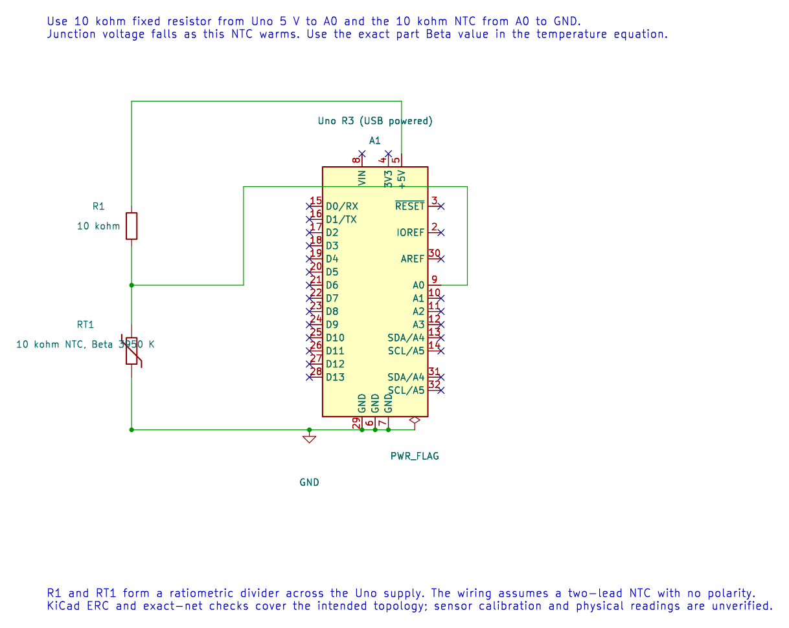

# 10 KΩ NTC Thermistor

## What You Will Learn

An NTC thermistor's resistance falls as its temperature rises. The Uno cannot measure resistance directly, so a fixed resistor and thermistor form a voltage divider. The ADC converts the divider voltage to a number; the firmware then estimates resistance and temperature.

## Parts and Wiring

Lab 35 assumes a 10 kΩ NTC thermistor with a Beta value of 3950 K and a 10 kΩ fixed resistor. Check the exact part's datasheet because thermistors with the same nominal resistance can have different Beta values.

| Connection | Destination | Purpose |
| --- | --- | --- |
| Uno 5 V | 10 kΩ fixed resistor, then A0 | Divider high side |
| A0 | NTC lead 1 | ADC measurement node |
| NTC lead 2 | GND | Divider low side |
| Uno GND | Divider ground | Shared reference |



With this arrangement, warming the NTC lowers its resistance and usually lowers the A0 reading. Keep the sensor away from the Uno regulator and other heat sources.

## Worked Resistance Calculation

Let `N` be the 10-bit ADC result and let `Rfixed` be the resistor from 5 V to A0. For the wiring above:

```text
Rntc = Rfixed × N / (1023 − N)
```

If `N = 512` and `Rfixed = 10 kΩ`, then `Rntc ≈ 10 kΩ × 512 / 511 ≈ 10.02 kΩ`. This is close to the nominal 10 kΩ point, which is normally specified at 25 °C.

The Beta equation estimates temperature in kelvin:

```text
1/T = 1/T0 + ln(R/R0) / B
```

Lab 35 uses `T0 = 298.15 K`, `R0 = 10 kΩ` and `B = 3950 K`. Its serial output is hundredths of kelvin, so `29815` means 298.15 K. Subtract 273.15 to convert to Celsius: approximately 25 °C.

## Firmware and Build

The code rejects ADC values 0 and 1023 before dividing. Those rail readings indicate an open, shorted or out-of-range divider and do not provide a valid resistance. The example uses `float` and `logf()` to keep the Beta calculation readable; those functions increase Flash use. GCC and XC8 builds pass, but neither compiler result verifies a real sensor's calibration.

```powershell
python atmega328p-labs/tools/build.py 35-thermistor --compiler gcc
python atmega328p-labs/tools/build.py 35-thermistor --compiler xc8
```

Upload using the course serial workflow. Open a 9600-baud terminal and record the values at room temperature. Warm the sensor gently between your fingers and compare the direction of change with a separate thermometer. Do not use boiling water or expose the circuit to mains voltage.

## Code Walkthrough

### 10k NTC divider
The example's `main()` configures its peripherals, runs the algorithm and reports or displays the result. These source operations are listed in execution order:

- `(void)avr_adc_init(AVR_ADC_AVCC);` - Selects the reference in ADMUX and enables the ADC in ADCSRA with a divide-by-128 prescaler. At 16 MHz, the ADC clock is 125 kHz. The HAL keeps the result right-adjusted, waits for reference settling and leaves ADC interrupts disabled.
- `(void)avr_uart_init(9600UL);` - Configures USART0 for asynchronous 8N1. It chooses a baud divisor and normal/double-speed mode, programs UBRR0/UCSR0A/UCSR0C, then enables receive and transmit in UCSR0B.
- `for (;;)` - Repeats the foreground task indefinitely; each pass checks inputs, advances the calculation or services the peripheral shown below.
- `if (avr_adc_read(0U, &sample, AVR_POLL_BUDGET) == AVR_OK && sample > 0U && sample < 1023U)` - The body runs only when the conversion succeeds and its code is between 1 and 1022. The HAL selects the channel in ADMUX, disables the digital buffer through DIDR0, discards the first conversion after a channel change, and polls with a finite budget.
- `float resistance = 10000.0f * (float)sample / (1023.0f - (float)sample);` - Applies the divider equation for this wiring: R_NTC = R_fixed x ADC / (1023 - ADC), using the measured 10-bit ADC code.
- `float kelvin = 1.0f / (1.0f / 298.15f + logf(resistance / 10000.0f) / 3950.0f);` - Applies the Beta equation in kelvin using T0 = 298.15 K, R0 = 10 kohm and B = 3950 K. The constants must match the thermistor.
- `uint16_t centikelvin = (uint16_t)(kelvin * 100.0f);` - Multiplies kelvin by 100 so the integer output retains two decimal places without floating-point formatting.
- `(void)avr_uart_u16(centikelvin);` - Formats an unsigned integer as decimal digits and sends them on USART0; it does not add a newline.
- `(void)avr_uart_put('\n', AVR_POLL_BUDGET);` - Waits for the USART transmit buffer within its poll budget, then writes the byte to UDR0.
- `_delay_ms(500);` - Waits for the stated interval; the foreground does no other work during this blocking delay.

Algorithm: The beta equation uses kelvin and a specified nominal resistance/beta. A different thermistor needs different constants. Floating-point logarithm is deliberately included to inspect its Flash cost.
Expected behaviour: Prints approximate hundredths of kelvin; subtract 27315 to obtain hundredths of Celsius
**HAL source files in this repository:** [ATmega328P HAL on GitHub](https://github.com/arnabdasbwn/atmega328p-hal)

- [`include/avr_hal/adc.h`](https://github.com/arnabdasbwn/atmega328p-hal/blob/main/include/avr_hal/adc.h)
- [`include/avr_hal/uart.h`](https://github.com/arnabdasbwn/atmega328p-hal/blob/main/include/avr_hal/uart.h)
- [`src/adc.c`](https://github.com/arnabdasbwn/atmega328p-hal/blob/main/src/adc.c)
- [`src/uart.c`](https://github.com/arnabdasbwn/atmega328p-hal/blob/main/src/uart.c)


## Common Problems

- **The ADC is near zero or full scale:** Check for a short, open connection, wrong divider order or missing ground.
- **Temperature is plausible but offset:** Verify the thermistor's Beta value, nominal resistance, fixed-resistor tolerance and reference voltage.
- **Values change slowly:** The bead and its coating have thermal mass; allow time to settle and avoid touching it during a measurement.
- **The calculation is too large for a product:** Measure Flash and execution time, then consider a lookup table or fixed-point approximation.

## Check Your Understanding

1. If `N` approaches 1023 in this wiring, what does the equation predict and why should firmware reject it?
2. Why is a nominal 10 kΩ resistance not enough to identify the correct Beta constant?
3. What does a serial value of `29315` represent?

**Suggested answers:** The denominator approaches zero and the calculated resistance grows without bound; the reading indicates a rail/open condition and must be rejected. Beta varies by thermistor model even when nominal resistance matches. `293.15 K`, which is 20 °C.

## Source and Further Reading

- [Lab 35 source](<https://github.com/arnabdasbwn/atmega328p-labs/blob/main/examples/35-thermistor/main.c>)
- Use the datasheet for the exact NTC part to obtain its R25, Beta value, tolerance and temperature range.
- [ATmega328P Documentation](https://www.microchip.com/en-us/product/ATMEGA328P), ADC section.
