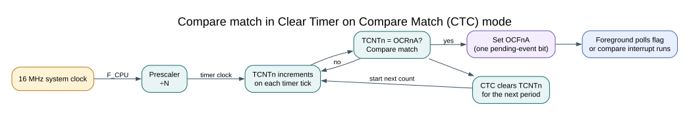

# Timer/counter1 on the ATmega328P

## Learning Goals

Timer1 is the ATmega328P's sixteen-bit general-purpose timer. By the end of this lesson, you should be able to calculate a CTC interval, identify Timer1's compare and capture pins, and recognise when another feature already owns the timer.

## Why Timer1 Has Longer Intervals

Timer1 can count from 0 through 65,535, giving it a maximum fixed TOP of 65,535 in the basic CTC mode used here. In mode 4, `OCR1A` is TOP and a compare match sets `OCF1A` and restarts the count. The period is:

```text
T_match = prescaler × (OCR1A + 1) / F_CPU
```

At 16 MHz, a divide-by-256 prescaler gives a timer tick of 16 µs. For a one-second interval, the number of timer ticks must be `1 s / 16 µs = 62,500`, so `OCR1A = 62,499`. Timer0 and Timer2 cannot hold that many counts in one CTC interval because their counters are only eight bits wide.



## Register-Level Setup

This configuration stops Timer1 while loading its 16-bit TOP, selects CTC mode 4, clears any old compare flag, then starts the timer with a divide-by-256 clock. Compare interrupts remain disabled; software polls `OCF1A`.

```c
TCCR1A = 0U;
TCCR1B = 0U;
TIMSK1 = 0U; /* This example polls; it owns Timer1's interrupt enables. */
TCNT1 = 0U;
OCR1A = 62499U;
TIFR1 = _BV(OCF1A); /* W1C: write one to clear the pending compare flag. */
TCCR1B = _BV(WGM12) | _BV(CS12); /* CTC mode 4; CS12:0 = 0b100, divide by 256. */
```

When a compare is observed, clear just its flag with `TIFR1 = _BV(OCF1A);`. These status flags are write-one-to-clear. Do not use `TIFR1 |= ...`, which can clear other flags that were set during the read-modify-write.

## What Else Timer1 Can Do

Timer1 also provides two output-compare channels and an input-capture unit. On the Uno R3, its compare outputs are D9/OC1A and D10/OC1B; its input-capture input is D8/ICP1. The capture unit can copy the timer count into `ICR1` when a selected edge arrives, giving a more precise timestamp than polling a pin in a loop.

The 16-bit timer registers are accessed over the AVR's eight-bit data bus. If foreground code reads a 16-bit timer value that an interrupt can also change or access, protect the shared operation with an atomic section. Keep that section short; the [atomic access lesson](volatile-atomic.md) explains the distinction between `volatile` and atomicity.

## Timer Ownership on the Uno

A servo pulse generator, Timer1 PWM output and a separate Timer1 CTC scheduler cannot each configure the same timer independently. They share `TCCR1A`, `TCCR1B`, `TCNT1` and compare resources. Allocate one owner for the timer and agree on its mode, TOP, prescaler, pins and interrupt vectors before combining features. Arduino libraries can also claim timers; keep bare-metal labs in their own projects.

## Build and Observe the Lab

Lab 67 is the register-level version of the one-second CTC exercise. Lab 08 uses the Timer HAL for the same interval. Compare the setup in both source files, then observe that each toggles the onboard D13 LED at every compare; a full on/off cycle takes about two seconds. Lab 12 demonstrates servo pulses, and Lab 38 uses input capture to measure an external pulse.

```powershell
python atmega328p-labs/tools/build.py 67-timer1-register-ctc --compiler gcc
python atmega328p-labs/tools/build.py 67-timer1-register-ctc --compiler xc8
python atmega328p-labs/tools/build.py 08-timer1-ctc --compiler gcc
python atmega328p-labs/tools/build.py 08-timer1-ctc --compiler xc8
```

- [Lab 67 register-level source](<https://github.com/arnabdasbwn/atmega328p-labs/blob/main/examples/67-timer1-register-ctc/main.c>)
- [Lab 08 HAL source](<https://github.com/arnabdasbwn/atmega328p-labs/blob/main/examples/08-timer1-ctc/main.c>)

The compiler builds do not measure the physical output. A slow LED confirms that the program is running but cannot verify a 16 µs timer tick. Use a scope or logic analyser to measure output timing.

## Code Walkthrough


**Example code on GitHub:**
- [SG90 servo pulse generation (`12-servo`)](https://github.com/arnabdasbwn/atmega328p-labs/blob/main/examples/12-servo/main.c)
- [Timer1 hardware edge timestamp (`38-input-capture`)](https://github.com/arnabdasbwn/atmega328p-labs/blob/main/examples/38-input-capture/main.c)

### Timer1 Register-Level CTC Polling
The example's `main()` configures its peripherals, runs the algorithm and reports or displays the result. These source operations are listed in execution order:

- `PORTB &= (uint8_t)~_BV(PORTB5);` - Sets or clears the Port B output latch. When the pin is an output, this determines its output level; on an input, it controls the pull-up.
- `DDRB |= _BV(DDB5);` - Sets the Port B direction bits; a set bit selects output mode.
- `TCCR1A = 0U;` - Selects Timer1 compare-output behavior and lower waveform-mode bits.
- `TCCR1B = 0U;` - Stops the timer clock while the remaining mode, counter and compare registers are prepared.
- `TIMSK1 = 0U;` - Controls Timer1 interrupt enables; only the selected event sources can request an interrupt.
- `TCNT1 = 0U;` - Holds the live 16-bit Timer1 count; writing zero starts from a known count.
- `OCR1A = 62499U;` - Loads TOP=62499. With Timer1 divided by 256, the compare rate is 16 MHz / 256 / 62500 = 1 Hz.
- `TIFR1 = _BV(OCF1A);` - Contains Timer1 event flags. These flags are write-one-to-clear: assign the mask directly and do not use |=.
- `TCCR1B = _BV(WGM12) | _BV(CS12);` - Sets WGM12 for Timer1 CTC mode and CS12 for a divide-by-256 clock.
- `for (;;)` - Repeats the foreground task indefinitely; each pass checks inputs, advances the calculation or services the peripheral shown below.
- `if ((TIFR1 & _BV(OCF1A)) != 0U)` - Contains Timer1 event flags. These flags are write-one-to-clear: assign the mask directly and do not use |=.
- `PINB = _BV(PINB5);` - Writing a one to a PINB bit toggles that pin's PORTB output latch on the ATmega328P.

Algorithm: Directly configures Timer1 in CTC mode 4 at 16 MHz / 256 / (62499 + 1) = 1 Hz.
Expected behaviour: The onboard LED toggles once per compare event, nominally once per second
**HAL source files in this repository:** [ATmega328P HAL on GitHub](https://github.com/arnabdasbwn/atmega328p-hal)


### Timer1 one-second compare
The example's `main()` configures its peripherals, runs the algorithm and reports or displays the result. These source operations are listed in execution order:

- `(void)avr_gpio_mode(13U, AVR_GPIO_OUTPUT);` - Maps the Uno header pin to its AVR port, sets its DDR direction bit and prepares the PORT latch for the requested initial level or pull-up.
- `(void)avr_timer_ctc(AVR_TIMER1, 256U, 62499U);` - Configures 1 in CTC mode with prescaler 256 and OCRnA TOP 62499; event rate is 16 MHz / (256 x (62499 + 1)) = 1 Hz. The HAL disables this timer's interrupt sources and leaves flag polling to the caller.
- `for (;;)` - Repeats the foreground task indefinitely; each pass checks inputs, advances the calculation or services the peripheral shown below.
- `if ((TIFR1 & _BV(OCF1A)) != 0U)` - Contains Timer1 event flags. These flags are write-one-to-clear: assign the mask directly and do not use |=.
- `TIFR1 = _BV(OCF1A);` - Contains Timer1 event flags. These flags are write-one-to-clear: assign the mask directly and do not use |=.
- `(void)avr_gpio_toggle(13U);` - Atomically toggles the selected pin output latch.

Algorithm: A 16-bit timer can count 62500 prescaled clocks. Timer0 cannot hold TOP=62499 because it is only eight bits.
Expected behaviour: L changes once per second: full LED cycle is two seconds
**HAL source files in this repository:** [ATmega328P HAL on GitHub](https://github.com/arnabdasbwn/atmega328p-hal)

- [`include/avr_hal/gpio.h`](https://github.com/arnabdasbwn/atmega328p-hal/blob/main/include/avr_hal/gpio.h)
- [`include/avr_hal/timer.h`](https://github.com/arnabdasbwn/atmega328p-hal/blob/main/include/avr_hal/timer.h)
- [`src/gpio.c`](https://github.com/arnabdasbwn/atmega328p-hal/blob/main/src/gpio.c)
- [`src/timer.c`](https://github.com/arnabdasbwn/atmega328p-hal/blob/main/src/timer.c)


### SG90 servo pulse generation
The example's `main()` configures its peripherals, runs the algorithm and reports or displays the result. These source operations are listed in execution order:

- `(void)avr_timer1_pwm(8U, 40000U, 3000U);` - Configures Timer1 mode 14 with prescaler 8; ICR1 becomes 39999, giving a 20 ms frame, and OCR1A starts at 3000 ticks (1500 us high).
- `for (;;)` - Repeats the foreground task indefinitely; each pass checks inputs, advances the calculation or services the peripheral shown below.
- `OCR1A = 2000U;` - Loads 2000 timer ticks for a 1 ms high pulse; Timer1 ticks at 0.5 us with the divide-by-8 prescaler.
- `_delay_ms(1000);` - Waits for the stated interval; the foreground does no other work during this blocking delay.
- `OCR1A = 3000U;` - Loads 3000 timer ticks for a 1.5 ms high pulse; this is the nominal servo centre position.
- `OCR1A = 4000U;` - Loads 4000 timer ticks for a 2 ms high pulse; the servo endpoint depends on the actual servo.

Algorithm: At divide-by-8 each tick is 0.5 us. 40000 ticks make a 20 ms frame. Servo angle and safe travel depend on the actual unit; do not force a mechanical stop.
Expected behaviour: Servo alternates approximately between 1, 1.5 and 2 ms pulse positions
**HAL source files in this repository:** [ATmega328P HAL on GitHub](https://github.com/arnabdasbwn/atmega328p-hal)

- [`include/avr_hal/timer.h`](https://github.com/arnabdasbwn/atmega328p-hal/blob/main/include/avr_hal/timer.h)
- [`src/timer.c`](https://github.com/arnabdasbwn/atmega328p-hal/blob/main/src/timer.c)


### Timer1 hardware edge timestamp
The example's `main()` configures its peripherals, runs the algorithm and reports or displays the result. These source operations are listed in execution order:

- `(void)avr_uart_init(9600UL);` - Configures USART0 for asynchronous 8N1. It chooses a baud divisor and normal/double-speed mode, programs UBRR0/UCSR0A/UCSR0C, then enables receive and transmit in UCSR0B.
- `(void)avr_timer1_capture(8U, true);` - Starts Timer1 input capture at ICP1 (Uno D8), choosing the edge and prescaler. The application still owns any capture ISR and overflow accounting.
- `TIMSK1 = _BV(ICIE1);` - Controls Timer1 interrupt enables; only the selected event sources can request an interrupt.
- `sei();` - Enables global interrupts after the example has configured its sources and shared state.
- `for (;;)` - Repeats the foreground task indefinitely; each pass checks inputs, advances the calculation or services the peripheral shown below.
- `uint16_t copy = 0U;` - Clears the state/counter after its threshold is reached so the next interval starts from zero.
- `bool available = false;` - Stores this intermediate or output value for the next algorithm step. Check the units and range represented by each operand.
- `if (ready != 0U)` - Tests the stated condition; the following block handles the matching case and the other path is skipped.
- `copy = width;` - Stores this intermediate or output value for the next algorithm step. Check the units and range represented by each operand.
- `ready = 0U;` - Clears the state/counter after its threshold is reached so the next interval starts from zero.
- `available = true;` - Stores this intermediate or output value for the next algorithm step. Check the units and range represented by each operand.
- `if (available)` - Tests the stated condition; the following block handles the matching case and the other path is skipped.
- `(void)avr_uart_u16(copy);` - Formats an unsigned integer as decimal digits and sends them on USART0; it does not add a newline.
- `(void)avr_uart_put('\n', AVR_POLL_BUDGET);` - Waits for the USART transmit buffer within its poll budget, then writes the byte to UDR0.

Algorithm: ICR1 captures the counter at the hardware edge; interrupt latency does not shift that timestamp. One unsigned subtraction handles one wrap, not multiple wraps.
Expected behaviour: Prints high-pulse width in 0.5 us ticks
**HAL source files in this repository:** [ATmega328P HAL on GitHub](https://github.com/arnabdasbwn/atmega328p-hal)

- [`include/avr_hal/timer.h`](https://github.com/arnabdasbwn/atmega328p-hal/blob/main/include/avr_hal/timer.h)
- [`include/avr_hal/uart.h`](https://github.com/arnabdasbwn/atmega328p-hal/blob/main/include/avr_hal/uart.h)
- [`src/timer.c`](https://github.com/arnabdasbwn/atmega328p-hal/blob/main/src/timer.c)
- [`src/uart.c`](https://github.com/arnabdasbwn/atmega328p-hal/blob/main/src/uart.c)


## Check Your Understanding

At 16 MHz with a divide-by-8 prescaler, what TOP value gives a 16 ms CTC interval?

**Answer:** A timer tick is 0.5 µs, so 16 ms needs 32,000 counts. Set `OCR1A = 31,999`.

## References

- Microchip, [ATmega328P documentation](https://www.microchip.com/en-us/product/ATMEGA328P), 16-bit Timer/Counter1 chapter.
- [Timer1 CTC source](<https://github.com/arnabdasbwn/atmega328p-labs/blob/main/examples/08-timer1-ctc/main.c>), [servo pulses](servo.md) and [input capture](input-capture.md).
