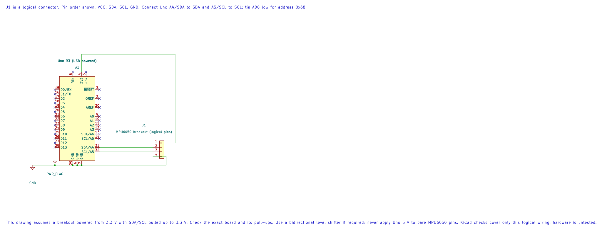

# TWI and I²C Bus Concepts

## Two Shared Lines

The ATmega328P calls its peripheral **TWI**; it implements the commonly used I²C bus protocol. On the Uno R3, SDA is A4 and SCL is A5. Both lines are open-drain/open-collector style signals and need pull-up resistors to the bus logic supply. Devices share the lines and use addresses to determine which one should respond.

Choose pull-up values and bus voltage for the total bus capacitance, speed and attached devices. A 3.3 V module may not tolerate a 5 V pull-up. Use a suitable level translator or keep all bus devices at a compatible voltage.

## Start, Address, Acknowledge

The controller begins a transaction with START, sends a 7-bit address plus a direction bit, and checks for ACK. Data bytes follow, each with ACK or NACK. STOP ends the transaction. Some register reads use a repeated START between the register-address write and the data read, without releasing the bus.

The bus speed is part of the electrical design. Standard-mode I²C uses up to 100 kHz, and fast-mode uses up to 400 kHz when all devices and the bus capacitance support it. A device's data sheet may specify a lower maximum.

## Addresses Are Passed as Seven Bits

The course TWI HAL accepts an unshifted seven-bit address such as `0x68`; it adds the read/write direction bit during the transaction. Do not shift the address yourself before calling it. Address lists may also show an eight-bit write/read byte, so check how each document represents an address.



| Uno R3 | Compatible Breakout | Purpose |
| --- | --- | --- |
| 3.3 V | VCC | Supply, only when supported by the breakout |
| A4 / SDA | SDA | Two-way data line |
| A5 / SCL | SCL | Clock line |
| GND | GND | Shared reference |

This drawing assumes a 3.3 V breakout with 3.3 V I²C pull-ups. Breakout boards differ: check the exact board's power input, pull-up voltage and pin labels before wiring it to a 5 V Uno.

Build the address-probe example before using it on a bus:

```powershell
python atmega328p-labs/tools/build.py 22-twi-scan --compiler xc8
```

## Exercise with Answer

Why does the bus need pull-up resistors if the controller can drive a line low?

**Answer:** The bus devices release the line to represent high and pull it low to represent low. The pull-up creates the high level; compatible devices can share the line without driving opposite push-pull levels against one another.

## Code Walkthrough


**Example code on GitHub:**
- [Direct-Register TWI Identity Read (`74-twi-register-read`)](https://github.com/arnabdasbwn/atmega328p-labs/blob/main/examples/74-twi-register-read/main.c)

### Direct-Register TWI Identity Read
The example's `main()` configures its peripherals, runs the algorithm and reports or displays the result. These source operations are listed in execution order:

- `uint8_t identity = 0U;` - Clears the state/counter after its threshold is reached so the next interval starts from zero.
- `DDRB |= _BV(DDB5);` - Sets the Port B direction bits; a set bit selects output mode.
- `PORTB &= (uint8_t)~_BV(PORTB5);` - Sets or clears the Port B output latch. When the pin is an output, this determines its output level; on an input, it controls the pull-up.
- `twi_result_t result = mpu6050_register_read(MPU6050_WHO_AM_I_REGISTER, &identity);` - Stores this intermediate or output value for the next algorithm step. Check the units and range represented by each operand.
- `if ((result == TWI_RESULT_OK) && (identity == MPU6050_WHO_AM_I_VALUE))` - Tests the stated condition; the following block handles the matching case and the other path is skipped.
- `PORTB |= _BV(PORTB5);` - Sets or clears the Port B output latch. When the pin is an output, this determines its output level; on an input, it controls the pull-up.
- `for (;;)` - Repeats the foreground task indefinitely; each pass checks inputs, advances the calculation or services the peripheral shown below.

Algorithm: Directly controls TWBR/TWSR/TWCR/TWDR, checks each TWI status, uses repeated START, NACKs the final byte and bounds waits.
Expected behaviour: D13 turns on when WHO_AM_I register 0x75 returns 0x68
**HAL source files in this repository:** [ATmega328P HAL on GitHub](https://github.com/arnabdasbwn/atmega328p-hal)


### TWI address probe
The example's `main()` configures its peripherals, runs the algorithm and reports or displays the result. These source operations are listed in execution order:

- `(void)avr_twi_init(100000UL);` - Configures TWI for the requested bus rate and enables the peripheral. The bus still requires suitable external pull-ups and compatible signal voltage.
- `(void)avr_uart_init(9600UL);` - Configures USART0 for asynchronous 8N1. It chooses a baud divisor and normal/double-speed mode, programs UBRR0/UCSR0A/UCSR0C, then enables receive and transmit in UCSR0B.
- `for (;;)` - Repeats the foreground task indefinitely; each pass checks inputs, advances the calculation or services the peripheral shown below.
- `for (uint8_t address = 8U; address < 0x78U; ++address)` - Repeats while `address < 0x78U` is true; `uint8_t address = 8U` sets the starting state and `++address` advances it each pass.
- `if (avr_twi_transfer(address, NULL, 0U, NULL, 0U, AVR_POLL_BUDGET) == AVR_OK)` - The operation runs only after this API reports AVR_OK. Performs a bounded TWI transaction at the requested 7-bit address; the result reports address/data phase errors.
- `(void)avr_uart_u16(address);` - Formats an unsigned integer as decimal digits and sends them on USART0; it does not add a newline.
- `(void)avr_uart_put('\n', AVR_POLL_BUDGET);` - Waits for the USART transmit buffer within its poll budget, then writes the byte to UDR0.
- `_delay_ms(1000);` - Waits for the stated interval; the foreground does no other work during this blocking delay.

Algorithm: Address 0x68 is printed as decimal 104. Do not shift an address before passing it to this HAL. Probe only devices whose datasheets allow an empty write transaction.
Expected behaviour: Responding 7-bit addresses print in decimal; an empty bus prints none
**HAL source files in this repository:** [ATmega328P HAL on GitHub](https://github.com/arnabdasbwn/atmega328p-hal)

- [`include/avr_hal/twi.h`](https://github.com/arnabdasbwn/atmega328p-hal/blob/main/include/avr_hal/twi.h)
- [`include/avr_hal/uart.h`](https://github.com/arnabdasbwn/atmega328p-hal/blob/main/include/avr_hal/uart.h)
- [`src/twi.c`](https://github.com/arnabdasbwn/atmega328p-hal/blob/main/src/twi.c)
- [`src/uart.c`](https://github.com/arnabdasbwn/atmega328p-hal/blob/main/src/uart.c)


## References

- Microchip, [ATmega328P product documentation](https://www.microchip.com/en-us/product/ATMEGA328P), TWI peripheral.
- [TWI address probe lab](<https://github.com/arnabdasbwn/atmega328p-labs/blob/main/examples/22-twi-scan/main.c>)
- Check the attached device's data sheet for address, voltage, pull-up and bus-speed limits.
- MPU6050 wiring source and checks
