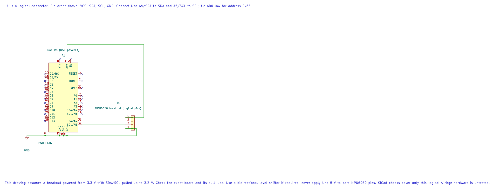

# Using the TWI HAL

## Configure the Bus



The interface is declared in [`avr_hal/twi.h`](https://github.com/arnabdasbwn/atmega328p-hal/blob/main/include/avr_hal/twi.h) and implemented in [`twi.c`](https://github.com/arnabdasbwn/atmega328p-hal/blob/main/src/twi.c). `avr_twi_init()` accepts 100,000 or 400,000 Hz at the reference 16 MHz clock. It owns A4/SDA and A5/SCL, but the circuit must provide external pull-ups and voltage compatibility.

## Transfer Contract

`avr_twi_transfer(address, tx, tx_length, rx, rx_length, budget)` accepts an unshifted seven-bit address from `0x08` to `0x77`. It writes the requested bytes and, when both directions are used, issues a repeated START before reading. The caller retains ownership of both buffers; the receive buffer may contain a partial result if the transaction fails.

The budget limits unsuccessful polls at each protocol state; it is not a whole-transaction time in milliseconds. The HAL distinguishes argument errors, NACK, arbitration loss, timeout and unexpected I/O state. It does not retry automatically. After arbitration loss it releases the bus without issuing STOP; after other errors it attempts STOP. If STOP times out, TWI is disabled. When a transaction error happened first, that original status is returned, so call `avr_twi_init()` after diagnosing the bus before trying again.

## Use It with a Peripheral Data Sheet

Compare direct register access in [Lab 74](<https://github.com/arnabdasbwn/atmega328p-labs/blob/main/examples/74-twi-register-read/main.c>) with the HAL-based [MPU6050 Lab 32](<https://github.com/arnabdasbwn/atmega328p-labs/blob/main/examples/32-mpu6050/main.c>). Lab 74 checks each START, address, data and final-NACK status explicitly. The HAL version keeps those state transitions in `avr_twi_transfer()` and reports a status to the caller. The [TWI scan lab](<https://github.com/arnabdasbwn/atmega328p-labs/blob/main/examples/22-twi-scan/main.c>) demonstrates an address probe. Do not interpret an ACK as a valid sensor measurement.

Build the scanner and HAL sensor consumer with the course script:

```powershell
python atmega328p-labs/tools/build.py 22-twi-scan --compiler gcc
python atmega328p-labs/tools/build.py 32-mpu6050 --compiler xc8
```

Their builds have been validated; no physical TWI sensor test is recorded.

## Exercise with Answer

Why is the receive buffer allowed to be partially filled on an error?

**Answer:** A transaction can fail after one or more bytes have already arrived. The API reports the failure and documents the partial buffer so the caller does not mistake incomplete data for a complete reading.

## Code Walkthrough

### Direct-Register TWI Identity Read
The example's `main()` configures its peripherals, runs the algorithm and reports or displays the result. These source operations are listed in execution order:

- `uint8_t identity = 0U;` - Clears the state/counter after its threshold is reached so the next interval starts from zero.
- `DDRB |= _BV(DDB5);` - Sets the Port B direction bits; a set bit selects output mode.
- `PORTB &= (uint8_t)~_BV(PORTB5);` - Sets or clears the Port B output latch. When the pin is an output, this determines its output level; on an input, it controls the pull-up.
- `twi_result_t result = mpu6050_register_read(MPU6050_WHO_AM_I_REGISTER, &identity);` - Stores this intermediate or output value for the next algorithm step. Check the units and range represented by each operand.
- `if ((result == TWI_RESULT_OK) && (identity == MPU6050_WHO_AM_I_VALUE))` - Tests the stated condition; the following block handles the matching case and the other path is skipped.
- `PORTB |= _BV(PORTB5);` - Sets or clears the Port B output latch. When the pin is an output, this determines its output level; on an input, it controls the pull-up.
- `for (;;)` - Repeats the foreground task indefinitely; each pass checks inputs, advances the calculation or services the peripheral shown below.

Algorithm: Directly controls TWBR/TWSR/TWCR/TWDR, checks each TWI status, uses repeated START, NACKs the final byte and bounds waits.
Expected behaviour: D13 turns on when WHO_AM_I register 0x75 returns 0x68
**HAL source files in this repository:** [ATmega328P HAL on GitHub](https://github.com/arnabdasbwn/atmega328p-hal)


### MPU6050 identity and acceleration
The example's `main()` configures its peripherals, runs the algorithm and reports or displays the result. These source operations are listed in execution order:

- `uint8_t identity = 0U, bytes[6];` - Clears the state/counter after its threshold is reached so the next interval starts from zero.
- `(void)avr_twi_init(100000UL);` - Configures TWI for the requested bus rate and enables the peripheral. The bus still requires suitable external pull-ups and compatible signal voltage.
- `(void)avr_uart_init(9600UL);` - Configures USART0 for asynchronous 8N1. It chooses a baud divisor and normal/double-speed mode, programs UBRR0/UCSR0A/UCSR0C, then enables receive and transmit in UCSR0B.
- `if (avr_device_read(0x68U, 0x75U, &identity, 1U) != AVR_OK || identity != 0x68U)` - This checks for any setup or transfer error before the program continues. Selects a device register and reads the requested number of bytes using the driver's TWI transaction.
- `return 1;` - Stops this path and returns the indicated status when setup or validation cannot continue.
- `if (avr_device_write(0x68U, 0x6BU, 0U) != AVR_OK)` - This checks for any setup or transfer error before the program continues. Writes the supplied bytes beginning at a device register using the driver's bus transaction.
- `for (;;)` - Repeats the foreground task indefinitely; each pass checks inputs, advances the calculation or services the peripheral shown below.
- `if (avr_device_read(0x68U, 0x3BU, bytes, 6U) == AVR_OK)` - The operation runs only after this API reports AVR_OK. Selects a device register and reads the requested number of bytes using the driver's TWI transaction.
- `for (uint8_t i = 0U; i < 6U; i = (uint8_t)(i + 2U))` - Repeats while `i < 6U` is true; `uint8_t i = 0U` sets the starting state and `i = (uint8_t` advances it each pass.
- `uint16_t raw = (uint16_t)((uint16_t)bytes[i] << 8U) | bytes[i + 1U];` - Stores this intermediate or output value for the next algorithm step. Check the units and range represented by each operand.
- `(void)avr_uart_u16(raw);` - Formats an unsigned integer as decimal digits and sends them on USART0; it does not add a newline.
- `(void)avr_uart_put(i == 4U ? '\n' : ',', AVR_POLL_BUDGET);` - Waits for the USART transmit buffer within its poll budget, then writes the byte to UDR0.
- `_delay_ms(100);` - Waits for the stated interval; the foreground does no other work during this blocking delay.

Algorithm: The default acceleration range is plus or minus 2 g with nominal 16384 LSB/g. Output is two's-complement big-endian. The example prints unsigned bit patterns to avoid hidden signed conversion; values above 32767 represent negative readings.
Expected behaviour: After identity verification and wake, six bytes are read as three raw 16-bit words
**HAL source files in this repository:** [ATmega328P HAL on GitHub](https://github.com/arnabdasbwn/atmega328p-hal)

- [`include/avr_hal/twi.h`](https://github.com/arnabdasbwn/atmega328p-hal/blob/main/include/avr_hal/twi.h)
- [`include/avr_hal/uart.h`](https://github.com/arnabdasbwn/atmega328p-hal/blob/main/include/avr_hal/uart.h)
- [`lib/drivers/register_device.c`](https://github.com/arnabdasbwn/atmega328p-hal/blob/main/lib/drivers/register_device.c)
- [`lib/drivers/register_device.h`](https://github.com/arnabdasbwn/atmega328p-hal/blob/main/lib/drivers/register_device.h)
- [`src/twi.c`](https://github.com/arnabdasbwn/atmega328p-hal/blob/main/src/twi.c)
- [`src/uart.c`](https://github.com/arnabdasbwn/atmega328p-hal/blob/main/src/uart.c)


### TWI address probe
The example's `main()` configures its peripherals, runs the algorithm and reports or displays the result. These source operations are listed in execution order:

- `(void)avr_twi_init(100000UL);` - Configures TWI for the requested bus rate and enables the peripheral. The bus still requires suitable external pull-ups and compatible signal voltage.
- `(void)avr_uart_init(9600UL);` - Configures USART0 for asynchronous 8N1. It chooses a baud divisor and normal/double-speed mode, programs UBRR0/UCSR0A/UCSR0C, then enables receive and transmit in UCSR0B.
- `for (;;)` - Repeats the foreground task indefinitely; each pass checks inputs, advances the calculation or services the peripheral shown below.
- `for (uint8_t address = 8U; address < 0x78U; ++address)` - Repeats while `address < 0x78U` is true; `uint8_t address = 8U` sets the starting state and `++address` advances it each pass.
- `if (avr_twi_transfer(address, NULL, 0U, NULL, 0U, AVR_POLL_BUDGET) == AVR_OK)` - The operation runs only after this API reports AVR_OK. Performs a bounded TWI transaction at the requested 7-bit address; the result reports address/data phase errors.
- `(void)avr_uart_u16(address);` - Formats an unsigned integer as decimal digits and sends them on USART0; it does not add a newline.
- `(void)avr_uart_put('\n', AVR_POLL_BUDGET);` - Waits for the USART transmit buffer within its poll budget, then writes the byte to UDR0.
- `_delay_ms(1000);` - Waits for the stated interval; the foreground does no other work during this blocking delay.

Algorithm: Address 0x68 is printed as decimal 104. Do not shift an address before passing it to this HAL. Probe only devices whose datasheets allow an empty write transaction.
Expected behaviour: Responding 7-bit addresses print in decimal; an empty bus prints none
**HAL source files in this repository:** [ATmega328P HAL on GitHub](https://github.com/arnabdasbwn/atmega328p-hal)

- [`include/avr_hal/twi.h`](https://github.com/arnabdasbwn/atmega328p-hal/blob/main/include/avr_hal/twi.h)
- [`include/avr_hal/uart.h`](https://github.com/arnabdasbwn/atmega328p-hal/blob/main/include/avr_hal/uart.h)
- [`src/twi.c`](https://github.com/arnabdasbwn/atmega328p-hal/blob/main/src/twi.c)
- [`src/uart.c`](https://github.com/arnabdasbwn/atmega328p-hal/blob/main/src/uart.c)


## References

- [TWI HAL header](https://github.com/arnabdasbwn/atmega328p-hal/blob/main/include/avr_hal/twi.h) and [implementation](https://github.com/arnabdasbwn/atmega328p-hal/blob/main/src/twi.c)
- [TWI transaction programming](twi-programming.md)
The current HAL headers and implementation are documented in the HAL Library README and API comments.
