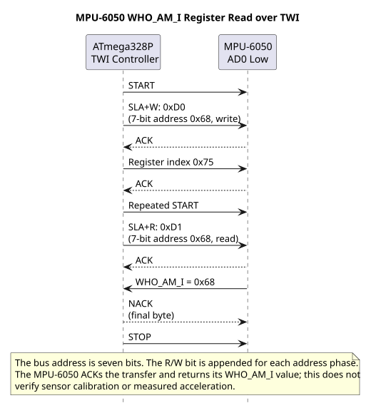
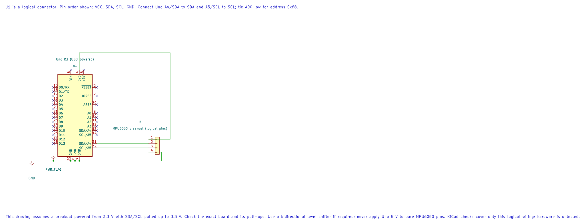

# Program a TWI Transaction

## Start with a Known Device

Before sending commands, identify the module, its supply range, bus address and maximum clock from its documentation. A bus scan can show that a device acknowledges an address, but it does not prove that the device is configured correctly or that a later register read will work.

The [TWI scan example](<https://github.com/arnabdasbwn/atmega328p-labs/blob/main/examples/22-twi-scan/main.c>) probes seven-bit addresses and prints those that respond. The probe is an address-write transaction with no data bytes; some devices may treat such a transaction specially. Scan only a bus whose attached devices permit address probing.

## Register Read Sequence

A common register read uses this sequence: START, device address with write direction, register address byte, repeated START, device address with read direction, receive one or more bytes, NACK the final byte, STOP. The exact sequence varies by device, so follow its data sheet.

The repeated START keeps the transaction associated with that device. If the device expects a STOP between phases, use that documented protocol instead. Multi-byte values may have a device-specific byte order and auto-increment rule.





### Worked Example: Read the MPU6050 Identity Register

The MPU6050 register map defines `WHO_AM_I` at register `0x75`; its expected value is `0x68`. With AD0 low, the device's seven-bit TWI address is `0x68`. The controller sends address byte `0xD0` for write, writes register index `0x75`, sends a repeated START, then sends `0xD1` for read. The peripheral returns one byte, which the controller NACKs to say that the read is finished, then the controller sends STOP.

The TWI HAL performs this sequence for a one-byte write followed by a one-byte read:

```c
#include "avr_hal/twi.h"

const uint8_t who_am_i_register = 0x75U;
uint8_t identity = 0U;
avr_status_t result = avr_twi_init(100000UL);
if (result == AVR_OK)
{
    result = avr_twi_transfer(0x68U, &who_am_i_register, 1U, &identity, 1U,
                              AVR_POLL_BUDGET);
}
if ((result == AVR_OK) && (identity == 0x68U))
{
    /* The device returned the expected identity byte. */
}
```

This assumes the specific device's AD0 pin is low. If AD0 is high, use seven-bit address `0x69`; the WHO_AM_I byte remains `0x68`. A successful ACK or identity read checks communication and device identity; it does not validate the accelerometer's calibration or measured motion.

Build the register-level and HAL examples under both compilers:

```powershell
python atmega328p-labs/tools/build.py 74-twi-register-read --compiler gcc
python atmega328p-labs/tools/build.py 32-mpu6050 --compiler xc8
```

Start with [Lab 74](<https://github.com/arnabdasbwn/atmega328p-labs/blob/main/examples/74-twi-register-read/main.c>) to follow each TWI register and status transition directly. Then compare [Lab 32](<https://github.com/arnabdasbwn/atmega328p-labs/blob/main/examples/32-mpu6050/main.c>), which uses the HAL to read the same identity register before reading accelerometer data. The wiring and device sequence are the same; the difference is how the host code manages the bus states. See the [TWI register lesson](twi-registers.md) and [MPU6050 sensor lesson](mpu6050.md) for the pin and device details.

The direct-register and HAL examples both have GCC and XC8 builds. A successful build does not prove that the module voltage, pull-ups, address or physical bus timing are correct.

## Handle Errors and Recover Deliberately

Check for NACK on both address and data. Arbitration loss means another controller won the bus; do not issue STOP as though this controller still owned it. A timeout may indicate stuck-low wiring, an absent clock, wrong voltage or a device holding the bus. The course HAL does not retry automatically.

Before changing software, inspect SDA/SCL idle levels and confirm pull-ups, shared ground, device power, address format and bus voltage. Use a logic analyser when available to decode START, address, ACK/NACK and STOP.

## Exercise with Answer

A scan prints address `104`. What is its hexadecimal seven-bit value, and what does the result prove?

**Answer:** `104` decimal is `0x68`. It proves the device acknowledged the scan transaction at that address; it does not prove its register protocol or sensor data are correct.

## Code Walkthrough

### Direct-Register TWI Identity Read
The example's `main()` configures its peripherals, runs the algorithm and reports or displays the result. These source operations are listed in execution order:

- `uint8_t identity = 0U;` - Clears the state/counter after its threshold is reached so the next interval starts from zero.
- `DDRB |= _BV(DDB5);` - Sets the Port B direction bits; a set bit selects output mode.
- `PORTB &= (uint8_t)~_BV(PORTB5);` - Sets or clears the Port B output latch. When the pin is an output, this determines its output level; on an input, it controls the pull-up.
- `twi_result_t result = mpu6050_register_read(MPU6050_WHO_AM_I_REGISTER, &identity);` - Stores this intermediate or output value for the next algorithm step. Check the units and range represented by each operand.
- `if ((result == TWI_RESULT_OK) && (identity == MPU6050_WHO_AM_I_VALUE))` - Tests the stated condition; the following block handles the matching case and the other path is skipped.
- `PORTB |= _BV(PORTB5);` - Sets or clears the Port B output latch. When the pin is an output, this determines its output level; on an input, it controls the pull-up.
- `for (;;)` - Repeats the foreground task indefinitely; each pass checks inputs, advances the calculation or services the peripheral shown below.

Algorithm: Directly controls TWBR/TWSR/TWCR/TWDR, checks each TWI status, uses repeated START, NACKs the final byte and bounds waits.
Expected behaviour: D13 turns on when WHO_AM_I register 0x75 returns 0x68
**HAL source files in this repository:** [ATmega328P HAL on GitHub](https://github.com/arnabdasbwn/atmega328p-hal)


### TWI address probe
The example's `main()` configures its peripherals, runs the algorithm and reports or displays the result. These source operations are listed in execution order:

- `(void)avr_twi_init(100000UL);` - Configures TWI for the requested bus rate and enables the peripheral. The bus still requires suitable external pull-ups and compatible signal voltage.
- `(void)avr_uart_init(9600UL);` - Configures USART0 for asynchronous 8N1. It chooses a baud divisor and normal/double-speed mode, programs UBRR0/UCSR0A/UCSR0C, then enables receive and transmit in UCSR0B.
- `for (;;)` - Repeats the foreground task indefinitely; each pass checks inputs, advances the calculation or services the peripheral shown below.
- `for (uint8_t address = 8U; address < 0x78U; ++address)` - Repeats while `address < 0x78U` is true; `uint8_t address = 8U` sets the starting state and `++address` advances it each pass.
- `if (avr_twi_transfer(address, NULL, 0U, NULL, 0U, AVR_POLL_BUDGET) == AVR_OK)` - The operation runs only after this API reports AVR_OK. Performs a bounded TWI transaction at the requested 7-bit address; the result reports address/data phase errors.
- `(void)avr_uart_u16(address);` - Formats an unsigned integer as decimal digits and sends them on USART0; it does not add a newline.
- `(void)avr_uart_put('\n', AVR_POLL_BUDGET);` - Waits for the USART transmit buffer within its poll budget, then writes the byte to UDR0.
- `_delay_ms(1000);` - Waits for the stated interval; the foreground does no other work during this blocking delay.

Algorithm: Address 0x68 is printed as decimal 104. Do not shift an address before passing it to this HAL. Probe only devices whose datasheets allow an empty write transaction.
Expected behaviour: Responding 7-bit addresses print in decimal; an empty bus prints none
**HAL source files in this repository:** [ATmega328P HAL on GitHub](https://github.com/arnabdasbwn/atmega328p-hal)

- [`include/avr_hal/twi.h`](https://github.com/arnabdasbwn/atmega328p-hal/blob/main/include/avr_hal/twi.h)
- [`include/avr_hal/uart.h`](https://github.com/arnabdasbwn/atmega328p-hal/blob/main/include/avr_hal/uart.h)
- [`src/twi.c`](https://github.com/arnabdasbwn/atmega328p-hal/blob/main/src/twi.c)
- [`src/uart.c`](https://github.com/arnabdasbwn/atmega328p-hal/blob/main/src/uart.c)


### MPU6050 identity and acceleration
The example's `main()` configures its peripherals, runs the algorithm and reports or displays the result. These source operations are listed in execution order:

- `uint8_t identity = 0U, bytes[6];` - Clears the state/counter after its threshold is reached so the next interval starts from zero.
- `(void)avr_twi_init(100000UL);` - Configures TWI for the requested bus rate and enables the peripheral. The bus still requires suitable external pull-ups and compatible signal voltage.
- `(void)avr_uart_init(9600UL);` - Configures USART0 for asynchronous 8N1. It chooses a baud divisor and normal/double-speed mode, programs UBRR0/UCSR0A/UCSR0C, then enables receive and transmit in UCSR0B.
- `if (avr_device_read(0x68U, 0x75U, &identity, 1U) != AVR_OK || identity != 0x68U)` - This checks for any setup or transfer error before the program continues. Selects a device register and reads the requested number of bytes using the driver's TWI transaction.
- `return 1;` - Stops this path and returns the indicated status when setup or validation cannot continue.
- `if (avr_device_write(0x68U, 0x6BU, 0U) != AVR_OK)` - This checks for any setup or transfer error before the program continues. Writes the supplied bytes beginning at a device register using the driver's bus transaction.
- `for (;;)` - Repeats the foreground task indefinitely; each pass checks inputs, advances the calculation or services the peripheral shown below.
- `if (avr_device_read(0x68U, 0x3BU, bytes, 6U) == AVR_OK)` - The operation runs only after this API reports AVR_OK. Selects a device register and reads the requested number of bytes using the driver's TWI transaction.
- `for (uint8_t i = 0U; i < 6U; i = (uint8_t)(i + 2U))` - Repeats while `i < 6U` is true; `uint8_t i = 0U` sets the starting state and `i = (uint8_t` advances it each pass.
- `uint16_t raw = (uint16_t)((uint16_t)bytes[i] << 8U) | bytes[i + 1U];` - Stores this intermediate or output value for the next algorithm step. Check the units and range represented by each operand.
- `(void)avr_uart_u16(raw);` - Formats an unsigned integer as decimal digits and sends them on USART0; it does not add a newline.
- `(void)avr_uart_put(i == 4U ? '\n' : ',', AVR_POLL_BUDGET);` - Waits for the USART transmit buffer within its poll budget, then writes the byte to UDR0.
- `_delay_ms(100);` - Waits for the stated interval; the foreground does no other work during this blocking delay.

Algorithm: The default acceleration range is plus or minus 2 g with nominal 16384 LSB/g. Output is two's-complement big-endian. The example prints unsigned bit patterns to avoid hidden signed conversion; values above 32767 represent negative readings.
Expected behaviour: After identity verification and wake, six bytes are read as three raw 16-bit words
**HAL source files in this repository:** [ATmega328P HAL on GitHub](https://github.com/arnabdasbwn/atmega328p-hal)

- [`include/avr_hal/twi.h`](https://github.com/arnabdasbwn/atmega328p-hal/blob/main/include/avr_hal/twi.h)
- [`include/avr_hal/uart.h`](https://github.com/arnabdasbwn/atmega328p-hal/blob/main/include/avr_hal/uart.h)
- [`lib/drivers/register_device.c`](https://github.com/arnabdasbwn/atmega328p-hal/blob/main/lib/drivers/register_device.c)
- [`lib/drivers/register_device.h`](https://github.com/arnabdasbwn/atmega328p-hal/blob/main/lib/drivers/register_device.h)
- [`src/twi.c`](https://github.com/arnabdasbwn/atmega328p-hal/blob/main/src/twi.c)
- [`src/uart.c`](https://github.com/arnabdasbwn/atmega328p-hal/blob/main/src/uart.c)


## References

- [TWI scan source and wiring](<https://github.com/arnabdasbwn/atmega328p-labs/blob/main/examples/22-twi-scan/main.c>)
- TDK/InvenSense, [MPU-6000/MPU-6050 Register Map and Descriptions](https://invensense.tdk.com/wp-content/uploads/2015/02/MPU-6000-Register-Map1.pdf), register `0x75`.
- [TWI concepts](twi-concepts.md) and [registers](twi-registers.md)
- Check the exact peripheral data sheet before probing or reading registers.
