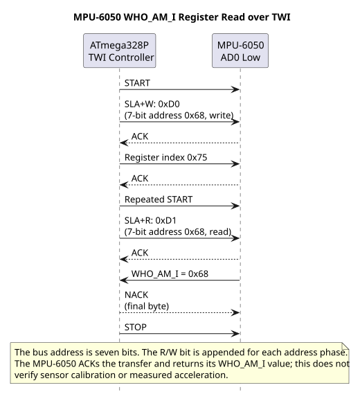

# TWI Questions and Answers

## Questions

Trace the pin names with the [MPU6050 wiring diagram](../assets/circuits/mpu6050/mpu6050.svg) and the transaction phases with the [TWI sequence diagram](../assets/diagrams/twi-register-read.svg).

1. Which Uno R3 pins carry SDA and SCL for the ATmega328P TWI peripheral?
2. Why are pull-up resistors used on the bus?
3. What is the difference between a seven-bit device address and the address/direction byte on the wire?
4. What does an address scan prove?
5. Why might a register read use a repeated START?
6. Should a controller issue STOP after it loses arbitration?

## Answers

1. A4/SDA and A5/SCL. Check the exact board schematic when using another target.
2. Bus devices pull the shared lines low and release them for high. The pull-ups establish the high level while allowing multiple devices to share the wires.
3. The seven-bit address identifies the device. The on-wire address byte contains those bits plus a read/write direction bit. The course HAL accepts the unshifted seven-bit form.
4. It proves that a device acknowledged that probe at the address. It does not prove the device's register protocol or returned data.
5. It keeps the bus transaction active while changing from the register-address write to a read phase. The device protocol determines whether that sequence is required.
6. No. After arbitration loss, another controller owns the bus. The losing controller releases it and waits according to the protocol.

## Continue Learning

Before connecting a new TWI module, write down its supply, pull-up voltage, address and maximum bus speed from its data sheet. Then compare the required register sequence with the [HAL transfer contract](twi-hal.md).

The [TWI sequence diagram](../assets/diagrams/twi-register-read.svg) and the wiring SVG is shown above.

## Code Walkthrough

**Example code on GitHub:**
- [Direct-Register TWI Identity Read (`74-twi-register-read`)](https://github.com/arnabdasbwn/atmega328p-labs/blob/main/examples/74-twi-register-read/main.c)
- [TWI address probe (`22-twi-scan`)](https://github.com/arnabdasbwn/atmega328p-labs/blob/main/examples/22-twi-scan/main.c)
- [MPU6050 identity and acceleration (`32-mpu6050`)](https://github.com/arnabdasbwn/atmega328p-labs/blob/main/examples/32-mpu6050/main.c)

### Direct-Register TWI Identity Read
The example's `main()` configures its peripherals, runs the algorithm and reports or displays the result. These source operations are listed in execution order:

- `uint8_t identity = 0U;` - Clears the state/counter after its threshold is reached so the next interval starts from zero.
- `DDRB |= _BV(DDB5);` - Sets the Port B direction bits; a set bit selects output mode.
- `PORTB &= (uint8_t)~_BV(PORTB5);` - Sets or clears the Port B output latch. When the pin is an output, this determines its output level; on an input, it controls the pull-up.
- `twi_result_t result = mpu6050_register_read(MPU6050_WHO_AM_I_REGISTER, &identity);` - Stores this intermediate or output value for the next algorithm step. Check the units and range represented by each operand.
- `if ((result == TWI_RESULT_OK) && (identity == MPU6050_WHO_AM_I_VALUE))` - Tests the stated condition; the following block handles the matching case and the other path is skipped.
- `PORTB |= _BV(PORTB5);` - Sets or clears the Port B output latch. When the pin is an output, this determines its output level; on an input, it controls the pull-up.
- `for (;;)` - Repeats the foreground task indefinitely; each pass checks inputs, advances the calculation or services the peripheral shown below.

Algorithm: Directly controls TWBR/TWSR/TWCR/TWDR, checks each TWI status, uses repeated START, NACKs the final byte and bounds waits.
Expected behaviour: D13 turns on when WHO_AM_I register 0x75 returns 0x68
**HAL source files in this repository:** [ATmega328P HAL on GitHub](https://github.com/arnabdasbwn/atmega328p-hal)

### TWI address probe
The example's `main()` configures its peripherals, runs the algorithm and reports or displays the result. These source operations are listed in execution order:

- `(void)avr_twi_init(100000UL);` - Configures TWI for the requested bus rate and enables the peripheral. The bus still requires suitable external pull-ups and compatible signal voltage.
- `(void)avr_uart_init(9600UL);` - Configures USART0 for asynchronous 8N1. It chooses a baud divisor and normal/double-speed mode, programs UBRR0/UCSR0A/UCSR0C, then enables receive and transmit in UCSR0B.
- `for (;;)` - Repeats the foreground task indefinitely; each pass checks inputs, advances the calculation or services the peripheral shown below.
- `for (uint8_t address = 8U; address < 0x78U; ++address)` - Repeats while `address < 0x78U` is true; `uint8_t address = 8U` sets the starting state and `++address` advances it each pass.
- `if (avr_twi_transfer(address, NULL, 0U, NULL, 0U, AVR_POLL_BUDGET) == AVR_OK)` - The operation runs only after this API reports AVR_OK. Performs a bounded TWI transaction at the requested 7-bit address; the result reports address/data phase errors.
- `(void)avr_uart_u16(address);` - Formats an unsigned integer as decimal digits and sends them on USART0; it does not add a newline.
- `(void)avr_uart_put('\n', AVR_POLL_BUDGET);` - Waits for the USART transmit buffer within its poll budget, then writes the byte to UDR0.
- `_delay_ms(1000);` - Waits for the stated interval; the foreground does no other work during this blocking delay.

Algorithm: Address 0x68 is printed as decimal 104. Do not shift an address before passing it to this HAL. Probe only devices whose datasheets allow an empty write transaction.
Expected behaviour: Responding 7-bit addresses print in decimal; an empty bus prints none
**HAL source files in this repository:** [ATmega328P HAL on GitHub](https://github.com/arnabdasbwn/atmega328p-hal)

- [`include/avr_hal/twi.h`](https://github.com/arnabdasbwn/atmega328p-hal/blob/main/include/avr_hal/twi.h)
- [`include/avr_hal/uart.h`](https://github.com/arnabdasbwn/atmega328p-hal/blob/main/include/avr_hal/uart.h)
- [`src/twi.c`](https://github.com/arnabdasbwn/atmega328p-hal/blob/main/src/twi.c)
- [`src/uart.c`](https://github.com/arnabdasbwn/atmega328p-hal/blob/main/src/uart.c)

### MPU6050 identity and acceleration
The example's `main()` configures its peripherals, runs the algorithm and reports or displays the result. These source operations are listed in execution order:

- `uint8_t identity = 0U, bytes[6];` - Clears the state/counter after its threshold is reached so the next interval starts from zero.
- `(void)avr_twi_init(100000UL);` - Configures TWI for the requested bus rate and enables the peripheral. The bus still requires suitable external pull-ups and compatible signal voltage.
- `(void)avr_uart_init(9600UL);` - Configures USART0 for asynchronous 8N1. It chooses a baud divisor and normal/double-speed mode, programs UBRR0/UCSR0A/UCSR0C, then enables receive and transmit in UCSR0B.
- `if (avr_device_read(0x68U, 0x75U, &identity, 1U) != AVR_OK || identity != 0x68U)` - This checks for any setup or transfer error before the program continues. Selects a device register and reads the requested number of bytes using the driver's TWI transaction.
- `return 1;` - Stops this path and returns the indicated status when setup or validation cannot continue.
- `if (avr_device_write(0x68U, 0x6BU, 0U) != AVR_OK)` - This checks for any setup or transfer error before the program continues. Writes the supplied bytes beginning at a device register using the driver's bus transaction.
- `for (;;)` - Repeats the foreground task indefinitely; each pass checks inputs, advances the calculation or services the peripheral shown below.
- `if (avr_device_read(0x68U, 0x3BU, bytes, 6U) == AVR_OK)` - The operation runs only after this API reports AVR_OK. Selects a device register and reads the requested number of bytes using the driver's TWI transaction.
- `for (uint8_t i = 0U; i < 6U; i = (uint8_t)(i + 2U))` - Repeats while `i < 6U` is true; `uint8_t i = 0U` sets the starting state and `i = (uint8_t` advances it each pass.
- `uint16_t raw = (uint16_t)((uint16_t)bytes[i] << 8U) | bytes[i + 1U];` - Stores this intermediate or output value for the next algorithm step. Check the units and range represented by each operand.
- `(void)avr_uart_u16(raw);` - Formats an unsigned integer as decimal digits and sends them on USART0; it does not add a newline.
- `(void)avr_uart_put(i == 4U ? '\n' : ',', AVR_POLL_BUDGET);` - Waits for the USART transmit buffer within its poll budget, then writes the byte to UDR0.
- `_delay_ms(100);` - Waits for the stated interval; the foreground does no other work during this blocking delay.

Algorithm: The default acceleration range is plus or minus 2 g with nominal 16384 LSB/g. Output is two's-complement big-endian. The example prints unsigned bit patterns to avoid hidden signed conversion; values above 32767 represent negative readings.
Expected behaviour: After identity verification and wake, six bytes are read as three raw 16-bit words
**HAL source files in this repository:** [ATmega328P HAL on GitHub](https://github.com/arnabdasbwn/atmega328p-hal)

- [`include/avr_hal/twi.h`](https://github.com/arnabdasbwn/atmega328p-hal/blob/main/include/avr_hal/twi.h)
- [`include/avr_hal/uart.h`](https://github.com/arnabdasbwn/atmega328p-hal/blob/main/include/avr_hal/uart.h)
- [`lib/drivers/register_device.c`](https://github.com/arnabdasbwn/atmega328p-hal/blob/main/lib/drivers/register_device.c)
- [`lib/drivers/register_device.h`](https://github.com/arnabdasbwn/atmega328p-hal/blob/main/lib/drivers/register_device.h)
- [`src/twi.c`](https://github.com/arnabdasbwn/atmega328p-hal/blob/main/src/twi.c)
- [`src/uart.c`](https://github.com/arnabdasbwn/atmega328p-hal/blob/main/src/uart.c)
