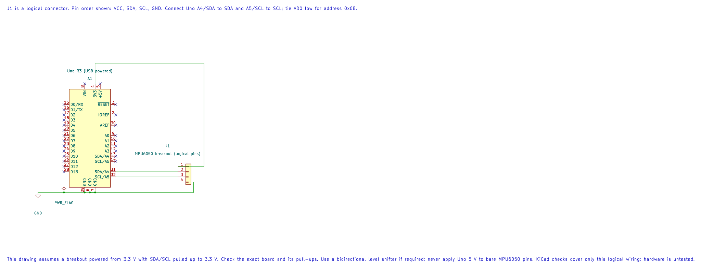

# ATmega328P TWI Registers

## Main TWI Registers



| Register | Role |
| --- | --- |
| `TWBR` | Bit-rate divider |
| `TWSR` | Prescaler selection and protocol status code |
| `TWCR` | Enable, START, STOP, ACK and interrupt/flag control |
| `TWDR` | Address or data byte sent/received |
| `TWAR` | Own address when operating as a peripheral |
| `TWAMR` | Optional address mask for peripheral mode |

In controller mode, the SCL rate depends on CPU clock, `TWBR` and the prescaler selected by `TWPS1:0` in `TWSR`:

```text
f_SCL = F_CPU / (16 + 2 × TWBR × prescaler)
```

At the Uno's 16 MHz clock with prescaler 1, 100 kHz uses `TWBR = (16,000,000 / 100,000 - 16) / 2 = 72`. For 400 kHz, `TWBR = 12`. The course HAL supports these two rates at the reference clock. The calculated divider does not replace the electrical checks: use external pull-ups and make sure every module supports the selected bus voltage and speed.

For a 100 kHz controller, the key register setup is:

```c
TWSR = 0U; /* TWPS1:0 = 0: prescaler is 1. */
TWBR = 72U;
TWCR = _BV(TWEN); /* Enable TWI without enabling its interrupt. */
```

Build the direct-register example under both compilers:

```powershell
python atmega328p-labs/tools/build.py 74-twi-register-read --compiler gcc
python atmega328p-labs/tools/build.py 74-twi-register-read --compiler xc8
```

The setup assumes the TWI bus is idle and the module uses compatible pull-ups. A peripheral driver should not enable global interrupts as a side effect.

## Compare the Direct-Register Example

Lab 74 performs the WHO_AM_I read without calling the TWI HAL. It checks the status after every phase: `TW_START`, `TW_MT_SLA_ACK`, `TW_MT_DATA_ACK`, `TW_REP_START`, `TW_MR_SLA_ACK` and `TW_MR_DATA_NACK`. It reads `TWDR` only after the final status matches. The code also places a finite bound on every `TWINT` wait and on STOP completion.

If the address is not acknowledged, the status is `TW_MT_SLA_NACK` or `TW_MR_SLA_NACK`; the example attempts a bounded STOP and leaves the result LED off. If arbitration is lost, it clears the event and releases TWI without sending STOP. Compare this phase-by-phase code with the HAL in [Lab 32](<https://github.com/arnabdasbwn/atmega328p-labs/blob/main/examples/32-mpu6050/main.c>), which uses the same underlying transaction through a reusable API.

## Status Codes and Twint

The status bits in `TWSR` report the most recently completed bus step. Common controller-transmit and controller-receive statuses include:

| Status | Meaning |
| --- | --- |
| `0x08` / `0x10` | START / repeated START transmitted |
| `0x18` / `0x20` | SLA+W acknowledged / not acknowledged |
| `0x28` / `0x30` | Data byte acknowledged / not acknowledged |
| `0x38` | Arbitration lost |
| `0x40` / `0x48` | SLA+R acknowledged / not acknowledged |
| `0x50` / `0x58` | Received byte acknowledged / final byte received with NACK |

`TWINT` signals that the current bus step has completed. Software writes a one to `TWINT` while issuing the next control command to clear the flag and continue the state machine. Every wait for `TWINT` needs a finite timeout so a stuck bus cannot trap the firmware forever.

Do not treat status flags like ordinary RAM. Check the masked status in `TWSR` before advancing. A NACK is different from a timeout or arbitration loss, and each result needs a different recovery decision. After losing arbitration, release the bus instead of sending STOP as though this controller still owned it.

## Start a Controller Transaction

This register sequence fragment requests START, waits for `TWINT`, checks for status `0x08`, then loads the address byte. The wait function is intentionally omitted here; a real implementation must bound it and check every resulting status before proceeding.

```c
#include <util/twi.h>

TWCR = _BV(TWINT) | _BV(TWSTA) | _BV(TWEN);
/* Wait with a finite budget, then require (TWSR & 0xF8U) == TW_START. */
TWDR = (uint8_t)((address << 1U) | TW_WRITE);
TWCR = _BV(TWINT) | _BV(TWEN);
/* Wait with a finite budget, then require the expected address-ACK status. */
```

`TWINT` is written as one to continue. In the address byte, `TW_WRITE` is zero and `TW_READ` is one; the HAL accepts the unshifted seven-bit address and creates this byte itself. The software fixtures [99](<https://github.com/arnabdasbwn/atmega328p-labs/blob/main/examples/99-twi-register-read-test/main.c>) and [100](<https://github.com/arnabdasbwn/atmega328p-labs/blob/main/examples/100-twi-register-nack-test/main.c>) model a successful identity read and an address NACK; neither is a physical bus test.

## Exercise with Answer

Why should TWI code report a NACK separately from a timeout?

**Answer:** A NACK means the bus step completed and the addressed device or byte was not acknowledged. A timeout means the expected state did not complete within the polling budget. The likely causes and recovery actions are different.

## Code Walkthrough


**Example code on GitHub:**
- [TWI address probe (`22-twi-scan`)](https://github.com/arnabdasbwn/atmega328p-labs/blob/main/examples/22-twi-scan/main.c)

### Direct-Register TWI Identity Read
The example's `main()` configures its peripherals, runs the algorithm and reports or displays the result. These source operations are listed in execution order:

- `uint8_t identity = 0U;` - Clears the state/counter after its threshold is reached so the next interval starts from zero.
- `DDRB |= _BV(DDB5);` - Sets the Port B direction bits; a set bit selects output mode.
- `PORTB &= (uint8_t)~_BV(PORTB5);` - Sets or clears the Port B output latch. When the pin is an output, this determines its output level; on an input, it controls the pull-up.
- `twi_result_t result = mpu6050_register_read(MPU6050_WHO_AM_I_REGISTER, &identity);` - Stores this intermediate or output value for the next algorithm step. Check the units and range represented by each operand.
- `if ((result == TWI_RESULT_OK) && (identity == MPU6050_WHO_AM_I_VALUE))` - Tests the stated condition; the following block handles the matching case and the other path is skipped.
- `PORTB |= _BV(PORTB5);` - Sets or clears the Port B output latch. When the pin is an output, this determines its output level; on an input, it controls the pull-up.
- `for (;;)` - Repeats the foreground task indefinitely; each pass checks inputs, advances the calculation or services the peripheral shown below.

Algorithm: Directly controls TWBR/TWSR/TWCR/TWDR, checks each TWI status, uses repeated START, NACKs the final byte and bounds waits.
Expected behaviour: D13 turns on when WHO_AM_I register 0x75 returns 0x68
**HAL source files in this repository:** [ATmega328P HAL on GitHub](https://github.com/arnabdasbwn/atmega328p-hal)


### TWI address probe
The example's `main()` configures its peripherals, runs the algorithm and reports or displays the result. These source operations are listed in execution order:

- `(void)avr_twi_init(100000UL);` - Configures TWI for the requested bus rate and enables the peripheral. The bus still requires suitable external pull-ups and compatible signal voltage.
- `(void)avr_uart_init(9600UL);` - Configures USART0 for asynchronous 8N1. It chooses a baud divisor and normal/double-speed mode, programs UBRR0/UCSR0A/UCSR0C, then enables receive and transmit in UCSR0B.
- `for (;;)` - Repeats the foreground task indefinitely; each pass checks inputs, advances the calculation or services the peripheral shown below.
- `for (uint8_t address = 8U; address < 0x78U; ++address)` - Repeats while `address < 0x78U` is true; `uint8_t address = 8U` sets the starting state and `++address` advances it each pass.
- `if (avr_twi_transfer(address, NULL, 0U, NULL, 0U, AVR_POLL_BUDGET) == AVR_OK)` - The operation runs only after this API reports AVR_OK. Performs a bounded TWI transaction at the requested 7-bit address; the result reports address/data phase errors.
- `(void)avr_uart_u16(address);` - Formats an unsigned integer as decimal digits and sends them on USART0; it does not add a newline.
- `(void)avr_uart_put('\n', AVR_POLL_BUDGET);` - Waits for the USART transmit buffer within its poll budget, then writes the byte to UDR0.
- `_delay_ms(1000);` - Waits for the stated interval; the foreground does no other work during this blocking delay.

Algorithm: Address 0x68 is printed as decimal 104. Do not shift an address before passing it to this HAL. Probe only devices whose datasheets allow an empty write transaction.
Expected behaviour: Responding 7-bit addresses print in decimal; an empty bus prints none
**HAL source files in this repository:** [ATmega328P HAL on GitHub](https://github.com/arnabdasbwn/atmega328p-hal)

- [`include/avr_hal/twi.h`](https://github.com/arnabdasbwn/atmega328p-hal/blob/main/include/avr_hal/twi.h)
- [`include/avr_hal/uart.h`](https://github.com/arnabdasbwn/atmega328p-hal/blob/main/include/avr_hal/uart.h)
- [`src/twi.c`](https://github.com/arnabdasbwn/atmega328p-hal/blob/main/src/twi.c)
- [`src/uart.c`](https://github.com/arnabdasbwn/atmega328p-hal/blob/main/src/uart.c)


### Register-Level TWI Scripted Device Fixture
The example's `main()` configures its peripherals, runs the algorithm and reports or displays the result. These source operations are listed in execution order:


Algorithm: Checks the START, address, register, repeated-START, read-NACK and STOP sequence on simulated registers.
Expected behaviour: A scripted address ACK and WHO_AM_I byte set the D13 success output
**HAL source files in this repository:** [ATmega328P HAL on GitHub](https://github.com/arnabdasbwn/atmega328p-hal)


### Register-Level TWI Address-NACK Fixture
The example's `main()` configures its peripherals, runs the algorithm and reports or displays the result. These source operations are listed in execution order:


Algorithm: Exercises the address-NACK error and bounded STOP cleanup path.
Expected behaviour: The simulated sensor does not ACK; the D13 success output remains off and cleanup requests STOP
**HAL source files in this repository:** [ATmega328P HAL on GitHub](https://github.com/arnabdasbwn/atmega328p-hal)


## References

- Microchip, [ATmega328P documentation](https://www.microchip.com/en-us/product/ATMEGA328P), TWI register summary and status codes.
- [TWI HAL header](https://github.com/arnabdasbwn/atmega328p-hal/blob/main/include/avr_hal/twi.h)
- [Direct-register TWI identity read](<https://github.com/arnabdasbwn/atmega328p-labs/blob/main/examples/74-twi-register-read/main.c>), [register-read test fixture](<https://github.com/arnabdasbwn/atmega328p-labs/blob/main/examples/99-twi-register-read-test/main.c>), [address-NACK test fixture](<https://github.com/arnabdasbwn/atmega328p-labs/blob/main/examples/100-twi-register-nack-test/main.c>) and [HAL MPU6050 example](<https://github.com/arnabdasbwn/atmega328p-labs/blob/main/examples/32-mpu6050/main.c>)
- [TWI concepts](twi-concepts.md)
