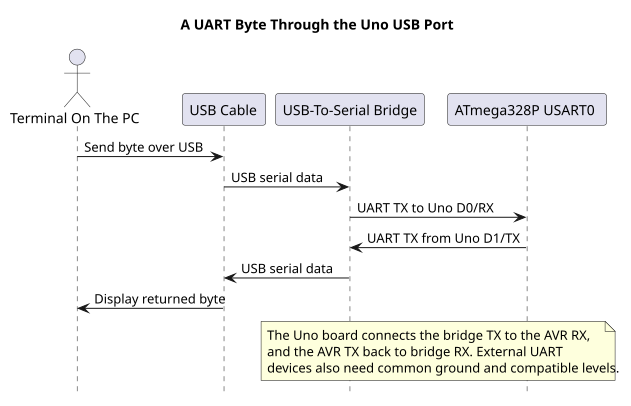

# UART and Asynchronous Serial

## Two Data Wires and a Shared Timing Agreement

UART sends serial data without a separate clock wire. The transmitter and receiver agree on a baud rate and frame format. Connect TX to the other device's RX and connect grounds. The logic voltage and baud-rate error must be acceptable to both devices.

The Uno R3 exposes the ATmega328P USART on D0/RX and D1/TX. Its USB interface converts those UART signals to a computer COM port. A terminal setting such as **9600 baud, 8N1** means 9,600 symbol bits per second, eight data bits, no parity bit and one stop bit.



| Connection | Uno R3 Signal | Direction At The Uno |
| --- | --- | --- |
| USB-to-serial bridge TX | D0 / RX | Into the ATmega328P |
| USB-to-serial bridge RX | D1 / TX | Out of the ATmega328P |
| Separate UART module TX | D0 / RX | Into the ATmega328P |
| Separate UART module RX | D1 / TX | Out of the ATmega328P |
| Separate UART module ground | GND | Shared reference |

For a separate module, cross TX and RX and confirm its logic levels before connecting it. The USB path already contains the board's USB-to-serial bridge, so the COM4 echo test needs only the USB cable.

## Calculate Frame Time

An 8N1 frame has one start bit, eight data bits and one stop bit: ten bit periods total. At 9,600 baud, one frame takes approximately:

`10 / 9,600 seconds ≈ 1.042 ms`

This is why a foreground receiver that does lengthy work can overrun the hardware receive buffer. An interrupt-driven ring buffer can separate byte capture from slower application work, but it still has a finite capacity.

## UART Is Not Rs-232

The Uno UART pins use logic-level signals. Traditional RS-232 uses different voltage levels and polarity; connect through a suitable transceiver, not directly to D0/D1. Also check whether a module is 3.3 V-only before attaching it to a 5 V Uno.

The [UART echo lab](<https://github.com/arnabdasbwn/atmega328p-labs/blob/main/examples/14-uart-echo/main.c>) returns each received byte. Its COM4 test echoed `41 00 5A 7E` at 9600 8N1 through the USB serial interface. That validates this byte path on the reference setup; it does not validate every UART module or cable.

The same example can be built with the course script. A build checks the firmware; the COM4 observation is the separate physical test:

```powershell
python atmega328p-labs/tools/build.py 14-uart-echo --compiler xc8
```

## Exercise with Answer

Why might a terminal show each typed character twice?

**Answer:** The terminal may display local echo, and the board may also echo the received byte. Disable local echo when testing a firmware echo program.

## Code Walkthrough


**Example code on GitHub:**
- [USART Register-Level Echo (`71-usart-register-echo`)](https://github.com/arnabdasbwn/atmega328p-labs/blob/main/examples/71-usart-register-echo/main.c)
- [Interrupt-driven USART receive queue (`47-uart-buffer`)](https://github.com/arnabdasbwn/atmega328p-labs/blob/main/examples/47-uart-buffer/main.c)

### USART Register-Level Echo
The example's `main()` configures its peripherals, runs the algorithm and reports or displays the result. These source operations are listed in execution order:

- `for (;;)` - Repeats the foreground task indefinitely; each pass checks inputs, advances the calculation or services the peripheral shown below.
- `if (usart_get(&received))` - Tests the stated condition; the following block handles the matching case and the other path is skipped.

Algorithm: Configures UBRR0, UCSR0A/B/C and UDR0 directly; checks RXC0 and per-byte FE0/DOR0/UPE0 before echoing.
Expected behaviour: Each error-free received byte is echoed once; malformed or timed-out receives are ignored
**HAL source files in this repository:** [ATmega328P HAL on GitHub](https://github.com/arnabdasbwn/atmega328p-hal)


### Bounded UART echo
The example's `main()` configures its peripherals, runs the algorithm and reports or displays the result. These source operations are listed in execution order:

- `(void)avr_uart_init(9600UL);` - Configures USART0 for asynchronous 8N1. It chooses a baud divisor and normal/double-speed mode, programs UBRR0/UCSR0A/UCSR0C, then enables receive and transmit in UCSR0B.
- `for (;;)` - Repeats the foreground task indefinitely; each pass checks inputs, advances the calculation or services the peripheral shown below.
- `avr_status_t status = avr_uart_get(&byte, AVR_POLL_BUDGET);` - Use the linked public header for this function's parameters, register ownership, blocking behavior and status values.
- `if (status == AVR_OK)` - Only enters the following block when the operation reports success.
- `(void)avr_uart_put(byte, AVR_POLL_BUDGET);` - Waits for the USART transmit buffer within its poll budget, then writes the byte to UDR0.

Algorithm: One 8N1 frame contains ten bits. At 9600 baud, a frame takes approximately 1.042 ms; the application must service reception before hardware buffering overflows.
Expected behaviour: Each received byte is echoed once
**HAL source files in this repository:** [ATmega328P HAL on GitHub](https://github.com/arnabdasbwn/atmega328p-hal)

- [`include/avr_hal/uart.h`](https://github.com/arnabdasbwn/atmega328p-hal/blob/main/include/avr_hal/uart.h)
- [`src/uart.c`](https://github.com/arnabdasbwn/atmega328p-hal/blob/main/src/uart.c)


### Interrupt-driven USART receive queue
The example's `main()` configures its peripherals, runs the algorithm and reports or displays the result. These source operations are listed in execution order:

- `if ((avr_uart_init(9600UL) != AVR_OK) || (avr_uart_rx_start() != AVR_OK))` - This checks for any setup or transfer error before the program continues. Configures USART0 for asynchronous 8N1. It chooses a baud divisor and normal/double-speed mode, programs UBRR0/UCSR0A/UCSR0C, then enables receive and transmit in UCSR0B. Enables the interrupt-driven USART receive queue. Start it after UART setup and enable global interrupts only when shared state is ready.
- `return 1;` - Stops this path and returns the indicated status when setup or validation cannot continue.
- `(void)avr_gpio_mode(13U, AVR_GPIO_OUTPUT);` - Maps the Uno header pin to its AVR port, sets its DDR direction bit and prepares the PORT latch for the requested initial level or pull-up.
- `(void)avr_gpio_mode(8U, AVR_GPIO_OUTPUT);` - Maps the Uno header pin to its AVR port, sets its DDR direction bit and prepares the PORT latch for the requested initial level or pull-up.
- `avr_tick_init();` - Configures the course millisecond tick interrupt source; it does not enable global interrupts itself.
- `uint32_t previous = 0UL;` - Clears the state/counter after its threshold is reached so the next interval starts from zero.
- `sei();` - Enables global interrupts after the example has configured its sources and shared state.
- `for (;;)` - Repeats the foreground task indefinitely; each pass checks inputs, advances the calculation or services the peripheral shown below.
- `if (avr_uart_rx_get(&value) == AVR_OK)` - The operation runs only after this API reports AVR_OK. Removes one byte from the receive queue without blocking; an empty queue returns a busy status.
- `(void)avr_uart_put(value, AVR_POLL_BUDGET);` - Waits for the USART transmit buffer within its poll budget, then writes the byte to UDR0.
- `uint32_t now = avr_tick_ms();` - Use the linked public header for this function's parameters, register ownership, blocking behavior and status values.
- `if (avr_elapsed(now, previous, 500UL))` - Tests this condition to choose which algorithm path runs.
- `previous = now;` - Stores this intermediate value for the next step of the algorithm; check the operands and units.
- `(void)avr_gpio_toggle(13U);` - Atomically toggles the selected pin output latch.
- `avr_uart_rx_stats_t stats;` - Use the linked public header for this function's parameters, register ownership, blocking behavior and status values.
- `(void)avr_uart_rx_stats(&stats);` - Use the linked public header for this function's parameters, register ownership, blocking behavior and status values.
- `if ((stats.dropped != 0U) || (stats.errors != 0U))` - Tests the stated condition; the following block handles the matching case and the other path is skipped.
- `(void)avr_gpio_write(8U, true);` - Changes the pin's PORT output latch; for an input pin this selects its pull-up state.

Algorithm: A finite single-producer/single-consumer queue separates the ISR from foreground processing; one slot distinguishes full from empty.
Expected behaviour: Echo received bytes while LED L toggles; D8 latches high after receive loss
**HAL source files in this repository:** [ATmega328P HAL on GitHub](https://github.com/arnabdasbwn/atmega328p-hal)

- [`include/avr_hal/gpio.h`](https://github.com/arnabdasbwn/atmega328p-hal/blob/main/include/avr_hal/gpio.h)
- [`include/avr_hal/tick.h`](https://github.com/arnabdasbwn/atmega328p-hal/blob/main/include/avr_hal/tick.h)
- [`include/avr_hal/uart.h`](https://github.com/arnabdasbwn/atmega328p-hal/blob/main/include/avr_hal/uart.h)
- [`include/avr_hal/uart_rx.h`](https://github.com/arnabdasbwn/atmega328p-hal/blob/main/include/avr_hal/uart_rx.h)
- [`lib/interrupts/tick.c`](https://github.com/arnabdasbwn/atmega328p-hal/blob/main/lib/interrupts/tick.c)
- [`lib/interrupts/uart_rx.c`](https://github.com/arnabdasbwn/atmega328p-hal/blob/main/lib/interrupts/uart_rx.c)
- [`src/gpio.c`](https://github.com/arnabdasbwn/atmega328p-hal/blob/main/src/gpio.c)
- [`src/uart.c`](https://github.com/arnabdasbwn/atmega328p-hal/blob/main/src/uart.c)


## References

- Microchip, [ATmega328P product documentation](https://www.microchip.com/en-us/product/ATMEGA328P), USART.
- [UART echo source and hardware-validation record](<https://github.com/arnabdasbwn/atmega328p-labs/blob/main/examples/14-uart-echo/lab.json>)
- [Uno R3 board documentation](https://docs.arduino.cc/hardware/uno-rev3/)
- [Ring buffers and interrupt ownership](ring-buffer.md)
- [Rendered UART path diagram](../assets/diagrams/uart-usb-path.svg)
