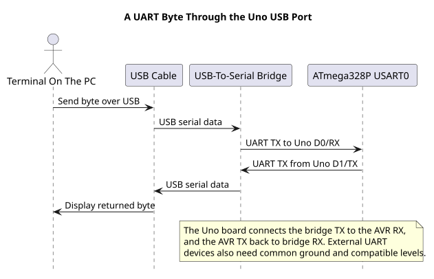

# Send and Receive UART Data

## Connect the Uno to a Terminal

Select **Arduino Uno** as the board and choose the COM port that appears when the board is connected. Close the serial monitor before using another terminal or upload tool. Set the terminal to match the firmware's baud rate and framing; the course echo example uses 9600 baud, 8N1, with local echo disabled.

The board's D0/RX and D1/TX are shared with the USB-to-serial interface. An external device attached there can conflict with upload or terminal communication. Disconnect external UART wiring when it could drive the same line, and connect grounds when using a separate device.

## Understand the Echo Program

Start with the direct-register [USART echo lab](<https://github.com/arnabdasbwn/atmega328p-labs/blob/main/examples/71-usart-register-echo/main.c>). It configures UBRR0 and UCSR0A/B/C, waits for RXC0, checks the received byte's error flags and writes to UDR0. The separate [HAL polling echo](<https://github.com/arnabdasbwn/atmega328p-labs/blob/main/examples/14-uart-echo/main.c>) packages those peripheral details behind status-returning functions. Comparing both versions shows what the HAL adds without hiding the register behaviour from the first lesson.

The [polling echo example](<https://github.com/arnabdasbwn/atmega328p-labs/blob/main/examples/14-uart-echo/main.c>) receives a byte with a bounded wait, checks hardware status and sends the same byte back. The HAL reports a timeout separately from a framing, parity or overrun error. The receive destination is unchanged on failure.

The [interrupt-buffer example](<https://github.com/arnabdasbwn/atmega328p-labs/blob/main/examples/47-uart-buffer/main.c>) captures incoming data in a finite ring buffer and sends it from foreground code. If incoming data exceeds the buffer's capacity or foreground service rate, bytes can still be lost; inspect its error counters.

## Build and Observe

Build the register-level example with `python "atmega328p-labs/tools/build.py" 71-usart-register-echo --compiler xc8`; replace `xc8` with `gcc` to use AVR GCC. Send a short sequence such as `A`, `Z` and `7`; each character should return once. To check that zero bytes are handled, send `41 00 5A 7E` with a binary serial tool and confirm the same byte sequence returns.

The physical COM4 test passed for the byte sequence `41 00 5A 7E` at 9600 8N1. That evidence covers the USB-to-UART echo path, not the serial bootloader upload path or arbitrary devices.

The register lab has a wiring table and expected behavior in its [`lab.json`](<https://github.com/arnabdasbwn/atmega328p-labs/blob/main/examples/71-usart-register-echo/lab.json>). Its software build is validated, but it has not been retested on COM4.

## Exercise with Answer

Why can a single application use polling for one slow sensor but an interrupt queue for UART receive?

**Answer:** A sensor can often be sampled at a chosen interval, while UART bytes arrive according to an external sender and can be lost if the foreground is busy. The design should be based on event timing and buffer capacity, not on a rule that every peripheral must use interrupts.

## Code Walkthrough

### USART Register-Level Echo
The example's `main()` configures its peripherals, runs the algorithm and reports or displays the result. These source operations are listed in execution order:

- `for (;;)` - Repeats the foreground task indefinitely; each pass checks inputs, advances the calculation or services the peripheral shown below.
- `if (usart_get(&received))` - Tests the stated condition; the following block handles the matching case and the other path is skipped.

Algorithm: Configures UBRR0, UCSR0A/B/C and UDR0 directly; checks RXC0 and per-byte FE0/DOR0/UPE0 before echoing.
Expected behaviour: Each error-free received byte is echoed once; malformed or timed-out receives are ignored
**HAL source files in this repository:** [ATmega328P HAL on GitHub](https://github.com/arnabdasbwn/atmega328p-hal)

### Bounded UART echo
The example's `main()` configures its peripherals, runs the algorithm and reports or displays the result. These source operations are listed in execution order:

- `(void)avr_uart_init(9600UL);` - Configures USART0 for asynchronous 8N1. It chooses a baud divisor and normal/double-speed mode, programs UBRR0/UCSR0A/UCSR0C, then enables receive and transmit in UCSR0B.
- `for (;;)` - Repeats the foreground task indefinitely; each pass checks inputs, advances the calculation or services the peripheral shown below.
- `avr_status_t status = avr_uart_get(&byte, AVR_POLL_BUDGET);` - Use the linked public header for this function's parameters, register ownership, blocking behavior and status values.
- `if (status == AVR_OK)` - Only enters the following block when the operation reports success.
- `(void)avr_uart_put(byte, AVR_POLL_BUDGET);` - Waits for the USART transmit buffer within its poll budget, then writes the byte to UDR0.

Algorithm: One 8N1 frame contains ten bits. At 9600 baud, a frame takes approximately 1.042 ms; the application must service reception before hardware buffering overflows.
Expected behaviour: Each received byte is echoed once
**HAL source files in this repository:** [ATmega328P HAL on GitHub](https://github.com/arnabdasbwn/atmega328p-hal)

- [`include/avr_hal/uart.h`](https://github.com/arnabdasbwn/atmega328p-hal/blob/main/include/avr_hal/uart.h)
- [`src/uart.c`](https://github.com/arnabdasbwn/atmega328p-hal/blob/main/src/uart.c)

### Interrupt-driven USART receive queue
The example's `main()` configures its peripherals, runs the algorithm and reports or displays the result. These source operations are listed in execution order:

- `if ((avr_uart_init(9600UL) != AVR_OK) || (avr_uart_rx_start() != AVR_OK))` - This checks for any setup or transfer error before the program continues. Configures USART0 for asynchronous 8N1. It chooses a baud divisor and normal/double-speed mode, programs UBRR0/UCSR0A/UCSR0C, then enables receive and transmit in UCSR0B. Enables the interrupt-driven USART receive queue. Start it after UART setup and enable global interrupts only when shared state is ready.
- `return 1;` - Stops this path and returns the indicated status when setup or validation cannot continue.
- `(void)avr_gpio_mode(13U, AVR_GPIO_OUTPUT);` - Maps the Uno header pin to its AVR port, sets its DDR direction bit and prepares the PORT latch for the requested initial level or pull-up.
- `(void)avr_gpio_mode(8U, AVR_GPIO_OUTPUT);` - Maps the Uno header pin to its AVR port, sets its DDR direction bit and prepares the PORT latch for the requested initial level or pull-up.
- `avr_tick_init();` - Configures the course millisecond tick interrupt source; it does not enable global interrupts itself.
- `uint32_t previous = 0UL;` - Clears the state/counter after its threshold is reached so the next interval starts from zero.
- `sei();` - Enables global interrupts after the example has configured its sources and shared state.
- `for (;;)` - Repeats the foreground task indefinitely; each pass checks inputs, advances the calculation or services the peripheral shown below.
- `if (avr_uart_rx_get(&value) == AVR_OK)` - The operation runs only after this API reports AVR_OK. Removes one byte from the receive queue without blocking; an empty queue returns a busy status.
- `(void)avr_uart_put(value, AVR_POLL_BUDGET);` - Waits for the USART transmit buffer within its poll budget, then writes the byte to UDR0.
- `uint32_t now = avr_tick_ms();` - Use the linked public header for this function's parameters, register ownership, blocking behavior and status values.
- `if (avr_elapsed(now, previous, 500UL))` - Tests this condition to choose which algorithm path runs.
- `previous = now;` - Stores this intermediate value for the next step of the algorithm; check the operands and units.
- `(void)avr_gpio_toggle(13U);` - Atomically toggles the selected pin output latch.
- `avr_uart_rx_stats_t stats;` - Use the linked public header for this function's parameters, register ownership, blocking behavior and status values.
- `(void)avr_uart_rx_stats(&stats);` - Use the linked public header for this function's parameters, register ownership, blocking behavior and status values.
- `if ((stats.dropped != 0U) || (stats.errors != 0U))` - Tests the stated condition; the following block handles the matching case and the other path is skipped.
- `(void)avr_gpio_write(8U, true);` - Changes the pin's PORT output latch; for an input pin this selects its pull-up state.

Algorithm: A finite single-producer/single-consumer queue separates the ISR from foreground processing; one slot distinguishes full from empty.
Expected behaviour: Echo received bytes while LED L toggles; D8 latches high after receive loss
**HAL source files in this repository:** [ATmega328P HAL on GitHub](https://github.com/arnabdasbwn/atmega328p-hal)

- [`include/avr_hal/gpio.h`](https://github.com/arnabdasbwn/atmega328p-hal/blob/main/include/avr_hal/gpio.h)
- [`include/avr_hal/tick.h`](https://github.com/arnabdasbwn/atmega328p-hal/blob/main/include/avr_hal/tick.h)
- [`include/avr_hal/uart.h`](https://github.com/arnabdasbwn/atmega328p-hal/blob/main/include/avr_hal/uart.h)
- [`include/avr_hal/uart_rx.h`](https://github.com/arnabdasbwn/atmega328p-hal/blob/main/include/avr_hal/uart_rx.h)
- [`lib/interrupts/tick.c`](https://github.com/arnabdasbwn/atmega328p-hal/blob/main/lib/interrupts/tick.c)
- [`lib/interrupts/uart_rx.c`](https://github.com/arnabdasbwn/atmega328p-hal/blob/main/lib/interrupts/uart_rx.c)
- [`src/gpio.c`](https://github.com/arnabdasbwn/atmega328p-hal/blob/main/src/gpio.c)
- [`src/uart.c`](https://github.com/arnabdasbwn/atmega328p-hal/blob/main/src/uart.c)

## References

- [UART concepts](uart-concepts.md) and [USART registers](uart-registers.md)
- [Register-level USART echo](<https://github.com/arnabdasbwn/atmega328p-labs/blob/main/examples/71-usart-register-echo/lab.json>)
- [UART echo hardware record](<https://github.com/arnabdasbwn/atmega328p-labs/blob/main/examples/14-uart-echo/lab.json>)
- [UART ring buffer and overflow test](ring-buffer.md)
